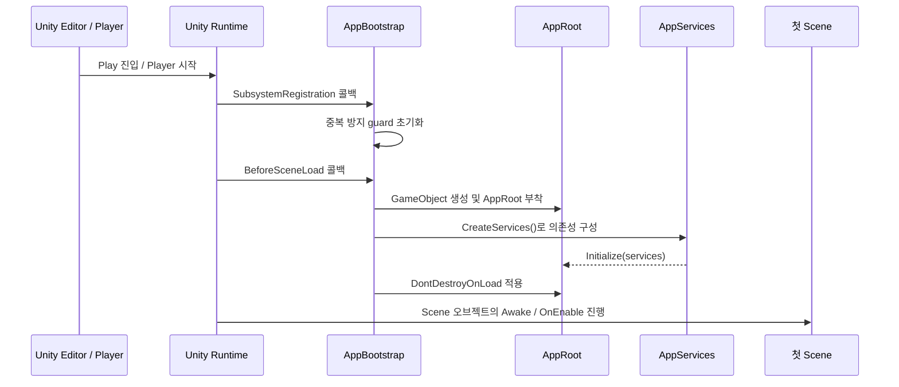
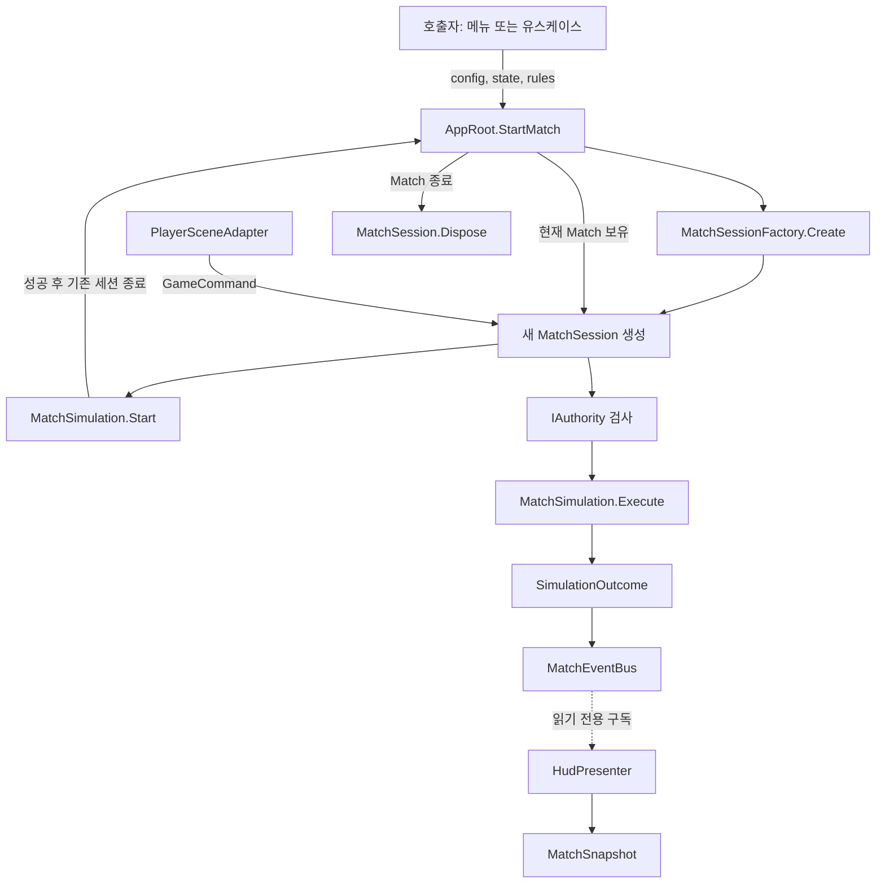
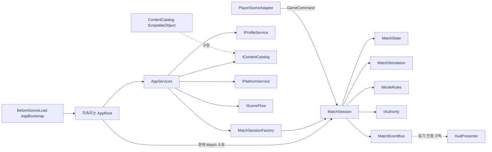
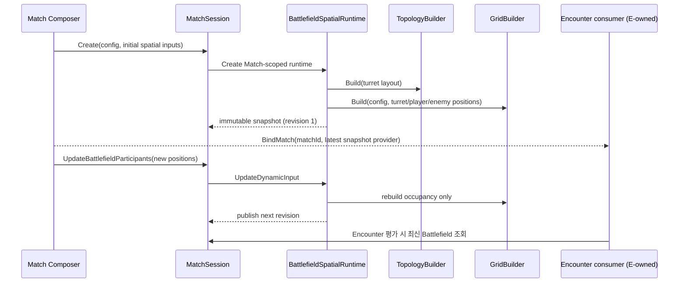

# Core Foundation

## 2026-10-15 지역·요청 경계 추가

최신 [배치·구현·검증 기록](../../../Docs/planning/2026-10-15-core-sprint-implementation.md)과 [Core API](../../../Docs/architecture/core-api-usage.md)를 먼저 확인하세요. 아래 10월 8일 이전 내용은 기존 기반 설명이며 새 네트워크 통합 완료를 뜻하지 않습니다.

지역 원본은 Match 소유 `RegionRuntime`의 Uniform Grid입니다. `RegionSceneBinding`이 정적 CU 구역을 연결하거나 동적 활성 터렛을 임시 삼각형으로 계산해 셀에 투영합니다. 동적 터렛에는 지역 잠금을 걸지 않으며 점령 회수로 나머지 터렛을 끄지 않습니다. Battlefield의 참가자 밀도 Grid와 지역 점령 Grid는 별개입니다.

현재 Initial_Stage의 실제 모드 전환·점령 형성/회수, HUD의 CU 자동 활성화와 로컬 actor 주입은 검증했습니다. 정식 Encounter 요청은 타입 결과·최신 조회·중복 방지를 거쳐 E의 실제 Planner/Executor를 사용합니다. 실제 UTP 두 SDK 검사에 이어 **Windows 실행 파일 두 개**에서 같은 설정·지역 해시·최소 NetworkObject를 확인하고 정적→동적→회수→종료→재시작을 검증했습니다. Client는 권한 MatchSession을 만들지 않습니다. 추가한 터렛 명령 전송/정책/Scene gateway는 아래와 같으며, 이 최신 명령 조립을 포함한 Windows 재검사·Client HUD 조작·전체 전투 동기화는 아직 남아 있습니다.

Initial_Stage의 SinglePlayerHost는 명시적인 연결→준비→시작 API를 호출합니다. Manual로 바꾸면 InitialStageCompositionRoot의 InitialStageNetworkBinding Inspector에서 단계를 나눠 실행할 수 있습니다. Host만 MatchSession을 소유하고 Client는 공유 설정/지역 읽기 모델과 자기 로컬 actor를 연결합니다. 상대 Player의 실제 이동/전투 복제는 아직 이 경로가 제공하지 않습니다. [실행 API와 정확한 책임 경계](../../../Docs/architecture/core-sprint-region-and-request-api.md#initial_stage-실행-api)를 확인하세요.

터렛은 SceneEntityIdentity의 논리 ID와 D의 로컬 InstanceId를 분리합니다. TurretMatchBinding이 Match별 대응표를 만들고 D의 승급/강등 사실에서 ID만 이전합니다. 실제 D Factory·교체·삭제 및 Windows Host/Client의 제작 키 8개 일치를 검증했습니다. Battlefield 배치와 동적 지역 입력은 같은 논리 ID를 사용하되 서로 다른 상태를 나타냅니다.

터렛 명령은 `TurretCommandRequest → TurretCommandGateway → TurretCommandService → TurretFeatureCommandExecutor → D API`로 연결합니다. 모든 참가자가 ON/OFF·CU 자동 활성화·승급·강화/강등을 요청하고 Host가 실제 연결 발신자·Match·최신 actor 위치/생존/조작·D 규칙을 검증합니다. 실제 NGO 왕복/재전송/위조 거부·재접속과 Initial_Stage의 거리 정책/명령·정리/재시작을 검사했습니다. `InitialStageNetworkBinding.TurretCommands`는 현재 Match의 입력 Port이며 접수와 서버 확정 결과는 다릅니다. 같은 요청은 GUID를 유지해 재전송합니다.

Host가 실제 소유하는 B actor는 `RegisterAuthorityPlayerActor`로 연결하고 반환 lease를 actor 수명에 맞춰 해제합니다. 원격 actor가 없으면 AuthorityActorUnavailable로 거부합니다. Client payload 좌표·PlayerStart로 거리 검증을 대신하지 않습니다. **기존 HUD 버튼의 requester 교체와 D의 Client 읽기 상태 연결은 아직 진행 중**이며, 원격 요청 전송 검사만으로 전체 Client 조작이 완료된 것은 아닙니다. Match 종료는 D 자동 큐/예약을 해제하지만 체력·강화·열 상태의 전체 초기화는 수행하지 않습니다.

AppRoot.Update는 App 소유 네트워크 큐를 게임시간 정지와 무관하게 Pump합니다. OnApplicationQuit/OnDestroy는 같은 Dispose를 호출하며, Editor의 AppPlayModeShutdown은 ExitingPlayMode에서 Scene 파괴 전 정리를 시작합니다. 자세한 단계·커밋·실패/수정 증거는 위 스프린트 기록을 확인하세요.

이 디렉터리는 기존 게임 코드와 연결하지 않고 새로 구성한 게임 Core입니다. 코드는 `TeamHJD.Game.*` namespace를 사용하며, 기존 `Global`/`Game`/Manager 구조와 호환된다고 가정하지 않습니다. 현재 App/Match 수명주기, Battlefield topology/Grid producer, Stage 1 Encounter 진단 요청 경계가 구현되어 있습니다. 다만 `MatchSimulation.Execute()`의 전투 규칙, 최종 밸런스, 전체 승패 루프는 아직 구현되지 않았습니다.

## 2026-10-08 로컬 1차 통합 패치

2026-10-09 이관 후 Core는 `Assets/Scripts/Core`, 실제 Grid asset은 `Assets/Data/Core`, 실행 Scene은 `Assets/Scenes/Gameplay/Initial_Stage.unity`입니다. namespace/asmdef/수명주기는 유지하고 Legacy 자동 Bootstrap·구형 Manager 실행 코드를 제거했습니다. [이동 대응·기능 제한](../../../Docs/architecture/asset-layout-and-migration.md) · [검증 기록](../../../Docs/planning/2026-10-09-asset-migration-results.md).

최신 인수: PL이 실제 런타임을 확인하고 A의 공간 분석·Spawn 전달/분산·Game Debugger 기술 PoC를 승인했습니다. [마감과 Issue 판정](../../../Docs/planning/2026-10-08-poc-closeout-and-pr-handoff.md) · [팀 Core API 규약](../../../Docs/architecture/core-api-usage.md). 아래 날짜별 배치에서 남긴 미검증 기록은 당시 결과이며, 최신 인수와 구분합니다. 정식 승패·성장·2인 Network·공통 Windows Build를 모두 완료했다는 뜻은 아닙니다.

`IEncounterMatchConsumer`를 통한 Match 시작 바인딩, 최신 Battlefield snapshot 조회, Grid 점유·적 밀도·Frontline 거리 기반 SpawnPoint 배분, 첫 Encounter 자동 요청이 구현되어 있습니다. 분대 구성과 수량 `Normal`/10은 임시값입니다. 자동 요청은 기본 0.5초 실시간 지연 후 NGO Host/Executor 준비를 기다립니다. 기존 1차 검증 때는 터렛 0개였지만, 팀원의 #490 Scene 반영 후 최신 CLI 통합 검사에서는 삼각형 8개·외곽 6개와 네 source의 스폰 성공을 확인했습니다. 실제 전투/승패는 별도 Gate입니다. 반복 진행·공식 PlanId/중복 방지·지역 해금·최종 난이도는 [통합 준비표](../../../Docs/planning/2026-10-07-stage1-poc-integration-prep.md)의 후속 범위입니다.

## 2026-10-08 Game Debugger 확장

상단 `Layout`에서 단일/좌우·상하 2분할/4분할을 선택해 여러 기능을 동시에 볼 수 있습니다. 각 영역의 드롭다운으로 기능을 고르고 분할선을 드래그해 크기를 조절합니다. `Battlefield + Stats`, `Encounter + Stats`, `Monitor ×4` 빠른 배치와 영역별 기록·지표·필터·스크롤 보존을 지원합니다. 시간 제어·Match·수집·Scene 표시 설정은 공용이며, 좌측 메뉴는 강조된 `ACTIVE · P#` 영역에 적용됩니다. 자세한 사용법은 [Game Debugger 가이드](../../../Docs/tooling/game-debugger-guide.md)를 참고하세요.

사용 가이드는 빠른 시작부터 배속·Scene Gizmo/셀·전선 선택·일회/반복 요청·Spawn 판단·큰 통계 창·Timeline 정지·기록 공유까지 실제 작업 순서로 정리했습니다. SpawnPoint는 같은 Scene 전체에서 요청 직전에 갱신하며, 이후 복제한 지점도 고유 ID로 등록합니다. 등록과 실제 스폰 배정은 다르므로 지점별 결과는 Statistics의 후보 Reason으로 확인합니다.

`Tools > TeamHJD > Game Debugger`에서 Overview/Battlefield/Encounter/Statistics/Timeline/Capture·Compare를 사용합니다. 독립 Battlefield 창은 제거하고 편집 기능을 내부 패널로 통합했습니다. Scene Overlay는 유지됩니다. 배속/Pause/Step, 요청·실제 생성·실제 사망의 선 그래프, 터렛/전력·연결 검사, 조건부 정지, 북마크, JSON/CSV·실행 A/B를 제공합니다. Editor 수집은 게임 서비스가 아니며 계산/스폰 정책을 대신하지 않습니다.

Statistics의 `Time series`는 명시적인 X/Y축, 최신 시간 추적, 가시 구간 최대값 기반 Auto Y, 상하좌우 탐색·축 확대/축소와 독립 큰 창을 제공합니다. `Spawn decisions / distribution`에서는 요청 당시 Grid/전선·후보 제외 사유·배정·계획/실제 수량·개체 생성 좌표를 지도와 표로 조회합니다. Overview와 Encounter/Timeline도 수치 카드·선택 가능한 스크롤 표·접힌 상세 설명으로 분리했습니다.

Encounter의 `연속 Encounter 요청 / 시뮬레이션`에서 간격과 횟수(0 = 무제한)를 설정합니다. 기본은 게임시간 2초·10회이며 기존 최신 Match 요청 계약을 사용합니다. Battlefield 및 Scene Overlay의 `Frontline geometry`는 면적·외곽 길이·연결군·경계 선택과 안/밖 방향을 표시하는 읽기 전용 기하 진단입니다. 기하 외곽을 전술 우세나 실제 교전 전선으로 오인하지 않습니다. [반복 요청](../../../Docs/tooling/encounter-repeat-debugging.md) · [Spawn 검사](../../../Docs/tooling/game-debugger-spawn-inspection.md) · [전선 설계/시각화](../../../Docs/tooling/frontline-visualization-design.md)

Player prefab의 타깃 등록 누락은 별도 HOTFIX `dcb583d1`로 수정했습니다. 실제 Initial_Stage에서 생성된 적의 이동, 모든 타깃 해제 시 정지, Player만 복원 시 이동 재개를 CLI로 확인했습니다. [원인·검증](../../../Docs/planning/2026-10-08-enemy-movement-hotfix.md)

`MatchStart`, `DebugWindow`, `RuntimeUI`, `SceneCollision`은 공통 Match snapshot 경계를 사용합니다. `IGameDiagnosticsSource`의 사실 이벤트를 `GameDebuggerSession → Recorder → Statistics/Chart/Export`로 전달합니다. 스폰 성공 후 이벤트와 생존 수 차분은 다르며 Despawn은 처치가 아닙니다. 종료 기록은 활성 snapshot과 분리됩니다. [사용/API·제한](../../../Docs/tooling/game-debugger-guide.md) · [배치 결과/CLI 증거](../../../Docs/planning/2026-10-08-game-debugger-batch-results.md)

[Game Debugger Design.md](../../../Docs/tooling/game-debugger/Design.md)에 글꼴·Dark/Light 색·가독성·관측 흐름·확장 경계를 정리했습니다. Scene Gizmos/Scene layers를 함께 켜고 Frame Grid/Cell과 context/evidence 복사를 사용할 수 있습니다. Snapshot 조회 상태는 영역별로 보존되며 오래된 선택 자료가 사라져도 다른 요청으로 대체하지 않습니다. 목록 정렬은 변경 기반 캐시를 사용하고 Client의 서버 미관측 0은 N/A로 구분합니다.

초기 전체 EditMode 36 성공·Explicit 1 제외 이후, 실사용 모니터 후속 집중 검사는 **54/54 성공**, 실제 Initial_Stage snapshot·사망·반복 Spawn 통합은 **1/1 성공**입니다. 별도 이동 HOTFIX Scene 검사도 **1/1 성공**입니다. 창 GUI 렌더링은 자동 확인했지만 실제 사용자 드래그·도킹·물리 충돌·영상/멀티 Client 인수는 별도이며 전체 PoC 승패 완료 판정이 아닙니다.

## 2026-10-03 병합본의 구현·검증 기록

- PR #469와 #473이 `main`에 병합됐습니다. #473은 Battlefield Debug의 요청 버튼에서 현재 Match snapshot을 전달해 Host/Server 경로로 Slime 10마리를 생성하는 Stage 1 테스트 연결을 포함합니다.
- Battlefield topology 입력은 배치된 Turret 위치를 기준으로 합니다. 과열 같은 일시 작동 중단은 배치 위치를 제거하지 않으며, 파괴된 Turret은 제외합니다.
- 사용자가 `Initial_Stage` Play Mode에서 Request Encounter를 눌러 실제 생성 결과를 확인했습니다. PR #473에 해당 화면과 Unity CLI live Editor 진단이 기록되어 있습니다.
- 이 검증은 Battlefield→Encounter 요청→Spawn의 테스트 경로를 확인한 것이며, 플레이어/터렛 전투, 적 사망, 전선 이동, 승패/종료까지 포함한 전체 PoC 한 판을 검증한 것은 아닙니다.
- PR Repository checks는 통과했습니다. Unity EditMode 자동 테스트와 Windows Build는 해당 PR CI에서 실행되지 않았습니다. topology 테스트 코드는 존재하지만, 현재 Stage Scene의 실제 배치 터렛으로 삼각형/전선 결과를 확인한 증거는 별도입니다.
- A/Core의 생산자·연결 구현은 대부분 완료 상태입니다. GitHub #443/#458의 잔여 확인 조건 및 팀 통합은 아래 이슈 판정 표와 YGDocs의 최신 마감 노트를 확인하세요.

## 어셈블리와 의존성

```text
TeamHJD.Game.Domain
TeamHJD.Game.Contracts → Domain
TeamHJD.Game.Application → Contracts, Domain
TeamHJD.Game.Content.Authoring → Domain
TeamHJD.Game.Content.Runtime → Content.Authoring, Contracts, Domain
TeamHJD.Game.Infrastructure → Contracts, Domain
TeamHJD.Game.Infrastructure.Fakes → Contracts, Domain
TeamHJD.Game.Networking → Contracts, Domain, Unity.Netcode.Runtime, Unity.Collections
TeamHJD.Game.Presentation → Application, Contracts, Domain
TeamHJD.Game.Bootstrap → Application, Content.Authoring, Content.Runtime, Contracts, Domain, Infrastructure, Fakes, Presentation, Turrets
TeamHJD.Game.Editor → Application, Bootstrap, Content.Authoring, Contracts, Domain, Turrets (Editor only)
TeamHJD.Game.Tests.EditMode → Application, Content.Runtime, Contracts, Domain, Fakes (Editor only)
```

화살표는 왼쪽 어셈블리가 오른쪽 어셈블리를 참조한다는 뜻입니다. 실제 각 asmdef 경로는 아래 트리에 적었습니다. `Bootstrap`은 구체 구현을 조립하는 Composition Root입니다. `Domain`, `Contracts`, `Application`, `Infrastructure.Fakes`는 Unity Engine 참조를 금지하는 asmdef 설정(`noEngineReferences`)을 사용합니다. `Infrastructure` asmdef는 현재 코드 구현이 없는 확장 경계입니다.

## 디렉터리

```text
Assets/Scripts/Core/
├─ Bootstrap/
│  ├─ AppBootstrap.cs
│  ├─ AppRoot.cs
│  └─ TeamHJD.Game.Bootstrap.asmdef
├─ Application/
│  ├─ AppServices.cs
│  ├─ CommandSubmissionResult.cs
│  ├─ CommandSubmissionStatus.cs
│  ├─ LocalAuthority.cs
│  ├─ MatchEventBus.cs
│  ├─ MatchSession.cs
│  ├─ MatchSessionFactory.cs
│  ├─ BattlefieldSpatialRuntime.cs
│  └─ TeamHJD.Game.Application.asmdef
├─ Content/
│  ├─ Authoring/
│  │  ├─ DifficultyProfileDefinition.cs
│  │  ├─ StageDefinition.cs
│  │  └─ TeamHJD.Game.Content.Authoring.asmdef
│  └─ Runtime/
│     ├─ ContentCatalog.cs
│     └─ TeamHJD.Game.Content.Runtime.asmdef
├─ Contracts/
│  ├─ CommandAuthorization.cs
│  ├─ IAuthority.cs
│  ├─ IContentCatalog.cs
│  ├─ IMatchEventStream.cs
│  ├─ IPlatformService.cs
│  ├─ IProfileService.cs
│  ├─ ISceneFlow.cs
│  ├─ PlatformUser.cs
│  └─ TeamHJD.Game.Contracts.asmdef
├─ Domain/
│  ├─ Commands/ (GameCommand 및 5개 구체 명령)
│  ├─ Economy/ (CurrencyBalance, CurrencyDelta, RewardReceipt)
│  ├─ Events/ (MatchEvent 및 구체 이벤트 6개)
│  ├─ Identifiers/ (CurrencyId, DefinitionId, EntityId, MatchId, PlayerId, StageId)
│  ├─ Internal/CollectionCopy.cs
│  ├─ Match/ (설정, 상태, 생명주기, Simulation, 결과, 규칙)
│  ├─ Battlefield/ (터렛 공간 입력, Territory topology, 경계 변 snapshot)
│  ├─ Players/ (PlayerState와 Profile/Loadout Snapshot)
│  ├─ World/ (ControlUnit, Enemy, Sector, Turret, Wave 상태)
│  └─ TeamHJD.Game.Domain.asmdef
├─ Infrastructure/
│  ├─ Fakes/
│  │  ├─ FakeContentCatalog.cs
│  │  ├─ FakePlatformService.cs
│  │  ├─ FakeProfileService.cs
│  │  ├─ FakeSceneFlow.cs
│  │  └─ TeamHJD.Game.Infrastructure.Fakes.asmdef
│  └─ TeamHJD.Game.Infrastructure.asmdef
├─ Presentation/
│  ├─ Scene/PlayerSceneAdapter.cs
│  ├─ UI/HudPresenter.cs
│  ├─ UI/IHudView.cs
│  └─ TeamHJD.Game.Presentation.asmdef
├─ Editor/
│  ├─ BattlefieldDebugSession.cs / SceneDrawer / SceneOverlay / DiagnosticPanels
│  ├─ GameDebugger/
│  │  ├─ GameDebuggerWindow.cs / GameDebuggerLayout.cs / GameDebugger.uss
│  │  ├─ Recording/ (Session, Recorder, Archive, DTOs, Statistics, Export)
│  │  ├─ Simulation/ (GameSimulationControls, TimeScaleLease)
│  │  ├─ Charts/ (GameDebugChart, GameDebugChartViewport, GameDebugMetric)
│  │  ├─ GameDebugStatisticsWindow.cs (큰 통계 조회 창)
│  │  ├─ Spawning/ (판단 snapshot 기록·검증·XY map·Inspector)
│  │  ├─ Controls/ (EncounterRepeatScheduler, EncounterRepeatDebugControls)
│  │  ├─ Frontline/ (기하 보고·선택 session·Inspector)
│  │  └─ Panels/ (GameDebuggerPane, GameDebuggerPaneState, BattlefieldDebugPanel, GameDebugInspectionPanels)
│  └─ TeamHJD.Game.Editor.asmdef (Editor 전용)
├─ Tests/EditMode/
│  ├─ BattlefieldTopologyBuilderTests.cs
│  └─ TeamHJD.Game.Tests.EditMode.asmdef
└─ README.md
```

트리는 `.cs`, `.asmdef`, `.md` 파일을 기준으로 현재 디렉터리를 요약하며 Unity `.meta` 파일은 생략했습니다. `Domain/Battlefield`는 순수 입력·계산·결과 타입, `Application/BattlefieldSpatialRuntime`은 Match 수명 경계, `Editor`는 Scene View 표시, `Tests/EditMode`는 해당 Domain 계산을 검증하는 코드입니다. 이 분리는 실제 의존 경계와 일치합니다. namespace는 계속 `TeamHJD.Game.*`로 유지하므로 물리 경로가 코드 의존성이나 타입 이름을 바꾸지는 않습니다.

모든 C# 파일 맨 위에는 해당 파일의 역할을 한국어로 설명하는 짧은 주석을 둡니다. 업계에서 통용되는 타입명과 API명은 코드와 일치하도록 영어로 유지하고, 설명은 한국어로 작성합니다.

## 용어 빠른 안내

| 용어 | 쉽게 말하면 | 현재 Core에서의 예 |
| --- | --- | --- |
| Core | 게임 규칙과 실행 기반을 담는 코드 영역 | 이 디렉터리 전체 |
| Domain | 게임에서 쓰는 데이터와 규칙의 중심 영역 | `MatchState`, `PlayerState`, `GameCommand` 등. 현재는 모델과 경계가 있고 실제 전투 규칙은 없음 |
| Application | 여러 Domain 동작의 순서와 수명을 조정 | `MatchSession`, `AppServices` |
| Contract / Port | 외부 기능을 어떤 메서드로 쓸지 약속한 인터페이스 | `IProfileService`, `IContentCatalog` |
| Adapter | 계약을 실제 기술에 연결하는 구현 | 앞으로 만들 Steam·저장소 구현. 지금 `FakeProfileService`가 같은 계약을 임시 구현 |
| Bootstrap / Composition Root | 앱 시작 때 구체 객체를 만들고 서로 연결하는 조립 지점 | `AppBootstrap.CreateServices()` |
| Scope | 객체가 살아 있는 범위와 정리 시점 | 앱 전체인 App Scope, 한 판인 Match Scope, 한 Scene인 Scene Scope |
| Catalog | 콘텐츠 정의를 찾아주는 목록/조회 창구 | 현재 `ContentCatalog`는 Stage/Difficulty ID 등록 여부 확인과 `MatchConfig` 생성만 함 |
| Definition | 제작자가 편집하는 고정 콘텐츠 원본 | `StageDefinition`, `DifficultyProfileDefinition` |
| Selection | 플레이어가 고른 매치 시작 입력 | `MatchSelection` |
| Config | 매치 시작 전에 확정해 둔 실행 설정 | `MatchConfig`; 현재 호출자가 만들어 전달 |
| State | 지금 플레이 중인 매치의 기준 상태 | `MatchState`; Match가 끝날 때까지 변함 |
| Snapshot | 현재 State를 외부에 보여주기 위해 떼어낸 시점 복사본 | `MatchSnapshot`; 그 자체로 저장/복구 기능을 제공하진 않음 |
| Command | “이 동작을 해 달라”는 요청 | `FireCommand`, `StartWaveCommand`; 현재 Simulation Handler는 미구현 |
| Event | “이 일이 이미 발생했다”는 사실 | `WaveStarted`, `PlayerHealthChanged`; 발행 기능은 있으나 실제 전투 이벤트는 미구현 |
| Authority | 명령을 실행해도 되는 주체인지 검사하는 정책 | 현재 `LocalAuthority`는 Match roster의 Player인지 확인 |
| Simulation | 명령을 규칙에 따라 적용하고 상태 전이를 수행하는 경계 | 현재 `MatchSimulation.Execute()`는 `NotHandled`를 반환 |
| Presenter / View | Presenter는 데이터를 화면에 전달, View는 실제로 그림 | `HudPresenter` / `IHudView`; 실제 View와 자동 연결은 없음 |
| Fake | 실제 외부 시스템 대신 테스트용으로 동작하는 대체 객체 | `FakeProfileService`는 데이터를 메모리에만 보관 |
| asmdef / Assembly | asmdef는 Unity 컴파일 단위를 정하고, Assembly는 빌드되는 코드 묶음 | `TeamHJD.Game.Domain.asmdef` |
| namespace | 코드 타입의 정식 이름을 묶는 이름 공간. 폴더와 반드시 같을 필요는 없음 | 폴더는 `Domain/Match/`, namespace는 `TeamHJD.Game.Domain` |

### C# 문법도 헷갈릴 때

- `sealed class`: 이 클래스를 상속해 파생 클래스를 만들 수 없다는 뜻입니다. 교체 지점은 상속 대신 계약(interface) 구현으로 둡니다.
- `IDisposable` / `Dispose()`: 사용이 끝난 객체가 보유한 구독이나 자원을 정리하도록 알리는 약속/메서드입니다. 메모리에서 즉시 삭제하거나 Unity `Destroy`를 호출하는 뜻은 아닙니다.
- `left ?? right`: `left`가 null이 아니면 left를, null이면 right 값을 선택합니다. `left ??= value`는 left가 null일 때만 대입합니다.

## Play 진입부터 App 생성까지

`AppBootstrap`을 Scene 오브젝트에 붙여 두는 방식이 아닙니다. Unity 런타임이 Play 진입 또는 Player 실행 시 런타임 초기화 콜백을 호출하고, Attribute로 등록된 정적 메서드를 실행합니다.



`RuntimeInitializeOnLoadMethod`는 Unity가 정적 메서드를 런타임 시작 시점에 호출하도록 등록하는 장치입니다. Unity 6 실행 순서에서 `SubsystemRegistration`은 첫 Scene 로드보다 앞서 호출되어 이전 Play 세션의 정적 guard를 초기화하고, `BeforeSceneLoad`는 첫 Scene 오브젝트가 메모리에 올라온 뒤 `Awake`가 호출되기 전에 실행됩니다. 따라서 흔히 “씬 생성 전”이라고 줄여 말하지만 정확히는 **Scene의 `Awake`보다 먼저**입니다. 이 콜백의 호출 주체는 프로젝트 코드가 아니라 Unity 엔진입니다. Editor의 Enter Play Mode도 같은 콜백 단계를 보장합니다. [Unity 실행 순서 문서](https://docs.unity3d.com/6000.0/Documentation/ScriptReference/RuntimeInitializeOnLoadMethodAttribute.html)

현재 [`AppBootstrap.cs`](Bootstrap/AppBootstrap.cs)의 실제 단계는 다음과 같습니다.

1. `ResetForNewRuntimeSession()` — `SubsystemRegistration`에서 `_hasBootstrapped`를 `false`로 되돌립니다. Domain Reload가 꺼진 Editor 설정에서도 새 런타임 진입마다 가드를 초기화하기 위한 단계입니다.
2. `CreateAppRoot()` — `BeforeSceneLoad`에서 한 번만 실행합니다. 새 `GameObject`를 만들고 `AppRoot` 컴포넌트를 붙입니다.
3. `CreateServices()` — `Resources/Core/ContentCatalog`의 `ContentCatalog`를 찾습니다. 없으면 경고를 남기고 `FakeContentCatalog`를 사용합니다. 현재 Profile·Platform·SceneFlow도 메모리 Fake이며, 권한 구현은 `LocalAuthority`입니다.
4. `root.Initialize(...)` — 생성한 서비스 묶음을 `AppRoot`에 전달합니다.
5. `DontDestroyOnLoad(rootObject)` — Scene이 바뀌어도 앱 루트가 유지되도록 합니다. Unity API는 root GameObject에만 적용할 수 있고 자식 계층도 함께 유지합니다. [Unity DontDestroyOnLoad 문서](https://docs.unity3d.com/6000.0/Documentation/ScriptReference/Object.DontDestroyOnLoad.html)

이 시점에 **Match는 시작되지 않습니다.** App 구성만 끝난 상태입니다. 현재 테스트용 Fake SceneFlow는 요청을 기록할 뿐 실제 Scene을 로드하지 않으며, 메뉴/Scene에서 `StartMatch`를 호출하도록 연결한 실제 게임 진입도 아직 없습니다.

## Match를 시작하고 명령을 처리하는 흐름

실제 게임 흐름이 연결되면 상위 메뉴/유스케이스가 콘텐츠와 플레이어 데이터를 준비한 뒤 `AppRoot.StartMatch(config, initialState, modeRules)`를 호출합니다. 현재는 이 세 입력을 호출자가 제공해야 합니다. 프로필 로드나 `MatchSelection → Content.ResolveMatchConfig` 연결은 자동 실행되지 않습니다.



주요 Method 흐름:

| Method | 호출/역할 |
| --- | --- |
| `AppRoot.StartMatch` | 새 세션을 Factory로 만들고 `Start()`를 호출합니다. 시작에 성공하면 기존 세션을 정리하고 새 세션을 App의 현재 세션으로 보유합니다. |
| `MatchSessionFactory.Create` | Match 단위 객체 그래프(`MatchSimulation`, 이벤트 버스 등)를 생성해 `MatchSession`에 묶습니다. |
| `MatchSession.Start` | 초기 상태가 `Preparing`인지 확인한 뒤 `Running`으로 전이합니다. |
| `PlayerSceneAdapter.Bind` | Scene 입력 Adapter에 세션을 연결합니다. `Submit`은 받은 `GameCommand`를 세션에 전달합니다. Scene 연결은 현재 자동 구성되지 않았습니다. |
| `MatchSession.Submit` | 권한을 검사하고 통과하면 Simulation에 명령을 전달합니다. 결과 이벤트를 Match-local 버스에 발행합니다. |
| `MatchSimulation.Execute` | Domain 상태를 변경하는 경계입니다. 현재는 전투 명령 처리기가 의도적으로 없어서 `NotHandled`를 반환합니다. |
| `HudPresenter.Bind` | Match 이벤트를 구독하고 즉시 Snapshot을 그립니다. 이후 이벤트마다 최신 Snapshot을 View에 전달합니다. |
| `AppRoot.CompleteCurrentMatch` | `MatchSession.Complete`에 완료 결과를 요청합니다. `IModeRules`가 결과와 보상 제안을 만들고 완료 이벤트를 발행합니다. |
| `AppRoot.EndCurrentMatch` | 현재 Match를 Dispose하고 App의 Match 참조를 비웁니다. |
| `AppRoot.OnDestroy` | 앱 루트가 제거/종료될 때 Match와 앱 서비스들을 정리합니다. |

현재 `CompleteCurrentMatch`는 구조만 준비된 API로, 실제 플레이 흐름에서 호출되도록 연결되어 있지는 않습니다. `FakeProfileService`도 앱 구성 시 생성되지만 현재 어느 Method에서도 로드/저장을 호출하지 않습니다. Fake는 프로필 API 대체 구현일 뿐 저장 파일이나 Backend 데이터가 아닙니다.

## Catalog와 Profile의 현재 범위

`ContentCatalog`는 앱 구성 때 선택해 `IContentCatalog`로 등록하지만, 앱 시작 시 특정 Stage나 난이도를 선택하지는 않습니다. 나중에 호출자가 `MatchSelection`을 넘기면 `ResolveMatchConfig`가 Stage/Difficulty ID가 Catalog에 등록되어 있는지 확인하고, 선택 입력과 Catalog 버전을 `MatchConfig`로 옮깁니다. 현재 Authoring Definition의 밸런스 값을 읽어 초기 `MatchState`를 만들거나, 전체 목록을 UI에 제공하거나, 플레이어 해금 여부를 확인하지는 않습니다.

`FakeContentCatalog`는 Stage/Difficulty ID를 미리 등록해 두고 같은 계약을 메모리에서 구현합니다. `FakeProfileService`는 `PlayerId`를 키로 프로필 Snapshot을 메모리에 읽고 씁니다. 둘 다 앱 구성용 대체 구현이며 실제 파일 저장·Backend·플레이어 계정 연동은 하지 않습니다. 현재 Bootstrap은 Fake profile을 만들지만 사용하지 않고, Match 시작 흐름도 Catalog를 호출하도록 연결되지 않았습니다.

## 왜 GameManager 하나 대신 App 수명주기를 두는가

`GameManager`라는 이름이나 Manager 컴포넌트 자체가 잘못된 것은 아닙니다. 작은 게임에서는 하나의 Scene 안에서 점수·일시정지·라운드를 관리하는 `GameManager`가 가장 단순하고 적절할 수 있습니다. 이 구조가 구분하려는 것은 이름이 아니라 **수명과 책임의 범위**입니다.

- **App Scope:** Scene 교체 전후에도 필요한 플랫폼 로그인, 프로필 저장, 앱 설정, 서비스 구성처럼 게임 실행 전체에 걸친 기능.
- **Match Scope:** 한 판의 상태, 권한, Simulation, 이벤트처럼 Match 종료 시 함께 폐기되어야 하는 기능.
- **Scene/UI Scope:** 현재 Scene 입력과 화면 표현처럼 Scene 전환 시 해제되어야 하는 기능.

전역 `GameManager` 하나가 이 모두를 맡으면 Match 데이터가 Scene 사이에 남거나, Scene 오브젝트를 전역 객체가 붙잡거나, 테스트에서 전역 상태를 초기화해야 하는 문제가 생기기 쉽습니다. 여기서는 `AppRoot`가 앱 수준 객체의 생성·폐기 경계와 Composition Root를 맡고, 매 판 데이터는 별도 `MatchSession`에 둡니다. Scene/UI는 필요한 세션을 명시적으로 받아 연결합니다. 새 테스트 Scene은 자체 구성으로 필요한 서비스와 Match를 만들 수 있어 다른 Scene이나 과거 테스트의 전역 상태에 덜 얽힙니다.

이 방식은 Dependency Injection/Composition Root와 수명주기 Scope를 명시하는 일반적인 애플리케이션 아키텍처 접근과 맞닿아 있습니다. .NET DI의 공식 지침도 Singleton/Scoped/Transient를 구분하고, 긴 수명의 객체가 짧은 Scope 객체를 붙잡아 수명을 늘려버리는 실수를 경고합니다. 이는 특정 엔진이나 모든 게임 스튜디오가 반드시 쓰는 한 가지 표준이라는 뜻은 아닙니다. Unity 프로젝트에서는 간단한 Scene Manager, 수동 Composition Root, DI Container(Project/Scene Context 등)를 프로젝트 규모와 팀 취향에 따라 선택합니다. 우리 구조는 별도 DI 패키지 없이 App/Match 경계를 수동으로 구성하는 작은 Composition Root입니다. [Microsoft 서비스 수명 지침](https://learn.microsoft.com/en-us/dotnet/core/extensions/dependency-injection/service-lifetimes)

기대 효과는 다음과 같습니다.

- 의존성을 어디서 만들고 누구에게 전달하는지 `AppBootstrap`/`AppRoot`에서 추적할 수 있습니다.
- Scene 간 생존 객체를 최소화하고, App / Match / Scene의 종료 시점을 명확히 할 수 있습니다.
- `MatchSession`을 별도로 만들어 Play Mode 씬, Edit Mode 테스트, 향후 네트워크 세션에서 재사용·검증하기 쉬워집니다.
- Fake와 실제 저장/플랫폼/네트워크 구현을 계약 단위로 교체할 수 있고, Domain/Application은 Unity나 SDK에 덜 종속됩니다.
- 향후 Host 권한, 로컬/원격 입력을 Match의 Command 경계로 통합할 수 있는 자리를 확보합니다. 단, 현재 네트워크·온라인 처리가 구현된 것은 아닙니다.

비용과 주의점도 있습니다. 구성 타입과 명시적 연결이 늘고, 초기에는 작은 게임에 비해 보일러플레이트가 생깁니다. 또한 App Scope에 모든 Manager를 몰아넣으면 거대한 전역 객체가 다시 만들어집니다. 그래서 App에는 진짜 앱 전체 수명 서비스만 두고, Match/Scene 책임은 각자의 Scope에 둡니다. **이 설계는 Singleton을 다른 이름으로 감춘 것이 아닙니다.** AppRoot만 Scene 사이에 남는 Unity 객체이고, 접근은 static `Instance`가 아니라 전달된 참조를 사용합니다.

## 현재/목표 경계

`AppRoot`는 앱 범위 구성의 Unity 소유자이며 `AppServices`는 typed dependency 묶음입니다. `AppRoot`가 현재 `MatchSession`을 보유하고, Match는 `MatchSessionFactory`가 생성합니다. Match 이벤트는 Match-local이며 Presentation에는 구독 전용 인터페이스로 노출합니다.



전투/웨이브/경제 규칙, 완성된 `IModeRules`, 정의 데이터로 초기 MatchState를 만드는 Factory, 로컬 바이너리 저장, Backend 검증, Steam, 네트워크·Host Migration, 실제 HUD View 및 Scene 연결은 아직 구현하지 않았습니다. 실제 adapter를 붙이기 전까지 Bootstrap은 개발용 Fake를 사용합니다.

## Match-scope 공간 분석 (현재 구현 상태)

이번 Sprint의 설계 방향에서는 Territory/Frontline을 Encounter 내부에 두지 않고, Match 범위의 공용 `BattlefieldSpatialRuntime`에서 생성하는 파생 데이터로 다룹니다. **Stage 1 PoC 목표는 2026-10-02에 갱신되어 Uniform Grid와 최소 Encounter → Spawn 실행 흐름까지 같은 PoC에서 확인하는 것으로 확장되었습니다.** 이 기능들은 현재 구현 상태와 동일시하면 안 됩니다. #458–#460이 Grid·Encounter·Editor 진단 범위를 추적하고, #420이 통합 흐름을 추적합니다.

현재 구현된 Core producer의 수명/갱신 흐름은 다음과 같습니다.



`BattlefieldDebugPanel`는 Play Mode에서 활성 Match snapshot을 `IEncounterDebugCommandTarget` 계약으로 Encounter 측에 전달합니다. 1차 통합 패치에서는 Scene 조립부가 `IEncounterMatchConsumer`에도 최신 snapshot 조회 함수를 바인딩하고 Match 시작 뒤 첫 요청을 자동 실행합니다. Core는 Encounter 정책을 소유하지 않습니다. Enemy 쪽 Planner는 Squad Preset·예산을 유지하면서 Grid 점유·기존 적 수·Frontline 거리를 지점 배분에 사용합니다.

```text
MatchState (authoritative state)
  → BattlefieldSpatialRuntime (derived spatial analysis)
      ├─ Territory / Frontline snapshot (read-only)
      └─ Uniform Grid / raw occupancy
              ── Match bind/automatic first request or Editor debug request ──>
          EncounterRuntime (E-owned prototype)
              → SpawnPlan → Unity/Network Spawn Executor

BattlefieldSpatial snapshot → Editor Debug Tool (visualization only)
```

현재 `BattlefieldPoint`, `TurretSpatialInput`, `BattlefieldSpatialInput`, `BattlefieldTopologyBuilder`가 Unity 독립 Domain에 구현되어 있습니다. 입력 점으로 Delaunay 삼각형을 만들고 변 인접 관계를 구성하며, 삼각형 하나만 공유하는 외곽 변을 Frontline으로 노출합니다. 점이 3개 미만이거나 공선이면 topology는 비지만 유효 입력 vertex는 보존하며, 동일 좌표의 터렛은 모호한 topology를 피하기 위해 예외 처리합니다. 계산은 좌표 범위를 먼저 축소해 정규화하고 고정 epsilon을 사용하며, 이 정밀도 정책은 검토 가능한 초기 구현입니다.

여기에 Uniform Grid 생산 경로를 추가했습니다. `BattlefieldGridConfiguration`은 XY 중심 원점, Z 표시 평면, 맵 너비/높이, 가로/세로 셀 수를 보유합니다. 원점은 Grid의 중심이며 경계는 `center ± size / 2`로 계산합니다. 기본은 중심 `(0,0,0)`, 크기 `16×16`, 셀 분할 `16×16`이며 전부 구성 변경 가능합니다. 공간 조회는 XY만 사용합니다. 셀은 row-major `CellId = y * CellsX + x`를 사용하고, 동일한 Grid 설정 안에서 재현 가능한 ID입니다. 분할 설정을 바꾸면 CellId 의미도 바뀌므로 Match snapshot의 revision/config와 함께 해석해야 합니다. 내부 경계점은 양의 방향 셀에 속하며 맵의 최대 X/Y 경계는 마지막 셀에 포함됩니다. 범위 밖 입력은 무시하지 않고 종류별 out-of-bounds ID 목록에 기록합니다. 최대 셀 수는 과도한 메모리 할당을 막기 위해 262,144로 제한합니다.

Editor 창 `Tools > TeamHJD > Game Debugger`의 Battlefield 패널에서 `Authored Grid Defaults`에서 `BattlefieldGridSettings` 공용 에셋을 편집합니다. Scene View는 Edit Mode에서 이 authored 기본값을, Play Mode에서는 활성 Match Grid를 표시합니다. Edit Mode의 Territory/Frontline은 현재 Scene의 Turret 배치를 입력으로 Core `BattlefieldTopologyBuilder`를 호출해 그리는 미리보기이며 Match나 게임 상태를 만들지 않습니다. 창의 `Add Turret Battlefield Input Source to Active Scene` 버튼으로 Source를 Scene에 한 번 추가하면 Play Mode에서 작동 중인 Turret 배치/상태의 변경을 구독해 Core snapshot을 갱신합니다. Play Mode의 `Runtime Grid Override`는 활성 Match에만 명시적으로 적용되며 authoring asset을 수정하지 않습니다. `Restore Authored Defaults`는 활성 Match에 공용 기본값을 다시 적용합니다. Editor에서 입력하는 Center X/Y는 Grid의 중심 좌표이며 좌측 하단은 중심에서 맵 크기의 절반을 뺀 위치입니다. Play Mode에서 실행 중 AppRoot를 자동 탐색하며, `Encounter Request`는 현재 Match snapshot을 전달합니다. 사전 준비는 Edit Mode의 `Install Encounter Test Runtime in Active Scene` 버튼으로 하고, Scene 저장 후 Play Mode에서 요청합니다.

`BattlefieldGridBuilder`는 전달된 Turret/Player/Enemy 위치만 셀별로 모읍니다. 결과인 `BattlefieldGridSnapshot`과 `BattlefieldGridCellSnapshot`은 셀 및 ID 목록을 정렬해 deterministic하게 노출하는 읽기 전용 snapshot입니다. 빈 셀은 occupant 목록을 공유하고, 점유 셀에서만 목록을 할당하며 `OccupiedCells` query도 제공합니다. 이것은 raw occupancy일 뿐 영향력, 위험도, 전술 우세, Spawn suitability를 계산하지 않습니다. Initial Stage composition은 Player transform과 `IBattlefieldEnemyPositionSource`에서 0.1초 간격으로 위치를 읽고 cell 점유가 바뀐 때만 갱신합니다. Domain은 `UnityEngine`/`UnityEditor`/NGO에 의존하지 않습니다.

Match 생성 시 `BattlefieldSpatialRuntime`이 topology와 Grid를 조립합니다. Match 도중에는 `MatchSession.UpdateBattlefieldParticipants`, `UpdateBattlefieldTurretLayout`, `ReconfigureBattlefieldGrid`가 새 immutable snapshot/revision을 만듭니다. Dynamic occupancy 갱신은 topology를 다시 계산하지 않습니다. Initial Stage 조립부는 actor 위치를 0.1초마다 표본화하되 cell 점유가 변경된 경우에만 해당 API를 호출합니다. `MatchSession.Battlefield`는 항상 최신 snapshot을 반환합니다. `IEncounterMatchConsumer`는 게임 흐름의 Match 바인딩, `IEncounterDebugCommandTarget`은 Editor 수동 요청 경계입니다. 1차 정책은 Grid/Frontline을 지점 선택에 반영하지만 최종 Spawn 밸런스 규칙은 아닙니다.

### 팀 간 연결 API — 현재 공개된 것과 빈 경계

현재 호출할 수 있는 입력·조회 API는 다음과 같습니다.

```csharp
var spatialInput = new BattlefieldSpatialInput(new[]
{
    new TurretSpatialInput(turretEntityId, new BattlefieldPoint(x, y))
});

MatchSession session = appRoot.StartMatch(config, initialState, modeRules, spatialInput);
BattlefieldSpatialSnapshot snapshot = session.Battlefield;
```

- `BattlefieldSpatialInput` / `TurretSpatialInput`: Match 생성 시 전달하는 불변 초기 입력. 입력 ID는 현재 `EntityId`를 받습니다.
- `BattlefieldSpatialSnapshot`: `MatchId`, `Revision`, `Vertices`, `Triangles`, `EdgeAdjacencies`, `FrontlineEdges`, `Grid` 읽기 전용 결과.
- `BattlefieldGridConfiguration` / `BattlefieldGridSnapshot`: Grid 정의, 모든 셀의 raw occupancy, 좌표→셀 조회, out-of-bounds actor ID를 제공합니다.
- `BattlefieldDynamicSpatialInput`: Match 도중 변하는 Player/Enemy 위치를 명시적으로 전달하는 불변 입력입니다. 중복 ID와 null 항목은 거부됩니다.
- `AppRoot.StartMatch(..., staticInput, dynamicInput, gridConfiguration)`: Match 조립부가 초기 spatial inputs 및 Grid 설정을 전달하는 진입점. 반환된 `MatchSession`을 Encounter 등 필요한 소비자에게 명시적으로 넘깁니다.
- `MatchSession.Battlefield`: Match가 소유한 최신 immutable snapshot 조회.
- `MatchSession.UpdateBattlefieldParticipants(...)`: Player/Enemy 위치 갱신을 전달해 Grid만 다시 계산.
- `IBattlefieldTurretInputSource` / `TurretBattlefieldInputSource`: Edit Mode에서는 활성 Scene에 배치된 Turret 위치로 미리보기를 만들고, Play Mode에서는 해당 Scene의 배치·활성 Turret 중 파괴되지 않은 위치를 Core의 불변 공간 입력으로 투영합니다. 과열 등 일시 비작동 상태여도 배치 위치는 유지합니다. Play Mode 배치 변경은 layout이 실제로 달라질 때만 Match topology를 다시 계산합니다. Debug 창에서 Source 컴포넌트를 Scene에 추가해야 함.
- `IBattlefieldEnemyPositionSource`: Scene 조립부가 Spawn된 Enemy의 위치 값만 받을 수 있는 계약. `EnemySpawnExecutor` 구현은 현재 executor가 배치된 Scene에서만 동작.
- `MatchSession.UpdateBattlefieldTurretLayout(...)`: Turret layout 변경을 전달해 Territory와 Grid 모두 다시 계산.
- `MatchSession.ReconfigureBattlefieldGrid(...)`: Origin/맵 크기/가로·세로 분할 변경을 Match 중 적용.
- 동일 갱신 API는 `AppRoot`에도 제공됩니다. Editor 진단에서는 이를 사용해 현재 Match 결과를 갱신합니다.
- `AppRoot.BattlefieldSnapshotChanged` / `CurrentBattlefieldSnapshot`: `UNITY_EDITOR` 전용이며 Debug Window만을 위한 진단 연결입니다. 게임 Feature API가 아닙니다.

실제 팀 통합에서 열려 있는 연결 지점도 분명히 구분해야 합니다.

1. **Turret → Core 입력 Adapter:** `TurretBattlefieldInputSource`가 Scene의 활성 Turret 위치를 Core `TurretSpatialInput`으로 투영합니다. Edit Mode 미리보기는 활성 Turret 배치를 사용하고, Play Mode는 파괴되지 않은 배치 Turret을 사용합니다. 과열은 firing availability만 일시 중지하고 Battlefield 배치 입력에는 영향을 주지 않습니다. ID는 실행 중의 instance ID, 위치는 Unity world XY이며 Match Runtime에는 값 객체만 들어갑니다. Debug 창의 `Add Turret Battlefield Input Source to Active Scene`으로 해당 Scene에 컴포넌트를 추가해야 런타임 구독이 활성화됩니다. 이 ID는 Match-local 임시 값이며 저장/네트워크 식별자로 취급하지 않습니다.
2. **Match 생성자 → 다른 Runtime Feature:** `AppRoot`는 현재 Match를 private하게 보유하고, `StartMatch` 반환값 외에 `CurrentMatch` 조회 API가 없습니다. 현재는 Match를 만든 조립자가 `MatchSession`을 필요한 Feature에 주입해야 합니다. 서로 독립된 Feature가 나중에 임의로 현재 Match를 조회해야 한다면, static 접근자를 추가하기보다 Match-scope composition/injection API를 별도로 열어야 합니다.
3. **위치 입력 공급자/갱신 cadence:** Initial Stage composition은 실제 Player actor와 `IBattlefieldEnemyPositionSource` 구현에서 위치를 0.1초 간격으로 수집합니다. XY 좌표가 Grid cell을 바꾼 경우에만 새 immutable 입력으로 Grid snapshot을 갱신합니다. EnemySpawnExecutor는 Spawn된 NGO object의 ID/XY만 제공하도록 연결되어 있으며 사용자가 Play Mode에서 Enemy 점유 표시까지 확인했습니다. 이는 Match의 Player/Enemy 전투 상태 권위 연결이나 네트워크 갱신 모델 검증은 아닙니다.
4. **Enemy/Encounter 소비:** Core는 `MatchSession.Battlefield` snapshot을 producer-side로 제공하고, Scene의 `IEncounterMatchConsumer`에 최신 조회 함수를 바인딩합니다. `EnemyNetworkTestLauncher`는 첫 자동 요청과 `IEncounterDebugCommandTarget` 수동 요청을 같은 `EncounterRuntime.TrySpawn(...)`에 전달합니다. Enemy 쪽 임시 공간 정책이 후보 셀·적 밀도·전선 거리를 사용합니다. Core의 전선/Grid 계산 자체가 Spawn을 명령하지는 않습니다.

따라서 Core의 현 API는 **Turret snapshot 투영, Territory/Frontline 생성, Player/Enemy의 Grid cell 변경 입력 갱신 및 Encounter snapshot 전달까지 구현된 생산 경계**입니다. Initial_Stage에 Enemy test runtime은 Debug Window의 Encounter 탭 설치 버튼으로 추가하고 저장합니다. 자동 Host·Enemy 생성은 CLI의 명시적 통합 테스트로 확인했습니다. 실제 터렛 입력/전선과 상호 전투는 팀원 업로드 뒤 검증합니다. Spawn 난이도와 반복 요청 정책은 Encounter Owner 범위입니다.

### Encounter에 연결할 때의 실제 호출 경계

Core 쪽에서 Encounter에 넘길 데이터는 별도 복사본이나 새 singleton이 아니라 Match가 소유한 `MatchSession.Battlefield`입니다. Match를 시작한 조립자가 반환된 세션 참조를 보유하고, Encounter 평가 시점에 최신 snapshot을 읽어 E의 입력 API에 전달하는 방식이 현재 코드와 맞습니다.

```csharp
// Match 조립부의 개념적 흐름. Encounter 입력 메서드는 E와 합의 후 연결합니다.
MatchSession match = appMatchHost.StartMatch(
    config, initialState, modeRules,
    turretInput, participantInput, gridConfiguration);

BattlefieldSpatialSnapshot currentBattlefield = match.Battlefield;
// encounter.<합의된 평가 메서드>(currentBattlefield);

// Match 종료는 소유자인 AppRoot가 처리합니다.
appMatchHost.TryEndMatch(match.Config.MatchId);
```

- `AppRoot`는 내부의 현재 Match를 소유하고 `StartMatch`의 반환값으로 조립자에게 세션을 제공합니다. `CurrentMatchId`로 소유권만 조회하며, 전체 `CurrentMatch`를 전역적으로 노출하지 않습니다.
- Unity bootstrap은 `BeforeSceneLoad`에 `AppRoot`를 만들고, `AppRoot`는 Scene 로드 시 해당 Scene의 활성 `ISceneCompositionRoot` 하나를 찾아 `IAppMatchHost`로 전달합니다. 이 검색은 Scene당 한 번의 composition 작업이며, Core는 Enemy/Encounter 구현 타입을 참조하지 않습니다. 한 Scene에 조립자가 둘 이상이면 중복 Match 소유를 막기 위해 오류를 기록하고 조립하지 않습니다.
- Scene 조립자는 `IAppMatchHost`만 받아 Match 수명 API를 사용합니다. `CurrentMatchId`로 자신의 Match가 아직 활성인지 검사하고, `TryEndMatch(ownedMatchId)`로 자신이 시작한 Match만 종료합니다. 이전 Scene 종료가 새 Match를 끝내지 않습니다. `EndCurrentMatch()`는 App의 무조건 종료 경로로 남깁니다.
- `MatchSession.Battlefield`는 Match 수명 중 explicit update가 끝날 때마다 새 revision을 가리킵니다. Scene은 App host 경유로 위치/배치를 갱신해 Editor 변경 통지도 같은 결과를 받습니다. Encounter 바인딩 해제 후 `TryEndMatch(ownedMatchId)`로 Core Match를 종료합니다. Encounter가 `MatchSession`을 Dispose하지 않습니다. 소비자 해제 예외가 Core 정리를 중단하지 않도록 보호합니다.
- SpawnPoint 위치를 Grid에 조회하려면 Encounter/조립부가 SpawnPoint의 XY를 `BattlefieldPoint`로 투영하고 `snapshot.Grid.TryGetCellAt(...)`을 사용할 수 있습니다. 이는 raw cell occupancy 조회일 뿐이고, Spawn suitability 정책·Grid cell score를 뜻하지 않습니다.
- Debug PoC 경로에는 `EncounterRuntime.TrySpawn(BattlefieldSpatialSnapshot, squadOrder, maxEnemyCount, out result)` 수신 API가 연결됐습니다. 현재는 유효한 Match snapshot인지 검사하고 MatchId/revision·공간 데이터 요약을 기록한 뒤 기존 planner/executor를 실행합니다. Grid/Frontline 기반 spawn 점수, SpawnPlan ID/idempotency 및 Encounter의 전체 Match 종료 lifecycle은 별도 Encounter 소유 범위입니다.
- Encounter의 `Advance`/평가 cadence도 E 책임입니다. 권장 방향은 Match 시간 또는 권위 tick에서 저비용 상태/타이머를 진행하고, 이벤트나 별도 Decision Interval에서만 SpawnPlan을 평가하는 혼합형입니다. 매 렌더 프레임마다 Grid 전체를 재구축하거나 SpawnPlan을 재생성한다는 뜻은 아닙니다. 이번 Core 변경은 Encounter 시간 시스템을 새로 만들지 않습니다.

### main #463 Encounter 수신 검토 (2026-10-02)

아래 표는 10월 2일 당시의 검토 기록입니다. 현재는 상단 10월 8일 통합 패치처럼 Match 바인딩 및 Grid/전선 기반 지점 배분이 연결되어 있으며, 생성 결과와 공간 판단 snapshot을 Statistics에 제공합니다. 과거의 “미연결”을 현재 상태로 읽지 않습니다.

`Assets/Scripts/Features/Enemy/Spawning`에는 `EncounterRuntime`, `SpawnCompositionPlanner`, `SpawnInstruction`, `EnemySpawnExecutor`, `SpawnPoint` 경로가 추가됐습니다. 이는 기존 빈 상태가 아니라 **적을 실제 생성하는 첫 수직 프로토타입**이지만, 열린 #459 완료와 Battlefield 통합을 같은 것으로 보면 안 됩니다.

| 현재 E 코드 | #459/Core와의 관계 |
|---|---|
| `EncounterRuntime()` | `Object.FindAnyObjectByType<EnemySpawnExecutor>()`로 Scene에서 executor를 찾고, 기본 planner가 Resources 카탈로그를 로드합니다. Match에서 명시적으로 생성/폐기하는 수명과 주입 경계는 아직 없습니다. |
| `Spawn()` / `TrySpawn(snapshot, ...)` | 기존 `Spawn()`은 매개변수 없이 planner/executor를 호출합니다. Debug 경로의 `TrySpawn`은 Battlefield snapshot을 인자로 받아 MatchId/revision과 공간 요약을 기록한 뒤 planner/executor를 호출합니다. 두 경로 모두 Match-scoped Encounter lifecycle/중복 실행 보장은 아직 없습니다. |
| `SpawnCompositionPlanner.TryPlan(...)` | SpawnPoint 활성/점령 가능 여부만 보고, 현재는 `"Normal"`·최대 10마리의 임시값을 사용합니다. Territory/Frontline/Grid/Match 상태와는 연결되지 않았습니다. |
| `SpawnInstruction` | 지점별 적 ID/수량 명령입니다. Debug 요청 결과에서 지점별 planned/spawned 수를 확인할 수 있습니다. Issue가 요구하는 inspectable aggregate `SpawnPlan`, Plan ID, 중복 실행 계약과는 아직 구분됩니다. |
| `EnemySpawnExecutor.Execute(...)` | NGO Server 검사, prefab/NetworkObject 검증, 지점 재검증, 서버 Spawn을 수행합니다. 생성된 Enemy ID/XY를 Core용 `IBattlefieldEnemyPositionSource`로 제공합니다. 현재 결과는 실제 Spawn 수를 반환하지만, 한 Plan의 idempotency 상태를 제공하지 않습니다. |
| `SpawnPoint` | `AreaId`, 위치, 반경, `CanSpawnEnemies`를 제공합니다. Area와 Grid cell/Territory의 매핑은 아직 없습니다. |

따라서 다음 연결은 Core가 Enemy에 의존하도록 만드는 것이 아니라, E/조립 계층에서 `MatchSession.Battlefield`를 명시적으로 Encounter 입력으로 전달하는 방향이어야 합니다. 현재 Enemy 스크립트에는 별도 asmdef가 없고 Core는 named asmdef이므로, Core Bootstrap asmdef에 Enemy/Encounter 참조를 추가하는 방식은 피합니다. 먼저 E와 snapshot 입력 signature·정책이 소비할 최소 필드·Match 생성/폐기 소유자를 맞춘 뒤, 실제 Scene composition에서 연결합니다. #459 acceptance와 원격 상태는 GitHub 이슈를 기준으로 확인합니다.

이 계산 코어에는 Legacy Manager나 Scene 객체 참조가 없습니다. 다만 Project Build Settings에 Legacy `Main`/Stage 씬이 남아 있고 해당 Manager는 기존 Scene/Prefab에서 사용 중입니다. #440 Legacy 목록화 및 Owner 검토가 미완료이고 #441은 승인 대상을 전제로 하므로, 이번 변경에서 Legacy 씬·스크립트를 일괄 제거하거나 비활성화하지 않았습니다. 신규 Core Runtime과 실제 게임 Scene을 혼합하지 않는 작업 경계는 확보했지만, Player 빌드에서 Legacy를 완전히 제거했다고 간주하면 안 됩니다.

기존 #461/EnemySandbox 검증 기록은 당시의 AppBootstrap 실행 증거이며 Match 시작/종료 검증과는 구분합니다. 이번 `Initial_Stage` 검증에서는 Match 및 Player 생성·정리를 확인했습니다. Player prefab의 구형 스크립트가 `GeneralManager.Instance`를 통해 존재하지 않는 Legacy Manager를 생성하려던 경로는 `TryGetExistingInstance` 조회 API로 바꿔, Core Scene에서 Manager를 자동 생성하지 않고 안전하게 건너뛰도록 했습니다. Play Mode 재진입 후 `Player(Clone)` 1개, Legacy `GeneralManager`/`AudioManager` 0개, 신규 Console Error 0건을 확인했습니다. Player의 이동·공격이 실제로 가능한지는 별도 미검증입니다.

현재 A/Core 구현 범위에는 Territory topology/frontline, Match-scope Uniform Grid, Grid 구성 Editor 진단 UI, `InitialStageCompositionRoot` 기반의 로컬 Match/Player spawn 및 teardown 경로가 포함됩니다. main #463의 Encounter→Spawn 초기 코드는 추가됐지만 #459의 Battlefield/Grid consumer handoff, 명시적 Plan 결과 및 end-to-end 통합은 미완료입니다. Influence Map, Enemy density/우세 점수, 최종 spawn scoring/budget/difficulty는 이번 Core 구현에 포함하지 않습니다.

## Player Feature와 Core의 소유 경계 (2026-10-02)

main에 병합된 Player_V2는 Unity Scene의 입력·이동·표현·무기/스킬 동작을 담당하는 Feature 코드이며 Core의 authoritative Player 모델과 아직 연결되어 있지 않습니다. Player 코드를 Core 디렉터리로 옮기거나 App 전역 Manager가 Player를 직접 소유하게 만들지 않습니다.

| 관심사 | 소유자 | Core와의 연결 원칙 |
|---|---|---|
| 입력 수집, Rigidbody2D 이동, 조준/애니메이션, 무기·폭탄·스킬의 Scene 동작 | Player Feature / Scene | 각자 Player 객체와 Unity 컴포넌트를 관리. Core Domain은 `Transform`, `MonoBehaviour`, prefab을 참조하지 않음 |
| Match 내 Player 식별·생존/체력 등 규칙 상태, 명령 승인, 결과 | Core Match/Domain | `PlayerId` 기반 `PlayerState`와 `GameCommand`를 Match 수명 안에서 authoritative state로 관리 |
| 현재 위치를 Battlefield Grid에 제공 | Initial Stage composition → Core spatial input | Player prefab actor의 ID+XY를 0.1초 주기로 샘플하고 cell이 달라질 때만 새 `BattlefieldDynamicSpatialInput`을 전달. 이는 전투 상태/명령 authority의 연결과는 별개 |
| Player prefab 생성/제거 | Match의 Scene composition root / Player spawner adapter | `PlayerStart`는 Scene spawn 위치만 제공. Match 조립부가 Player prefab을 생성하고 Match/Scene 종료 때 제거. Core는 Unity GameObject 수명을 직접 관리하지 않음 |
| 온라인 소유권/입력 전달 및 복제 | Network adapter / Match authority | Player Scene 객체 자체를 authority로 간주하지 않음. 로컬 입력과 권위 명령을 분리하고, Core가 검증 가능한 command 경계를 사용 |
| HUD 표시 | Presentation | Match snapshot/event를 표시. UI가 Player 상태의 별도 진실 원천이 되지 않음 |

현재 Player V2 구현에서 확인된 통합 리스크는 `PlayerInfo`가 `DataManager` 및 `GeneralManager.Instance.inGameManager.GameOver()`를 호출하고, 이동/외형/공격/터렛 스킬도 `GeneralManager`의 대화·웨이브 상태를 조회한다는 점입니다. `PlayerBomb`는 Scene에서 `InGameManager`를 검색해 폭탄 UI를 직접 갱신합니다. `PlayerInputHandler`는 커스텀 `GameInput`과 `Input.GetKeyDown`을 함께 쓰며, 발사체/임시 터렛은 Unity 객체를 직접 생성합니다. `InitialStageCompositionRoot`는 현재 Player actor의 XY만 Battlefield dynamic input으로 투영하며, 이 Legacy 결합을 Core Match의 authoritative Player action/state로 대체하지는 않습니다. 이는 기존 Player feature의 현재 상태를 설명하는 것이며 즉시 레거시 제거 대상이라는 뜻은 아닙니다.

Player 탄환·폭탄의 `EnemyHealth` 피해와 Turret 공격 코드는 `main`에 병합됐지만, 이번 `Initial_Stage` 자동 생성 테스트에서는 타격·사망까지 확인하지 않았습니다. 오히려 Enemy 분대가 `TargetableComponent`에서 공격 가능한 Player/Turret을 찾지 못했다는 경고가 남았습니다. Player, Turret, Enemy Owner가 같은 Scene에서 타깃 등록·실제 피해·사망/Despawn과 authority 경계를 함께 확인해야 합니다.

### Player 생성과 수명주기

Player는 Stage Scene에 고정 배치하지 않고 Match 시작 시 prefab에서 생성합니다. Scene composition root가 Match/Scene runtime을 구성하면서 Player actor spawner를 호출하고, 반환된 actor handle을 보관해 Match 종료 또는 Scene unload 때 제거합니다. Core `MatchSession`은 `PlayerState`와 규칙 상태만 보유하고 `Instantiate`/`Destroy`를 호출하지 않습니다. `PlayerStart`는 위치/회전/향후 player slot 같은 authoring 정보만 제공하며 스폰 결정을 수행하지 않습니다. AppRoot는 App 서비스와 MatchSession을 소유하며 Player prefab은 생성하지 않습니다.

협동을 위해 local Player spawner와 향후 network-authoritative spawner를 adapter 경계로 교체 가능하게 둡니다. NGO 구현에서는 authority가 Player NetworkObject를 spawn/despawn해야 하며, Core `PlayerId`와 Steam/platform identity는 spawner/identity adapter에서 매핑합니다. Stage 1은 한 PlayerStart에서 local Player 하나를 생성하는 경로만 먼저 증명하고, 두 명의 spawn point/seat mapping 및 network ownership은 협동 통합 단계에서 추가합니다.

PoC 테스트 Scene은 `Assets/Scenes/Gameplay/Initial_Stage.unity`입니다. `InitialStageCompositionRoot`가 `ISceneCompositionRoot`를 구현해 AppRoot로부터 Match host를 받고, 테스트용 Match 데이터·규칙을 구성한 뒤 Player actor를 생성합니다. 이 Scene에는 `PlayerStart_Local` 하나가 있고, Player prefab source는 Stage_1에서 사용 중인 `Assets/Prefabs/Player/Player.prefab`입니다. 기존 Stage_1의 `PlayerSpawnPoint`와 고정 배치 Player는 참고 대상이지 테스트 Scene에 복사할 대상은 아닙니다.

`MatchPlayerActorScope.SpawnPlayers(...)`는 Match roster에 맞춰 0부터 연속된 `PlayerStart.SlotIndex`를 사용해 Player actor를 만들고 각 actor의 `PlayerSceneAdapter`를 해당 `MatchSession`에 바인딩합니다. 초기화 중 실패하면 생성된 actor를 정리하며, Scene unload/Play Mode 종료 때 composition root가 scope를 폐기한 다음 `IAppMatchHost.TryEndMatch(ownedMatchId)`를 호출합니다. 즉 AppRoot는 Match 규칙 세션을, Scene scope는 Unity actor를 소유합니다. 현재 Scene Grid의 공용 기본값은 중심 `(0, 0)`, 가로·세로 `275`, X/Y 각각 16셀입니다.

Initial_Stage의 `Main Camera`에는 임시 `MatchCameraFollow`가 붙어 있고, `InitialStageCompositionRoot`가 Match 시작 뒤 생성된 Player Transform을 타겟으로 연결합니다. Stage_1의 기존 `CameraController`와 달리 구형 `GeneralManager`/Tilemap에 의존하지 않는 Match Scene 전용 follow입니다. 현재는 부드러운 XY 추적만 제공하며 맵 경계 제한, 컷씬/화면 전환, 카메라 흔들림은 포함하지 않습니다. 향후 카메라 전환·경계·연출을 소유하는 Scene camera rig/director로 분리할 수 있습니다. 이번 CLI 통합 테스트는 Scene/Match가 시작되는 사실을 확인했지만, 카메라 화면 품질은 육안으로 검증하지 않았습니다.

`SpawnPoint`만 Stage Scene에 놓아도 Enemy는 생성되지 않습니다. `Initial_Stage`는 Match 생성 뒤 `IEncounterMatchConsumer`에 최신 Battlefield 조회 경로를 바인딩합니다. NGO가 `NetworkManager` 오브젝트를 `DontDestroyOnLoad`로 옮기므로 소비자는 현재 Scene이 아닌 활성 오브젝트 전체에서 유일한 구현을 찾습니다. `EnemyNetworkTestLauncher`는 기본 0.5초 후 Host/Executor를 준비해 `EncounterRuntime.TrySpawn(...)`을 한 번 호출하며, Debug Window 수동/반복 요청도 같은 경로입니다. Planner는 Squad Preset/상한과 공간 정책으로 지점별 `SpawnInstruction`을 만들고 Executor가 등록된 `NetworkObject` 프리팹을 생성합니다. Scene에는 NetworkManager/UnityTransport, EnemySpawnExecutor/NetworkObject, SpawnPoint와 Launcher가 있어야 합니다.

2026-10-08 반복 편중 수정: `SpawnPointSpatialPolicy`는 후보를 Grid 셀로 묶어 **cell service + 현재 Enemy 수 + 셀 공유 예정량**을 비교합니다. 셀 내부 지점은 별도의 point service로 분산하고, 전선 거리는 동률 보조 기준입니다. `SpawnDistributionHistory`는 Match별 실제 생성만 기록하며, 신규 후보 기준값/XY Grid 재설정/실패 시 미소비를 처리합니다. service는 실제 누적 통계가 아닌 가상 분산 부하입니다. [설계·진단 열](../../../Docs/architecture/spatial-spawn-distribution.md)과 [검증 결과](../../../Docs/planning/2026-10-08-spawn-distribution-fix.md)를 참고하세요. 영속 plan ID/재전송 중복 실행 계약과 최종 난이도 Director는 이번 편중 수정 범위가 아닙니다.

```text
PlayerInputHandler / Player Scene Components
        ├─ local presentation & physics (Player Feature)
        ├─ typed player action → Match command boundary (future adapter)
        └─ stable PlayerId + XY → BattlefieldDynamicSpatialInput
                                      ↓
                            MatchSession / Core Domain
                                      ↓
                   snapshot/events → HUD and other features
```

### Stage 1 PoC 한 사이클의 현재 판정

2026-10-08 PL의 실제 런타임 확인으로 A의 기술 PoC를 완료 인수했습니다. 현재 Battlefield/Uniform Grid producer, Initial_Stage 조립·Player 생성/정리, 최신 snapshot을 쓰는 첫 자동/일회/반복 Encounter 요청, 실제 NGO Spawn 및 셀 공유 service 기반 분산, Game Debugger/Scene 진단이 연결돼 있습니다. 정식 승패·결과 흐름은 이 인수 범위가 아니며 `MatchSimulation.Execute()`는 실제 전투 명령을 아직 처리하지 않습니다.

최신 공간 정책 검사 24/24, 최종 집중 회귀 20/20, 실제 Scene 요청 검사 2/2 및 동적 Grid 재검사 1/1이 통과했습니다. 고정 입력 480마리에서 30/30셀을 사용했고 최신 동적 점유 240마리에서는 27/30셀을 사용했습니다. 이전의 타깃 없음 경고는 `dcb583d1` Player 타깃 HOTFIX와 실제 이동 회귀로 보완했습니다. HOTFIX는 임시로 제외/교체할 수 있지만 대체 타깃 연결 없이 제거하면 정지가 재발할 수 있습니다. 팀 공통 Windows Build·플레이 관찰과 E의 공식 Plan 중복 방지 인수는 여전히 별도입니다.

최신 완료 범위·검사·Issue 판정은 팀 공유 [PoC 인수 기록](../../../Docs/planning/2026-10-08-poc-closeout-and-pr-handoff.md)에 정리합니다. 개인 YGDocs는 여전히 ignore 대상이며 PR의 필수 참고 자료로 사용하지 않습니다.

## 2026-10-08 2차 통합: Core 수명과 Editor 진단

배치 결과·검증 파일·후속 Owner는 [2차 배치 결과](../../../Docs/planning/2026-10-08-phase2-batch-results.md)에 기록합니다. A 단독 범위 B0~B3를 구현했으며 E의 Encounter 수명/결정 기록(B4), 공동 진단 결합(B5), 실제 터렛 검증(Gate T)은 별개입니다.

### 확인 순서와 사용법

1. `IAppMatchHost.CurrentMatchId / TryEndMatch` → `AppRoot` → `InitialStageCompositionRoot.HasCurrentMatch`를 읽습니다. 이전 Scene의 Update·터렛 이벤트·snapshot provider·종료는 새 Match를 대상으로 실행되지 않습니다.
2. Scene 조립부의 `_encounterConsumerBehaviour`에는 활성 `IEncounterMatchConsumer` 구현체를 직접 연결할 수 있습니다. NGO/DDOL 이동 뒤에도 참조를 유지합니다. 기존 저장 Scene 호환용 미지정 조회는 남아 있지만 복수 소비자는 오류이며 임의로 선택하지 않습니다. **이번 배치에서 Scene YAML은 변경하지 않았습니다.**
3. `Tools > TeamHJD > Game Debugger`를 엽니다. 공용 에셋/현재 Match Grid 변경과 Source 추가는 `Battlefield`, 수동 요청/테스트 런타임 설치는 `Encounter`, 기록 조회는 `Timeline`과 `Capture / Compare`입니다.
4. Scene View의 Overlays 메뉴에서 `Battlefield`를 표시합니다. 창과 같은 레이어 토글을 공유하고 **창을 닫아도 표시가 유지**됩니다. 숨기려면 `Scene layers`를 끕니다. 상태는 EditorPrefs에 프로젝트별로 저장되며 게임 데이터가 아닙니다.
5. `Pick cell` 활성화 후 Scene View에서 왼쪽 클릭합니다. XY 평면은 Grid Origin Z입니다. 선택 셀은 노랑 테두리이며 ID·X/Y·좌표 범위·T/P/E ID와 범위 밖 ID는 `Battlefield` 탭에서 읽습니다. 일반 Scene 편집 전에는 Pick cell을 끕니다.
6. `Topology / Grid / Capture` 프리셋을 사용합니다. 법선은 외곽 변의 **안→밖 기하 방향**이며 우세 방향이 아닙니다. Capture는 라벨/선택 강조/게임 변경 명령을 줄이고 Scene·Match/revision·Grid·범례를 유지합니다. Commit/Build 라벨을 직접 입력한 뒤 `Copy capture metadata`로 공유 설명을 복사합니다. 스크린샷 자동 저장 기능은 아닙니다.

### Editor의 실제 분리

| 파일 | 책임 |
| --- | --- |
| `BattlefieldDebugSession` | 현재 AppRoot/snapshot 연결, Edit Preview의 Core 계산 호출, 소스 무효화, 셀 선택·최대 64개 이력 |
| `BattlefieldDebugDisplaySettings` | Editor 전용 레이어·캡처 표시 옵션 |
| `BattlefieldSceneDrawer` | Scene Handles·외곽 기하 법선·셀 선택·범례. Window의 생명주기에 종속되지 않음 |
| `BattlefieldSceneOverlay` | Scene View에서 공유 표시 상태 조작 |
| `BattlefieldDiagnosticPanels` | 공용 조회·상세·프리셋·메타데이터 UI |
| `GameDebuggerWindow` / `GameDebuggerPane` | 단일/좌우·상하 2분할/4분할 배치, 영역별 기능·기록·필터·스크롤; 공용 Match/시간/수집기 유지 |
| `BattlefieldDebugPanel` | 내부 패널에서 공용 에셋/현재 Match/Scene/Encounter 명령의 명시적 실행 (독립 창 없음) |

PREVIEW는 활성 Scene의 정적 터렛 입력만으로 Core builder를 호출합니다. LIVE는 활성 Match snapshot만 사용합니다. Match 종료/소스 무효화 시 이전 값을 제거하고 `UNAVAILABLE`로 표시합니다. 오래된 값을 보존하는 STALE 모드는 만들지 않았습니다. 기본 조회는 0.25초 간격이며 표시/소스 변경 때만 repaint합니다. Grid 각 축은 최대 약 1,024개 선, 점유 면은 2,048개 셀, 라벨은 최대 128개로 제한해 Editor 부하를 줄입니다. **표시만 제한하며 Core snapshot을 줄이지 않습니다.**

전체 회귀 실행은 23개 통과(명시적 통합 1개 제외), 새 Editor 진단 3개 통과, 별도 명시적 Initial_Stage Play Mode 테스트 1개 통과입니다. 마지막 실행은 Host·Player 1개·Slime 10개(두 지점 각각 5개)를 확인했습니다. 창 종료 뒤 소스 유지·셀 ID 검증·Match 종료 stale 제거·프리셋의 게임 상태 불변성은 테스트했지만 실제 Overlay 화면의 시각 QA와 실제 터렛 전선은 팀원 업로드 후 확인해야 합니다. 동일 로그에 타깃 없음 경고가 있어 상호 전투 완료로 주장하지 않습니다.

## 관련 공식 문서

- [Unity 런타임 초기화 콜백과 실행 순서](https://docs.unity3d.com/6000.0/Documentation/ScriptReference/RuntimeInitializeOnLoadMethodAttribute.html)
- [Unity `DontDestroyOnLoad`](https://docs.unity3d.com/6000.0/Documentation/ScriptReference/Object.DontDestroyOnLoad.html)
- [Microsoft DI 서비스 수명](https://learn.microsoft.com/en-us/dotnet/core/extensions/dependency-injection/service-lifetimes)
