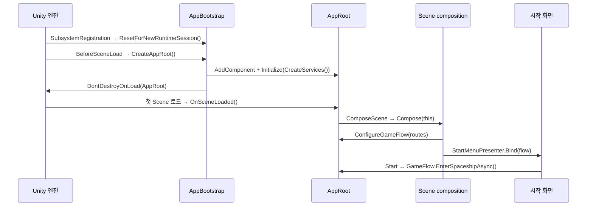
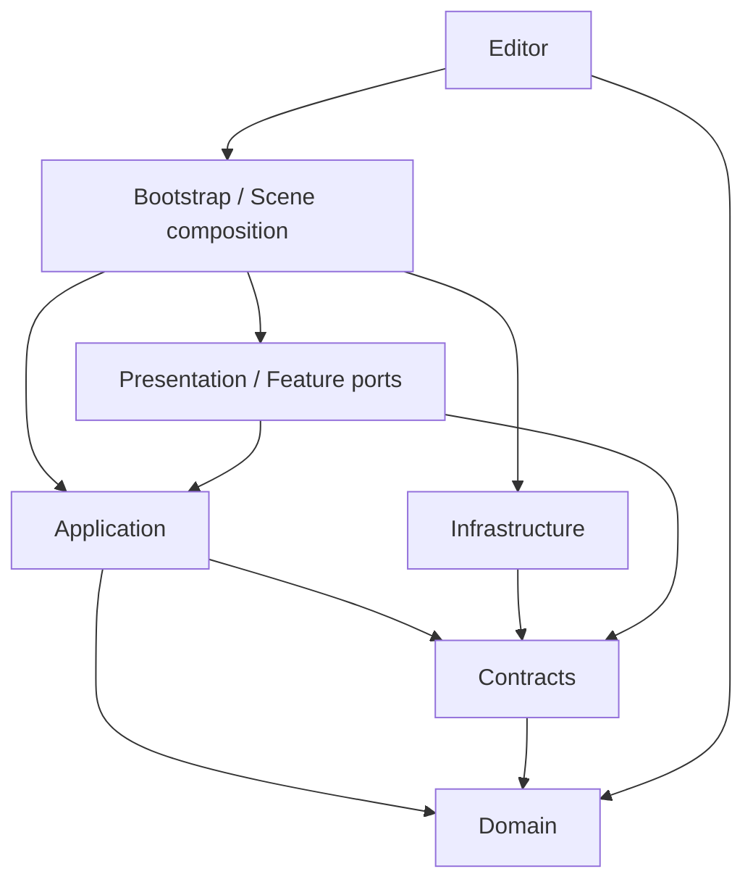

# Core 사용 안내

갱신: 2026-11-05. 최신 main의 Feature·기존 Scene·Prefab을 유지한 Core 기반 통합 브랜치다. main에 이미 반영된 터렛 권한/ID/관측 계약을 사용하도록 Core 연결을 복구했다. CU는 기존 IControlUnitVitals를 그대로 읽으며 Feature에 새 인터페이스 구현을 강제하지 않는다. [기반 분리와 검증 기록](../../../Docs/planning/2026-11-05-foundation-main-integration.md)을 현재 기준으로 읽는다.

- [이번 배치 결과와 수동 확인](../../../Docs/planning/2026-11-04-core-resume-results.md)
- [실제 함수 호출·수명·Feature 연결 지도](../../../Docs/architecture/core-lifecycle-and-api-guide.md)
- [시간/예약 API](../../../Docs/architecture/match-time-api.md) · [필드 정지](../../../Docs/architecture/match-field-pause-api.md)
- [체크포인트 IO](../../../Docs/architecture/checkpoint-storage-api.md) · [저장/복원 실행](../../../Docs/architecture/checkpoint-execution-api.md)
- [Steam 도입 설계](../../../Docs/architecture/steam-integration-design.md)
- [범용 Random API·기존 교체 위치](../../../Docs/architecture/core-random-api.md) · [우주선 출입 보고 API](../../../Docs/architecture/core-presence-report-api.md) — Core 구현이며 Feature 호출부는 미변경.

## Random을 사용하는 팀원은 먼저 확인

[Random API 사용법](../../../Docs/architecture/core-random-api.md)의 첫 예제처럼 정적 헬퍼 한 줄로 연결한다. 새 부모 클래스·개별 해제 클래스는 필요 없다. Core가 반환값을 보관하고 Scene/Match 정리 때 해제한다. 날씨·스폰·공격은 Host Match, 로컬 HUD 효과는 App의 PresentationRandom을 사용한다.

```csharp
// 기존 IRandomConsumer 구현 컴포넌트의 필드와 메서드.
// using System; using TeamHJD.Game.Application; using TeamHJD.Game.Contracts;
private IRandomSource _random;

public IDisposable BindRandom(IRandomStreams streams)
    => RandomBinding.Bind(streams, "weather", ref _random);

// Core가 연결한 이후 Feature 실행 시 호출한다.
public bool RollSuccess(double chance) => _random.Chance(chance);
```

해제 후 참조는 남지만 `IsAvailable`이 false가 된다. 같은 필드의 재연결·순수 함수 전달·직접 조립 예제는 사용법을 따른다. 게임 난수는 Host에서만 사용하며 팀원 기능의 실제 호출부는 변경하지 않았다.

## 먼저 실행해 볼 것

1. Unity 메뉴 `Tools > TeamHJD > The Developer > Open Core Startup Scene`을 선택한다. 경로는 `Assets/Scenes/Bootstrap/Startup.unity`다.
2. Play 후 기존 Main의 **Start** 버튼을 누른다. 우주선 `SpaceShipGrayBox`로 이동한다. 이 경로는 실제 PlayMode 검사로 확인했다.
3. Game Debugger의 **Overview > APP · GAME FLOW**에서 위치와 전환 상태를 확인한다. 선택 Mission 출격/귀환도 같은 API를 호출한다.
4. `Initial_Stage`는 main의 기존 제작 Scene을 사용한다. 터렛 권한/ID/해금 초기화는 main의 승인된 계약으로 연결한다. 실제 Feature의 시간 소비·저장 writer·원격 Player 연결과 Mission 전체 승패/복원 인수는 별개다.

Build Settings의 기존 Scene 순서는 유지하고 새 Startup을 마지막에 등록했다. 시작 화면은 위 메뉴로 직접 연다. 제품 빌드의 첫 Scene 변경은 별도 인수 뒤에 진행한다. Editor에서 다른 Scene을 직접 Play하면 그 Scene을 사용하며 강제로 시작 화면으로 이동하지 않는다. Load 버튼은 저장 자료를 실제 Mission에 복원하는 연결이 준비되지 않아 비활성 상태다. Exit는 Standalone 앱 종료이며 Editor의 Play 종료 버튼을 대체하지 않는다.

시작 화면은 `Reference/Main.unity`의 Canvas·카메라·EventSystem과 기존 이미지/폰트를 복제했다. 복제본에서 레거시 동작과 미연결 버튼 호출만 제거했다. 원본 Main과 우주선/Initial_Stage는 수정하지 않았다. 화면의 최종 배치·가독성은 사람이 확인해야 한다.

## 코드를 읽는 순서

| 순서 | 클래스와 함수 | 알 수 있는 것 |
| --- | --- | --- |
| 1 | [AppBootstrap](Bootstrap/AppBootstrap.cs): `ResetForNewRuntimeSession`, `CreateAppRoot`, `CreateServices` | Unity가 호출하는 진입점, 개발 서비스·실제 로컬 저장소 생성 |
| 2 | [AppRoot](Bootstrap/AppRoot.cs): `Initialize`, `OnSceneLoaded`, `ComposeScene`, `Dispose` | App 소유권과 Scene 조립·종료 |
| 3 | [AppServices](Application/AppServices.cs): 생성자, `CreateCheckpointScope`, `PumpNetwork` | typed 서비스 묶음, App/Match 수명 분리 |
| 4 | [StartupSceneRoot](Bootstrap/SceneComposition/StartupSceneRoot.cs): `Compose` | 시작 화면에 App 흐름과 기존 버튼을 전달하는 곳 |
| 5 | [GameFlowController](Application/GameFlow/GameFlowController.cs): `AdoptMainMenu`, `EnterSpaceshipAsync`, `LaunchMissionAsync` | 제품 진입 위치와 전환·실제 Mission 준비 확인 |
| 6 | [AppGameFlowHost](Bootstrap/AppGameFlowHost.cs): `TravelAsync`, `WaitForMissionReadyAsync` | Unity/기존 App 전환과 순수 C# 흐름을 연결하는 adapter |
| 7 | [InitialStageCompositionRoot](Bootstrap/SceneComposition/InitialStageCompositionRoot.cs): `Compose`, `ComposeAuthority`, `ReleaseOwnedBindings` | 실제 Match·Player·공간·지역·환경 조립. main의 Feature 계약과 읽기 Port를 소비 |
| 8 | [MatchSession](Application/MatchSession.cs), [MatchCoordinator](Application/MatchCoordinator.cs) | Match 원본/모드 규칙과 실제 Feature 사건에 따른 완료 조율 |
| 9 | [MatchTimeService](Application/Time/MatchTimeService.cs), [MatchPresenceService](Application/Time/MatchPresenceService.cs) | 게임 시계·예약·참가자 위치와 필드 정지 정책 |
| 10 | [MatchCheckpointScope](Application/Persistence/MatchCheckpointScope.cs), [CheckpointService](Application/Persistence/CheckpointService.cs) | 명시 저장·복원·필수 writer·등록/해제 |
| 11 | Contracts와 해당 Infrastructure adapter | Feature가 제공/소비할 port, NGO·Unity·binary IO 구현 |

## Unity는 Bootstrap을 누가 호출하는가

`AppBootstrap`을 Scene에 붙이거나 다른 스크립트에서 직접 호출하지 않는다. Unity 엔진이 `RuntimeInitializeOnLoadMethod`가 붙은 정적 메서드를 실행한다.



`SubsystemRegistration`은 Domain Reload를 끈 새 실행에서도 중복 방지 상태를 초기화하는 진입점이다. `BeforeSceneLoad`는 첫 Scene 객체의 Awake보다 먼저 App을 준비한다. Scene이 바뀌어도 App은 유지되고 Scene 소유 객체는 해당 Scene에서 정리한다.

## 폴더 이름과 의존성

| 폴더 | 의미 / 예 |
| --- | --- |
| Domain | 게임의 개념·불변 값·규칙·자료구조. ID, MatchConfig, Grid, 지역, 저장 DTO. Unity Scene을 찾지 않음 |
| Contracts | 외부에 요구하거나 제공하는 인터페이스/요청·결과 계약. 누가 구현하는지는 조립부가 결정 |
| Application | 규칙과 port를 호출하는 실행 절차. MatchSession, GameFlowController, 시간·예약·체크포인트 조율 |
| Bootstrap | 실제 객체를 만들고 연결하는 Unity 진입/Scene 조립부. Core와 Feature가 만나는 위치 |
| Infrastructure | Unity Scene, NGO, binary 파일 IO 등 외부 기술 adapter. Fakes는 외부 서비스를 대신하는 개발/검사 구현 |
| Content | 디자이너가 제작한 정의/카탈로그의 authoring과 runtime 읽기 |
| Presentation | 입력·화면·카메라·실제 Unity 객체의 표현 adapter. 원본 게임 규칙을 소유하지 않음 |
| Editor | Game Debugger·Scene View·제작 도구. Player 빌드의 필수 runtime과 분리 |
| Tests | Core 계약/실제 adapter 검사. fixture 통과를 제품 전체 인수와 구분 |



실제 asmdef가 컴파일 경계를 결정한다. Domain/Application/Contracts와 Infrastructure.Fakes는 엔진 참조가 없는 구성이다. Feature의 MonoBehaviour·Steam/NGO SDK 타입을 Domain에 넣지 않는다. 공개 서비스는 주입받고 Feature가 전역 AppRoot/Manager를 찾아 상태를 직접 바꾸지 않게 한다.

## 주요 사용 경계

- 게임 흐름: 시작/출격/결과의 호출자는 `app.GameFlow`를 사용한다. `Phase`는 App의 현재 진입 위치이며 `MatchPhase`·네트워크 준비 Phase와 다르다. `ReturnToSpaceshipAsync`는 Match를 종료하고 귀환하며, 임시 우주선 출입과 같지 않다.
- Match: `AppRoot.StartMatch`는 Factory로 생성한 Session을 App에 등록한다. `InitialStageCompositionRoot`는 그 Session에 실제 Scene 원본을 연결한다. `MatchCoordinator`는 CU 사건을 읽어 Session의 모드 규칙으로 완료를 조율한다.
- 시간: 공용 게임 시계의 정지·배속은 NGO 접속 시각/메시지 pump와 분리한다. 2인 모두 우주선에 있어야 필드를 정지하며 실제 출입 사실은 Player 담당자가 제공한다.
- 저장: App은 binary 저장소를 제공하고 Match 조립부가 `CreateCheckpointScope`에 runtime·실제 participant·필수 writer 키 목록을 넘긴다. 필수 writer가 빠지면 `MissingParticipantKeys`와 `RequiredFeatureWritersUnavailable`로 설명한다. 현재 Stage에 전체 Feature writer가 연결된 것은 아니다.
- 환경/Encounter: Core는 확정 공간·환경 snapshot을 전달한다. Enemy/Encounter가 계획/실제 생성을 소유하고 World/Weather가 실제 날씨·낮밤 상태를 소유한다.
- UI: StartMenuPresenter는 기존 버튼을 App 흐름에 전달한다. 공용 메뉴/결과 버튼도 GameFlow를 사용한다. Combat HUD와 Player 입력 원본은 Player/UI 담당 범위다.

`Catalog`는 플레이어 상태가 아닌 콘텐츠 정의 목록이다. App은 여러 Match에서 같은 정의를 읽을 수 있도록 카탈로그를 가진다. 어떤 Match를 시작할지는 이후 요청/설정이 선택한다.

`Snapshot`은 어느 순간의 읽기 자료다. 실제 CU/Player/터렛 HP를 소유하는 Feature와 `MatchState`의 기초 상태를 혼동하지 않는다. 현재 Domain MatchState만 저장해서 전체 전투를 되돌릴 수는 없다.

## 왜 GameManager 하나 대신 App/Match 수명을 구분하는가

App은 플랫폼/프로필·네트워크 연결·Scene 전환·저장소처럼 게임 중 여러 Match가 공유하는 서비스를 관리한다. Match는 해당 판의 시간·규칙·공간·환경·요청 수명을 관리한다. Scene은 실제 Player/적/터렛을 연결하고 자신의 구독·lease를 종료한다.

이렇게 나누면 Scene을 직접 실행해도 필요한 의존성을 명시할 수 있고, 순수 C# 절차는 Unity 없이 검사할 수 있다. Match가 끝났다고 Steam 연결까지 끊거나, UI가 닫혔다고 다른 입력 잠금이 풀리는 문제를 줄인다. 새 서비스를 추가할 때는 이름에 Manager를 붙이는 것보다 소유자·수명·원본·생성/해제 주체를 먼저 정한다.

`IDisposable.Dispose()`는 해당 객체가 소유한 구독·등록·작업 등을 해제하는 C# 관례다. Unity의 GameObject 파괴와 같지 않다. 호출자가 받은 lease는 교체/종료 때 Dispose하고, 다른 소유자의 서비스는 임의로 Dispose하지 않는다. `sealed`는 상속을 막고, `a ?? b`는 a가 null일 때 b를 선택한다.

## 현재 한계와 팀 연결

- 터렛 Match 권위/ID/관측: main의 승인된 API로 Core 소비자를 연결했다. 터렛 생성·전력·공격 규칙은 변경하지 않는다.
- Weather/Time: Core 공용 clock/scheduler와 환경 port는 제공한다. 김진태의 실제 규칙/표현 연결은 대기한다.
- Player/Enemy/터렛/CU 저장 writer와 상태 재생성: 각 담당자가 원본을 제공해야 한다. 저장 파일 읽기 API와 실제 게임 전체 재개는 다르다.
- 우주선의 실제 Player 배치/출입 판정·제작 콘솔 버튼: World/Player 담당자 연결이 필요하다. Debugger 요청이 실제 콘솔 UX의 완료를 뜻하지 않는다.
- Steam/Backend·실제 프로필·온라인 인증: 도입 설계 단계다. 현재 Platform/Profile은 개발 Fake다. 계정·성장 원본과 체크포인트를 분리한다.
- 현재 branch의 원격 main 통합, 실제 2인 플레이·Mission 전체 승패/복원·빌드는 별도 인수다.

과거 작업 공간의 제외/보류 이력은 [HOLD 목록](../../../Docs/planning/2026-11-02-feature-integration-hold.md)에 보존한다. 이 이력을 최신 main의 승인된 계약까지 미구현이라는 뜻으로 해석하지 않는다. 현재 PR 범위와 검증은 [main 통합 기록](../../../Docs/planning/2026-11-05-foundation-main-integration.md)을 따른다.
