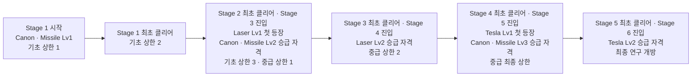
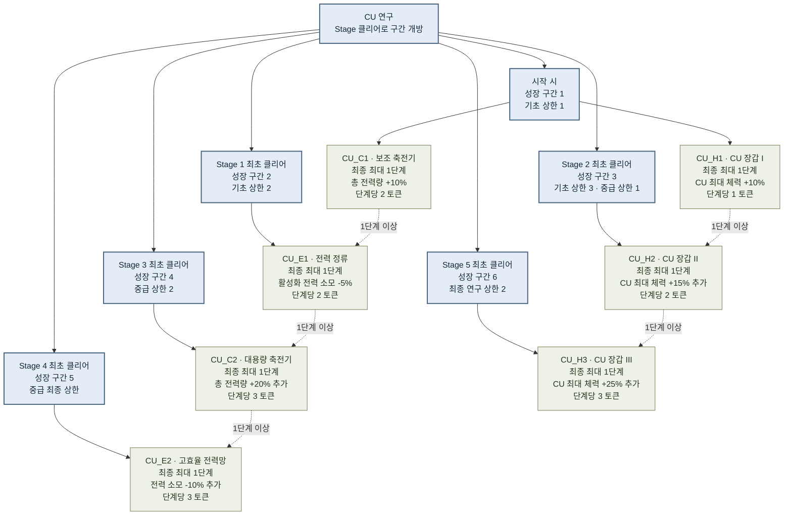
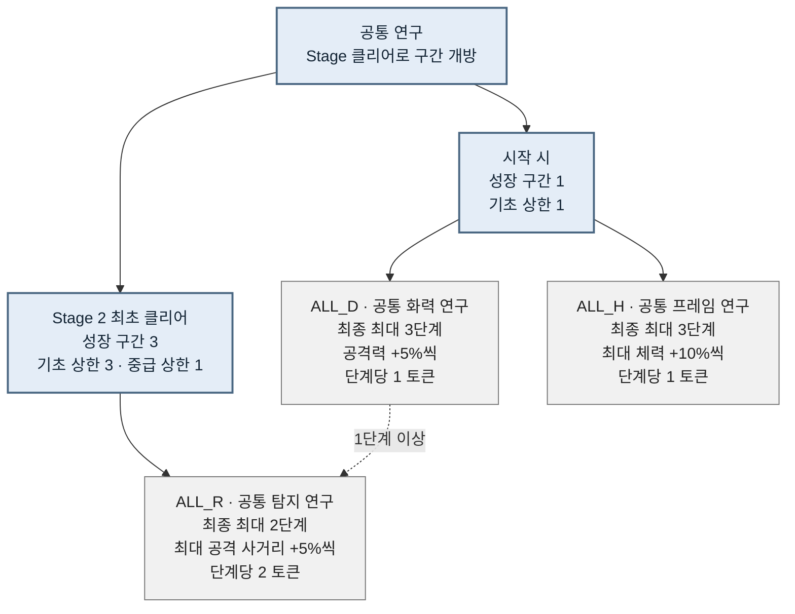
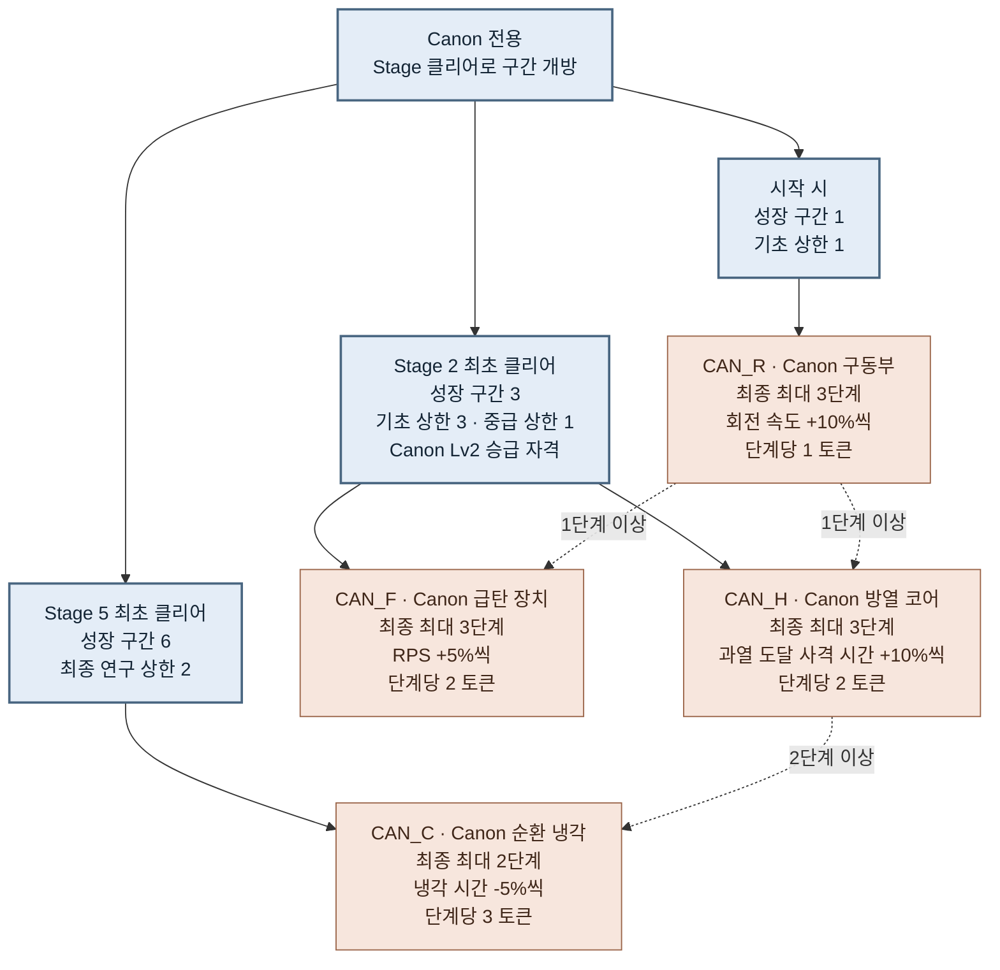
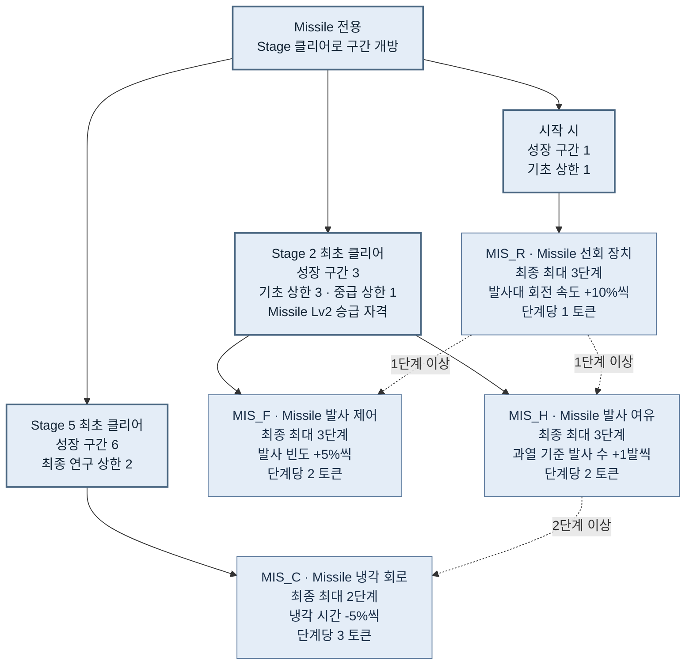
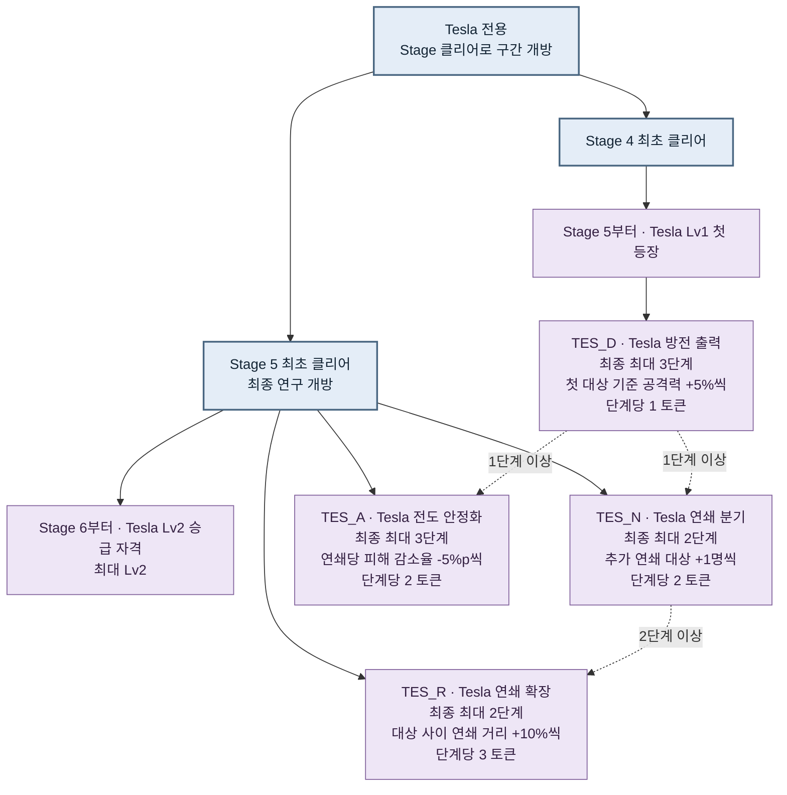
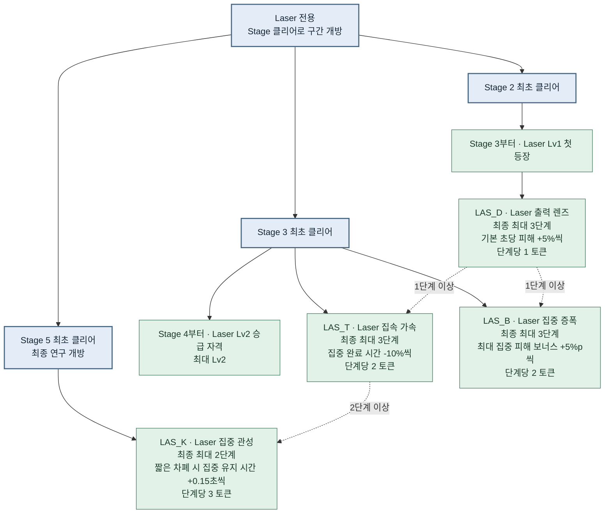

# 터렛·CU 스킬 트리 선행 조건

2026년 11월 10일 수정 · 상태: 설계 초안 · Canon / Missile / Laser / Tesla

**이 스킬 트리는 Stage 최초 클리어로 성장 구간을 여는 단일 트리다.** Laser는 Stage 3, Tesla는 Stage 5에 Lv1로 처음 등장하며 둘 다 Lv2가 최대다. Tesla는 회전하지 않는다. 등장 이후의 Lv2 승급 시점, 연구 배치, 전투 모델, 수치와 비용은 설계 제안이다.

## 업그레이드 항목 수와 총 횟수

**업그레이드 항목 26가지 · 모든 단계를 포함한 총 업그레이드 58회.**

항목 수는 구매 가능한 서로 다른 노드 수이고, 총 횟수는 각 노드의 최대 단계를 합산한 값이다. 예를 들어 최대 3단계인 연구 하나는 1가지 항목이며, 끝까지 올리면 3회 업그레이드한다.

| 구분 | 업그레이드 항목 수 | 총 업그레이드 횟수 |
|---|---:|---:|
| CU 연구 | 7가지 | 7회 |
| 공통 연구 | 3가지 | 8회 |
| Canon 전용 | 4가지 | 11회 |
| Missile 전용 | 4가지 | 11회 |
| Tesla 전용 | 4가지 | 10회 |
| Laser 전용 | 4가지 | 11회 |
| **전체 합계** | **26가지** | **58회** |

시작 상태·자동 Stage 해금·성장 구간 표시는 제외한다. 공통 연구와 상세 그림에 반복된 동일 노드는 한 번만 센다. 개별 터렛의 현장 승급은 위 합계와 별도다. Canon·Missile은 기당 최대 2회, Laser·Tesla는 기당 최대 1회다. 연구 노드의 최대 단계와 터렛 자체의 Lv는 별도로 계산한다.

## 진행 방식

Stage 최초 클리어가 연구 구간과 연구 상한을 직접 연다. CU 전력 연구는 상위 터렛 연구나 승급 자격의 필수 조건이 아니다. 전체 Stage 수는 미정이므로 아래는 **선형 6구간 배치 예시**다. Stage 2·4 클리어가 원래 회의에서 정해졌다는 뜻은 아니다.

| 성장 구간 | 영구 진입 조건 | 기초 연구 상한 | 중급 연구 상한 | 최종 연구 상한 | 새로 등장하는 종류 · 열리는 승급 |
|---|---|---|---|---|---|
| 1 | 시작 시 | 노드 최대와 1 중 작은 값 | 잠김 | 잠김 | Canon·Missile Lv1 시작 |
| 2 | Stage 1 최초 클리어 | 노드 최대와 2 중 작은 값 | 잠김 | 잠김 | — |
| 3 | Stage 2 최초 클리어 | 각 노드 최대 | 노드 최대와 1 중 작은 값 | 잠김 | Laser Lv1 첫 등장 · Canon·Missile Lv2 |
| 4 | Stage 3 최초 클리어 | 각 노드 최대 | 노드 최대와 2 중 작은 값 | 잠김 | Laser Lv2 |
| 5 | Stage 4 최초 클리어 | 각 노드 최대 | 각 노드 최대 | 잠김 | Tesla Lv1 첫 등장 · Canon·Missile Lv3 |
| 6 | Stage 5 최초 클리어 | 각 노드 최대 | 각 노드 최대 | 각 노드 최대 | Tesla Lv2 |

새 터렛의 전용 기초 연구는 첫 등장부터 열린다. 중급 연구와 Lv2 승급 자격은 첫 등장 Stage를 클리어한 뒤 연다. 따라서 Laser는 Stage 4부터, Tesla는 Stage 6부터 Lv2 승급이 가능하다. 최종 연구는 기존 구간 6과 개별 선행 연구 조건을 모두 충족해야 한다.

CU 전력 정류는 구간 2, 대용량 축전기는 구간 4, 고효율 전력망은 구간 5에서 별도로 열린다. 연구표의 최초 개방 구간도 함께 충족해야 한다. 클리어는 무료 연구나 토큰을 지급하지 않고 구매 자격만 연다. 플레이어 레벨·보스 조건·CU 유료 관문을 Stage 조건 위에 추가로 중첩하지 않는다.

이미 열린 구간은 재방문해도 유지한다. 현재 맵 번호가 아니라 영구 클리어 ID 기록으로 조건을 평가한다. 연구 상한에 도달한 채 Stage에서 막히면 연구를 더 살 수 없으므로 토큰 수급과 재도전 난이도를 함께 시험해야 한다.

## 성장 구간 개요

## 전체 Mermaid 트리

노드에 적힌 최대 단계는 최종 상한이다. 이 설계에서는 성장 구간별 상한을 함께 적용한다. 여러 진입 조건은 모두 AND이며 점선 숫자는 앞 연구의 최소 구매 단계다. 동일 색은 적용 대상을 나타낸다.

```mermaid
%% 4종 터렛 / 설계 제안 / 입력 조건은 모두 AND
flowchart TB
    START["Stage 클리어로 구간 개방<br/>시작 시 Canon · Missile Lv1"]
    G1["시작 시<br/>성장 구간 1<br/>기초 상한 1"]
    START --> G1
    G2["Stage 1 최초 클리어<br/>성장 구간 2<br/>기초 상한 2"]
    START --> G2
    G3["Stage 2 최초 클리어<br/>성장 구간 3<br/>기초 상한 3 · 중급 상한 1<br/>Canon · Missile Lv2 승급 자격"]
    START --> G3
    G4["Stage 3 최초 클리어<br/>성장 구간 4<br/>중급 상한 2"]
    START --> G4
    G5["Stage 4 최초 클리어<br/>성장 구간 5<br/>중급 최종 상한<br/>Canon · Missile Lv3 승급 자격"]
    START --> G5
    G6["Stage 5 최초 클리어<br/>성장 구간 6<br/>최종 연구 상한 2"]
    START --> G6
    LAS1["Stage 3부터 · Laser Lv1 첫 등장"]
    G3 --> LAS1
    LAS2["Stage 4부터 · Laser Lv2 승급 자격<br/>최대 Lv2"]
    G4 --> LAS2
    TES1["Stage 5부터 · Tesla Lv1 첫 등장"]
    G5 --> TES1
    TES2["Stage 6부터 · Tesla Lv2 승급 자격<br/>최대 Lv2"]
    G6 --> TES2
    CU_C1["CU_C1 · 보조 축전기<br/>최종 최대 1단계<br/>총 전력량 +10%<br/>단계당 2 토큰"]
    G1 --> CU_C1
    CU_E1["CU_E1 · 전력 정류<br/>최종 최대 1단계<br/>활성화 전력 소모 -5%<br/>단계당 2 토큰"]
    G2 --> CU_E1
    CU_C1 -. "1단계 이상" .-> CU_E1
    CU_C2["CU_C2 · 대용량 축전기<br/>최종 최대 1단계<br/>총 전력량 +20% 추가<br/>단계당 3 토큰"]
    G4 --> CU_C2
    CU_E1 -. "1단계 이상" .-> CU_C2
    CU_E2["CU_E2 · 고효율 전력망<br/>최종 최대 1단계<br/>전력 소모 -10% 추가<br/>단계당 3 토큰"]
    G5 --> CU_E2
    CU_C2 -. "1단계 이상" .-> CU_E2
    CU_H1["CU_H1 · CU 장갑 I<br/>최종 최대 1단계<br/>CU 최대 체력 +10%<br/>단계당 1 토큰"]
    G1 --> CU_H1
    CU_H2["CU_H2 · CU 장갑 II<br/>최종 최대 1단계<br/>CU 최대 체력 +15% 추가<br/>단계당 2 토큰"]
    G3 --> CU_H2
    CU_H1 -. "1단계 이상" .-> CU_H2
    CU_H3["CU_H3 · CU 장갑 III<br/>최종 최대 1단계<br/>CU 최대 체력 +25% 추가<br/>단계당 3 토큰"]
    G6 --> CU_H3
    CU_H2 -. "1단계 이상" .-> CU_H3
    ALL_D["ALL_D · 공통 화력 연구<br/>최종 최대 3단계<br/>공격력 +5%씩<br/>단계당 1 토큰"]
    G1 --> ALL_D
    ALL_H["ALL_H · 공통 프레임 연구<br/>최종 최대 3단계<br/>최대 체력 +10%씩<br/>단계당 1 토큰"]
    G1 --> ALL_H
    ALL_R["ALL_R · 공통 탐지 연구<br/>최종 최대 2단계<br/>최대 공격 사거리 +5%씩<br/>단계당 2 토큰"]
    G3 --> ALL_R
    ALL_D -. "1단계 이상" .-> ALL_R
    CAN_R["CAN_R · Canon 구동부<br/>최종 최대 3단계<br/>회전 속도 +10%씩<br/>단계당 1 토큰"]
    G1 --> CAN_R
    CAN_F["CAN_F · Canon 급탄 장치<br/>최종 최대 3단계<br/>RPS +5%씩<br/>단계당 2 토큰"]
    G3 --> CAN_F
    CAN_R -. "1단계 이상" .-> CAN_F
    CAN_H["CAN_H · Canon 방열 코어<br/>최종 최대 3단계<br/>과열 도달 사격 시간 +10%씩<br/>단계당 2 토큰"]
    G3 --> CAN_H
    CAN_R -. "1단계 이상" .-> CAN_H
    CAN_C["CAN_C · Canon 순환 냉각<br/>최종 최대 2단계<br/>냉각 시간 -5%씩<br/>단계당 3 토큰"]
    G6 --> CAN_C
    CAN_H -. "2단계 이상" .-> CAN_C
    MIS_R["MIS_R · Missile 선회 장치<br/>최종 최대 3단계<br/>발사대 회전 속도 +10%씩<br/>단계당 1 토큰"]
    G1 --> MIS_R
    MIS_F["MIS_F · Missile 발사 제어<br/>최종 최대 3단계<br/>발사 빈도 +5%씩<br/>단계당 2 토큰"]
    G3 --> MIS_F
    MIS_R -. "1단계 이상" .-> MIS_F
    MIS_H["MIS_H · Missile 발사 여유<br/>최종 최대 3단계<br/>과열 기준 발사 수 +1발씩<br/>단계당 2 토큰"]
    G3 --> MIS_H
    MIS_R -. "1단계 이상" .-> MIS_H
    MIS_C["MIS_C · Missile 냉각 회로<br/>최종 최대 2단계<br/>냉각 시간 -5%씩<br/>단계당 3 토큰"]
    G6 --> MIS_C
    MIS_H -. "2단계 이상" .-> MIS_C
    TES_D["TES_D · Tesla 방전 출력<br/>최종 최대 3단계<br/>첫 대상 기준 공격력 +5%씩<br/>단계당 1 토큰"]
    TES1 --> TES_D
    TES_N["TES_N · Tesla 연쇄 분기<br/>최종 최대 2단계<br/>추가 연쇄 대상 +1명씩<br/>단계당 2 토큰"]
    G6 --> TES_N
    TES_D -. "1단계 이상" .-> TES_N
    TES_A["TES_A · Tesla 전도 안정화<br/>최종 최대 3단계<br/>연쇄당 피해 감소율 -5%p씩<br/>단계당 2 토큰"]
    G6 --> TES_A
    TES_D -. "1단계 이상" .-> TES_A
    TES_R["TES_R · Tesla 연쇄 확장<br/>최종 최대 2단계<br/>대상 사이 연쇄 거리 +10%씩<br/>단계당 3 토큰"]
    G6 --> TES_R
    TES_N -. "2단계 이상" .-> TES_R
    LAS_D["LAS_D · Laser 출력 렌즈<br/>최종 최대 3단계<br/>기본 초당 피해 +5%씩<br/>단계당 1 토큰"]
    LAS1 --> LAS_D
    LAS_T["LAS_T · Laser 집속 가속<br/>최종 최대 3단계<br/>집중 완료 시간 -10%씩<br/>단계당 2 토큰"]
    G4 --> LAS_T
    LAS_D -. "1단계 이상" .-> LAS_T
    LAS_B["LAS_B · Laser 집중 증폭<br/>최종 최대 3단계<br/>최대 집중 피해 보너스 +5%p씩<br/>단계당 2 토큰"]
    G4 --> LAS_B
    LAS_D -. "1단계 이상" .-> LAS_B
    LAS_K["LAS_K · Laser 집중 관성<br/>최종 최대 2단계<br/>짧은 차폐 시 집중 유지 시간 +0.15초씩<br/>단계당 3 토큰"]
    G6 --> LAS_K
    LAS_T -. "2단계 이상" .-> LAS_K
    classDef gate fill:#E4EDF7,stroke:#496681,color:#142535,stroke-width:2px;
    classDef cu fill:#EDF1E7,stroke:#717E51,color:#29331C;
    classDef common fill:#F1F1F1,stroke:#777777,color:#222222;
    classDef canon fill:#F7E6DD,stroke:#996347,color:#402719;
    classDef missile fill:#E4EDF7,stroke:#58769A,color:#1C3049;
    classDef tesla fill:#EEE6F6,stroke:#80609B,color:#342042;
    classDef laser fill:#E2F2E9,stroke:#4D7D65,color:#1B3929;
    class START,G1,G2,G3,G4,G5,G6 gate;
    class CU_C1,CU_E1,CU_C2,CU_E2,CU_H1,CU_H2,CU_H3 cu;
    class ALL_D,ALL_H,ALL_R common;
    class CAN_R,CAN_F,CAN_H,CAN_C canon;
    class MIS_R,MIS_F,MIS_H,MIS_C missile;
    class TES1,TES2,TES_D,TES_N,TES_A,TES_R tesla;
    class LAS1,LAS2,LAS_D,LAS_T,LAS_B,LAS_K laser;
```

## 노드 명세

| ID | 노드 | 적용 대상 | 구간 | 최대 단계 | 단계당 토큰 | 효과 | 선행 연구 |
|---|---|---|---|---:|---:|---|---|
| CU_C1 | 보조 축전기 | CU 연구 | 성장 구간 1 | 1 | 2 | 총 전력량 +10% | 없음 |
| CU_E1 | 전력 정류 | CU 연구 | 성장 구간 2 | 1 | 2 | 활성화 전력 소모 -5% | CU_C1 1단계 |
| CU_C2 | 대용량 축전기 | CU 연구 | 성장 구간 4 | 1 | 3 | 총 전력량 +20% 추가 | CU_E1 1단계 |
| CU_E2 | 고효율 전력망 | CU 연구 | 성장 구간 5 | 1 | 3 | 전력 소모 -10% 추가 | CU_C2 1단계 |
| CU_H1 | CU 장갑 I | CU 연구 | 성장 구간 1 | 1 | 1 | CU 최대 체력 +10% | 없음 |
| CU_H2 | CU 장갑 II | CU 연구 | 성장 구간 3 | 1 | 2 | CU 최대 체력 +15% 추가 | CU_H1 1단계 |
| CU_H3 | CU 장갑 III | CU 연구 | 성장 구간 6 | 1 | 3 | CU 최대 체력 +25% 추가 | CU_H2 1단계 |
| ALL_D | 공통 화력 연구 | 공통 연구 | 성장 구간 1 | 3 | 1 | 공격력 +5% / 단계 | 없음 |
| ALL_H | 공통 프레임 연구 | 공통 연구 | 성장 구간 1 | 3 | 1 | 최대 체력 +10% / 단계 | 없음 |
| ALL_R | 공통 탐지 연구 | 공통 연구 | 성장 구간 3 | 2 | 2 | 최대 공격 사거리 +5% / 단계 | ALL_D 1단계 |
| CAN_R | Canon 구동부 | Canon 전용 | 성장 구간 1 | 3 | 1 | 회전 속도 +10% / 단계 | 없음 |
| CAN_F | Canon 급탄 장치 | Canon 전용 | 성장 구간 3 | 3 | 2 | RPS +5% / 단계 | CAN_R 1단계 |
| CAN_H | Canon 방열 코어 | Canon 전용 | 성장 구간 3 | 3 | 2 | 과열 도달 사격 시간 +10% / 단계 | CAN_R 1단계 |
| CAN_C | Canon 순환 냉각 | Canon 전용 | 성장 구간 6 | 2 | 3 | 냉각 시간 -5% / 단계 | CAN_H 2단계 |
| MIS_R | Missile 선회 장치 | Missile 전용 | 성장 구간 1 | 3 | 1 | 발사대 회전 속도 +10% / 단계 | 없음 |
| MIS_F | Missile 발사 제어 | Missile 전용 | 성장 구간 3 | 3 | 2 | 발사 빈도 +5% / 단계 | MIS_R 1단계 |
| MIS_H | Missile 발사 여유 | Missile 전용 | 성장 구간 3 | 3 | 2 | 과열 기준 발사 수 +1발 / 단계 | MIS_R 1단계 |
| MIS_C | Missile 냉각 회로 | Missile 전용 | 성장 구간 6 | 2 | 3 | 냉각 시간 -5% / 단계 | MIS_H 2단계 |
| TES_D | Tesla 방전 출력 | Tesla 전용 | 성장 구간 5 | 3 | 1 | 첫 대상 기준 공격력 +5% / 단계 | 없음 |
| TES_N | Tesla 연쇄 분기 | Tesla 전용 | 성장 구간 6 | 2 | 2 | 추가 연쇄 대상 +1명 / 단계 | TES_D 1단계 |
| TES_A | Tesla 전도 안정화 | Tesla 전용 | 성장 구간 6 | 3 | 2 | 연쇄당 피해 감소율 -5%p / 단계 | TES_D 1단계 |
| TES_R | Tesla 연쇄 확장 | Tesla 전용 | 성장 구간 6 | 2 | 3 | 대상 사이 연쇄 거리 +10% / 단계 | TES_N 2단계 |
| LAS_D | Laser 출력 렌즈 | Laser 전용 | 성장 구간 3 | 3 | 1 | 기본 초당 피해 +5% / 단계 | 없음 |
| LAS_T | Laser 집속 가속 | Laser 전용 | 성장 구간 4 | 3 | 2 | 집중 완료 시간 -10% / 단계 | LAS_D 1단계 |
| LAS_B | Laser 집중 증폭 | Laser 전용 | 성장 구간 4 | 3 | 2 | 최대 집중 피해 보너스 +5%p / 단계 | LAS_D 1단계 |
| LAS_K | Laser 집중 관성 | Laser 전용 | 성장 구간 6 | 2 | 3 | 짧은 차폐 시 집중 유지 시간 +0.15초 / 단계 | LAS_T 2단계 |

## 터렛별 상세 Mermaid

전체 그림이 복잡할 때 아래 가지를 따로 검토한다. 분리 그림의 구간 조건과 전체 그림은 같은 노드 데이터에서 생성한다.

### CU 연구

### 공통 연구

### Canon 전용

### Missile 전용

### Tesla 전용

### Laser 전용

## 네 종류의 역할과 제안 전투 모델

- **Canon:** 회전해서 조준하는 반복 사격형. 회전·RPS·연속 사격 허용 시간·냉각을 연구한다.
- **Missile:** 회전하는 발사대와 미사일 과열 기준을 갖는 형태. 발사대 회전·발사 빈도·과열 기준 발사 수·냉각을 연구한다. 발사대 회전 연구가 비행 중 미사일의 유도 선회까지 바꾸지는 않는다.
- **Tesla:** 회전이 필요 없다는 점은 사용자 확정 조건이다. 이번에는 첫 대상에서 인접 적으로 이어지는 연쇄 방전형을 제안한다. 회전·조준 각도·포신 추적·투사체 선회 연구를 넣지 않는다.
- **Laser:** 동일 대상에게 지속 피해를 주며 집중 화력이 누적되는 빔형을 제안한다. 회전 필요 여부는 미정이라 이번 안에는 Laser 회전 연구를 넣지 않는다. 필요성이 확정되면 Laser 전용 가지에서 검토한다.

공통 연구에는 공격력·최대 체력·최대 공격 사거리만 둔다. 공통 연구의 적용 대상은 Canon·Missile·Tesla·Laser 전투용 터렛이며 CU는 제외한다. 공통 RPS·공통 회전·공통 과열 연구는 두지 않는다. 회전을 쓰지 않는 Tesla나 전투 모델이 다른 Laser가 무효한 연구에 토큰을 쓰지 않게 하기 위해서다. CU 최대 체력 연구는 CU에만 적용한다.

## Tesla 연쇄 방전 규칙 제안

기본은 최초 대상 1명과 추가 연쇄 대상 1명이다. 연쇄 분기 2단계면 추가 대상은 3명으로, 최초 대상을 포함해 최대 4명을 맞힌다. 같은 적은 한 번의 방전에서 한 번만 맞는다.

최초 대상 탐지는 Tesla의 최대 공격 사거리를 사용한다. 다음 적은 직전 적 위치에서 기본 3유닛 안의 가까운 유효 대상으로 고르고, 동률은 안정적인 대상 ID로 정렬한다. 유효한 다음 적이 없으면 종료한다. 연쇄 거리 연구를 끝내면 이 연결 거리는 3.6유닛이다. 공통 사거리 연구는 최초 대상 탐지만 늘리고 연쇄 거리를 늘리지 않는다.

기본 피해 감소율은 연쇄당 30%다. 피해는 `첫 대상 피해 × (1 - 감소율)^연쇄 횟수`로 계산한다. 전도 안정화 3단계면 감소율은 15%가 되어 피해 계수는 `1 → 0.85 → 0.7225 → 0.614125`다. -5%p는 30%에서 25%로 바꾸는 뜻이다. 연쇄 분기와 감쇠 연구는 서로 다른 노드이고 둘 다 구매할 수 있다.

각 방전 때 초기 후보를 한 번 정하고, 실제 적중 전 생존·유효성을 재확인한다. 연쇄 횟수 상한은 사라지거나 죽은 적 때문에 늘어나지 않는다. 위 규칙·숫자는 제안이며 Tesla의 실제 공격 주기·기본 피해·과열 여부·시각 효과는 아직 확정하지 않는다.

## Laser 지속 집중 규칙 제안

Laser 기본 공격력은 초당 피해로 정의한다. 판정 틱 수를 늘려 DPS가 중복 상승하지 않도록 `초당 피해 × 실제 피해 적용 시간`으로 환산한다. 같은 적에게 유효한 빔 피해를 주는 동안만 집중이 쌓인다.

기본 최대 집중 도달 시간은 1.5초, 기본 최대 피해 보너스는 +10%다. 집중 중에는 0부터 최대 보너스까지 선형 증가한다. 집속 가속 3단계면 도달 시간은 1.05초이고, 집중 증폭 3단계면 최대 보너스는 +25%다. 기본 피해 연구 합산 후 집중 배율을 한 번 곱한다.

집중 관성은 **같은 대상이 사거리 안에 살아 있는 상태에서 잠깐 가려질 때만** 집중 진행도를 단계당 0.15초, 최대 0.3초 보존한다. 가려진 동안 피해·집중 증가가 없으며, 마지막 유효 피해 시각부터 유예를 계산해 가림 상태 반복으로 시간을 무한 연장하지 않는다. 다시 보이면 기존 진행도부터 이어 간다.

대상 변경·사거리 이탈·대상 사망·터렛 OFF·잠금·파괴·과열 중단·복구에는 즉시 집중을 초기화한다. 유예 초과도 초기화한다. 집중 관성이 벽을 관통하거나 OFF 상태를 넘겨 집중을 유지하게 만들지는 않는다. 충돌체·차폐 레이어 계약, 기본 사거리와 초당 피해·회전·과열 여부는 후속 설계 사항이다.

## 공통 계산과 저장

같은 기본 능력치의 비율은 현재 Lv Definition 기본값에 합산한다. 예를 들어 공통 화력 최대 +15%와 Tesla 방전 출력 최대 +15%는 첫 대상 기본 피해의 +30%다. 이후 연쇄 감쇠를 곱한다. Laser는 공통 +15%와 출력 렌즈 +15%로 기본 DPS가 1.3배가 되고, 집중 최대 +25%이면 최종 1.625배다. 이는 명중·중단·냉각 손실을 제외한 계산 예시다.

CU 총 전력량은 기본값 대비 최대 +30%, 공통 전력 효율은 기본 소모 대비 최대 -15%, CU 체력은 최대 +50%다. 개별 터렛에 전력 감소 연구를 추가하지 않는다. 정수 파라미터는 최종 보정 후 한 번만 올림하고 양수 활성화 비용은 최소 1을 유지한다. 원래 전력 비용 0이면 0이다.

연구는 계정/세이브의 전역 진행으로 유지하고, 해당 종류의 모든 해금된 터렛과 모든 Lv에 적용한다. Stage 재방문이나 다음 Stage 이동으로 되돌리지 않는다. 색상은 연구를 나누는 기준이 아니다. 이미 구매한 공통 연구는 Laser·Tesla가 각자의 등장 조건을 충족한 뒤부터 적용된다.

구매한 터렛 보정은 해당 터렛이 OFF·냉각 완료일 때 적용하는 제안이다. 자동 활성화 중에는 연구·승급 요청을 거절한다. 최대 체력 보정은 현재 체력 비율을 유지하고 파괴된 대상을 복구하지 않는다. CU 용량 증가를 즉시 충전으로 취급하지 않는다.

개별 현장 승급은 해금·생존·OFF·냉각 완료·자동 활성화 미진행을 요구한다. 제안 비용은 Lv1→2에 터렛 Blueprint 1개와 일반 재화 100, Lv2→3에 Blueprint 2개와 일반 재화 250이다. 구매 자격 개방이 씬의 터렛을 자동 승급시키지는 않는다. Laser·Tesla에는 Lv1→Lv2 승급만 있다. 표에 적힌 시점은 설계상 승급 자격이다.

연구 초기화·환불은 이번 비교안에 포함하지 않는다. 기존 Low Power/High Firepower와 중첩 적용하지 않고 저장 이관 규칙을 정한 뒤 교체한다. 현재 Definition 원본을 수정하는 방식 대신 전역 연구를 읽어 최종값을 계산해야 한다. 실제 권한 검증·재화 차감·저장·상태 동기화는 별도 구현이 필요하다.

## 확인과 후속 작업

Tesla 연쇄 후보 선택·피해 감쇠·연쇄 시각 효과, Laser 집중 누적·중단·차폐, 네 종류의 실제 Lv Definition과 성장 저장 데이터는 구현·검증이 필요하다. Canon/Missile의 현재 파라미터와 달리 Tesla/Laser의 enum이나 기존 스크립트가 있다는 이유로 이 제안이 작동한다고 판단하지 않는다.

근거는 사용자의 3·4안 요청, Tesla 회전 불필요 조건, 연쇄 방전·지속 집중을 제안으로 포함하라는 선택, 기존 1·2안 및 10월 30일 회의 성장 경계다. Stage와 무관하게 만드는 4안은 별도 비교안으로서 기존 회의의 Stage/보스 관문과 다른 선택을 의도적으로 제안한다.
