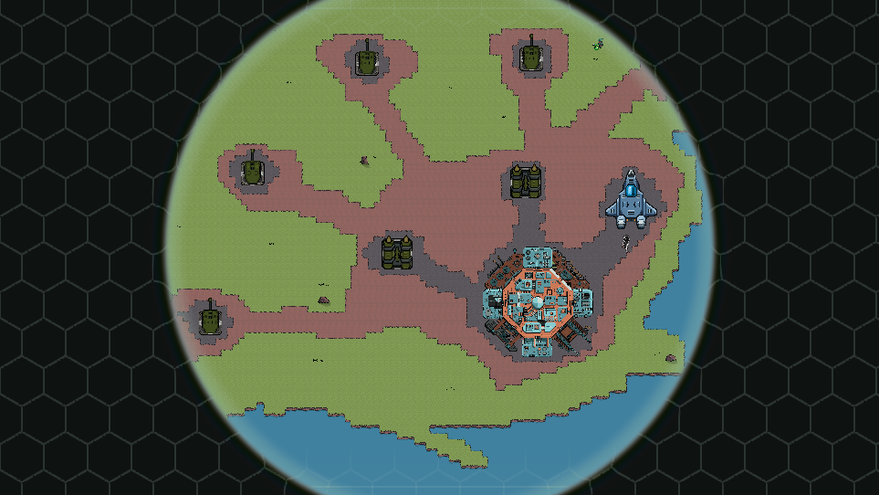
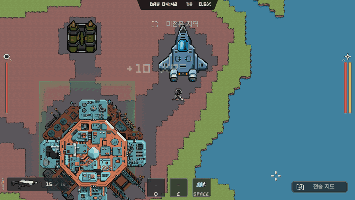

# 전술 지도 파동 공개·회수 — 2026-11-15

관련 PR: [#734](https://github.com/Team-HJD-21/unity-6-the-developer/pull/734)

상태: 로컬 구현·검수 완료. Core 통합 PR에 전달하며 이 기록 자체는 main 반영을 뜻하지 않는다.

## 바뀐 화면

기존 전환막은 육각선만 반투명하게 그려 셀 내부에 필드가 비쳤다. 지도 카메라가 전체 화면보다 작은 viewport를 사용하면 조작 UI와 함께 숨겨진 여백 패널 뒤로 이전 필드 프레임도 남을 수 있었다.

이번 사용자 요청에 따라 미공개 영역을 저채도 육각 표면으로 완전히 가린다. 지도는 화면 중앙 파동의 안쪽에서만 공개하고, 닫을 때는 같은 경계를 바깥에서 중앙으로 회수한다. 공개 완료 전에는 지도 UI와 기존 HUD를 표시하지 않는다. 유지 상태의 중앙 투명도와 가장자리 잔상은 보존한다. 새 설명 문구·인디케이터·생성 이미지·패키지는 추가하지 않았다.

GIF는 실제 렌더 캡처를 축소하고 사용자가 닫기 버튼을 누르기까지 기다린 시간만 줄인 검수 자료다. 아래 구현 시간은 게임의 기본값이다.

## 진입점과 실행 흐름

- `TacticalCommandController.Open` → `TacticalModeEffect.SetOpen(true)`: 첫 프레임에 Cover=1로 이전 필드를 차단하고, 그 아래에서 `CommitMapView`로 카메라를 교체한다. `CommitMapView`는 실제 `Frame.Viewport`를 `SetRevealViewport`에 전달한다.
- 0.06초 유지 뒤 지도 공개 반경을 중앙→외곽으로 키운다. `EnterSeconds` 0.42초 × `WaveTimeScale` 1.25 = 0.525초다. viewport 밖은 공개하지 않으며 완료 프레임의 여백 패널로 이어진다.
- `Close`는 `ExitSeconds` 0.30초 × 1.25 = 0.375초 동안 외곽→중앙으로 덮는다. 완전히 가린 뒤 카메라를 복구하고 0.06초 유지, 0.12초 표면 소거 후 필드 HUD와 입력을 복구한다.
- 파동과 소거에는 5차 SmoothStep을 두 번 적용한다. 이전 구현도 기본 5차 보간을 사용했으며 이번에는 초반·끝의 감속을 더 분명하게 했다. 단조 증가와 부동소수점 경계 안정성을 위해 중간 계산은 double을 사용한다.
- 닫는 도중 재열기는 현재 공개 반경에서 이어간다. 아직 지도가 공개되기 전의 닫기 취소는 불필요한 안쪽 파동을 생략한다. 외부 메뉴·사망·Scene 해제의 즉시 정리와 `HudPresentationVisibility` scope는 유지한다.

`ContentIsMap`은 실제 카메라 handoff 상태를 나타낸다. `IsOpen`은 입력 lease 수명이고 `IsMapPresented`는 완료한 지도 UI 상태이므로 서로 대체해서 사용하지 않는다.

## 변경 범위와 검증

우선 볼 파일은 `TacticalModeEffect.cs`와 `TacticalModeFrame.shader`다. 컨트롤러 변경은 실제 viewport 전달 한 줄이며 `.mat`는 새 표면 색/viewport 기본값만 추가한다. 기존 GUID와 참조를 유지했다. 이번 UI 작업에서 Scene·Prefab·폰트·프로젝트 설정·네트워크·저장 API는 편집하거나 저장하지 않았다. 공유 브랜치에 이미 있거나 다른 세션이 수정한 파일은 별도다.

- Unity 6000.3.23f1 DX11, 스크립트 컴파일 실패 없음.
- `TacticalPresentationTests` 10/10: 실제 GPU 셰이더 출력의 전면 불투명도, 중앙 공개, viewport 밖 차단, 유지 중앙 alpha=0 및 보간 단조성·끝점 검증.
- 실제 Stage_1 연동 검사 3/3: `FullMembraneHandsOffUiOnlyAfterTheCenterWaveAndCancelsWithoutLeakingInput`, `ClosingMapFillsFromTheRimBeforeReleasingCameraThenFadesTheMembrane`, `MapTransitionsHideAllHudLayersThenRestoreTheirExistingState`.
- 실제 OS 마우스로 지도 버튼과 닫기 버튼을 클릭했다. 정상 재생 98 렌더 프레임 중 전환 63프레임에서 스킬·체력·자물쇠·알림·XP·필드 상태·지도 조작 UI 노출 0. 중앙 파동 안의 지도와 바깥 차단 표면, 역방향 회수, 완료 후 복구를 캡처로 확인했다.
- 처음 두 추가 씬 검사 시도는 다른 Unity 실행이 기본 UDP 7777을 사용해 진입 전에 실패했다. 다른 프로세스를 멈추지 않고 검수 인스턴스의 메모리상 transport만 임시 빈 loopback 포트로 바꾼 후 두 검사 모두 통과했다. Scene/포트 설정은 저장하지 않았고 임시 Scene-open 구독도 해제했다.

검수 원본은 Git에서 제외되는 `Docs/Local/Validation/TacticalReveal20261115`의 테스트 JSON·`native-wave/samples.json`·PNG에 보존했다. 종료 상태는 Play=false, Startup dirty=false, 임시 피해 보호 컴포넌트 0이다. 새 빌드·원격 2인·모든 화면비 인수를 수행한 결과는 아니다. viewport letterbox 차단은 별도의 GPU 경계 검사로 확인했다.
