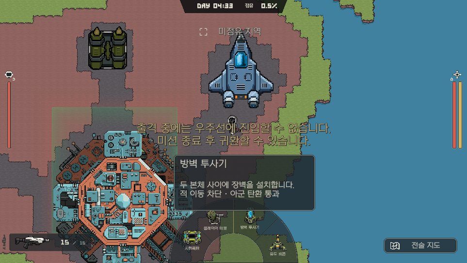
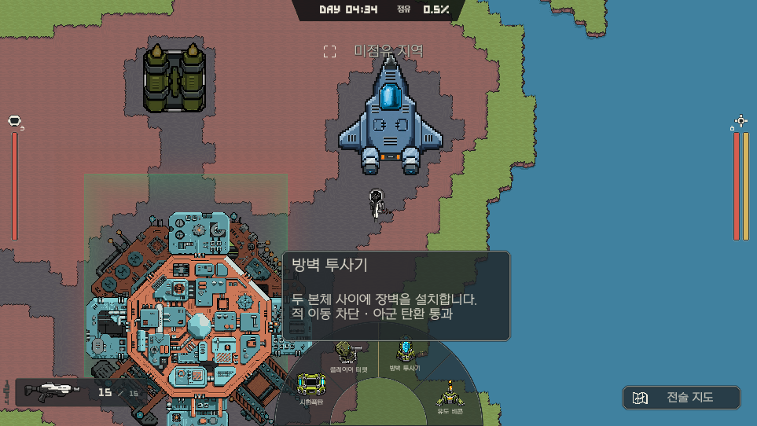
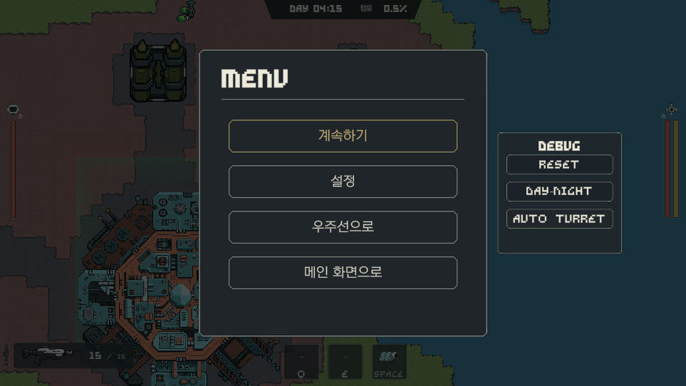
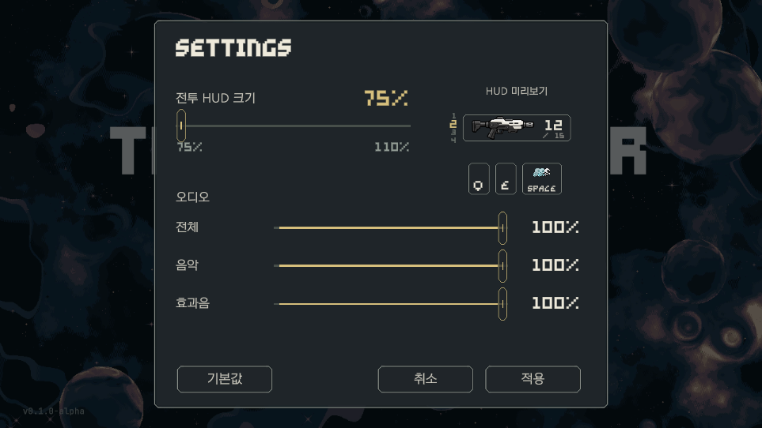

# UI 텍스트 가독성 폴리싱 — 2026-11-15

상태: UI 가독성 구현·검수 완료. 실제 병합 여부는 연결된 PR에서 확인한다.

PR: [#740](https://github.com/Team-HJD-21/unity-6-the-developer/pull/740)

## 확인하고 바꾼 부분

22개 UI 프리팹의 정적 문구와 실제로 들어오는 알림·스킬 설명·복귀 오류·패배 사유를 점검했다. 단순 overflow 플래그는 숨겨진 레거시 컴포넌트와 비활성 텍스트의 오래된 mesh 정보도 포함하므로, 실제 사용 경로·본문 크기 측정·렌더 화면을 대조해서 수정했다.

- 우주선 진입 제한 안내를 `출격 중에는 우주선에 진입할 수 없습니다.` / `미션 종료 후 귀환할 수 있습니다.` 두 줄로 정리했다. 진입 제한 정책과 Alert key는 유지한다.
- 공용 Alert는 기존 텍스트 전용 디자인을 유지하면서 밝은 의미색, 24–28pt 본문, 두 줄 높이76, 어두운 외곽선0.18과 얕은 그림자로 밝은 지면과 분리한다. 기존 스킬 위 위치와 겹침 회피, 비점유 입력, 2.2초 수명은 유지한다.
- 4:3 로딩 화면에서 고정 폭 Content 때문에 게임명이 화면 왼쪽에 걸리던 문제를 수정했다. Content의 가로 폭을 viewport에 맞추고 안내 패널·제목·진행 표시를 가운데에 맞췄다. 작은 조작 안내 본문과 키도 프레임 안에서 키웠다.
- 스킬 선택 설명의 NoWrap 때문에 방벽 설명이 카드 밖으로 나가던 문제를 수정했다. 프레임368×148·본문332×88로 조정하고 줄바꿈을 허용한다. 방벽 요약은 핵심 효과가 두 줄 안에 끝나도록 다듬었다. 상세 스킬 규칙은 바꾸지 않는다.
- TMP Modern Hangul 줄바꿈을 사용해 한글 단어를 우선 보존한다. 짧은 Q/E·SPACE·무기 번호는 줄바꿈하지 않으며, 키·숫자·무한 탄약 기호의 글자 영역도 확보했다.
- 메뉴·설정·결과·안전장치 패널에 화면 배율0.8 하한과 viewport24px 여백 맞춤을 적용했다. 큰 설정창은 높이가 부족하면 하한보다 축소해 전체 버튼을 남긴다. 전투 HUD의 사용자 크기 설정은 유지한다.
- 메뉴·결과·안전장치의 복귀 오류 텍스트를20pt·두 줄 높이로 조정했다. 공용 메뉴가 커졌을 때 우측 디버그 패널이 겹치는 문제도 실제 메뉴 경계를 따라 배치하도록 수정했다. 필드에서 메뉴가 없을 때 패널 검색을 반복하지 않는다.
- 스킬 선택 설명의 화면 배율 하한은0.8, 상세 스킬 설명·무기 이름은0.75다. 부모 HUD 배율까지 포함해 계산한다. 확대된 상세 툴팁과 무기 이름은 실제 카드 크기로 화면 밖 노출을 막는다. 무기 이름의 기존 Smoothstep 등장·퇴장과 교체 회전은 유지한다.

새 안내 패널·상시 설명·인디케이터·이미지·폰트·Manager·패키지는 추가하지 않았다. 기존 SDF 재질과 프리팹을 수정해 에디터에서 계속 편집할 수 있다. 다른 세션이 제작한 Scene·Core 저장/진입·전력·터렛 작업은 이 범위에서 편집하지 않았다. `SpaceshipTravelService` 수정은 위 안내 문자열 하나다.

## 실제 화면

아래 네 이미지는 정상 Play의 실제 Game View 캡처다. 원본 크기는963×542이며 메인→우주선→Stage_1 진입 경로와 별도의 Stage_1 재검수를 수행했다.

## 진입점·에셋 편집

우선 `AppPanelView.RefreshReadableScale`, `CombatHudScaleBinding.Apply`, `UiReadabilitySetup.Apply`를 본다. 공용 패널은 기존 App 화면 수명에 연결되고, 툴팁은 기존 HUD scale binding의 개별 Element 설정을 읽는다. 스킬/Alert 문구 → 실제 프리팹 TMP → 화면 배율·위치 보정 순서다. 새로운 입력·게임 상태 원본은 만들지 않았다.

명시 제작 메뉴는 `Tools/TeamHJD/The Developer/Common UI/Apply text readability`다. 확인된 텍스트 영역만 갱신하고 Scene·폰트를 저장하지 않는다. 기존 `CommonUiPrefabSetup`, `HudV6PrefabSetup`, `HudAmmoDockSetup`, `UiProductPolishSetup.ApplyLoading`에도 해당 제작값을 반영했다. 기존 GUID/fileID·오브젝트·참조를 보존했고, 저장 시 생긴 전체 프리팹 오브젝트 순서 변경과 공백 변경은 제거했다. TMP 설정도 한글 줄바꿈 항목만 변경했다.

## 검증과 경계

- Unity6000.3.23f1 DX11, UI 소스 컴파일 실패 없음.
- `UiReadabilityTests`6/6: 실제 스킬 요약·긴 상세 설명, 복귀 오류 두 줄과 버튼 간격, 800×600/1280×720/2560×1080의 실제 Canvas viewport 경계·로딩 배치 경계와 버튼 글자 크기, 부모 HUD 배율을 포함한 툴팁 하한.
- `CombatHudPresentationTests`4/4: 실제 반원 hover/장착·교환·취소·입력 잠금·알림 겹침, 숫자 탄창과 Cryo 무기 교체, 프리팹 raycast·중복 배경 회귀.
- `CommonAlertPresentationTests`3/3, `MissionUiPresentationTests`3/3, `CommonUiSettingsTests`6/6. 설정의 미리보기·취소·적용·기본값과 입력 lease 검증도 포함한다.
- 실제 OS 마우스로 메인의 설정 진입·취소와 게임 시작, 스킬 선택창·방벽 hover, 무기 이름 hover, 메뉴 복귀, 전술 지도·지도 설정·터렛 선택을 확인했다. 우주선 제한 알림은 실제 `SpaceshipEnter.EnterAsync` 경로로 요청했다. 키보드·긴 드래그의 새 하드웨어 인수를 뜻하지 않는다.
- 실제 우주선 제한 알림: 두 줄, alpha1, 잘림/overflow=false, 본문28pt×화면 배율0.8=22.4px. 확대 스킬 설명과 동시 표시해 사각형 겹침=false. 방벽 요약도 두 줄, 잘림/overflow=false다. 수정 메뉴와 디버그 패널도 실제 사각형 겹침=false다.
- 공용 메뉴·설정·결과·안전장치·Alert·로딩의24개 조합을 별도 Preview Scene/RenderTexture에서800×600,1280×720,1920×1080,2560×1080을 렌더했다. 실제 플레이와 독립 렌더 결과를 구분한다. 지원 화면비 전체·빌드·원격2인 인수는 수행하지 않았다.

HUD 회귀 검사와 최종 포함 파일은 ignored `Docs/Local/Validation/UiReadability20261115`의 테스트 JSON·preview-results·native 측정·handoff manifest에 보존한다. 기존 무기 글리프 검사는 Dynamic 폰트의 앞선 렌더 캐시에 의존하지 않고 실제 글리프 생성 가능성을 확인하도록 정리했다. 기존 폰트 디스크 변경과 staged cache8개는 그대로 보존했다. 새 제작·검수 스크립트의 `.meta`를 포함하며, 별도 커밋·푸시·PR은 Core 통합 담당이 진행한다.

## 통합 담당 추가 확인

인계 후 동일 제품 소스를 별도 QA 프로젝트의 원본 폰트 atlas로 검사했다. 가독성·공용 UI와 HUD 나머지 항목은21/22 통과했지만, batch640×480의 자동 hover 진입 검사1개는 timeout으로 남았다. 같은 hover 검사를 실제 일반 Editor에서 비동기 Test Runner로 다시 실행해1/1 통과했다(10.55초). 이 차이를 제품 입력 조건을 완화하거나 timeout을 늘려 숨기지 않았다. headless 실패의 정확한 내부 원인은 확정하지 않았으며 batch 전체22/22 통과로 보고하지 않는다. 별도 hover 실패 시 화면·Canvas·포인터·가시성·선택 상태를 표시하도록 검사 메시지만 보강했다.

실제 Editor 인수22/22와 네이티브 마우스 검수는 위 기록을 따른다. 통합 확인 후 Startup 편집 상태(Play=false, dirty=false)로 복귀했고, 폰트3개 diff와 기존 staged cache8개의 patch가 인계 전과 같음을 재확인했다. 원본 UI 자산34개만 게시하며 Scene·폰트 atlas·캐시를 포함하지 않는다.
