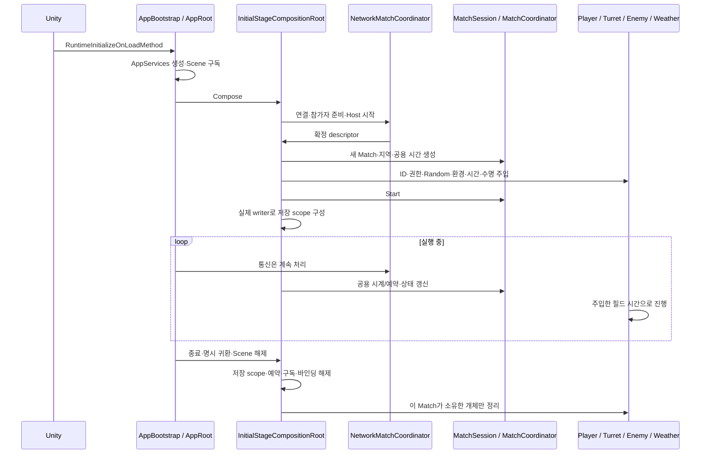
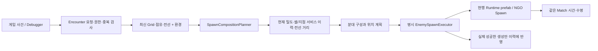
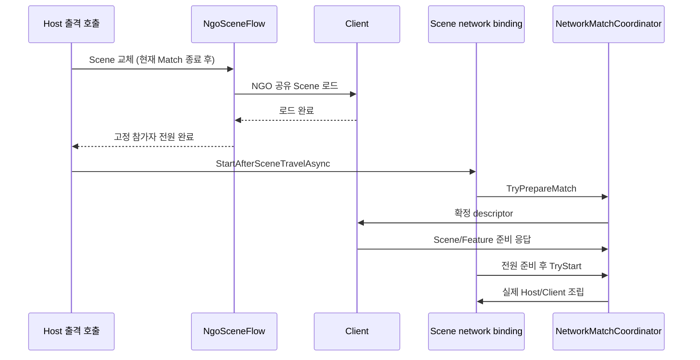

# Core와 실제 Feature 연결 안내

**현재 수동 확인·미구현·전달 기준:** [최종 로컬 안내](../../01_planning/02_implementation-records/2026/11/2026-11-05-core-local-review.md). 실제 낮밤·Steam SDK·Host 포털/페이드와 HUD는 후속 구현으로 들어왔다. 아래 계약/초기 검증 기록의 시점을 현재 미구현으로 오해하지 않는다.

> **최신 상태:** 누락 보완과 구조 정리, 검증·외부 의존은 [최종 정리](../../01_planning/02_implementation-records/2026/11/2026-11-05-core-completion-results.md)를 먼저 확인합니다. 실제 Weather writer/제품 Player 통합·PL 인수와 Core 자동 검증은 구분합니다.

기준: 2026-11-05, `main 1a03e9a91` 이후 `codex/core-feature-integration-20261105`. 이 문서는 해당 작업 브랜치의 실제 코드를 설명한다. 아직 PR·배포한 상태는 아니다. 이전 HOLD 기록은 당시 보관 기록으로 유지한다.

먼저 [읽는 순서와 수명](core-lifecycle-and-api-guide.md), [공용 시간](../02_match/match-time-api.md), [저장 실행](../05_checkpoints/checkpoint-execution-api.md)을 함께 본다. 자동 저장 사건·미정 승리 목표·보상은 이번 연결에서 정하지 않았다. Player 감속은 가장 강한 효과 하나를 적용하고 각 효과를 독립 만료한다.

## 무엇이 연결됐나

| 기능 | 실제 원본 | Core가 연결하는 부분 |
| --- | --- | --- |
| Player 이동·행동 | `PlayerControlState`, Movement, Skill, Weapon | 로컬 화면 입력 잠금과 생존 잠금을 분리. 필드 정지 중 우주선 이동은 허용하고 공격·회복·필드 스킬은 정지 |
| 터렛·CU | `FieldTurretController`, Base, 종류별 무기, `ControlUnitHealth` | Host 명령 검증·Match 수명·공용 시간·저장. 전력·과열·수리·자동 큐 규칙은 Feature 원본 유지 |
| 적·스폰 | `EnemySpawnExecutor`, `EnemyNetworkController`, `EncounterRuntime` | 현재 Match/생성기 소유권과 시간 주입, 최신 Grid·전선·환경·origin 전달, 종료 정리 |
| 날씨 전환 | `CountTick`, `WeatherManager` | 공용 예약과 환경 발행. **날씨 선택/Random 교체·예고 큐·Weather writer는 김진태 담당** |
| UI와 Scene | 기존 View/Asset, `ScreenManager`, `SceneFlowController` | 로컬 메뉴, 결과/로딩, App 게임 이동. Match 임시 정지와 Scene 교체를 구분 |
| 저장 | 각 Feature의 `.Checkpoint.cs` | 같은 프레임 캡처, binary IO, 준비→적용→참조 연결, 실패 복구, 필수 writer 누락 검사 |

`MatchState`의 기초 Player/CU 수치가 실제 Feature HP를 대체하지 않는다. HUD·피해·저장은 해당 Feature 원본을 읽는다. Player 사망은 [11/12 확정 배치](../../01_planning/02_implementation-records/2026/11/2026-11-12-core-progression-batch-plan.md)의 협동 구조·공용 예산·안전장치 정책을 따른다. 기존 상호작용 입력 3초/HP 30%와 팀 공용 60초는 승인한 시험값이다. Player 구조 성공 API와 실제 상태/입력/저장 연결은 아직 구현·통보·검증 대상이며 기존 코드가 이미 제공하는 기능으로 해석하지 않는다.

## 생성부터 종료까지



Core는 Feature의 전투 클래스를 상속하는 새 Manager를 만들지 않는다. Scene 조립부가 계약으로 연결하고 반환된 lease를 정리한다. `partial` 파일은 같은 실제 클래스에서 시간/저장 책임을 읽기 쉽게 나눈 것이며 별도 상태 원본이 아니다.

터렛 Factory 생성·저장 복원에서는 전달받은 Controller를 전력과 시간·발사체 소유자로 함께 연결한다. [초기화 순서와 #624 보완](../07_turrets/turret-owner-time-initialization.md)을 참고한다.

## 연결할 때 쓸 함수

### 시간과 생성 자식

기존 MonoBehaviour는 `FieldSimulationTime.CanAdvance(this)`, `Seconds(this)`, `DeltaTime(this)`, `FixedDeltaTime(this)`를 사용한다. Coroutine도 절대 마감 시각을 비교하며 진행한다. 새 자식에는 생성 직후 다음을 호출한다.

```csharp
FieldSimulationTime.BindSpawned(projectile.gameObject, this);
```

이 함수는 생성자에게 주입된 시계·종료 토큰을 상속하고 같은 Scene에 배치한다. NGO 개체의 파괴는 Host가 해야 하므로 `destroyOnCompletion: false`로 바인딩하고 원래 생성기가 Despawn한다. 전역 현재 Match 검색은 하지 않는다.

Player는 `PlayerMatchPresence`와 `PlayerControlState`가 시간/입력을 읽는다. CU/터렛의 Host 명령 경계와 Enemy의 서버 실행 검사는 유지한다. Unity `timeScale`과 Match 배속을 두 번 곱하지 않는다. [시간 API](../02_match/match-time-api.md).

### 날씨 담당 연결

`WeatherManager.Core.cs`가 `IMatchWeatherSource`와 예약 소비 계약을 제공한다. `CountTick.BindScheduler`는 Match가 소유하는 lease를 반환한다. 초기 날씨도 첫 Encounter 전에 환경 snapshot에 발행한다. Client는 전달된 표현 상태만 적용한다.

진태 writer는 `CountTick.CaptureTimerState()`로 간격·남은 시간을 보관하고, 실제 날씨/예고 큐 적용 뒤 `RestoreTimerState(...)`로 예약을 연결한다. Core 시간 복원은 과거 예약을 취소하므로 남은 시간을 다시 등록해야 한다. 날씨 전환 자체로 새 습격을 발행하지 않는다. 우선 **다음 계획의 조건**만 바꾼다.

환경 snapshot/복제에는 시간 `Epoch`가 포함된다. 같은 세대의 역행은 거부하고 복원으로 바뀐 세대는 수용한다. 환경 wire/channel은 **v2**이며 서로 같은 변경의 빌드가 필요하다.

### Encounter와 생성기

`Initial_Stage`의 `EncounterSceneConfiguration`이 현행 `EnemySpawnRoot.prefab` 인스턴스를 선택한다. 같은 Scene에 예전 Debug Spawner가 남아 있어도 발견 순서로 실행기를 고르지 않는다.

자동 첫 요청, Debugger, UI/Scene 요청은 같은 요청·계획·실행 경로를 사용한다. 자동 첫 요청 지연과 예약 요청은 **게임 시간**을 따른다. `TryScheduleOrigin(..., delayGameSeconds, out requestId)`는 지연 요청이며 생존 적 수와 구분한다. 실행 전 최신 snapshot/환경을 다시 읽는다.



명시 지점, WorldPoint/WorldArea, 등록한 동적 source의 창구가 있다. 현재 실제 전달 방식은 `Immediate`다. `GroundEmergence`/`AirDrop` 연출 어댑터가 없으면 명확히 거부한다. 나무 등 source 개체의 고유 저장·복원/등록 세대 재연결이 없는 상태에서는 **해당 source의 예약을 전체 저장으로 성공 처리하지 않는다**.

## 터렛 검증 경계는 어디인가

HUD의 ON/OFF·CU 자동 활성화·승급/강등·강화/강등은 `ITurretCommandRequester → TurretCommandGateway → TurretCommandService → TurretInteractionAuthorization → TurretFeatureCommandExecutor`를 지난다. Host가 참가자·현재 Match·실제 actor 위치/거리·대상 상태를 확인하고 D 원본을 호출한다. Client의 로컬 터렛 상태를 결과로 사용하지 않는다.

렌치 수리와 전투 피해는 HUD의 관리 명령과 다른 **실제 무기 실행**이다. 렌치는 Host로 바인딩된 Player의 같은 Match/Scene·필드 진행·방향/거리/장애물을 확인한 뒤 D의 실제 Repair API를 호출한다. 수리량을 Client payload에서 받는 새 창구를 만들지 않았다. Enemy HP도 실제 NGO Client의 직접 피해 변경을 거부한다. 원격 Player 공격/수리 입력을 Host에서 실행시키는 전체 NetworkBehaviour는 Player 담당 후속이다.

## 실제 저장 범위

| section | writer와 저장 내용 |
| --- | --- |
| `core/random` | 이름별 공용 난수 진행 |
| `world/spatial` | Grid·지역 모드·정적 정의·점유 셀. actor 적용 뒤 topology 재계산 |
| `world/control-unit` | 실제 CU HP·배치. 고정 논리 ID `world/control-unit`을 초기화 시 연결 |
| `world/field-turrets` | 공용 예산/반환 대기·자동 큐, 개체 ID/정의·강화/HP/잠금/ON·냉각/열·타깃·소유 탄환/미사일 |
| `world/enemies` | 적 콘텐츠/논리 ID·HP·물리·분대/목표·경로/능력 대기·폭발 진행·소유 탄환. writer v2는 원거리 발사 전/후·완료 대기와 정지 중 지연 이벤트도 저장 |
| `world/encounter` | 첫 요청의 남은 시간, 지원 origin의 예약, 실제 분산 이력 |
| `world/player/{slot}/actor` | HP·생존/회복·배치·물리·출입 위치·Dash 진행 |
| `world/player/{slot}/weapon` | 무기/재사용 대기·렌치 진행·소유 탄환 |
| `world/player/{slot}/movement-effects` | 각 감속 배율·남은 게임 초. 일반 이동/Dash의 최종 배율, 독립 만료 |
| `world/player/{slot}/loadout` | 스킬·충전/재사용·배치 중 의도·실제 소유 장치/Player 터렛 |
| `world/weather` | **미등록. 김진태가 실제 날씨·예고 큐·다음 전환 writer 제공** |

전체 Feature actor를 먼저 적용한 뒤 논리 ID로 표적·미사일 claim을 연결한다. 승급 전에 발사된 탄환도 발사 당시 정의와 같은 터렛 ID로 추적한다. 교체되어 비활성화된 이전 개체는 참조 검색에서 제외한다. 과거 `NetworkObjectId`, Unity InstanceId, Coroutine/delegate는 저장하지 않는다.

전투 중 Animator transition, 폭발 피해 직후 아직 발동 클립에 진입하지 않은 프레임은 일관된 캡처가 아니므로 요청을 거부한다. 잠시 뒤 명시 재요청할 수 있다. 표현용 일회성 SFX/파티클과 Debugger 관측 기록은 게임 상태 복원으로 재생하지 않는다. 중복 방지 장부/진단 sequence는 같은 실행에서 뒤로 돌리지 않는다.

현재 `Initial_Stage`의 전체 저장은 Weather writer 누락 때문에 차단된다. 이 상태를 없애려고 가짜 운영 writer를 넣지 않았다. 재화·경험치의 기본 보존 정책은 실행 API에 있지만 아직 제품 경제 원본/Backend 연결은 없다.

### 호출 예

```csharp
// 현재 Host Match의 명시 저장/되감기. scope는 Scene이 소유한다.
CheckpointOperationResult saved = await scene.Checkpoints.SaveAsync(new CheckpointSlot("manual"));
CheckpointOperationResult restored = await scene.Checkpoints.RestoreAsync(new CheckpointSlot("manual"));
// 재실행/허브에서 새 Mission을 구성하고 복원. 현재는 1인 Story만 지원한다.
CheckpointOperationResult resumed = await app.ResumeCheckpointAsync(
    new CheckpointSlot("manual"), "Assets/Scenes/Gameplay/Initial_Stage.unity");
```

결과의 `Status`, `Reason`, `IsCurrentScope`를 확인한다. writer는 현재 Scene의 `ICheckpointParticipant`로 자동 수집하거나 `scene.RegisterCheckpointParticipant(writer)`로 등록하고 반환 lease를 생성자 수명에서 해제한다. 관찰자는 `scene.CheckpointRequests`로 요청을 발행할 수 있다. **어떤 사건이 저장을 요청하는지는 아직 지정하지 않았다.**

`ResumeCheckpointAsync`는 슬롯→메타데이터→새 Match 입력→Scene 조립→실제 writer 복원 순서다. 현재 제작 Stage/난이도/콘텐츠 버전과 참가자 수가 맞아야 한다. 2인 재접속과 프로필/경제 Backend는 별도다. Mission 복원 실패는 GameFlow의 입장 성공으로 표시하지 않는다.

## 수동으로 볼 순서

[최신7단계 수동 확인](../../01_planning/02_implementation-records/2026/11/2026-11-05-core-local-review.md)을 따른다. Startup의 실제 문 출격/왕복과 Initial_Stage의 날씨 HUD·기존 Feature 조작감을 나눴다. 사람이 보는 연출·제작 데이터와 자동 기능 검증을 구분하며, 운영 Save와 원격 Player처럼 구현이 없는 항목을 수동 테스트만 남았다고 넘기지 않는다.

## 검증과 한계

격리 Unity 6000.3.23f1에서 실제 시작→우주선→Mission→귀환, 적 10개 자동 생성/전선, 출입 기반 필드 정지·재개, 필수 writer 누락 거절을 확인했다. 터렛 전력·수리·초기화 기존 PlayMode 85개가 통과했다.

Core 담당 writer는 검증용 외부 Weather 대역을 사용한 실제 Scene 검사로 적의 ID/HP/위치, 비행 탄환·미사일, 예약을 저장한 뒤 두 번 복원했다. **이 성공은 실제 날씨 큐나 전체 제품 Save 완료 증거가 아니다.** 검증 소스/로그는 Git 제외 `Docs/Local/Work/CoreIntegration-20261105/validation`에 보관한다.

기존 전체 회귀는 모두 통과한 상태가 아니다. main 원본에서도 재현된 Enemy prefab 경로/기대값 및 Player 테스트 기대·대기 문제를 별도 기록했다. 이번 Feature 통합의 새 실패와 섞지 않았다. 후속 UTP2인 실제 빌드와 Host 포털 연결은 완료했다. 최종 HUD 시각, 실제2계정 Steam 접속, Client 포털/미션 콘솔, 실제 Weather writer·제품 경제/Backend·미정 승패/보상은 각각 별도 확인/담당 구현이다.

## 추가 보강된 실제 경로

- `PlayerSlowEffects.ApplySlow(multiplier, duration)`: Enemy `ISlowEffectReceiver`의 Player 수신부다. 가장 강한 감속을 최종 이동에 한 번 적용한다. `Changed(multiplier, count)`는 HUD/효과 View의 선택적 구독 경계이며 구독자가 표시를 소유한다. 필드 정지 동안 만료 시각은 흐르지 않는다. 강한 효과가 끝나면 아직 살아 있는 약한 효과가 이어진다.
- 원거리 Animation Event는 서버·활성·현재 시계 경계를 확인한다. 정지 중 도착한 발사/종료는 저장 가능한 지연 상태로 남고 재개 시 한 번 처리한다. 발사 상태를 담지 않은 과거 v1 Enemy 저장을 event-timed prefab에 적용하는 것은 거절한다. 구형 개발 슬롯은 현재 writer로 다시 저장해야 한다.
- `AppRoot.ResumeCheckpointAsync(slot, missionScene)`는 실제 binary를 읽고 **새 Match ID**에 저장된 stage/seed/content를 적용한다. 일관된 writer 준비 뒤 월드를 복원한다. Scene 입장 실패·취소 시 해당 복원 작업이 만든 Match만 해제한다. 비동기 Scene/Match 조립 오류도 입장 대기자에게 바로 전달한다.
- `GameFlow.LaunchMissionAsync`는 Host의 명시 출격이다. `NgoSceneFlow`가 고정 1~2인 전체의 Scene 로드를 기다린 다음 `InitialStageNetworkBinding.StartAfterSceneTravelAsync`가 전원 Feature 준비 응답을 기다려 시작한다. Client는 독립 출격/로컬 권위 Match를 만들지 않고 실제 수신·조립된 Scene/Match를 App 흐름에 반영한다.
- 2인 실행 파일 검증은 세 개의 서로 다른 협동 Match, 공유 우주선 귀환2회, Client 시계·환경 세대 교체, 마지막 적 정리를 확인했다. Player 이동/공격 NetworkBehaviour·Host의 실제 원격 actor 생성은 여전히 Player 담당이다. 등록 전 원격 명령/저장에 필요한 실제 권위 actor가 생겼다고 가정하지 않는다.



공유 로드 중 참가자 집합 변경·미완료·timeout은 성공이 아니다. Single Scene 교체를 이미 시작한 뒤의 취소는 이전 Scene으로 되감지 않으며 실패 위치에서 명시 귀환할 수 있다. 자동 저장 사건·SOS·도중 참가·Host Migration·Steam 실제 transport/Backend는 추가 구현했다고 표시하지 않는다. SDK/로비는 후속에서 구현·확인했다.
