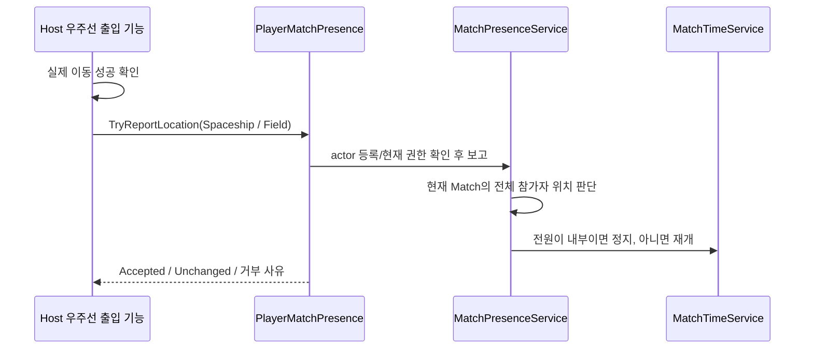

# 우주선 출입 보고 API — Core 정지 연결

기준: 2026-11-05. SpaceshipEnter/Exit 등 진태 소스는 수정하지 않았다. 기존 Core 위치 등록/시간 판정을 유지하며 Feature용 보고 계약과 거부 결과를 추가했다.

## 진태가 호출할 부분

실제 Player 이동이 성공한 **Host 코드**에서 해당 actor의 `PlayerMatchPresence`를 찾아 `TryReportLocation`을 호출한다. 입장 요청이나 Scene 로드 시작 시점에는 보고하지 않는다. 이동 실패면 위치도 갱신하지 않는다.

```csharp
using TeamHJD.Game.Contracts;
using TeamHJD.Game.Domain;
using TeamHJD.Game.Presentation.Scene;

// Host가 실제 이동을 완료한 직후. 아래 코드는 연결 예제이며 팀원 파일에 아직 적용하지 않았다.
var reporter = player.GetComponentInParent<PlayerMatchPresence>();
if (reporter == null)
{
    // Core의 해당 Player actor 등록이 먼저 필요함. 임의로 컴포넌트만 생성하지 않는다.
    return;
}

IPlayerMatchPresenceReporter api = reporter;
MatchPresenceReportStatus result = api.TryReportLocation(MatchPlayerLocation.Spaceship);
// 필드로 이동을 마쳤을 때는 MatchPlayerLocation.Field

if (result != MatchPresenceReportStatus.Accepted &&
    result != MatchPresenceReportStatus.Unchanged)
{
    // result와 api.MatchId / api.PlayerId를 함께 남겨 등록·권한·종료 여부를 확인.
}
```

이 API는 **어느 플레이어가 어디에 도착했는지 보고하는 창구**다. Feature가 전체 정지 여부를 계산하거나 `Time.timeScale = 0/1`을 쓰지 않는다. 우주선 내부 Player와 UI는 동작하고 필드 시계/소비자가 정지하는 기존 구조를 사용한다.

| 결과 | 의미 / 확인할 것 |
| --- | --- |
| Accepted | 위치가 변경되어 접수됨. 이 결과 하나로 전체 필드 정지를 뜻하지는 않음 |
| Unchanged | 같은 위치의 중복 보고. 접수 성공이며 revision/정지 전환을 중복 발생시키지 않음 |
| Unavailable | actor 미등록·lease 해제·Match 종료/게임플레이 취소. 이전 actor로 재보고하지 않음 |
| NotAuthority | Client actor 또는 Host 권한 상실. Time.timeScale을 바꿔 우회하지 않음 |
| InvalidLocation | 정의되지 않은 enum 값 |

`CanReport`는 호출 가능 여부를 미리 확인하는 값이고 최종 결과는 반환 status를 사용한다. 기존 `Report(location)` 예외형 API도 호환 유지하지만 새 연결은 위 status형을 권장한다.

## 정지 정책과 흐름



- 1인: 우주선 안이면 필드 정지, 밖이면 진행.
- SOS/2인: 두 명 모두 내부일 때만 정지. 한 명이라도 필드에 있으면 진행.
- 미등록 참가자는 필드에 있는 것으로 취급한다. 등록 누락으로 게임이 잘못 멈추지 않는다.
- 개인 메뉴를 여는 것과 플레이어 출입 보고는 별개다.
- Core 시계의 다른 정지 lease(저장/복원 등)가 있다면 출입에 따른 재개가 그 lease를 해제하지 않는다.
- 위치가 변경되면 기존 `MatchTimeSceneReplication`이 Host 시간/확정 위치를 Client에 복제한다. 통신과 허브 이동을 Unity 전역 timeScale로 중단시키지 않는다.

## Core/Player 생성부가 먼저 할 것

네트워크 Player 생성부는 Host의 실제 actor를 생성한 후 기존 API로 등록하고 반환 lease를 actor 교체/despawn/Match 종료에 Dispose한다.

```csharp
IDisposable registration =
    networkBinding.RegisterAuthorityPlayerActor(matchId, playerId, actualHostActor);
// actor가 사라지거나 교체될 때 registration.Dispose();
```

이 등록은 터렛 명령용 실제 Player 위치와 출입 보고권을 함께 연결한다. 로컬 단독 Scene의 최초 Player는 `InitialStageCompositionRoot`가 연결한다. 별도 Host actor 등록이 필요하면 `RegisterAuthorityPresence(playerId, actor)`로 위치 등록 lease만 받을 수도 있다. 같은 Player를 이중 등록하면 거부한다.

**Client 로컬 Trigger에서 위 보고 함수를 호출하는 것만으로 서버에 전달되지는 않는다.** 새 API는 RPC가 아니다. Client 이동은 Player/포털의 기존 네트워크 요청 경로로 Host가 실제 이동을 검증·완료한 뒤, Host의 해당 actor에 보고해야 한다. 현재 Player NetworkBehaviour/포털 RPC는 이번 Core API 배치에서 추가하거나 수정하지 않았다. 이 경로가 없는 동안에는 Host 출입부터 연결·확인한다.

`PlayerMatchPresence` 컴포넌트를 임의 AddComponent하는 것만으로 권한이 생기지 않는다. 명시적인 actor 등록이 필요하며, Client 읽기 바인딩은 보고권을 주지 않는다.

## 수명과 임시 방문

`SpaceshipEnter` / `SpaceshipExit`는 실제 이동/문 연출을 소유하고 Core는 참가자 위치·정지 판단·Scene 수명을 소유한다. 한 명이 나갔어도 다른 참가자가 허브에 있으면 공용 Hub Scene을 바로 내리지 않는다.

`GameFlowController.ReturnToSpaceshipAsync()`는 Match를 종료하는 정식 귀환이다. 전투 중 임시 우주선 방문에 사용하지 않는다. 임시 방문은 현재 Match를 유지하고 위 출입 보고 API에 연결한다.

## 구현·검증 범위

공개 계약: `IPlayerMatchPresenceReporter`, 결과: `MatchPresenceReportStatus`, Unity 진입점: `PlayerMatchPresence.TryReportLocation`.

삭제 전 검수 커밋 `e87bdf91`에서 실제 GameObject의 보고 컴포넌트와 Core 시계를 연결해 2인 정지/재개, 중복 revision 방지, Client·권한 상실·종료 취소·잘못된 값의 거부, 전역 Time.timeScale 비변경을 확인했다. 기존 1/2인 위치 서비스 검사도 함께 실행했다. 이후 PL 요청으로 이번 API의 임시 테스트 소스는 최종 PR에서 제외했으며 기존 프로젝트 검사는 유지했다. 실제 authored 포털 이동·원격 Player 생성/RPC 연결 인수는 진태/Player가 위 호출을 붙인 후 진행한다.
