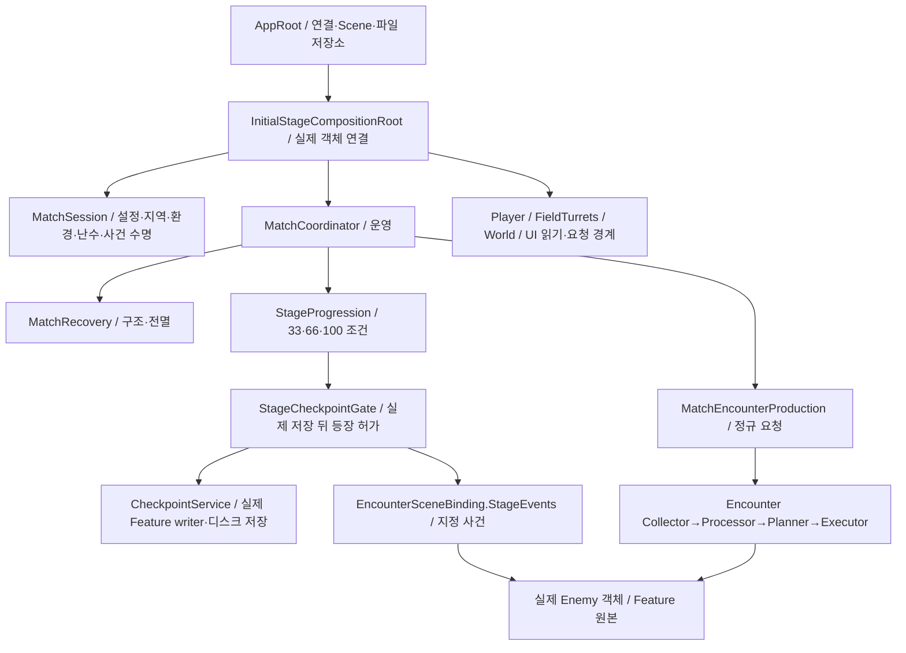

# Core 실행 지도

이 문서는 현재 `Stage_1` 연결을 읽는 순서다. 게임 전체가 완성됐다는 뜻은 아니다. 아래의 보스·Weather·실제 원격 Player 연결 제한도 함께 확인한다.

## 먼저 볼 코드

| 순서 | 클래스/함수 | 확인할 내용 |
| --- | --- | --- |
|1|`AppBootstrap.CreateAppRoot` → `AppRoot.Initialize`|Unity `BeforeSceneLoad`가 App을 한 번 생성한다. Scene의 Awake보다 먼저이며, Scene 객체가 직접 호출하지 않는다.|
|2|`GameFlowController` → `AppGameFlowHost`|Startup/시작화면→우주선→Mission을 조율한다. Scene 파일 로드와 실제 Match 준비는 별도 장벽이다.|
|3|`InitialStageNetworkBinding.TryPrepareMatch`/시작 경로|Host가 실제 접속자·Stage/Grid·준비 세대를 확정한다. 접속만으로 임의 두 번째 Match를 만들지 않는다.|
|4|`InitialStageCompositionRoot.ComposeAuthority`|실제 CU/터렛·PlayerStart·환경·Enemy 참조를 검사하고 아래 Application 객체를 순서대로 연결한다.|
|5|`MatchSession`/`MatchCoordinator`|Session은 판의 수명/자료를, Coordinator는 운영을 맡는다. 두 개의 GameManager를 두는 구조가 아니다.|
|6|`InitialStageCompositionRoot.Update`|시각/예약→성장 저장→CU 패배→구조 실패→Stage 사건 저장→Stage 진행→위치·점유 표본을 진행한다. 복원 중에는 일반 표본을 멈춘다.|
|7|`AppRoot.RetryPendingMissionRecoveryAsync` / `AppScreenPresenter`|기술 실패 메뉴에서 같은 복귀를 재시도한다. App이 Scene 수명을 골라 연결하며 실제 허브 귀환 성공 후 오류 표시를 닫는다.|
|8|`Root.Update` → `PumpFinalBattleScene` → `FinalBossTransition` → `IFinalBattleSceneDriver`|100%에서 Core가 저장·같은 Match의 Scene 로드·도착/보스 검사·실패 원복을 조율한다. 기본 FinalBattleSceneDriver/Enemy 어댑터 구현은 있으며 실제 Boss Scene/콘텐츠 설정은 남았다.|

`AppRoot`는 App 서비스와 Scene 교체를 소유한다. `InitialStageCompositionRoot`는 해당 Scene의 실제 객체를 연결하고 해제한다. 실제 공격/이동/HP를 이 두 클래스 안에 복제하지 않는다.

## 어떤 데이터가 진짜인가

| 필요한 정보 | 읽을 원본 |
| --- | --- |
|참가자/슬롯/시작 설정|`MatchConfig.Players`와 NGO descriptor. HP 목록이 아니다.|
|현재 Match 단계·확정 결과|`MatchState`, 시점 복사본은 `MatchSnapshot`. 세부 전투 상태는 들어 있지 않다.|
|Player HP/위치/성장|실제 Player Feature와 등록된 읽기 port. Core가 초기400 같은 값을 별도 현재 HP로 갖지 않는다.|
|CU HP/전력/터렛 상태|`ControlUnitHealth`/`FieldTurretController`와 Host 확정 표시 frame.|
|Enemy 위치·생명·생성|공통 Executor가 추적하는 실제 actor와 실제 HP 사건.|
|해금·점유|`RegionRuntime`의 `RegionGridSnapshot`. 정적 해금은 곧 점유가 아니다.|
|전선·밀도·공간 조회|`BattlefieldSpatialSnapshot`. 실제 입력에서 만든 읽기 자료이며 점유 원본을 대체하지 않는다.|
|공용/Field 시간|`MatchTimeService.Clock` / `FieldClock`. Client도 두 anchor를 분리한다.|
|전체 월드 복귀|`CheckpointService`와 각 Feature writer. `MatchSnapshot`을 저장하는 기능이 아니다.|
|유지할 성장/안전장치|`GrowthSaveService`와 별도 Host recovery 슬롯. 월드 rollback으로 되감지 않는다.|

초기에 만들었던 `PlayerState/ControlUnitState/WaveState/TurretState/EnemyState/SectorState`의 고정/빈 자료와 실제 Feature 원본을 이중으로 들고 있지 않는다. 발행·소비가 없는 과거 전투/Wave 사건 타입도 제거했다. 참가자를 만들 때도 State의 별도 목록 대신 Config를 읽는다.

## 기능별 연결 문서

- [일반 생산과 추가 출현](../08_encounter/encounter-production-api.md): Coordinator가 요청하고 실제 생성은 Executor가 한다.
- [정적 확보·스폰 차단](../02_match/static-region-capture.md): CU1셀·전투 성과/유지·확보/상실과 Region 그룹 제한.
- [개인/Host 성장 저장](growth-save-api.md), [구조·안전장치](../02_match/match-recovery-api.md): 저장 종류·실패/재시도 구분.
- [Stage 진행과 보스 접점](../02_match/stage-progression-api.md): 생성 확인과 실제 사망만 진행 사실로 사용한다.
- [시간](../02_match/match-time-api.md), [NGO 연결](../04_networking/network-match-api.md): Host 권위·같은 Build/프로토콜1.
- [출격/허브 귀환](../03_scene-flow/spaceship-travel-api.md): 전투 중 내부 자유 출입은 없다.

## 아직 실제 연결을 완료하지 못한 부분

- 실제 `world/weather` writer가 없어 전체 월드 저장/복원은 실행을 거부한다. 일부 writer만 성공한 것을 전체 성공으로 바꾸지 않는다.
- Field 실제 생성 서비스는 기존 Encounter 연결부/Executor에 구현했다.33/66% 확정 EnemyDefinition·점유 밖 보장 진입 위치 지정과 최종 Boss Scene/컷씬/실제 보스 등록이 필요하다. 공통 생성기의 실제 HP 사망은 Stage로 전달한다. 임시 Slime 제작값으로 검수한 생성·복원 메커니즘을 실제 보스전 완성으로 세지 않는다.
- 최종 Scene의 자동 조율·실패 참가자 원복은 Core에 연결했다. `FinalBattleSceneDriver`와 `FinalBattleBossSource`가 실제 도착/공통 Enemy 생성/선택적 연출 정리를 구현한다. 실제 제작값 연결·Boss Scene 성공/원격 Player 인수는 남았으며 코드 존재만으로 완료로 세지 않는다. 다른 Scene으로 이동한 Player는 옛 Field 밀도에 넣지 않는다.
- 실제 원격 Player NetworkBehaviour/생명·구조 입력, 원격 추가 출현 예고는 아직 전체 인수되지 않았다. localhost SDK2개 전송 검수와 실제 두 게임 실행은 다르다.
- 개인 저장은 현재 논리 PlayerId를 사용한다. 실제 Steam/Backend 계정에 귀속하는 인증·영속 ID 계약이 완성된 것으로 해석하지 않는다. 현재 스킬 트리 UI는 해금/강화 원본 자체를 만들지 않으며 실제 재화/스킬 강화 저장 writer도 별도 필요하다.

실행 근거와 실패 기록은 [11/13–14 통합 기록](../../01_planning/02_implementation-records/2026/11/2026-11-13-encounter-stage1-integration.md)에 있다. 공유 작업 트리의 실제 검수이며 별도 두 Build의 완성 인수와 구분한다.
