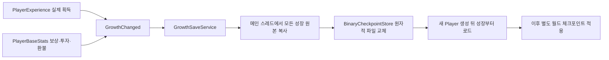

# 개인 성장 저장

월드 체크포인트로 과거 전투에 돌아가도 최신 경험치·성장은 남긴다. 현재 실제 원본은 `PlayerExperience`, `PlayerBaseStats`, Host 전장의 `FieldTurretController` 성장 writer다. 실제 스킬 강화·재화 소비 원본이 없는 기능을 저장 완료로 표시하지 않는다.

## 호출하는 쪽

- 게임/기존 HUD는 `AddExperience`, `TryClaimReward`, `TryInvest` 같은 기존 Feature API를 그대로 사용한다. UI에서 저장 함수를 중복 호출하지 않는다.
- `IGrowthCheckpointParticipant`는 실제 성장 원본이 구현한다. `PersistenceKey`는 `experience`, `base-stats`처럼 슬롯과 무관한 원본 이름이다. 원본 적용이 끝난 뒤 `GrowthChanged`를 보낸다.
- `InitialStageCompositionRoot.BindGrowthSaves`는 생성된 Player의 실제 writer를 개인별로 묶는다. `player/<논리 PlayerId>`를 해시한 `growth-…` 슬롯을 사용하며 매 Match ID나 roster 순서를 파일 귀속으로 사용하지 않는다. section payload의 논리 Player ID 검증은 유지한다.
- `PumpGrowthSaves`는 unscaled 절대 시각을 넘긴다. XP는 기본2초간 합쳐 캡처하고, 레벨업·보상 수령·스탯 변경은 모든 개인 원본을 즉시 한 묶음으로 캡처한다. 파일 쓰기는 불변 자료만 순서대로 처리하므로 늦은 옛 쓰기가 최신 값을 덮지 않는다.
- `FlushGrowthSaves()`는 정상 종료/월드 복귀 전에 대기 쓰기의 성공 또는 실패를 확인한다. Match 정리와 체크포인트 복원 시작에서도 호출한다. 강제 종료에는 마지막 성공한 파일만 보장하며 아직 합치던 XP는 유실될 수 있다.

저장 파일은 기존 `Application.persistentDataPath/Checkpoints` 아래의 독립 `growth-…checkpoint`다. 전체 월드 슬롯이나 `world/weather`의 준비 여부와 무관하게 개인 성장은 저장한다. 개인 저장을 전체 월드 저장으로 불러오지 않는다.

## 로드와 실패

조립부는 실제 Player identity/Feature 바인딩 뒤, 월드 복원 전에 성장 파일을 읽는다. 기본 파일 저장소는 작업 스레드에서만 IO하고 로딩 구간에서 완료를 기다린다. 이 저장소에 Unity 문맥으로 복귀해야 끝나는 IO 구현을 대입하면 안 된다. Backend로 옮길 때는 준비 단계의 비동기 로드 계약도 함께 바꿔야 한다.

모든 writer가 Prepare를 통과한 뒤 적용하고 실패 시 원복한다. 손상·원본 구성 변경·다른 Player·설정 불일치는 명시 오류이며 기본값으로 기존 파일을 덮지 않는다. 새 기능/저장 schema가 바뀌면 명시 이관이 필요하다. 디스크 오류는 `LastError`, `IssuedRevision/SavedRevision`, `HasPendingChanges`로 관측하고 실제 실패를 저장 성공으로 보고하지 않는다.

현재 네트워크 원격 Player 성장/Backend 인증 저장은 별도 통합 범위다. 실제 검수에서는 Stage_1에서 XP100/레벨2·보상수령·공격1 투자를 저장한 뒤 Play 완전 종료→새 actor 생성에서 동일값을 확인했다. QA 저장 파일은 원본을 보존하고 시험 후 원상복구했다.

## Host 공용 전장 성장과 월드 복귀

`FieldTurretController.CreateGrowthParticipant()`는 실제 터렛의 논리 ID별 제작 Definition(승급 레벨), 강화 종류/단계·DamageBonus, CU 전력 용량을 한 원본으로 캡처한다. 실제 강화/승급·용량 변경 사건만 즉시 저장한다. 일반 피해·냉각·ON/OFF는 성장 쓰기를 발생시키지 않는다.

성장 로드는 현재 전투 상태를 보존해 실제 터렛을 재구성한다. 이때 Cannon/Missile도 일반 실행과 같은 과열 표현을 사용하고, 식은 OFF 포신은 기존 회색으로 복원한다. 색상이 실제 해금/가동 상태의 원본은 아니므로 호출부는 `IsLocked`/`IsActivated`를 읽는다. 별도의 잠금 색상이나 새로운 Shader 정책은 추가하지 않았다.

공용 파일 귀속은 `field/<Host PlayerId>/<CampaignSlot>/<StageId>`다. `AppRoot.CampaignSlot`의 기본은 `campaign-1`이고 시작/허브 흐름이 Mission 입장 전 `SelectCampaign(new CheckpointSlot("campaign-2"))`로 다른 캠페인을 고를 수 있다. 활성 Match 중 변경은 거절하며 기존 파일을 삭제하지 않는다. 개인 성장 파일은 이 캠페인 선택과 별개다.

`world/campaign`은 월드가 참조하는 캠페인 ID다. 이어하기의 `ConfigureCheckpointArrival`가 이를 먼저 읽고 최신 공용 성장→새 actor→월드 순서로 조립한다. ID가 없는 옛 전체 월드 파일은 명시 이관이 필요하다고 반환하며 현재 파일을 임의 삭제하거나 다른 성장 파일을 붙이지 않는다.

기존 `FieldTurretController.Persistence.PrepareRestore`는 과거 전투 section을 검증한 뒤 최신 성장과 합친 계획을 만든다. 실제 actor·무기 상태 적용은 기존 Defense factory/writer를 재사용한다.

- 위치·HP 비율·파괴·냉각/탄환·자동 큐는 과거 월드 상태다. 최신 Definition/강화·CU 용량은 유지한다. Player/CU도 현재 최대 HP에 과거 HP 비율을 적용하며 사망/파괴를 회복으로 바꾸지 않는다.
- 최신 비용으로 과거 ON을 복원한다. 현재 정상 ON 대상에 먼저 자리를 보장하고, 나머지는 기존 CU 후보 순서와 안정된 논리 ID 순서로 검증한다. 가용 전력에 맞지 않는 대상은 OFF로 복원하고 `GrowthRestoreWarnings`에 사유를 남긴다. 복원 후 기존 Alert로 알리며 강제 전력 초과·강화 명령 재실행·비용 환급은 하지 않는다.
- 강화는 기존 **OFF + 냉각 완료** 조건을 유지한다. 저장 도입으로 전투 중 강화 조건을 바꾸지 않는다.
- 제작 터렛 ID 집합/콘텐츠가 달라지면 명시 이관을 요구한다. 런타임 InstanceId를 영속 키로 사용하지 않는다.

Game Debugger Overview→CHECKPOINT의 ‘개인 / Host 성장 저장’에서 실제 원본 키·요청/디스크 완료 revision·대기/실패를 확인한다. 성장 저장은 성공했어도 필수 Weather writer가 없으면 전체 월드 저장 버튼은 계속 차단된다.

실제 검수: 비용15 터렛을 강화해17로 만든 뒤 CU 용량15에서 과거 ON 월드를 적용했다. 정상 가동15 터렛은 유지, 강화 대상만 OFF·부족 사유로 복원됐다. 이후 canon_stage1_lv2/강화1을 유지한 과거 월드 적용과 Play 종료→새 actor 생성 후 동일 성장 복구를 확인했다. 실제 제작 레벨1/2의 MaxHP는 둘 다100이므로, 다른 최대 HP 간 비율은 별도 자동 검사로 확인했다.
