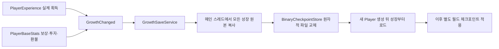

# 개인 성장 저장

월드 체크포인트로 과거 전투에 돌아가도 최신 경험치·성장은 남긴다. 현재 연결된 실제 원본은 `PlayerExperience`와 `PlayerBaseStats`이며 Host 공용 터렛/CU 성장은 다음 접합 배치다. 실제 스킬 강화·재화 소비 원본이 없는 기능을 저장 완료로 표시하지 않는다.

## 호출하는 쪽

- 게임/기존 HUD는 `AddExperience`, `TryClaimReward`, `TryInvest` 같은 기존 Feature API를 그대로 사용한다. UI에서 저장 함수를 중복 호출하지 않는다.
- `IGrowthCheckpointParticipant`는 실제 성장 원본이 구현한다. `PersistenceKey`는 `experience`, `base-stats`처럼 슬롯과 무관한 원본 이름이다. 원본 적용이 끝난 뒤 `GrowthChanged`를 보낸다.
- `InitialStageCompositionRoot.BindGrowthSaves`는 생성된 Player의 실제 writer를 개인별로 묶는다. `player/<논리 PlayerId>`를 해시한 `growth-…` 슬롯을 사용하며 매 Match ID나 roster 순서를 파일 귀속으로 사용하지 않는다. section payload의 논리 Player ID 검증은 유지한다.
- `PumpGrowthSaves`는 unscaled 절대 시각을 넘긴다. XP는 기본2초간 합쳐 캡처하고, 레벨업·보상 수령·스탯 변경은 모든 개인 원본을 즉시 한 묶음으로 캡처한다. 파일 쓰기는 불변 자료만 순서대로 처리하므로 늦은 옛 쓰기가 최신 값을 덮지 않는다.
- `FlushGrowthSaves()`는 정상 종료/월드 복귀 전에 대기 쓰기의 성공 또는 실패를 확인한다. Match 정리와 체크포인트 복원 시작에서도 호출한다. 강제 종료에는 마지막 성공한 파일만 보장하며 아직 합치던 XP는 유실될 수 있다.

저장 파일은 기존 `Application.persistentDataPath/Checkpoints` 아래의 독립 `growth-…checkpoint`다. 전체 월드 슬롯이나 `world/weather`의 준비 여부와 무관하게 개인 성장은 저장한다. 개인 저장을 전체 월드 저장으로 불러오지 않는다.

## 로드와 실패

조립부는 실제 Player identity/Feature 바인딩 뒤, 월드 복원 전에 성장 파일을 읽는다. 기본 파일 저장소는 작업 스레드에서만 IO하고 로딩 구간에서 완료를 기다린다. 이 저장소에 Unity 문맥으로 복귀해야 끝나는 IO 구현을 대입하면 안 된다. Backend로 옮길 때는 준비 단계의 비동기 로드 계약도 함께 바꿔야 한다.

모든 writer가 Prepare를 통과한 뒤 적용하고 실패 시 원복한다. 손상·원본 구성 변경·다른 Player·설정 불일치는 명시 오류이며 기본값으로 기존 파일을 덮지 않는다. 새 기능/저장 schema가 바뀌면 명시 이관이 필요하다. 디스크 오류는 `LastError`, `IssuedRevision/SavedRevision`, `HasPendingChanges`로 관측하고 실제 실패를 저장 성공으로 보고하지 않는다.

현재 네트워크 원격 Player 성장/Backend 인증 저장과 Host 공용 성장·전력 재검증은 별도 통합 범위다. 실제 검수에서는 Stage_1에서 XP100/레벨2·보상수령·공격1 투자를 저장한 뒤 Play 완전 종료→새 actor 생성에서 동일값을 확인했다. QA 저장 파일은 원본을 보존하고 시험 후 원상복구했다.
