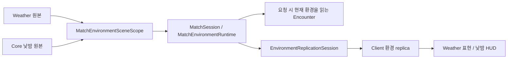

# Match 환경 API

기준: 2026-11-11. 날씨와 낮밤은 독립 정보입니다. 환경 변경은 확정 상태를 게시하는 일이며 그 자체로 Spawn 명령을 만들지 않습니다. 아래는 현재 소스의 연결이고, 과거 Feature 제외·실험 기록은 [당시 보류 문서](../../99_archive/planning-links/2026-11-02-feature-integration-hold.md)에 남깁니다.

## 소유권과 수명

- `Map.WeatherManager`가 현재 날씨·예고와 효과를 소유합니다. Core가 추첨 규칙·가중치·셰이더를 대신 구현하지 않습니다.
- `MatchDayNightCycle`은 Host 공용 게임 시계와 scheduler로 낮300초/밤300초를 진행합니다. `PhaseAdvanced`를 받은 기존 Weather가 다음 날씨를 선택합니다. 이 연결이 있으면 CountTick의 독립 예약을 중복 실행하지 않습니다.
- `InitialStageCompositionRoot`는 같은 Scene의 활성 `IMatchWeatherSource`와 `IMatchTimeOfDaySource`를 각 1개 이하로 연결합니다. 중복 원본은 초기화 실패입니다.
- `MatchEnvironmentSceneScope`가 Feature의 권위 Match·시계·seed·취소 수명을 연결하고 실제 값들을 `MatchSession.UpdateEnvironment`에 게시합니다. Session 폐기 때 구독과 lease를 해제합니다.
- `MatchEnvironmentRuntime`은 불변 snapshot과 revision을 보관합니다. HP·날씨 효과·Enemy 알고리즘을 소유하지 않습니다. 복원 시 시간 epoch가 바뀌면 같은 환경값도 새 revision으로 게시합니다.

## 읽기와 실제 소비

`AppRoot.CurrentEnvironment`, `MatchSession.Environment`, `AppRoot.NetworkEnvironments.Source`에서 현재 snapshot을 읽습니다. `IMatchEnvironmentSource.Changed`는 날씨뿐 아니라 시간대·구간 Reset·복원에도 발생할 수 있으므로 필요한 축의 이전 값과 비교합니다.

| 자료 | 의미 |
| --- | --- |
| MatchId / Revision | 소유 Match와 그 실행의 상태 변경 순서 |
| GameSeconds / Epoch | 확정 시각과 시간 복원 세대 |
| WeatherId / TimeOfDayId | 확정 날씨와 낮밤. 없는 축은 HasWeather/HasTimeOfDay=false |
| Forecast | Weather가 제공한 예고의 불변 복사 |
| PhaseAnchor | 선택적 현재 낮밤 구간의 시작·길이·단계. 미제공을 기본 5분으로 채우지 않음 |

날씨만 필요하면 `TryGetCurrentWeather(matchId, out weatherId)`, 낮밤만 필요하면 `TryGetCurrentDayPhase(matchId, out phase)`를 사용합니다. 원본 부재·다른 Match·알 수 없는 ID는 false입니다. Host 게임 규칙은 권위 원본을, Client 화면은 복제 원본을 사용합니다. 구독자는 자신의 수명 종료 때 해제합니다.

`EncounterRequestService.Submit`은 현재 Battlefield·환경을 한 번 읽고 같은 Match인지 확인해 `IEnvironmentAwareEncounterExecutor`로 전달합니다. 재전송은 기존 결과와 당시 환경 revision을 재사용합니다. Enemy의 `EncounterEnvironmentProfile`은 weather/time 필터·preset override·예산 배율을 제작하는 접점이며 최종 수치는 Enemy/밸런스 담당입니다. 환경 변경만으로 새 요청이 생기지는 않습니다.

## 네트워크와 Client 시간

`EnvironmentReplicationSession` / `NgoEnvironmentTransport`는 같은 준비 Descriptor의 서버 확정 상태만 전달합니다. 과거 revision·다른 Match·준비 세대·같은 revision의 충돌을 거절하고 미전송 상태는 최신 값으로 합칩니다. 종료 때 읽기 모델을 비워 다음 Match에 재사용하지 않습니다.

`PhaseAnchor`가 있으면 codec v3, 없으면 기존 v2를 전송합니다. 새 Reader는 v2도 읽습니다. 구형 Reader의 v3 수신은 보장하지 않으므로 협동은 같은 Build를 사용합니다. 채널 이름은 기존 `teamhjd.core.environment.v1`이며 채널 이름과 payload 버전은 별개입니다.

Client `MatchDayNightCycle`은 현재 구간과 같은 epoch의 **공용 게임 시계**로 잔여시간을 계산합니다. 최초 미도착/다른 epoch는 NaN, Host 확정 전에 시계만 경계를 넘으면 0에서 대기합니다. Client 수신은 `Changed`만 통지하며 새 Weather 추첨·PhaseAdvanced를 만들지 않습니다. [낮밤 API와 표시 오차 정책](../09_world/day-night-api.md)을 참고합니다.

## 저장과 관측의 범위

Core `world/time-of-day`는 구간 기준을 v2로 저장하고 기존 v1을 읽습니다. 실제 `world/weather`의 현재/예고·난수·효과 복원 writer는 김진태 담당이며 이 문서에서 완료로 취급하지 않습니다. 낮밤 저장과 Weather 저장은 서로 다른 section입니다. 운영 전체 Save는 필수 writer가 모두 있어야 합니다.

Game Debugger Overview는 현재 환경을, Statistics 요청 상세는 실제 판단에 사용한 환경 revision/규칙을 보여줍니다. Seed만으로 전체 게임의 결정론 replay를 보장하지 않습니다. 낮밤 Client 전송·두 실행 검증은 [리뷰 문서](../../team/reviews/client-day-night-anchor-20261111.md), 시간 정책은 [공용 시간 API](match-time-api.md)를 따릅니다.
