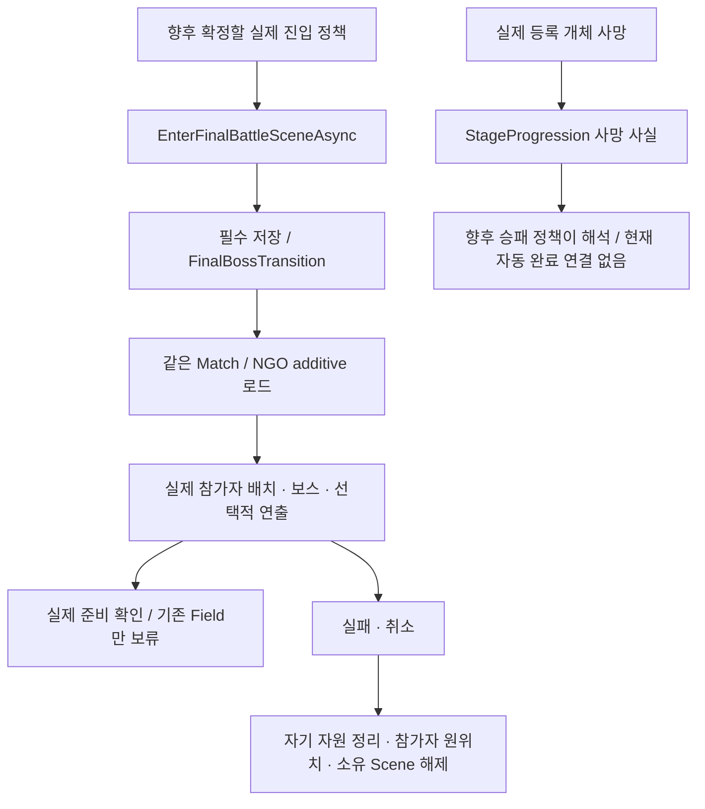

# Stage 점유와 보스 진행 연결

> **11/14 범위 확정:** 승패·보스·결과는 연결 API까지만 준비한다. 이번에 추가했던 자동 최종 진입/승리 확정과 결과 저장 연결은 제외했다. 실제 보스전·승리 조건·결과/사망 화면의 제품 설계가 확정된 것으로 읽지 않는다. 기존 main의 UI·사망 처리는 유지한다.

`StageProgression`은 `MatchCoordinator`가 소유하고, 실제 Scene의 `RegionGridSnapshot.CaptureRatio`를 읽는다. 현재 셀 점유와 최고 도달률은 구분한다. 최고 도달률은 이미 발생한33/66 사건을 점유 상실로 취소하지 않기 위한 값이며, 일반 스폰 난이도 정책을 대체하지 않는다.

## 실행 순서

1. `InitialStageCompositionRoot.BindStageProgression`이 성장/비환급 기록을 읽은 뒤 Mission 실행 ID와 Field 시계를 연결한다.
2. Root Update가 CU 패배·구조 실패를 먼저 처리하고 현재 점유 스냅샷을 `Pump`한다.
3.33%를 넘으면 `StageCheckpointGate`가 등장 전 저장을 요청한다. 같은 복원 epoch의 실제 디스크 저장이 완료된 뒤 `IFieldBossSpawnService.TrySpawnFieldBoss`에 실행별 안정된 사건 ID를 준다. true와 실제 EntityId를 모두 받아야 생성 확인이다.66%도 같은 경로이며 한 번에100%가 되어도33→66 순서다.
4. 생성 실패는 같은 사건 ID로1 Field초 뒤 재시도한다. 미출현 취소·일반 적 대체·허위 성공은 없다. 이미 확인된 첫 사건은 다시 만들지 않는다.
5. 현재 점유100%와 두 실제 생성 확인을 모두 만족하면 `StageProgress.CanEnterFinalBattle`이 true다. 두 중간보스의 처치는 진입 조건이 아니다.
6. 100%·두 Field 생성 등은 최종 진입 API의 현재 준비 조건으로만 읽는다. Root Update는 Boss Scene으로 자동 이동하지 않는다. 실제 진입 호출자는 게임 진행 설계가 정해진 뒤 연결한다.
7. 실제 HP 사망은 IEnemyCombatSource.DeathObserved → Root.ReportStageEnemyDeath → StageProgression에 전달한다. 등록된 최종 개체가 죽어도 MatchCoordinator의 자동 승리/결과 화면으로 연결하지 않는다. UI·Despawn·Scene 해제는 사망 사실로 제출하지 않는다.

## Enemy 생성 구현자가 지킬 경계

`IFieldBossSpawnService`는 현재 Scene에 정확히 하나이거나 실제 Encounter consumer가 구현한다. 현재 구현은 `EncounterSceneBinding.StageEvents`이며, `EnemySpawnExecutor.StageEvents`에서 실제 공통 생성/NGO·분대·위치·HP 관측·저장 경계를 사용한다. 편성을 다시 무작위로 뽑거나 정규 예산을 임의 소비하지 않는다.

사건 ID에서 `stage/<event ID>` EntityId를 만든다. 같은 사건을 다시 요청하면 **현재 Executor가 추적하는 실제 개체**를 찾아 ID를 반환한다. 별도 완료 캐시는 없으며, 기존 Enemy 저장이 이 ID를 보존한다. 등장 후 상태를 복원하면 새 NGO 개체에서도 같은 ID를 재사용하고, 등장 전 월드로 복귀해 개체가 없어지면 같은 사건을 다시 실제 생성한다. 과거 생성 성공 응답만 재사용하지 않는다.

33/66 개체 Definition과 유효 진입 위치는 제작 데이터로 필요하다. 해당 시점에도 점유 밖에서 생성 가능한 NavMesh 지점을 미리 보장해야 한다. 모든 후보를 점유한 뒤 일반 포인트 중 하나를 임의 선택하는 방식은 불가하다. 생성 실패를 최종 진입이 추월하지 않지만, 이 방어 자체가 콘텐츠/위치 보장을 대신하지는 않는다.

### Level/Enemy 제작 설정

1. 현재 Scene의 `EncounterSceneConfiguration`에 `fieldBoss33`·`fieldBoss66`를 지정한다. 해당 Executor의 EnemyCatalog에 등록된 **같은 Definition 에셋**과 실제 HP·NGO·Controller 컴포넌트가 필요하다. 새 Prefab은 NGO 등록도 함께 확인한다. 미지정 상태를 일반 Slime 등으로 자동 대체하지 않는다.
2. `RegionSceneBinding._captureExcludedAreas`에 월드 XY Bounds를 지정해 출현용 진입 셀을 점유 분모에서 제외한다. 양의 면적으로 겹친 셀만 제외하고 선/점 접촉은 제외하지 않는다. 기존 통행 불가 셀은 계속 제외되며 Region ID는 바뀌지 않는다. CU 시작 셀·목표 전체를 제거하면 초기화가 거부된다. 실행 중 값만 바꾸지 말고 기존 명시적 Grid 재설정 절차를 사용한다.
3. `EncounterSceneConfiguration.fieldBossEntrances`에 **같은 Scene의 활성 Transform을 복수 지정**한다. 위치는 Grid 안의 점유 불가 셀이고 NavMesh 위여야 한다. 탐색은 해당 위치에서0.5 이내이며 다른 임의 위치로 우회하지 않는다. 현재 추적 적과1월드 단위 미만으로 겹치는 지점은 건너뛰므로 두 사건의 동시 출현과 실제 Prefab 크기에 충분한 진입로를 제작한다.
4. 필수 Weather writer 등 전체 저장 연결을 완료한다. 준비하지 않은 진입로·카탈로그·콘텐츠는 실패 이유를 반환하며 최종 진입을 통과시키지 않는다. 기본 Scene에 보스 콘텐츠나 제외 영역을 임의 지정하지 않았다.

`Game Debugger`의 Statistics/Timeline에는 `StageProgression` Source, 사건 CauseEventId, 별도 요청 번호, 지정 편성과 실제 EntityId/위치를 기록한다. 중복 응답은 새 요청/생성을 기록하지 않는다. 정규 첫 생산보다 먼저 호출돼도 기존 생명·소환·통계 구독을 먼저 연결한다.

## 저장과 표시

`world/stage-progress`는 월드 section이다. 점유율/최고율·실제 생성 ID·확인한 죽음을 같은 시점으로 복원하고 rollback한다. 개인 성장·구조 시간·안전장치는 이 section에 넣지 않는다. 저장의 실행 ID가 현재 비환급 기록과 달라지면 거부한다. 새 필수 section을 포함하지 않은 과거 저장은 명시 migration 없이는 이어가지 않는다.

HUD는 `InitialStageCompositionRoot.StageProgress`의 읽기 값을 사용할 수 있다. Game Debugger의 Checkpoint 패널은 현재/최고 점유·33/66 실제 생성·최종 진입 조건·연결 대기 이유를 표시한다. Debugger가 별도 점유율이나 생성 성공을 만들지 않는다.

### 등장 전·처치 후 자동 저장

`InitialStageCompositionRoot`가 `StageCheckpointGate`를 연결하고 해제한다. 저장기는 기존 `CheckpointService.SaveAsync`를 그대로 사용한다. 별도 관찰자가 요청 시점을 정하며 저장소가 Stage 규칙을 판단하지 않는다.

- 등장 전에는 `stage-<Mission 실행 ID>-before-33` 또는 `before-66` 슬롯을 저장한다. `Saved`와 `IsCurrentScope`를 모두 확인하기 전에는 실제 생성기를 호출하지 않는다.
- 권위 HP 원본의 실제 죽음이 `StageProgression.ObserveEnemyDeath`에 도달하면 `FieldBossDefeated`가 `defeat-33` 또는 `defeat-66` 저장을 예약한다. 같은 사망 호출 스택의 Despawn·위치 등록 해제가 끝난 뒤 **다음 Root Update**에서 캡처한다. 단순 Despawn은 이 저장을 만들지 않는다.
- 저장은 한 번에 하나씩 처리한다. `Busy`는 다음 Update에서 시도하고, 기술 실패는 매 프레임 파일 쓰기를 반복하지 않는다. 원인을 해결한 뒤 `RetryStageCheckpoints()`를 명시 호출한다. 이 호출은 안전장치 횟수를 소비하지 않는다.
- 월드 복원의 epoch가 달라지거나 Match가 종료되면 임시 저장 작업 상태를 폐기한다. 이전 비동기 저장 완료가 새 월드의 등장 허가가 되지 않는다. Player 복귀가 진행 중이면 Stage 저장·생성을 보류한다.
- `PendingStageCheckpoints`와 `StageCheckpointError`는 읽기 진단이며, Game Debugger Checkpoint 패널에서 대기·실패·재시도를 볼 수 있다. 필수 writer 누락도 우회하지 않는다.

이 연결은 **Field 사건의 저장 순서**다. 최종 Boss Scene의 저장 선행·임대 경계는 아래 별도 API를 사용한다.

### 명시적인 최종 Scene 연결 API

현재 게임 루프에는 호출자가 없다. `Update`·100% 점유·최종 개체 사망이 Scene 이동이나 승리를 자동 실행하지 않는다. 실제 게임 진행 정책이 정해진 뒤 Host 조립부가 다음 API를 호출한다.

```csharp
// 실제 진입 시점을 정한 정책 소유자가 호출할 연결 지점입니다.
await stageRoot.EnterFinalBattleSceneAsync(currentMatchId, cancellation);
```

이 API는 현재 Host/Match·생존·복귀 미진행·Stage 준비 조건을 확인한다. 저장→동일 Match의 additive Scene 로드→실제 도착·생존 보스·HP 사망 원본 검사→전투 준비 확정 순서다. 미지정 driver/Build 경로·필수 저장 실패·도착/생성 실패는 Task 예외로 호출자에게 전달하고 `FinalBossTransitionError`에도 남긴다. 자동 재시도 버튼/시도 카운터는 제거했으며 재호출도 호출자가 명시적으로 정한다.



#### 유지한 기본 구현과 제작 접점

- Field Stage의 `FinalBattleSceneDriver.scenePath`는 실제 Build Settings의 Boss Scene 경로다. Root의 `_finalBattleSceneDriver`에 같은 Scene의 활성 구현을 지정한다. 실제 경로/콘텐츠는 현재 미지정이다.
- Boss Scene은 활성 `FinalBattleSceneLayout` 하나와 실제 참가자 도착점을 제공한다. PlayerId 오름차순으로 배치한다. 전용 NGO `EnemySpawnExecutor`·실제 카탈로그 Definition·NavMesh 생성점을 가진 `FinalBattleBossSource`를 layout의 `bossSource`에 지정한다. hash0인 Runtime AddComponent NetworkObject를 사용하지 않는다.
- 선택적 `PlayableDirector`는 유한한 단발 연출이며 공용 게임 정지와 별개인 UnscaledGameTime으로 재생한다. 기존 `CameraManager`의 view lease를 사용하고 Camera/AudioListener를 새로 만들지 않는다.
- 보스 source는 FieldClock 대신 공용 MatchTime을 쓴다. 준비 정지 중 생성만 허용하고 AI/공격은 공용 시간 재개를 따른다. 실제 모델/AI/스탯/보스전·컷씬 콘텐츠를 구현했다는 뜻은 아니다.
- Root가 실제 참가자의 Scene/부모/위치·Rigidbody 속도를 보관하고 실패 시 원복한다. driver의 보스/시점/연출 정리가 끝난 뒤 Core가 자신이 추가한 Scene만 해제한다. 대여한 Scene은 임의 해제하지 않는다. 준비 제한120/원복30 실시간 초이며 원복 전에 정지/입력 임대를 풀지 않는다.
- `PrepareFinalBossTransitionAsync` / `ConfirmFinalBossReady`는 저수준 연결 API로 유지한다. 저장 없는 Confirm은 거부한다. `IFinalBattleSceneDriver`의 Prepare/Rollback/StopMatch 수명 계약도 유지한다. 다른 Scene으로 이동한 Player는 옛 Field Grid 밀도에 넣지 않는다.

#### 사망 사실과 게임 완료의 구분

`StageProgression.Victory`는 기존 API 이름이며 현재 의미는 등록된 최종 개체의 사망 알림이다. `MatchCoordinator`는 이 이벤트를 구독해 자동 승리시키지 않는다. 진행 사실은 `StageProgressSnapshot.FinalBossDefeated`로 읽는다. `MatchCoordinator.CompleteMatch(outcome)`은 향후 실제 정책 소유자가 확정 결과를 전달할 명시 API로 유지한다.

기존 CU 파괴/Player 사망·구조/안전장치와 main의 임시 결과 UI는 이번 제외 작업에서 제거하지 않았다. 새 결과 화면을 디자인하지 않았으며 기존 UI를 최종 디자인으로 확정하지 않는다. 별도 캠페인 클리어/결과 저장 연결은 Assets에서 제외해 로컬 보관했다. 보상 제안은 실제 재화 지급 원본과 구분한다.

#### 검증과 남은 범위

현재 Editor assembly의 순수 NUnit17개를 직접 실행했다(Unity TestRunner 실행 아님). 실제 Stage_1에서 시험용100%·실제 일반 Enemy 추적 ID를 주입해 자동 진입 없음, 명시 API의 미지정 driver 거부와 입력/정지 정리, 실제 HP 사망 뒤에도 Match Running·결과 화면 없음·동일 Match 유지를 확인했다. 신규 Runtime 오류0이다. 자연 진행·실제 보스전·결과 디자인·전체 Weather 복원은 검증하지 않았다.

실제 보스 Scene/Definition/연출·제품 승패/결과 설계·Weather 필수 writer·원격 Player 도착/연출 응답은 남아 있다. 과거 자동 진입 실험의 통과 기록은 현재 자동 동작의 근거가 아니다.
