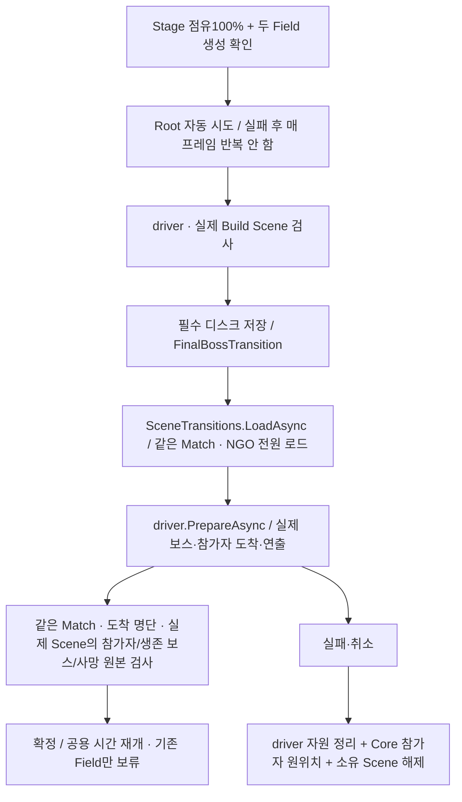

# Stage 점유와 보스 진행 연결

`StageProgression`은 `MatchCoordinator`가 소유하고, 실제 Scene의 `RegionGridSnapshot.CaptureRatio`를 읽는다. 현재 셀 점유와 최고 도달률은 구분한다. 최고 도달률은 이미 발생한33/66 사건을 점유 상실로 취소하지 않기 위한 값이며, 일반 스폰 난이도 정책을 대체하지 않는다.

## 실행 순서

1. `InitialStageCompositionRoot.BindStageProgression`이 성장/비환급 기록을 읽은 뒤 Mission 실행 ID와 Field 시계를 연결한다.
2. Root Update가 CU 패배·구조 실패를 먼저 처리하고 현재 점유 스냅샷을 `Pump`한다.
3.33%를 넘으면 `StageCheckpointGate`가 등장 전 저장을 요청한다. 같은 복원 epoch의 실제 디스크 저장이 완료된 뒤 `IFieldBossSpawnService.TrySpawnFieldBoss`에 실행별 안정된 사건 ID를 준다. true와 실제 EntityId를 모두 받아야 생성 확인이다.66%도 같은 경로이며 한 번에100%가 되어도33→66 순서다.
4. 생성 실패는 같은 사건 ID로1 Field초 뒤 재시도한다. 미출현 취소·일반 적 대체·허위 성공은 없다. 이미 확인된 첫 사건은 다시 만들지 않는다.
5. 현재 점유100%와 두 실제 생성 확인을 모두 만족하면 `StageProgress.CanEnterFinalBattle`이 true다. 두 중간보스의 처치는 진입 조건이 아니다.
6. Root Update가100%·두 Field 생성·생존 조건을 확인해 최종 Scene 진입을 한 번 시작한다. 지정된 Scene driver와 경로 검사→필수 저장→같은 Match의 additive 로드→실제 도착·보스·연출 확인→확정 순서다. 이전 Field만 보류하고 Player/공용 낮밤은 기존 공용 시계를 계속 사용한다.
7. 공통 생성기는 실제 HP 사망을 `IEnemyCombatSource.DeathObserved`로 보내고 Root가 `ReportStageEnemyDeath(match, actor)`에 연결한다. 별도 Boss 생성기가 공통 경계를 쓰지 않으면 해당 권위 HP 원본에서 이 API를 호출해야 한다. 등록한 최종 보스의 실제 죽음만 Coordinator의 Victory로 이어진다. UI·Despawn·Scene 해제는 죽음으로 제출하지 않는다.

## Enemy 생성 구현자가 지킬 경계

`IFieldBossSpawnService`는 현재 Scene에 정확히 하나이거나 실제 Encounter consumer가 구현한다. 현재 구현은 `EncounterSceneBinding.StageEvents`이며, `EnemySpawnExecutor.StageEvents`에서 실제 공통 생성/NGO·분대·위치·HP 관측·저장 경계를 사용한다. 편성을 다시 무작위로 뽑거나 정규 예산을 임의 소비하지 않는다.

사건 ID에서 `stage/<event ID>` EntityId를 만든다. 같은 사건을 다시 요청하면 **현재 Executor가 추적하는 실제 개체**를 찾아 ID를 반환한다. 별도 완료 캐시는 없으며, 기존 Enemy 저장이 이 ID를 보존한다. 등장 후 상태를 복원하면 새 NGO 개체에서도 같은 ID를 재사용하고, 등장 전 월드로 복귀해 개체가 없어지면 같은 사건을 다시 실제 생성한다. 과거 생성 성공 응답만 재사용하지 않는다.

33/66 개체 Definition과 유효 진입 위치는 제작 데이터로 필요하다. 해당 시점에도 점유 밖에서 생성 가능한 NavMesh 지점을 미리 보장해야 한다. 모든 후보를 점유한 뒤 일반 포인트 중 하나를 임의 선택하는 방식은 불가하다. 생성 실패를 최종 진입이 추월하지 않지만, 이 방어 자체가 콘텐츠/위치 보장을 대신하지는 않는다.

### Level/Enemy 제작 설정

1. 현재 Scene의 `EncounterSceneConfiguration`에 `fieldBoss33`·`fieldBoss66`를 지정한다. 해당 Executor의 EnemyCatalog에 등록된 **같은 Definition 에셋**과 실제 HP·NGO·Controller 컴포넌트가 필요하다. 새 Prefab은 NGO 등록도 함께 확인한다. 미지정 상태를 일반 Slime 등으로 자동 대체하지 않는다.
2. `RegionSceneBinding._captureExcludedAreas`에 월드 XY Bounds를 지정해 출현용 진입 셀을 점유 분모에서 제외한다. 양의 면적으로 겹친 셀만 제외하고 선/점 접촉은 제외하지 않는다. 기존 통행 불가 셀은 계속 제외되며 Region ID는 바뀌지 않는다. CU 시작 셀·목표 전체를 제거하면 초기화가 거부된다. 실행 중 값만 바꾸지 말고 기존 명시적 Grid 재설정 절차를 사용한다.
3. `EncounterSceneConfiguration.fieldBossEntrances`에 **같은 Scene의 활성 Transform을 복수 지정**한다. 위치는 Grid 안의 점유 불가 셀이고 NavMesh 위여야 한다. 탐색은 해당 위치에서0.5 이내이며 다른 임의 위치로 우회하지 않는다. 현재 추적 적과1월드 단위 미만으로 겹치는 지점은 건너뛰므로 두 사건의 동시 출현과 실제 Prefab 크기에 충분한 진입로를 제작한다.
4. 필수 Weather writer 등 전체 저장 연결을 완료한다. 준비하지 않은 진입로·카탈로그·콘텐츠는 실패 이유를 반환하며 최종 진입을 통과시키지 않는다. 기본 Scene에 보스 콘텐츠나 제외 영역을 임의 지정하지 않았다.

`Game Debugger`의 Statistics/Timeline에는 `StageProgression` Source, 사건 CauseEventId, 별도 요청 번호, 지정 편성과 실제 EntityId/위치를 기록한다. 중복 응답은 새 요청/생성을 기록하지 않는다. 정규 첫 생산보다 먼저 호출돼도 기존 생명·소환·통계 구독을 먼저 연결한다.

## 저장과 표시

`world/stage-progress`는 월드 section이다. 점유율/최고율·실제 생성 ID·확인한 죽음을 같은 시점으로 복원하고 rollback한다. 개인 성장·구조 시간·안전장치는 이 section에 넣지 않는다. 저장의 실행 ID가 현재 비환급 기록과 달라지면 거부한다. 새 필수 section을 포함하지 않은 과거 저장은 명시 migration 없이는 이어가지 않는다.

HUD는 `InitialStageCompositionRoot.StageProgress`의 읽기 값을 사용할 수 있다. Game Debugger의 Checkpoint 패널은 현재/최고 점유·33/66 실제 생성·최종 진입 조건·연결 대기 이유를 표시한다. Debugger가 별도 점유율이나 생성 성공을 만들지 않는다.

### 등장 전·처치 후 자동 저장

`InitialStageCompositionRoot`가 `StageCheckpointGate`를 연결하고 해제한다. 저장기는 기존 `CheckpointService.SaveAsync`를 그대로 사용한다. 별도 관찰자가 요청 시점을 정하며 저장소가 Stage 규칙을 판단하지 않는다.

- 등장 전에는 `stage-<Mission 실행 ID>-before-33` 또는 `before-66` 슬롯을 저장한다. `Saved`와 `IsCurrentScope`를 모두 확인하기 전에는 실제 생성기를 호출하지 않는다.
- 권위 HP 원본의 실제 죽음이 `StageProgression.ObserveEnemyDeath`에 도달하면 `FieldBossDefeated`가 `defeat-33` 또는 `defeat-66` 저장을 예약한다. 같은 사망 호출 스택의 Despawn·위치 등록 해제가 끝난 뒤 **다음 Root Update**에서 캡처한다. 단순 Despawn은 이 저장을 만들지 않는다.
- 저장은 한 번에 하나씩 처리한다. `Busy`는 다음 Update에서 시도하고, 기술 실패는 매 프레임 파일 쓰기를 반복하지 않는다. 원인을 해결한 뒤 `RetryStageCheckpoints()`를 명시 호출한다. 이 호출은 안전장치 횟수를 소비하지 않는다.
- 월드 복원의 epoch가 달라지거나 Match가 종료되면 임시 저장 작업 상태를 폐기한다. 이전 비동기 저장 완료가 새 월드의 등장 허가가 되지 않는다. Player 복귀가 진행 중이면 Stage 저장·생성을 보류한다.
- `PendingStageCheckpoints`와 `StageCheckpointError`는 읽기 진단이며, Game Debugger Checkpoint 패널에서 대기·실패·재시도를 볼 수 있다. 필수 writer 누락도 우회하지 않는다.

이 연결은 **Field 사건의 저장 순서**다. 최종 Boss Scene의 저장 선행·임대 경계는 아래 별도 API를 사용한다.

### 최종 진입의 필수 저장·정지 범위

기본 게임 경로는 `InitialStageCompositionRoot.FinalScene`의 자동 조율이다. Stage의 `_finalBattleSceneDriver`에 **같은 Scene의 활성 MonoBehaviour인 `IFinalBattleSceneDriver` 구현**을 지정한다. 기본 구현은 `FinalBattleSceneDriver`, 실제 Enemy 어댑터는 `FinalBattleBossSource`다. 실제 Boss Scene/콘텐츠와 Stage 설정은 아직 없다. Level은 아래 제작값을 지정하며 Core 전환 조율을 새로 구현하지 않는다.

`PrepareFinalBossTransitionAsync`는 이 조율부가 사용하는 저수준 범위 API다. `FinalBossTransition`은 **저장이 끝난 현재 월드의 진입 허가와 임시 정지/로컬 입력 임대**이며, 저장 없는 `ConfirmFinalBossReady` 직접 호출은 거부한다.

#### 기본 driver의 실제 Scene 제작 순서

1. Field Stage에 `FinalBattleSceneDriver`를 추가하고 `scenePath`에 실제 Boss Scene의 Build Settings 전체 경로를 지정한다. Root의 `_finalBattleSceneDriver`에 연결한다. 경로가 Field 자신이거나 Build 등록이 없으면 진입을 거부한다.
2. Boss Scene에는 활성 `FinalBattleSceneLayout` 하나를 두고 `playerStarts`에 실제 이동 가능한 도착점을 지정한다. PlayerId 오름차순으로 배치하며 현재 살아있는 실제 참가자 수만큼 필요하다.
3. 같은 Boss Scene의 전용 `EnemySpawnExecutor`와 `FinalBattleBossSource`를 연결한다. source에는 실제 카탈로그의 `EnemyDefinition`과 같은 Scene의 NavMesh 생성점을 지정하고, layout의 `bossSource`에 연결한다. Executor는 NGO Scene 객체 또는 실제 등록된 Executor prefab이어야 한다. Runtime에 NetworkObject를 AddComponent하여 hash0인 객체를 만들면 NGO가 생성을 거부한다.
4. 선택적으로 layout의 `intro`에 유한 길이/비반복 `PlayableDirector`, `introView`에 로컬 시점을 지정한다. 연출이 없으면 즉시 실제 준비를 확정한다. 연출은 공용 게임 정지와 별개인 UnscaledGameTime으로 재생하고 기존 CameraManager의 view lease를 사용한다. 새 Camera/AudioListener를 만들지 않는다.
5. Root가 필수 저장 완료 뒤 기본 driver를 호출한다. driver는 실제 참가자를 배치하고 source가 보스를 공통 Enemy 생성 경계로 만든 뒤 연출 종료를 기다린다. source는 **FieldClock이 아닌 공용 MatchTime**을 사용해 Field가 보류되어도 전투가 진행된다. 준비 중 공용 정지에서는 생성만 허용하며 AI/공격은 공용 시간 재개를 따른다.
6. 실패/안전장치 복귀는 driver가 자기 보스·연출·시점 연결을 해제하고 Root가 참가자의 Scene/부모/위치·Rigidbody 속도를 되돌린다. source 연결 획득 실패로 기존 소유자의 개체를 제거하지 않는다. Match 종료에서도 같은 정리가 반복 가능하다.

기본 driver와 Enemy 어댑터는 구현되어 있다. 실제 Boss Scene/Timeline·확정 Definition·제작값 연결은 미완이며, 원격 참가자의 실제 이동/로컬 연출 응답 인수와 최종 결과 저장/허브 성공 인수도 별도다. 이 제작 순서를 현재 완성된 보스전으로 읽으면 안 된다. Weather 필수 writer를 임의 대체하거나 건너뛰지 않는다.

#### 실제 Scene driver가 제공할 것

- `ScenePath`: 실제 Build Settings의 Boss Scene 경로. 현재 Field 자신을 대상으로 지정할 수 없다.
- `PrepareAsync(stage, cancellation)`: `stage.AuthorityActors`의 실제 참가자를 같은 Match로 로드된 목적 Scene에 배치하고, 실제 보스/연출을 준비한 뒤 `FinalBattleSceneReady`의 MatchId·Boss ID·도착 PlayerId 명단을 반환한다. 현재 코어는 호스트의 실제 Scene 소속과 명단을 확인하며 실제2인에서는 Player 담당의 원격 이동/도착 응답 연결이 별도로 필요하다.
- Boss Scene은 실제 보스 `IEntityIdentity`, 살아있는 적을 보고하는 `IBattlefieldEnemyPositionSource`, 실제 HP 죽음을 보고하는 `IEnemyCombatSource`를 제공한다. 기본 Enemy Executor의 공통 생성·위치·사망 경계를 재사용한다. 보고 ID만으로는 준비 완료가 아니다.
- `RollbackAsync`: 소유한 보스/카메라/연출 자원을 정리한다. Core가 기록한 실제 참가자 Scene·부모·위치를 되돌리고, 자신이 추가한 Scene만 참가자가 돌아온 뒤 해제한다. 원래 로드되어 있던 Scene은 빌려 쓰며 임의 해제하지 않는다.
- `StopMatch`: Match 종료 때 Feature 바인딩을 동기적으로 닫는다. Scene 로드/해제는 Core가 맡으므로 여기서 실행하지 않는다. 준비 전/부분 실패/반복 정리에 안전해야 한다.

준비 제한은 `_finalBattlePreparationTimeout`(기본120 실시간 초)이며 원복은30 실시간 초다. 게임 pause/배속에 묶이지 않는다. 원복 전에 정지/입력 임대를 해제하지 않으며, 늦은 완료는 이전 시도의 실제 참조로만 정리한다. `_finalBattleFlow`는 실패를 기록하고 끝나며, 제작/기술 오류는 `RetryFinalBattleScene()`로 재시도한다. 점유를 잃었다가 다시100%를 확보하거나 복원 epoch가 바뀌면 자동 시도를 다시 허용한다. 읽기 진단 `FinalBattleEntryAttempts`를 Debugger에 표시한다.

- 현재100% 점유·두 Field 사건 생성 확인·살아있는 참가자·복귀 미진행을 요구한다. 중간보스 처치는 추가 조건이 아니다.
- 공용 시간 pause lease와 Host 로컬 입력 임대를 획득하고 `stage-<실행 ID>-before-final`의 실제 디스크 `Saved/IsCurrentScope`를 기다린다. writer 누락/Busy/기술 실패는 예외이며 Scene 이동을 시작하지 않는다. 원인을 해결한 뒤 새 전환 범위로 재시도한다.
- 준비 범위가 살아 있는 동안 공용 시간과 기존 Field 시간이 모두 정지한다. Scene 로드·도착·연출을 끝내고 확정하면 Field만 held가 되고 공용 시간·Player·낮밤은 진행한다. 다른 pause 소유자의 임대는 해제하지 않는다.
- 외부 취소·Match 종료·월드 복원의 epoch 변경·참가자 실패는 이전 허가를 무효화한다. Root Update/종료 정리가 소유 스레드에서 입력/정지 임대를 해제한다. 늦게 도착한 저장 성공도 새 월드의 진입 허가가 되지 않는다.
- `transition.Cancellation`은 로드/도착/연출용이며 확정/Dispose 때 취소된다. 보스 전투를 여기에 바인딩하지 말고 현재 Match의 `MatchCoordinator.GameplayCancellation`과 **공용 MatchTime**을 사용한다. 기존 Field의 FieldTime과 구분한다.
- Core 자동 조율부는 실패 시 참가자 원위치/추가 Scene 정리를 이 범위 안에서 끝내고 Dispose한다. driver는 자신의 카메라/연출/보스 바인딩을 정리한다. `AppRoot.ReplaceGameplaySceneAsync`는 Match를 종료하므로 사용하지 않는다. NGO의 `SceneTransitions.LoadAsync`는 기존 전원 로드 장벽을 사용하지만 실제 Player 이동·연출 완료를 대신하지 않는다.
- Game Debugger Checkpoint 패널의 `FinalBossTransitionPending/Error`는 저장/준비 상태를 읽는다. 실제 Scene 소유자 없이 Debugger가 진입 성공을 만드는 버튼은 제공하지 않는다.

현재 이 API·Root 연결과 순수 Core 검사7개를 구현했다. 미저장 Scene을 보존하려고 현재 Editor assembly의 NUnit 메서드를 직접 실행했으며7개가 통과했다. Unity TestRunner 실행과 구분한다. 실제 Stage_1 Root에서도 저장 우회 거부·실제 Weather 누락 거부 뒤 입력/정지 해제·같은 Match/Scene 유지를 확인했다. 여기서는 진입 경계를 시험하기 위해100%와 실제 일반 Enemy 두 개의 추적 ID를 임시 사용했으며 자연 진행 검수가 아니다. 실제 Boss Scene 조립·참가자 이동·연출과 그 성공 인수는 여전히 미연결이며, 허가/임대의 존재를 실제 최종 보스전 완료로 세지 않는다.

자동 조율 보강 후에는 순수 메서드10개와 CU 승패 우선 검사1개를 직접 확인했다. 실제 Player의 Runtime Scene 이동→원래 Scene/부모/위치 복구, Field Grid의 Player 수1→0→1도 확인했다. 실제 Scene driver 미지정 상태의 최초 시도1·재확보2·명시 재시도3, 매 프레임 반복 없음·입력/정지 누락 없음·신규 Runtime 오류0이다. 시험용100%와 실제 일반 Enemy 두 ID를 사용했으며 자연 진행/실제 Boss Scene 성공 검수가 아니다. 형식적인 Native 원복 UnityTest는 Play coroutine으로 분리했으나 이번에는 TestRunner로 실행하지 않았다.

보스 Scene 준비/전투 중에는 Field writer만으로 다른 Scene의 Player·보스를 저장/복원하지 않도록 Field checkpoint 실행을 차단한다. 안전장치 복귀는 먼저 실제 Scene 자원/참가자를 정리한 뒤 등장 전 Field 체크포인트를 복원하며, 그 새 epoch에서 자동 진입을 재평가한다. 실제 Boss Scene writer/콘텐츠가 완성된 범위는 아니다. 최종 HP 사망이 도착했을 때 CU HP가 이미0이면 기존 패배 판정을 먼저 확정하고, 생존 CU에서는 Victory를 한 번만 확정한다.

## 현재 구현/검증과 미연결

최초 정책·world codec·Coordinator/Root 연결과 자동6개를 검증했다. 당시 실제 Stage_1 진입에서 CU1/201셀(0.4975%)·Player1·게임 진행 정상·`FieldBossContentNotConnected`를 확인했다. 아래 생성 구현 보강 전의 기록이다.

현재 카탈로그에는19종의 적이 있으나33/66에 사용할 확정 Definition이 지정되어 있지 않다. 실제 Boss Scene도 제공되지 않았다. Field 생성 서비스 자체는 구현했으며, 지정 콘텐츠·보장 진입로·최종 Scene/컷씬·실제 보스 등록은 미연결이다. 공통 생성기의 실제 HP 사망→Stage 전달/Match 종료 시 해제는 연결해 검증했다. 위 API의 존재를 실제 보스 플레이 완료로 해석하지 않는다. Reference의 과거 보스 Prefab은 현행 콘텐츠로 임의 승격하지 않았다.

11/14 실제 Stage_1에서 **미저장 시험용 Slime 지정**과 점유 제외 진입 셀2개로 생성 구현을 검증했다. 서로 다른 사건2개 생성, 재요청2→2, Enemy 원본 복원 뒤 사건 개체2 유지, 등장 이전 원본 복귀0→같은 사건1개 재생성을 확인했다. 복원 도중 정상 생산12개도 실행되어 총14개였으며 사건 개체 수와 구분했다. 기존 Game Debugger에 세 실제 생성 요청의 계획1/생성1·위치/ID가 남았다. 제외 영역4개 검사와 기존 스폰 제한 회귀를 별도로 기록하며, 시험값은 Scene에 저장하지 않았다. 이는 전체 Weather 월드 저장/실제 보스 콘텐츠 플레이 성공을 대신하지 않는다.

### 실제 사망 전달 검증 (11/14)

Stage 규칙6개와 실제 Stage_1의 터렛 사격→Enemy HP 사망→Stage 추적 완료를 확인했다. 추적 ID에는 시험용으로 실제 Slime ID를 넣었으며 보스 Definition을 대신 지정한 것이 아니다. 위치 원본12→11·팀 성과50·구독2→0, 나머지11개 Despawn 후 사망 수1 유지를 확인했다. 실제 보스 생성·최종 Scene 플레이 완료와 구분한다.

저장 순서 보강 후 Gate6개·Stage8개 검사를 통과했다. 실제 Stage_1에서도 같은 사격·사망 경로로 `defeat-33` 요청을 확인했다. 실제 저장기는 `RequiredFeatureWritersUnavailable`, 누락 목록은 `world/weather`였으며 전체 월드 성공은 없었다. 같은 실제 저장기를 사용한 생성 전 검사는 생성 호출0을 유지했다. 이 검사의 생성기는 Editor 전용 호출 횟수 fixture이며 실제 보스 콘텐츠가 아니다. 검수의 판정 스크립트가 오류 코드에 누락 키가 포함된다고 잘못 가정한 첫 결과는 보존하고, 코드·별도 누락 목록을 함께 대조한 판정을 기록했다.
