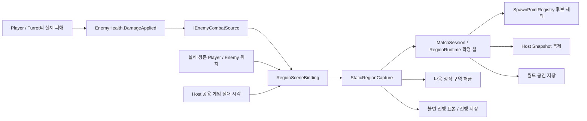

# 정적 지역 확보와 스폰 제한

2026-11-14 · Host 구현 및 실제 Stage1 연결 검증

정적 지역은 **해금과 확보가 다르다.** CU 거리 구역이 열리면 터렛을 사용할 수 있지만, 그 구역을 싸워서 확보한 것은 아니다. 동적 지역과 정적 지역 모두 최종 점유 셀이 원본이며, 터렛 사용 자격은 별도로 읽는다.

## 실제 실행 흐름

진입점은 `InitialStageCompositionRoot.RefreshDynamicInput`이다. 같은 위치에 서 있더라도 확보 타이머는 갱신한다. 사망 Player와 사망 Enemy는 생존 위치 표본에서 제외한다. 피해는 실제 HP가 줄어든 양만 전달하므로 오버킬이나 단순 Despawn을 성과로 세지 않는다. Player/Turret의 팀 기여를 합산하며 출처 불명 피해는 제외한다.

## 정적 진행 규칙

1. 처음에는 첫 구역의 터렛을 해금하고, CU가 있는 유효 셀 하나만 점유한다.
2. 최소 팀 전투 성과를 달성하고, 생존 참가자가 구역에 있으며, 현지 적 압력이 낮으면 60게임 초를 누적한다. 성과를 달성한 뒤 적을 전부 정리해도 확보 유지 시간은 누적된다.
3. 열세 또는 참가자 부재 동안에는 확보 누적을 멈춘다. 이탈 유예가 끝나면 미완료 시도의 시간과 성과를 초기화한다. 참가자 수를 타이머 배속으로 곱하지 않는다.
4. 확보 완료 시 해당 구역의 점유 가능 셀을 확정하고 다음 실제 대상 구역을 자동 해금한다.
5. 확보한 곳이 지속적으로 적 우세가 되면 점유를 잃는다. 해금은 유지한다. 터렛 OFF·냉각·파괴·빈 지역 자체만으로 점유를 회수하지 않는다. CU 시작 셀은 유지한다.

`StaticRegionCaptureSettings` 기본값은 확보60초, 이탈 유예180초, 연속 적 우세30초다. **최소 팀 피해20, 참가자당 허용 적 수2는 조절 가능한 시험값**이다. 현재 압력은 해당 구역의 실제 생존 적 수와 생존 참가자 수로 판단하며, 사거리·공격력까지 종합한 전술 우세 점수로 소개하지 않는다.

시간은 `deltaTime`을 더하지 않고 공용 게임 시각 표본의 차이를 사용한다. 처음 조건을 만족한 표본에서 과거 미확인 시간까지 소급해서 누적하지 않는다. 정지된 게임 시간은 진행하지 않고, 복원 직후에도 이전 시각과의 차이를 더하지 않는다.

## 데이터와 읽기 API

| API | 의미 / 사용하는 쪽 |
| --- | --- |
| `RegionGridDefinition.CapturableCells` | 셀별 점유 가능 지형 마스크. 실제 Host 준비 시 NavMesh 삼각형을 Grid에 투영한다 |
| `definition.CapturableCellCount` | 물·이동 불가 셀을 뺀 진행률 분모 |
| `snapshot.CapturedCells` / `CapturedCellCount` | 현재 확정 점유 셀. 터렛 해금 목록이 아니다 |
| `snapshot.UnlockedRegionIds` / `IsRegionUnlocked(id)` | 정적 터렛 사용 자격. 점유를 잃어도 유지한다 |
| `snapshot.CaptureRatio` | 확보 셀 / 점유 가능 셀. 게임 진행 및 HUD에 사용한다 |
| `binding.StaticCaptureProgress` | Host의 구역별 시간·실제 팀 피해·생존 참가자/적·판정 이유를 담은 불변 표본 |
| `binding.TryUnlockThroughZone(zone)` | 권한 있는 조립부/디버그 도구의 명시 해금. 점유 완료로 처리하지 않는다 |
| `binding.ConfigureCapture(settings)` | Host Game Debugger의 시험값 변경. 실제 진행은 Core가 판단한다 |

실제 운영 Match의 정의는 Scene 조립부에서 준비한다. 값만 만드는 독립 Domain/편집기 검사에서 `RegionGridDefinition`의 기본 마스크는 전체 셀이다. 그것을 실제 지형 검증으로 오해하지 않는다. 운영 Play에서 NavMesh가 없거나 Grid 안에 유효 지형이 없으면 준비를 실패시킨다. 현재 지형 투영은 활성 NavMesh의 XY 삼각형을 사용하므로, 다른 전장의 NavMesh를 동시에 활성화하는 구성은 별도의 Scene 지형 공급 계약이 필요하다.

Enemy의 기존 난이도 예산은 여전히 전체 Grid 분모를 사용한다. **게임 진행률의 유효 지형 분모를 예산에 무작정 대입하지 않는다.** 이번 연결에서 기존 난이도 증가·편성 가중치·AI/공격/스탯을 다시 조정하지 않았다.

## 스폰 후보와 실행

정적 구역의 유효 셀이 모두 확보되면 같은 Region ID의 SpawnPoint 그룹을 Collector/Planner 후보에서 뺀다. 점유 셀에 스폰 반경과 월드 단위 여유 거리가 닿는 개별 지점도 제외한다. 수동 비활성 상태는 별개로 유지한다.

계획 이후에도 개체를 생성하기 직전에 최신 점유를 확인한다. 생성 도중 바뀌었다면 나머지를 중단하고 계획/실제 수를 그대로 기록한다. 이미 생성한 분대를 통째로 다시 실행하지 않는다. 적합 후보가 없으면 일반 스폰을 만들지 않으며 점유 내부의 다른 곳으로 우회하지 않는다.

Enemy 스킬 소환은 Enemy가 정한 종류·수량·타깃 의도를 유지하는 별도 경로다. 정규 할당 제한을 이유로 스킬 편성을 다시 뽑지 않는다. 실제 생성·추적은 [공통 소환 경계](../08_encounter/encounter-spawn-origin-api.md#enemy-스킬-소환)를 사용한다.

## 저장과 네트워크

- `world/spatial` v2는 마스크·해금·점유를 분리해 저장한다. `world/region-start` v2는 동적 시작 설정과 정적 구역의 확보/이탈/열세/성과 진행을 저장한다.
- 공간과 개체를 적용한 뒤 참조 복원 단계에서 진행 상태를 연결한다. 적용 실패 시 공간과 진행 모두 백업으로 되돌린다. 진행 왕복만으로 전체 Enemy·성장·월드 복원이 완료됐다고 표시하지 않는다.
- v1 정적 저장의 셀은 당시 해금 표시였다. 같은 Grid 기하에서 이를 해금으로 이관하고 점유는 CU 한 셀로 시작한다. 전투 확보 완료로 재해석하지 않는다. 현재 지형과 Grid 기하가 맞지 않으면 명시적으로 거부한다.
- Match 준비 wire는 v3, 지역 wire는 v2다. 마스크·해금·점유 전체를 검증하며 혼합 빌드 호환을 주장하지 않는다. Client는 Host의 확정 결과를 읽는다.
- **세부 진행 타이머 표는 현재 Host 진단용이다. 실제 원격 Player의 성과/존재 입력과 Client 타이머 표시 인수는 별도로 확인해야 한다.** 이번 검증은 실제 두 실행 파일의 새 형식을 검증한 결과가 아니다.

## Game Debugger와 확인 결과

`Tools → TeamHJD → Game Debugger`의 Battlefield 지역 패널에서 진행률, 해금, 구역별 확보 초, 팀 피해, 참가자/적 수와 판정 이유를 본다. 시험값은 접은 항목에서 조절한다. 장시간 관측에는 명시적인 Player/CU 피해 보호를 사용할 수 있으며, 보호한 결과는 정상 난이도·패배 검사와 구분한다.

실제 `Assets/Scenes/Gameplay/Stage_1.unity`, 기본16×16에서 유효201/전체256, CU 시작1셀, 첫 구역 확보51셀과 해금[1,2]를 확인했다. Region1의 일반 스폰 할당은0이며, 실제12마리는 점유 밖에 생성됐다. 적 우세로 점유를 잃으면 해금은 유지하고 해당 그룹을 다시 사용할 수 있었다. 수동 OFF 지점은 계속 OFF였다.

위 Scene 연결 검사는 보호·위치 이동·확보2초 등 명시적인 시험 조건을 사용했다. 기본60초 경계와 유예/상실/복원은 별도 자동 검사로 확인했다. 생성 도중 점유 변경 시 계획3/실제1로 중단, 전체201셀 점유 시 일반 생성0, 공간·진행 저장의 메모리 왕복/rollback 및 v1 이관도 확인했다. **전체 Stage1 승패·보스·성장 저장 완료나 자연 플레이 재미 인수를 뜻하지 않는다.**

상세 실행 기록과 한계는 [통합 기록](../../01_planning/02_implementation-records/2026/11/2026-11-13-encounter-stage1-integration.md)을 따른다.
