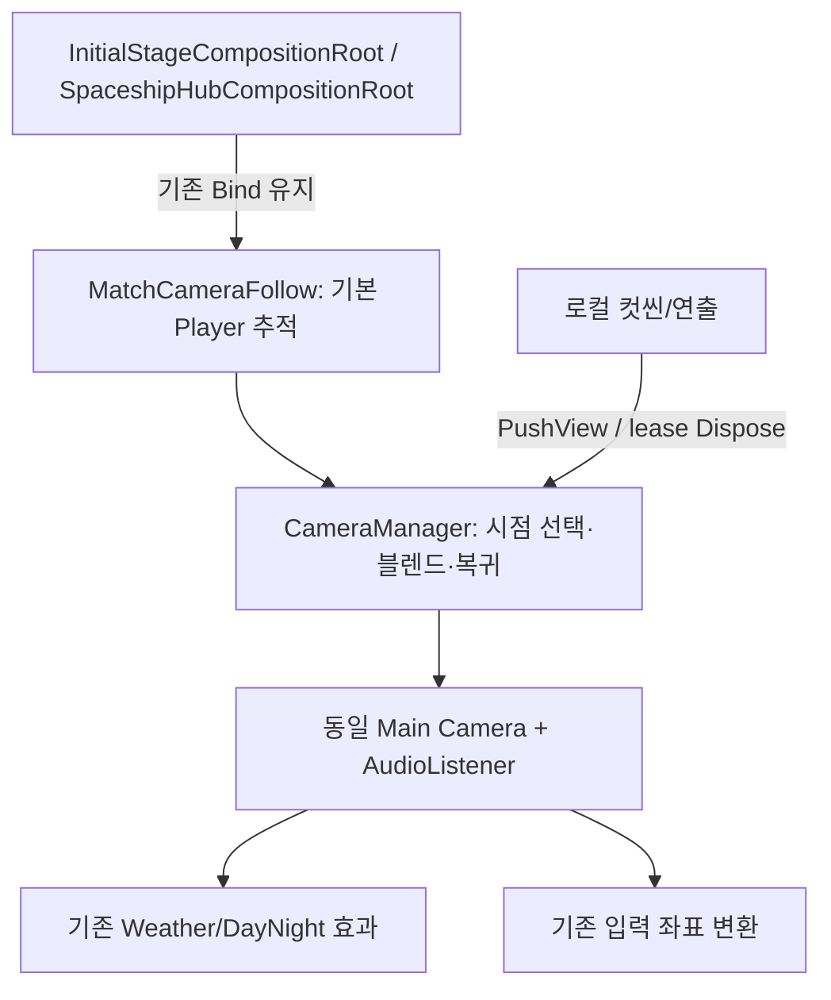

# 로컬 카메라 사용법

2026-11-11 · Core Presentation · 관련 #637

`CameraManager`는 **지금 내 화면의 출력 카메라와 시점 전환**만 관리합니다. Player 이동·조준·게임 정지·네트워크 권위를 관리하는 클래스가 아닙니다. Player가 있는 기존 Scene의 `MatchCameraFollow`가 자동으로 연결하므로 팀원이 매번 카메라를 생성하거나 목록에 등록할 필요는 없습니다.

## 가장 간단한 사용

컷씬 위치에 빈 GameObject를 두고 그 Transform을 전달합니다. 아래 메서드를 연출 시작/종료에서 호출하면 됩니다. 기존 Main Camera와 Weather 컴포넌트를 복제하거나 끄지 않습니다.

```csharp
using System;
using TeamHJD.Game.Presentation.Scene;
using UnityEngine;

public sealed class LocalShotExample : MonoBehaviour
{
    private IDisposable _view;

    public void BeginShot(Transform shotMarker)
    {
        EndShot();
        CameraManager camera = CameraManager.Current;
        if (camera == null || camera.ActiveTarget == null) return; // Player/허브 대상 미준비
        _view = camera.PushView(shotMarker, blendSeconds: .3f, orthographicSize: 14f);
    }

    public void EndShot()
    {
        _view?.Dispose();
        _view = null;
    }

    private void OnDisable() => EndShot();
}
```

- `blendSeconds: 0`은 즉시 전환입니다. 양수는 부드럽게 전환하며 복귀에도 같은 길이를 씁니다.
- `orthographicSize`를 생략하면 기존 카메라의 기본 크기를 사용합니다. 컷씬이 끝나면 기본 크기와 회전으로 돌아갑니다.
- 위치는 XY, 깊이는 기존 출력 카메라 Z를 유지합니다. 회전은 marker의 회전을 사용합니다. 현재 게임의 2D 정사영 기준이며 원근 FOV·다중 화면 기능은 아닙니다.
- marker를 애니메이션으로 움직이면 선택된 시점도 따라갑니다. 여러 연출이 겹치면 마지막 요청이 우선이며, 이전 lease를 먼저 해제해도 이미 끝난 연출이 나중에 되살아나지 않습니다.
- 로컬 시점 블렌드는 게임 정지 중에도 끝나도록 unscaled time을 씁니다. Match 시각·Time.timeScale은 바꾸지 않습니다. 입력 잠금이나 컷씬 재생/종료의 판단은 연출 소유자가 기존 입력/화면 API로 처리합니다.

## 조회와 알림

| API | 사용하는 곳과 의미 |
| --- | --- |
| `CameraManager.Current` | 로컬 화면의 현재 관리부. 조립 전에는 null이며 서버 이벤트로 다른 참가자의 카메라를 바꾸는 API가 아님 |
| `OutputCamera` | 입력 좌표 변환·표현이 사용할 실제 출력 Camera |
| `ActiveTarget` | 현재 선택한 임시 marker 또는 기본 로컬 Player |
| `HasOverride / IsBlending` | 디버그/연출 UI에서 현재 상태 조회 |
| `PushView(...) → IDisposable` | 컷씬 소유자가 임시 시점을 요청하고 종료·취소·OnDisable에서 해제 |
| `TrySetViewSize(target, size) → bool` | 현재 최상위 임시 target의 유한 양수 orthographic 배율만 변경. 전술 화면 휠 확대에 사용하며 다른 target·끝난 lease·잘못된 값은 false |
| `TrySetViewViewport(target, rect) → bool` | 현재 최상위 target의 임시 정규화 화면 영역만 변경. 양수 크기·유한 값·0~1 내부를 검사하며 lease 종료/actor 교체/비활성화 때 기본 영역으로 복귀 |
| `ViewChanged` | 같은 출력 안에서 시점이 바뀐 통지. 구독자는 자기 수명 종료 때 해제 |
| `OutputChanged` | Scene 교체 등으로 실제 출력 Camera가 바뀐 통지. 임시 컷씬마다 발생시키지 않음 |

알림을 받을 때는 먼저 현재 값을 읽고 구독하며, OnDisable/Dispose에서 같은 delegate를 해제합니다. 구독자의 예외는 기록하되 다른 표현 구독자·시점 lease 반환·카메라 정리를 중단하지 않습니다.

`PushView`의 마지막 선택 인수 `viewport`는 전술 지도의 맵 경계 보존에 사용합니다. 미지정한 기존 컷씬은 기본 화면 영역을 유지합니다. Unity는 [부분 rect에서도 기본 aspect를 화면 비율로 계산](https://docs.unity.com/en-us/engine/6000.3/script-reference/unityengine/camera/aspect)하므로 임시 viewport 소유 중에는 `pixelRect.width/height`의 연속 비율을 지정하고 종료 때 `ResetAspect`합니다. 정수 `pixelWidth`를 사용하면 중간 줌에서 반올림으로 맵 밖을 조금 그릴 수 있습니다. 임시 viewport 없이 기존에 수동 지정한 aspect를 사용하는 특수 출력은 별도 설계/검증 범위입니다.

## 기존 Scene과 어떻게 연결되나



`MatchCameraFollow.Awake`가 같은 객체의 Manager를 확보하고, 기존 `Bind`가 로컬 Player를 연결합니다. Match 권위/Client 조립과 시작 허브의 기존 호출자는 바꾸지 않았습니다. Match 종료 시 Core 조립부가 `Bind(null)`로 임시 view를 먼저 지우고 actor를 정리합니다. 허브도 기존 Release에서 해제합니다.

포털의 기존 `SnapToTarget` 호출은 유지합니다. 현재 시점으로 즉시 맞추므로 암전 중 카메라가 먼 거리를 날아오는 장면을 새로 만들지 않습니다. CameraManager가 임시 시점/블렌드를 조정하는 동안 Follow는 위치 쓰기를 양보합니다.

Additive Scene에 Core가 관리하는 출력이 여러 개 있으면 마지막으로 연결한 로컬 출력 하나의 Camera/AudioListener만 활성화합니다. 해당 관리부가 비활성화/제거되면 이전의 살아 있는 관리부로 돌아갑니다. 보조 렌더 카메라·미니맵·관리부 없는 카메라까지 전역으로 꺼버리지 않습니다. 새로운 Scene도 출력의 중복 listener 제작 여부는 확인해야 합니다.

## Weather/Player 담당자가 알아둘 점

이번에는 **World·Player·HUD 소스와 Scene/Prefab을 수정하지 않았습니다.** 기존 출력의 transform/확대만 바꾸므로 같은 Scene의 컷씬에서 Camera.main을 캐시한 입력과 Weather의 카메라 객체 자체는 바뀌지 않습니다.

향후 Scene마다 서로 다른 출력을 유지하는 확장이 필요하면 World/입력 소비자는 `OutputChanged`로 새 출력을 받아 재연결할 수 있습니다. 그 실제 소비자 수정은 승인 후 담당자와 진행합니다. 카메라를 Player의 NetworkObject 목록에 넣거나 날씨 상태의 권위 원본으로 사용하지 않습니다.

실제 검사에서는 Stage의 Weather 관련 컴포넌트 3개와 같은 출력 Camera를 유지하고 게임 정지 중 블렌드·복귀를 확인했습니다. Startup→허브→Stage→허브에서도 각 도착의 유효 대상과 활성 listener 1개를 확인했습니다. 마우스 조준 감각·실제 컷씬 미술/날씨 효과 육안 인수·실제 2인 Player 복제는 이 자동 검사의 완료 범위가 아닙니다. 따라서 #637 전체는 계속 추적합니다.

## 왜 이런 형태인가

[UE PlayerCameraManager](https://dev.epicgames.com/documentation/unreal-engine/API/Runtime/Engine/APlayerCameraManager)는 view target을 관리하고, [SetViewTargetWithBlend](https://dev.epicgames.com/documentation/unreal-engine/API/Runtime/Engine/GameFramework/APlayerController/SetViewTargetWithBlend?application_version=5.5)는 대상 전환과 블렌드 시간을 제공합니다. 여기서는 그 역할 구분을 참고해 기존 Unity 2D 출력에 필요한 부분만 적용했습니다. UE 전체 구조나 새 카메라 프레임워크를 도입한 것은 아닙니다.

[Unity Audio Listener 문서](https://docs.unity.com/en-us/engine/6000.5/manual/audio/reference/class-audio-listener)의 활성 listener 제약도 고려합니다. 프로젝트에서는 실제 사용 버전 6000.3.23f1에서 출력/리스너 전환을 검사했습니다.

[코드 흐름·검증·남은 인수](../../team/reviews/local-camera-management-20261111.md) · [화면/입력 관리](screen-management-api.md) · [우주선 이동](spaceship-travel-api.md)
