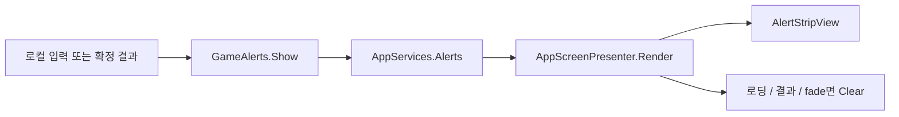

# 공통 Alert API

짧은 조작 결과는 공통 Alert로 보낸다. 배경·테두리·장식 없이 텍스트만 표시하며 성공은 초록, 실패는 빨강, 단순 안내는 HUD의 기본 강조색이다. 거리·냉각·체력처럼 계속 읽어야 하는 정보는 기존 상태창에 둔다. Alert는 로컬 표시이며 Host 검증이나 게임 상태를 바꾸지 않는다.

## 호출

```csharp
using TeamHJD.Game.Application;

// 실제 입력이 실패했을 때 한 번 호출한다. Update/preview에서는 호출하지 않는다.
GameAlerts.Show("Q 슬롯에 스킬을 장착하세요.", key: "skill/unassigned/0");
GameAlerts.Show("터렛을 활성화했습니다.", AlertTone.Success);
GameAlerts.Show("자동 활성화를 요청했습니다.", AlertTone.Info);
```

`Show`의 반환값은 알림 큐 수락 여부다. false를 터렛·스킬 사용 실패로 해석하면 안 된다. App이 없거나 종료됐을 때, 전체 화면 전환으로 표시가 억제됐을 때, 같은 key가 현재 표시/대기 중일 때, 큐가 찼을 때는 false다. key 생략 시 문구 자체를 사용한다. 같은 key를 반복 호출해도 표시 시간이 연장되지 않는다. 게임 네트워크로 복제되지 않으므로 Host에서 모든 참가자의 결과를 무조건 호출하지 말고, 해당 참가자의 UI가 받은 확정 응답에서 호출한다.

Unity 메인 스레드의 UI/Feature 결과에서 사용한다. 백그라운드 작업의 결과는 메인 스레드로 돌아온 뒤 호출한다.

기본 노출은 실시간 2.2초이며 Time.timeScale의 영향을 받지 않는다. 한 번에 한 개만 표시하고 대기는 최대 3개다. 입력·포커스·커서·게임 정지를 점유하지 않는다. 메뉴/설정에서도 일회성 디버그 결과를 읽을 수 있다. 전체 로딩·결과 화면·게임 전환·우주선 왕복 fade 중에는 표시와 대기를 함께 비운다. 이후 묵은 결과를 재생하지 않는다.

## 제작과 위치

- `Assets/Prefabs/UI/Common/AlertStrip.prefab`: 중앙 정렬 텍스트. `AlertStripView`에서 노출/진입/퇴장 시간·글자색과 TMP 표시를 편집한다. fade는 공통 `UiMotion.Sigmoid`를 사용한다.
- 제작 기본 크기는 720×64이며 아래에서 166 reference 단위에 둔다. 기본 위치의 중심은 약 198이며 스킬 슬롯 바로 위다. 글자는 26px, 긴 문구는 최소 22px까지 축소하며 최대 두 줄이다.
- `MinimumScreenScale=0.8`, `MinimumScreenWidth=800`으로 작은 창의 물리 글자 크기를 보강한다. 800px 이상 창에서22pt는 최소17.6 화면 픽셀이며, 더 좁으면 창 폭에 비례한다. 위쪽 경계 계산도 이 로컬 배율을 반영한다. 기존 전투 HUD의 사용자 배율 설정과 별개다.
- `Assets/Prefabs/UI/Common/AlertText.mat`: Alert 전용 FaceDilate0.08/어두운 outline0.14다. Error 의미색은 밝은 coral(0.98,0.72,0.66)이며 Success의 초록과 Info의 금색은 유지한다. 원본 폰트 material을 변경하지 않는다.
- `Assets/Prefabs/UI/Common/AppScreenCanvas.prefab`: Screen Stack 밖의 형제로 AlertStrip을 둔다. Scene Travel Fade가 가장 위다. Screen Stack 안에 넣으면 필드 커서가 전체 화면 UI로 오인할 수 있다.
- 제작 도구: `Tools > TeamHJD > The Developer > Common UI > Configure alerts` (`AlertPrefabSetup.Configure`). Common UI 제작 후 Edit Mode에서 한 번 실행한다. 두 전투 HUD나 Scene은 저장하지 않는다. 다시 실행하면 Alert 모양을 제작 기본값으로 적용하므로 Inspector로 조정한 뒤에는 무작정 재실행하지 않는다.
- 글꼴은 전용 `CombatHudBodySDF`를 재사용한다. setup은 이 전용 에셋에만 공통 문구·미배정·설치 실패 글리프를 준비한다. 원본 NEXON SDF를 저장하지 않는다. 미리보기 기본 문구는 비우며 실행 중 UI 계층을 조립하지 않는다.

### 스킬 선택창·툴팁과의 위치 조정

픽셀/RectTransform 계산은 Presentation과 로컬 HUD의 책임이다. Application의 AlertService에는 넣지 않는다.

```csharp
// 로컬 HUD가 현재 보이는 슬롯/선택창 등의 화면 경계를 계산한 뒤 호출한다.
// occupiedTopScreenY는 아래가 0인 Screen 픽셀 Y다. Canvas local Y나 0..1 비율이 아니다.
alertView.SetScreenBottomClearance(occupiedTopScreenY);

// 로컬 HUD를 해제하거나 더 이상 경계를 소유하지 않을 때 기본 위치로 돌린다.
alertView.ResetBottomClearance();
```

`SetScreenBottomClearance`는 실제 Canvas 카메라와 Scaler에 맞춰 좌표를 변환한다. 텍스트 박스 바닥을 기본 높이와 전달된 경계+`ClearanceGap`(기본 12 reference) 중 큰 값에 둔다. 위치는 호출 즉시 반영하고, 화면 위를 벗어나지 않도록 `TopPadding`을 남긴다. 별도 상하 이동 애니메이션을 추가하지 않으며 원래 HUD의 움직임을 따른다.

로컬 HUD는 보이는 슬롯/Selector 위를 기본 경계로 전달하고, 새 Alert 사각형을 읽어 툴팁·드래그 디스크와 실제 X/Y 겹침이 있을 때만 더 위로 배치한다. 숨긴 요소나 수평으로 멀리 떨어진 디스크 때문에 불필요하게 화면 위로 밀지 않는다. 이 겹침 판단은 HUD의 `CombatHudAlertLayout`이 담당하며 View는 다른 Feature를 검색하지 않는다.

## 실행 흐름과 책임



`AppServices`가 `AlertService`를 소유한다. `AppScreenPresenter`가 전역 호출 scope와 제작된 View를 연결하고 실시간을 전달한다. 종료 때 scope와 큐를 해제한다. Core는 Player나 HUD assembly를 참조하지 않는다. 각 Feature는 실제 요청/판정을 그대로 수행한 뒤 표시할 결과만 전달한다.

## 기존 출력의 정리

- 터렛 ON/OFF·레벨·강화·자동 활성화 결과: 공통 Alert로 전환.
- 처리 중 문구·거리 부족·냉각·잠김: 기존 터렛/CU 상태창 유지.
- 메뉴 디버그 날씨 변경 결과: 공통 Alert. CU 결과는 이미 공통 View가 내보내므로 이벤트를 다시 복제하지 않는다. 제출 전 로컬 실패만 디버그 이벤트에서 표시한다.
- 미배정 Q/E: `SlotUseAttempted`를 받는 로컬 HUD에서 연결한다.
- 설치 실패: 실제 설치 확인 클릭의 결과만 연결한다. preview의 매 프레임 유효성 결과는 대상이 아니다.
- XP 획득 popup, 지속 실패/재시도 화면, 개발자 Console 오류는 별개다. 모든 Debug.Log를 화면 알림으로 바꾸지 않는다.

## 검증

`AlertServiceTests`는 큐/중복/가림/종료를 확인한다. `CommonAlertPresentationTests`는 제작 참조·글자 의미색·입력 비점유·화면 경계 이동과 Reset을 확인한다. 실제 Play에서 Q/E 미배정, 터렛 ON/OFF와 전력 부족, CU 요청, 메뉴 날씨 조작, 로딩/왕복 fade 중 알림 제거, 스킬 선택창·툴팁·드래그 디스크와의 겹침을 따로 확인한다. 실행 결과는 통합 검증 기록에 남기며 코드 작성만으로 통과를 보고하지 않는다.
