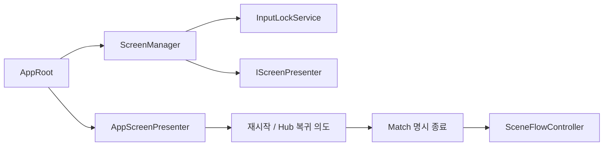

# ScreenManager와 운영 화면

기준일: 2026-10-26, B6 구현. 기존 전투 HUD를 유지하고 실제 UGUI Menu / Loading / MatchResult를 연결했다.

## 책임과 호출

AppServices가 화면/입력 수명을 소유하고 AppRoot가 실제 Presenter factory를 주입한다. Application에는 Unity UI 의존성이 없다. AppRoot.Update가 네트워크 pump 뒤 로딩 상태/로컬 UI를 갱신한다. 필요한 UI에는 ScreenManager를 주입하며 `AppRoot.Screens`를 매 프레임 검색하는 전역 service locator로 사용하지 않는다.

| API | 동작 |
| --- | --- |
| `ShowMenu()` / `ShowLoading()` | 중복 화면·입력 lease를 만들지 않음 |
| `Close(id)` | 자기 화면/Presenter/입력만 해제 |
| `Back()` | 개인 메뉴만 닫음. 최종 결과/commit된 로딩을 임의 취소하지 않음 |
| `BindMatch(matchId)` | 새 Match의 표시 문맥. 이전 메뉴/결과를 닫되 Loading은 유지 |
| `ShowResult(completion)` | 현재 Match의 불변 결과만 적용. 같은 객체의 중복 전달은 무해 |
| `ResetContext()` | Scene 문맥 변경. 결과 자료는 보존하고 이전 운영 화면을 닫음 |
| `IScreenPresenter.SetFocused / Dispose` | 실제 View 선택/표현·구독 수명 |

초기화/해제 실패에도 입력 lease와 다른 Presenter 정리를 시도한다. Presenter의 설정/정리 중 재진입은 거부한다. 새 화면은 표시 자료·Back/입력 정책과 실제 Presenter를 함께 연결한다. 화면 관리자는 승패·Scene 로딩·전투 HP를 소유하지 않는다.

## 결과 → 재시작/복귀

Host Session의 MatchCompleted와 NetworkMatchCoordinator.Completed를 같은 화면 경계에 연결한다. Client는 결과 표시를 위해 로컬 MatchSession을 만들지 않는다. 다른 Match/이미 확정된 다른 결과는 적용하지 않는다. actor/Session 폐기 후에도 불변 결과를 읽을 수 있으며 Backend 재화 지급 승인이나 자동 저장은 포함하지 않는다.

Restart / Return to spaceship 버튼 → `AppRoot.ReplaceGameplaySceneAsync` → Scene 유효성·권한·전송 대기 검사 → 현재 Match 명시 종료 → SceneFlowController 실제 교체 순서다. Client/다중 참가자 이동은 아직 공동 준비 계약이 없으므로 이유와 함께 버튼을 비활성화한다. 실패는 화면에 표시하고 파괴된 actor에서 결과를 재구성하지 않는다.

## 입력과 표시

- Escape는 개인 메뉴 open/Back이다. 공유 Match 시간과 TimeScale을 바꾸지 않는다. 메뉴가 열려도 적은 움직일 수 있다.
- 화면·전환은 각자 입력 token을 소유한다. 닫기로 사망 상태/다른 화면/로딩 잠금을 false로 덮지 않는다.
- Loading이 결과/메뉴보다 앞에 남는다. Additive만 취소하며 Single commit 뒤에는 기다림을 표시한다.
- Unity는 실제 진행 비율, NGO 완료 대기는 이동하는 막대로 표시한다. 임의 백분율을 만들지 않는다.
- 현재 Scene EventSystem을 사용한다. 없는 Scene에서는 화면 open 시 Scene 전용 fallback을 만들며 영구 중복을 만들지 않는다. 기존 Both 입력 설정을 유지한다.
- 키보드 선택은 현재 화면 버튼 사이로 제한하고 유효한 선택만 복원한다.

## 화면 형식

실제 View는 코드로 조립한 UGUI다. Overlay Canvas / 어두운 배경과 패널 / cyan 제목 / 큰 동작 버튼 / 별도 보조 상태 영역을 사용한다. 기준 Canvas 1280×720, 패널 480×410, 제목 29·본문 18·상태 15·버튼 16이다. 기존 HUD/아트와 UI Toolkit을 교체하지 않았다. 향후 prefab View로 바꿔도 수명·입력/결과 계약은 유지한다. 최종 아트·해상도별 외형은 사용자 수동 인수 대상이다.

## 검증

2026-10-28 실제 작업 프로젝트에서 PL이 요청된 메뉴·입력·결과/재시작·복귀를 포함한 수동 확인을 모두 수행하고 이상 없음을 보고했다. [수동 인수 기록](../../99_archive/planning-links/2026-10-28-core-acceptance.md)을 따른다. 이는 현재 로컬 후보의 인수이며 모든 지원 해상도·실제 원격 Player·공동 Scene 이동을 자동 인수한 기록은 아니다.

`b6-screens-fixed.xml`의 계약/종료 8개 통과 뒤, UI 사례의 잘못된 “Hub에는 항상 EventSystem이 있다” 가정을 수정했다. `b6-ui-flow-final.xml` 1/1 통과: 실제 Resume → CU 결과 → Restart → Loading → 새 CU/Match → Hub 복귀 → Hub 메뉴/Resume를 Button.onClick으로 확인했다. 사람의 마우스/키보드 사용성·외형과 실제 원격 Player/공동 이동을 자동 인수한 것은 아니다. [배치 기록](../../99_archive/planning-links/2026-10-26-core-sprint-implementation.md) 참조.

## 11월5일 로딩 화면 변경

로딩은 `LoadingScreenPresenter`로 분리했다. **불투명 검은 배경 + “임시 로딩 화면” 안내 + 화면 아래 얇은 진행 바**를 표시한다. 기존 카드/제목/설명/Cancel 버튼은 로딩 화면에서 제거했고 메뉴/결과 화면은 기존 서식을 유지한다.

`AppScreenPresenter`는 SceneFlowController뿐 아니라 GameFlow의 Mission 준비 완료까지 로딩을 유지한다. 실제 Unity Scene 진행률이 있으면 그 값을 사용하고, NGO 전원 로드/준비처럼 수치 진행률이 없는 구간은 이동하는 바를 표시한다. 가짜 퍼센트를 만들지 않는다. ScreenManager의 입력 잠금과 기존 취소/실패 정리 API는 유지한다. Esc는 프로젝트의 Input System 키 상태를 사용한다.

실제 우주선 진입·키 입력·로딩 입력 차단/해제, 검은 화면/하단 바·버튼/텍스트 없음은 격리 GPU 검사로 확인했다. 시각 자료와 자동/수동 구분은 최신 배치 결과를 따른다.

### 우주선 왕복 전환

우주선↔Initial_Stage는 `SceneFadePresenter`가 담당합니다. 이 구간에서는 `Screen:Loading`, 문구, 진행 바를 만들지 않습니다. 0.3초 암전 → 최소 0.3초 실제 이동/준비 → 0.3초 복귀이며, 실제 Scene 준비가 길면 완전 암전을 유지합니다. Startup에서 우주선으로 처음 들어오는 일반 진입은 기존 임시 로딩 안내·진행 바를 유지합니다.

`AppScreenPresenter`는 페이드가 보일 때 일반 로딩 표시와 Escape 메뉴 처리를 보류합니다. Core 이동 서비스가 전환 동안 입력 lease를 소유하고, 실제 이동/실패 복구는 화면이 완전히 검은 상태에서 끝냅니다. Camera는 `MatchCameraFollow.SnapToTarget()`으로 맞추고 평소 이동 추적은 유지합니다. [왕복 구조·설정·네트워크 경계](spaceship-travel-api.md)를 참고합니다.
