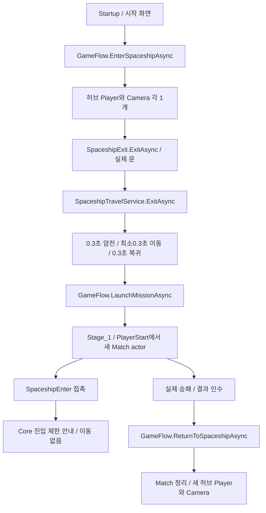

# 우주선 출격과 결과 귀환

현행 기준은 `PROJECT_PLAN.md`의 Spaceship Hub 규칙이다. 우주선은 출격 전 준비와 결과 뒤 귀환을 연결하며, 전투 중 필드에서 내부로 자유롭게 왕복하지 않는다. 과거 임시 Additive 방문과 모두 입장 시 필드 정지를 실제 출입 경로로 사용하지 않는다.

## 호출과 제작 연결

- `ISpaceshipTravel.ExitAsync(player, fieldScene)`은 시작 우주선에서 Mission을 출격하는 경계다. 처음 도착 위치는 전장의 `PlayerStart`가 정한다. 기존 방문 actor를 순간이동하거나 옛 귀환 Marker를 찾아 이동하지 않는다.
- `ISpaceshipTravel.EnterAsync(player)`는 필드 출입구의 의도를 전달한다. 현재는 진입을 막고 공통 Alert로 안내한다. Player/Match/Scene 수와 위치를 바꾸지 않는다.
- `SpaceshipExit`의 `missionSceneName`은 제작된 Mission 경로다. `FormerlySerializedAs("returnSceneName")`로 기존 Scene 값을 보존한다. 현재 우주선의 두 출구 모두 `Assets/Scenes/Gameplay/Stage_1.unity`로 읽힌다.
- `SpaceshipEnter`의 내부 목적 Scene/Marker, `SpaceshipExit`의 origin/귀환 Trigger/padding은 현행 흐름에서 쓰지 않아 제거했다. Scene/Prefab GUID와 오브젝트 참조는 변경하지 않았다.
- 결과 뒤 허브 이동은 문 API가 아니라 `GameFlow.ReturnToSpaceshipAsync`로 Match를 명시 종료한다. 새 Mission/Retry/Resume의 저장 규칙은 [복귀 API](../02_match/match-recovery-api.md)를 참고한다.

공용 `SpaceshipTravelService`는68행 수준의 출격/제한 경계로 줄였다. 옛 임시 방문의 Scene 로드·순간이동·복귀 위치 계산·방문자 추적은 제거했다. 필드 외부 정비·상호작용 UI가 이 변경만으로 구현된 것은 아니다.

## 검증 범위

실제 Startup→우주선→실제 SpaceshipExit 호출→Stage_1을 실행해 Hub/Stage 각각 Player1·활성 Camera1, Stage 새 actor·Mission 준비를 확인했다. 실제 필드 출입구 API 호출은 위치·Match·Scene 수를 유지했다. CU 파괴로 Defeat를 확정한 뒤 명시 허브 귀환을 실행해 Match없음/새 허브 actor1·Camera1을 확인했다.

출구 필드 이름 변경 뒤 실제 우주선 Scene을 읽어 두 경로가 유지됨을 검사했다. Scene을 저장/덮어쓰지 않고 clean Stage_1 편집 상태로 복귀했다. 실제 키보드·물리 문 접촉 연출의 인수와 실제2인 왕복 검증은 별개다. 이전 [11/5 검수 기록](../../01_planning/02_implementation-records/2026/11/2026-11-05-spaceship-fade-results.md)은 당시 동작 기록이며 현행 자유 출입 정책으로 읽지 않는다.
