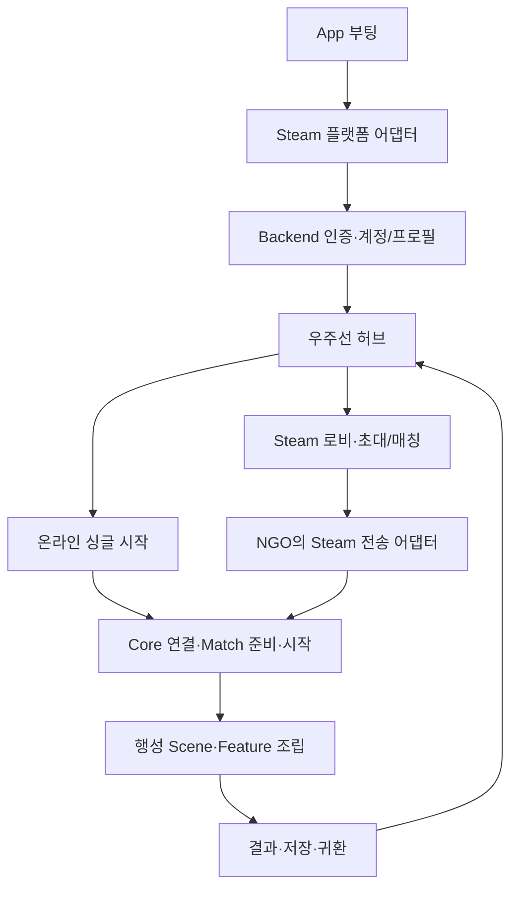

# Steam API 도입 조사와 Core 접합 설계

조사일: 2026-11-02. 상태: 이번 주 조사·설계 산출물 / **후속으로 SDK 초기화·사용자·로비 API를 구현했다. 실제 계정/인터넷 접속 인수는 구분한다**. 현재 Unity 6000.3.23f1, NGO 2.13.3 프로젝트를 기준으로 한다. [Network 계약](network-match-api.md), [전체 배치](../../99_archive/planning-links/2026-11-02-core-sprint-scope.md)를 함께 읽는다.

## 권장 구성과 선택 근거

Steamworks.NET을 C# SDK 어댑터의 우선 검토안으로 둔다. Valve API와 가까운 wrapper여서 공식 Steamworks 문서와 대응하기 쉽고 Unity/C# 지원 및 MIT 라이선스를 제공한다. 실제 도입 시 검증한 release/commit과 native 라이브러리 조합을 고정한다. 패키지 설치·선택 확정으로 해석하지 않는다. [제공자 문서](https://github.com/rlabrecque/Steamworks.NET) · [설치 조건](https://steamworks.github.io/installation/)

Steam 로비와 실제 게임 전송을 별개로 설계한다. 로비는 검색·초대·참가자와 게임 메타데이터를 다루는 서비스다. 실제 NGO 게임 연결은 별도 transport 경계에서 시작한다. 로비 메타데이터는 검색에 필요한 모드·버전·진입 가능 상태 정도로 제한한다. 전장 snapshot이나 매 프레임 상태를 로비에 저장하지 않는다. [Valve 로비 문서](https://partner.steamgames.com/doc/features/multiplayer/matchmaking)

인터넷 연결의 우선 검토안은 SteamNetworkingSockets 기반 NGO transport다. 기존 UTP의 IP/포트에 Steam ID를 넣어 같은 동작을 기대하지 않는다. Steam 쪽 식별·라우팅은 Valve 문서를 따르고, NGO 어댑터는 실제 두 실행 파일로 검증한다. [Steam Datagram Relay](https://partner.steamgames.com/doc/features/multiplayer/steamdatagramrelay)

Unity community 저장소에는 Steamworks.NET 기반 SteamNetworkingSockets transport가 있다. **도입 후보·구현 참고 자료**로만 사용하며 현재 NGO 2.13.3 호환을 보장하지 않는다. 소스/라이선스·SDK 의존성을 확인하고 연결·패킷·해제·재연결·Scene 전환을 재현한 후 채택한다. 필요하면 작은 SDK 어댑터를 유지하는 비용과 비교한다. [transport 원본](https://github.com/Unity-Technologies/multiplayer-community-contributions/tree/main/Transports/com.community.netcode.transport.steamnetworkingsockets)

## 현재 코드에서 접속할 지점

| 현재 경계 | 향후 변경 |
| --- | --- |
| `AppBootstrap.CreateServices`의 FakePlatformService/FakeProfileService | 제품 구성에서 실제 플랫폼·Backend 어댑터 선택. 개발 Fake는 명시적 개발 구성에서 제공 |
| `IPlatformService.SignInAsync` | 현재 Steam 사용자의 식별·플랫폼 준비 결과 제공. SDK 타입은 Infrastructure 내부로 제한 |
| `AppRoot.Update` / App 서비스 pump | App 소유 callback 처리를 게임 정지와 무관하게 계속 수행 |
| `INetworkSession` / `InitialStageNetworkBinding` | 로비의 선택 결과와 검증된 연결 정보를 받아 명시적인 연결·준비·시작 API 호출 |
| `NetworkMatchDescriptor.Participants` | 검증된 계정/Steam 사용자와 실제 연결을 대응시킨 뒤 Match-local 참가자를 확정 |
| `IProfileService` | Backend에서 확정한 계정 진행도. 필드 체크포인트와 로컬 캐시가 권위 프로필을 임의로 대체하지 않음 |

`local-player`, `peer-{connectionId}`, NGO ClientId, Steam ID, Backend 계정 ID를 같은 식별자로 취급하지 않는다. 현재 PlatformUser는 PlayerId를 사용하므로 실제 도입 전에 플랫폼 식별자·계정·Match 참가자 사이의 변환 규약을 명시해야 한다. 로비 데이터나 요청 payload가 주장하는 ID를 인증 결과로 등록하지 않는다.

온라인 싱글의 실제 Backend 준비·실패 정책은 제품 접속 정책과 함께 확정한다. 지금의 Fake 기반 실행을 온라인 인증 완료로 표시하지 않는다.

## 인증과 SDK 수명

Steam ID 조회와 Backend 계정 인증을 구분한다. Backend 연동은 클라이언트가 `GetAuthTicketForWebApi` 응답을 받은 뒤 ticket을 서버에 전달하고 서버가 검증하는 경로를 우선 검토한다. 플랫폼 ticket 수명·취소와 만료된 응답의 세대 검사를 함께 설계한다. 보상·프로필 권한은 검증한 서버 계정에 연결한다. 서버용 키는 클라이언트 설정에 넣지 않는다. [Valve 사용자 인증](https://partner.steamgames.com/doc/features/auth)

App이 SDK 초기화·callback 등록·pump·종료를 한 번 소유한다. callback은 주 스레드에서 처리하고 필드 게임 정지 중에도 pump를 계속한다. 초대·로그인 요청의 취소/완료와 App 종료를 구분하며, Feature/Scene이 SDK를 따로 종료하지 않는다. 초기화 실패는 플랫폼 접속 실패로 전달한다. [Valve SDK 수명 API](https://partner.steamgames.com/doc/api/steam_api)

Steamworks.NET의 Callback/CallResult는 해당 비동기 작업의 수명 동안 참조를 보유하고 종료 때 해제한다. 샘플 SteamManager의 사용 형태는 참고하되 우리 프로젝트는 기존 App 조립/주입 경계를 사용한다. [wrapper callback 문서](https://steamworks.github.io/gettingstarted/)

로비 참가자의 Steam 측 인증과 실제 게임 연결의 참가자 승인, Backend 검증은 각각 확인한다. transport가 제공하는 검증된 peer 식별자와 NGO 연결 ID를 대응시켜 현재 Host 검증 경계로 전달한다. 중복 계정·다른 content version·닫힌 Match 진입은 준비 단계에서 처리한다.

## 후속 구현 순서와 인수

1. 실제 AppID/개발 계정·SDK 후보를 확인하고 패키지/native 조합을 고정한다. App 초기화·식별·callback·종료부터 검증한다.
2. Backend ticket 인증·프로필 조회와 제품 접속 실패/재시도 경로를 연결한다. 취소/계정 변경 후 과거 응답을 적용하지 않는다.
3. 로비 생성·초대·참가/거부와 실제 transport 연결을 구현하고 기존 Match 준비 barrier에 연결한다.
4. 서로 다른 Steam 계정 두 개의 Windows 실행 파일로 참가·버전 불일치·이탈·재시작·App 종료를 확인한다. 인터넷 환경은 기존 loopback 검사와 별도 증거로 남긴다.

실제 SOS/late join, Host Migration, 랜덤 매칭의 최종 정책, 친구·채팅 UI, 제재·재접속 전체를 단순 로비 연결로 완료했다고 표시하지 않는다. 로비 owner 변경을 게임 권위/상태의 자동 이전으로 사용하지 않는다.

후속 SDK 구현 착수 전에 확인할 입력은 실제 AppID와 테스트 계정/소유권 준비, transport 후보 검증 결과, 운영 Backend 인증 엔드포인트다. 이번 조사·설계는 해당 계정 접근이나 패키지 설치를 수행하지 않았다. UI는 기존 HUD/우주선 콘솔·폰트 에셋을 사용하고 새 화면 구성이 필요한 경우 구체안을 PL에게 확인한다.

## 2026-11-04 재검토

SDK/Backend/transport 구현은 추가하지 않았습니다. 현재 신규 Startup→GameFlowController→AppGameFlowHost→AppRoot의 진입 경로에 플랫폼 준비/인증을 연결하는 방향으로 기존 설계를 유지합니다. 현재 Fake 플랫폼으로 우주선에 진입한 것을 온라인 인증 완료로 표시하지 않습니다.

Valve 공식 문서에서 GetAuthTicketForWebApi의 응답 callback을 기다린 뒤 서버가 ticket을 검증하는 경로를 다시 확인했습니다. callback pump는 App 수명에서 수행하고 필드 정지와 분리합니다. 로비 구성과 실제 게임 접속/Match 준비도 별도 단계로 유지합니다. Steamworks.NET의 Callback/CallResult 참조 수명과 RunCallbacks 요구도 다시 확인했습니다.

근거: [Valve 인증](https://partner.steamgames.com/doc/features/auth), [SDK callback/종료](https://partner.steamgames.com/doc/api/steam_api), [로비](https://partner.steamgames.com/doc/features/multiplayer/matchmaking), [wrapper callback](https://steamworks.github.io/gettingstarted/). SDK/transport 호환 실험과 실제 AppID/테스트 계정·운영 인증 엔드포인트는 실제 도입 단계의 입력이며 이번 조사 완료를 막는 미구현으로 혼동하지 않습니다.

## 2026-11-05 접점 재확인

현재 Core는 같은 Build의 UTP Host/Client에서 공유 Scene 로드→전원 준비→새 Match 시작·귀환을 확인했다. 향후 Steam 접속 어댑터는 이 연결/준비/게임 수명을 유지하고 transport·플랫폼/계정 인증만 실제 제공자로 연결한다. loopback UTP 성공은 Steam 인터넷 접속 인수가 아니다.

Valve의 [인증 문서](https://partner.steamgames.com/doc/features/auth), [멀티플레이 경계](https://partner.steamgames.com/doc/features/multiplayer), [SDR](https://partner.steamgames.com/doc/features/multiplayer/steamdatagramrelay), wrapper의 [Callback 수명](https://steamworks.github.io/gettingstarted/)과 [community SteamNetworkingSockets 원본](https://github.com/Unity-Technologies/multiplayer-community-contributions/tree/main/Transports/com.community.netcode.transport.steamnetworkingsockets)을 다시 확인했다. 로비 참가와 실제 게임 전송·검증된 계정은 별개이며 기존 설계를 유지한다. 후보 transport의 현재 프로젝트 호환성은 실제 도입 실험 전까지 보장하지 않는다. SDK 설치나 계정/키·인증 설정은 변경하지 않았다.

## 11월5일 SDK 착수 후 변경

고정 Steamworks.NET 의존성, App 소유 SteamPlatformService와 명시 개발/Steam 설정, 사용자 식별·친구 공개2인 로비/초대 API를 구현했다. [실제 설정/호출 방법](steam-api.md)을 따른다. 후보 AppID는4336820이며 실제 앱/계정 이용 권한 확인이 필요하다. SDK 초기화/로비는 자체 Backend 전체를 기다리지 않고 시험할 수 있다. 위 초기 조사 당시 미설치 설명은 당시 범위다. 실제 Steam NGO transport와 운영 Backend 인증은 여전히 후속이며, 로비 참가를 게임 접속 완료로 해석하지 않는다.
