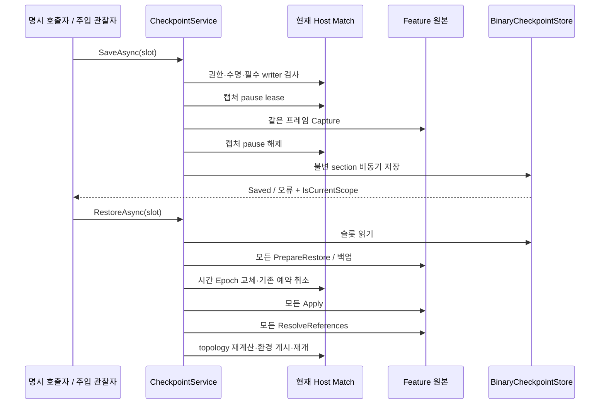

# 체크포인트 실행·요청 API

11월5일 낮밤 후속: [낮300초/밤300초와 Weather 연결](../09_world/day-night-api.md)을 구현했다. 실제 시간대 source·world/time-of-day 저장이 추가됐으며, 운영 Weather writer는 김진태 담당으로 유지한다. 아래 초기 단계에서 source가 없었다는 설명은 당시 기록이다.

갱신: 2026-11-05 / 실제 통합 작업 브랜치 기준. 전체 파일 형식·손상/원자 교체는 [저장소 API](checkpoint-storage-api.md), 실제 writer 목록과 수동 확인은 [Feature 통합 안내](../01_core/core-feature-integration-guide.md)를 본다.

## 책임과 호출 순서

`CheckpointService`는 저장/복원을 실행하고, `ICheckpointStore`는 불변 binary 자료의 IO를 맡는다. `ICheckpointParticipant`는 실제 Feature 원본을 캡처·검증·적용한다. `CheckpointRequestChannel`과 `CheckpointTrigger`는 외부 관찰자의 요청을 실행기에 연결한다. 실행기 자체는 자동 저장 시점을 결정하지 않는다. 현재 Stage의 등장 전·실제 처치 후 요청은 별도 [StageCheckpointGate](../02_match/stage-progression-api.md#등장-전처치-후-자동-저장)가 담당한다. 필수 Weather writer 연결 전에는 이 요청도 전체 저장을 거부한다.



## 등록과 해제

`InitialStageCompositionRoot.BindCheckpoints`가 현재 Scene의 실제 writer, 공용 Random/공간 writer, 현재 Encounter consumer가 제공하는 명시 Executor writer를 조립한다. 같은 Scene의 이전 Debug 생성기를 writer로 선택하지 않는다. 필수 section이 빠지면 저장/복원을 거부한다.

동적으로 만든 실제 writer는 `scene.RegisterCheckpointParticipant(writer)`로 연결하고 반환 lease를 actor/Feature 종료 시 해제한다. 원격 Player도 Host actor 등록 후 실제 writer가 필요하다. 중복 키·실행 중 메타데이터 변경은 오류다. Scene은 저장 scope부터 해제한 뒤 나머지 시간/Feature 바인딩을 정리한다.

## 호출 예

```csharp
var slot = new CheckpointSlot("manual");
var saved = await scene.Checkpoints.SaveAsync(slot);
var restored = await scene.Checkpoints.RestoreAsync(slot);

// 재화도 저장 값으로 되돌리려는 명시 정책. 기본은 현재 재화·경험치를 유지한다.
var policy = new CheckpointRestorePolicy(CurrencyRestorePolicy.RestoreCheckpoint);
var rollbackCurrency = await scene.Checkpoints.RestoreAsync(slot, policy);

// 허브/재실행: 새 Match 구성과 실제 복원까지 조율한다. 현재는 1인 Story 경로다.
var resumed = await app.ResumeCheckpointAsync(slot,
    "Assets/Scenes/Gameplay/Initial_Stage.unity");
```

`Status`, `Reason`, `IsCurrentScope`를 확인한다. 이미 파일 교체가 끝난 저장을 Scene 종료만으로 실패라고 바꾸지 않는다. 이전 실행의 결과로 현재 UI를 갱신하지 않는다. 슬롯 이름은 경로가 아니라 1~64자 ASCII 논리 이름이다.

## 경제 정책과 실제 actor

World는 저장 값으로 복원한다. Progression과 Currency는 기본적으로 현재 값을 보존하며 Currency만 명시 선택으로 되돌릴 수 있다. 이 정책은 실제 제품 경제/Backend 구현 완료를 뜻하지 않는다.

터렛·적·Player 장치/탄환을 단순 Clear하는 대신 실제 상태를 재구성한다. 논리 EntityId·Player 슬롯·콘텐츠 ID를 쓰고 과거 Unity InstanceId/NetworkObjectId/Coroutine/delegate는 영속화하지 않는다. 전체 actor를 먼저 적용한 뒤 표적과 미사일 claim을 다시 연결한다. 비활성화된 이전 actor는 해석 대상에서 제외한다. 예산/예약·자동 큐·열·발사 대기·살아 있는 투사체·스킬 배치 중 의도·남은 재사용/수명도 각 원본이 제공한다.

같은 실행의 요청 중복 방지 장부와 관측 sequence는 뒤로 돌리지 않는다. 복원된 예약은 새 요청 ID로 현재 Match에 등록한다. Animator transition과 폭발/원거리 Attack trigger 미소비 프레임은 명확히 캡처를 거부한다. 동적 source 개체 writer/등록 세대 연결이 없는 source 예약도 저장 성공으로 생략하지 않는다.

## 실패와 검증 상태

Prepare는 실제 원본을 바꾸지 않는다. 적용 실패 시 준비한 모든 백업을 역순 복구하고 참조를 다시 연결한다. 백업 복구/정리에 실패하면 Fault로 잘못된 월드를 계속 실행하지 않는다. 기술적 복원 실패를 게임 패배/보상으로 만들지 않는다.

현재 실제 Initial_Stage에는 **world/weather가 없다**. 진태가 실제 날씨·예고 큐·CountTick 남은 예약 writer를 등록해야 전체 저장을 사용할 수 있다. `CountTick.CaptureTimerState` / `RestoreTimerState`를 제공했다. 시간 복원으로 과거 예약이 취소되므로 적용 단계에서 다시 연결한다.

실제 Scene의 Core writer는 외부 Weather 검증 대역을 두고 HP/배치·탄환/미사일·예약을 저장한 뒤 두 번 복원했다. 이 결과와 실제 Weather 통합은 별개다. 2인 재접속, 제품 프로필/경제 원본과 자동 저장 사건은 후속이다. 과거 제외/실험 기록은 [11월2일 HOLD](../../99_archive/planning-links/2026-11-02-feature-integration-hold.md)에 보존한다.

## 파일에서 새 Match로 복원한 검사

실제 슬롯에 저장하고 우주선으로 귀환한 뒤 `AppRoot.ResumeCheckpointAsync`로 읽어 새 Scene/새 Match에 복원했다. 적의 논리 ID·Player HP·감속·필드 시각과 출입 위치를 확인했다. 새 ID에 저장된 stage/seed/content를 적용하며 과거 SDK ID를 재사용하지 않는다. writer 거절·읽기 전 취소·Scene 입장 도중 취소에서 새 Match/적 정리와 명시 귀환도 확인했다. Weather는 **격리 검증 대역**이므로 운영 Scene의 누락 gate를 없애지 않았다.

Player `movement-effects` section은 각 효과의 배율과 남은 게임 초를 가진다. Enemy writer v2는 원거리 발사 전후·완료 대기와 정지 중 보류 이벤트를 가진다. 이를 생략한 구형 개발 슬롯은 현재 필수 writer/버전에 맞지 않으면 거절한다. 테스트 중인 슬롯은 현재 버전으로 새로 저장한다.
