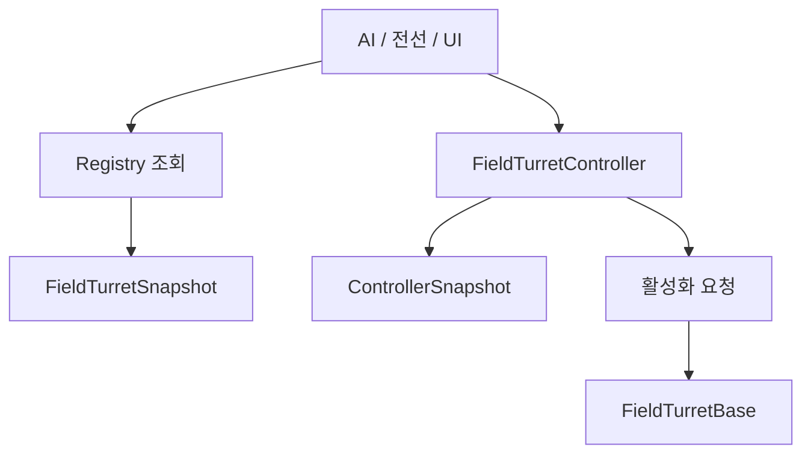
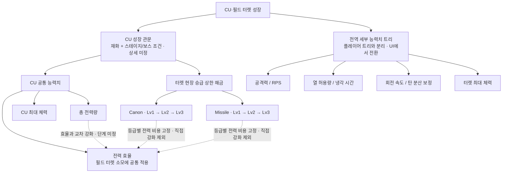

# 터렛 연동 가이드

최종 갱신: 2026-10-26
상태: Canon / Missile 구현 가이드. 제품 정책과 네트워크 계약은 별도 합의 대상.

냉각·수동 조작·강화 제한은 main `8d08001a`에 병합된 PR #525까지 포함한다.

## FieldTurret 명칭

맵에 배치된 터렛 시스템은 **FieldTurret**, 플레이어가 설치하는 보조 터렛은 기존 **TemporaryTurret / PlayerTurret**로 구분한다. FieldTurret 명칭 변경은 PR #547로 main에 반영됐다. 실제 화면·다중 클라이언트 인수와는 구분한다.

| 이전 이름 | 현재 이름 |
| --- | --- |
| `TurretBase` / `TurretController` | `FieldTurretBase` / `FieldTurretController` |
| `TurretDefinition` / `TurretInstanceRegistry` | `FieldTurretDefinition` / `FieldTurretInstanceRegistry` |
| `CanonTurretLv1`~`Lv3` | `FieldCanonTurretLv1`~`Lv3` |
| `MissileTurretLV1`~`LV3` | `FieldMissileTurretLV1`~`LV3` |
| `LaserTurret` | `FieldLaserTurret` |
| `TowerBullet` / `TowerMissile` | `FieldTurretBullet` / `FieldTurretMissile` |
| `DefaultCanonTurret` / `DefaultMissileTurret` / `DefaultLaserTurret` | `DefaultFieldCanonTurret` / `DefaultFieldMissileTurret` / `DefaultFieldLaserTurret` |
| `TeamHJD.Game.Turrets` 및 `.Contracts` / `.Tests` | `TeamHJD.Game.FieldTurrets` 및 `.Contracts` / `.Tests` |
| `Assets/Scripts/Features/Turrets` | `Assets/Scripts/Features/FieldTurrets` |
| `Assets/Prefabs/Turrets` / `Assets/Data/Turrets` | `Assets/Prefabs/FieldTurrets` / `Assets/Data/FieldTurrets` |
| `TurretTest.unity` | `FieldTurretTest.unity` |

활성화·체력·수리·승급·해금 API의 동작과 Definition ID, 직렬화된 필드 이름, 레이어·태그는 유지한다. 스크립트·프리팹·데이터의 `.meta` GUID를 유지하고 Unity 객체 및 런타임 상태 타입에 `MovedFrom` 정보를 추가했다. 외부 소비자는 새 타입·네임스페이스·경로를 사용한다. Core의 `TurretState`, `TurretSpatialInput`, `IBattlefieldTurretInputSource`, Enemy의 `TargetType.Turret` 같은 공용 계약과 플레이어 터렛 타입은 이번 변경에서 이름을 유지한다.

다른 영역에서 터렛을 사용한다면 내부 구현부터 읽을 필요는 없다. 필요한 작업에 맞는 문서부터 확인한다.

| 하고 싶은 일 | 먼저 읽을 문서 |
| --- | --- |
| 테스트 씬에 터렛 배치 | [빠른 시작](quick-start.md) |
| 초기 상태를 지정해 터렛 생성 | [명시적 초기화](initialization.md) |
| 터렛 ID 조회와 활성화 또는 피해 적용 | [API 사용법](api-reference.md) |
| AI와 전선 및 UI에 값 제공 | [스냅샷](snapshots.md) |
| 발사부터 피격까지 실행 순서 확인 | [전체 구조와 Mermaid](turret-system-guide.md) |
| 연동 전 확인해야 할 제약 | [검증과 제한 사항](testing.md) |
| Initial 씬의 플레이어 상태·터렛 조작 UI | [Player UI API](../06_player/player-ui-api.md) |

## 읽기와 변경의 경계

정보만 필요한 소비자는 `FieldTurretSnapshot` 또는 `FieldTurretControllerSnapshot`을 받는다. 복사본을 변경해서 터렛 상태를 바꿀 수는 없다. 상태 변경은 명령 API로 요청한다.

상세 구현의 원본은 [Turret System Guide](turret-system-guide.md)다. 이 문서 묶음은 외부 사용자가 필요한 API를 찾기 위한 입구이며 새 게임 규칙을 정의하지 않는다.

## CU·필드 터렛 공통 성장 트리 초안 — 2026-11-05

회의 검토용 설계 초안이다. 아래 노드·연결은 구현 완료를 뜻하지 않는다. [10월 30일 기획 보강회의](../../01_planning/01_meetings/2026/10/2026-10-30-planning-review.md)의 성장 경계를 기준으로 한다. 단계 수·재화량·보스/스테이지 번호·수치·저장/네트워크 계약은 미정이다. Markdown 안의 Mermaid로 관리하면 GitHub와 Docs에서 다이어그램을 함께 검토할 수 있다.

- CU 관문에 따라 승급 상한을 열되, 실제 개별 승급은 해당 터렛에 접근해서 요청한다. 현행 개별 업그레이드 API를 전역 트리로 바꾸는 작업은 이 초안에 포함하지 않는다.
- 전역 세부 능력치의 적용 범위(모든 터렛 공통/종류별), 노드 선행 조건, 중첩 방식, 초기화·환불, 기존 경로 데이터 전환은 회의에서 결정한다. 가지는 후보 목록이며 상호 배타 선택을 확정한 것이 아니다.
- CU 총 전력량과 효율을 같은 단계에 동시에 올리지 않는 방향만 반영했다. CU HP의 단계 배치도 미정이다.

## 상태별 타기팅·수리 기준

Enemy는 기존 `TargetableComponent.CanBeTargeted`를 읽는다. 이 속성은 컴포넌트 활성 여부와 체력으로 계산된다. `DamageableTargetAdapter`가 터렛의 체력과 대상 허용 여부를 이 컴포넌트에 반영한다. `FieldTurretBase`에 동명 속성을 추가하지 않는다.

아래 타기팅 표는 요구 동작이며 실제 Enemy 반영 완료를 뜻하지 않는다. 사용자 요청에 따라 Enemy 코드는 이번에 수정하지 않았다. `DamageableTargetAdapter`의 `IsActivated` 제한을 해금 조건(`!IsLocked`)으로 교체하고 기존 생존·활성 조건을 유지하도록 조수빈에게 요청한다. CU의 기존 생존 판정과 몬스터가 조회하는 공통 API는 유지한다.

| 터렛 상태 | Enemy 타기팅 | 일반 수리 `CanRepair` |
| --- | --- | --- |
| 해금된 ON / OFF / 냉각 중 | 가능 | 체력이 부족하면 가능 |
| 잠금 | 불가 | 불가 |
| 파괴 / 복구 진행 중 | 불가 | 일반 수리 불가, 별도 복구 경로 |
| 자동 활성화 진행 중 | 정상 상태라면 가능 | 수동 조작 차단으로 불가 |
| 초기화 전 / 비활성 컴포넌트 | 불가 | 불가 |

타기팅은 [10월 10일 회의](../../01_planning/01_meetings/2026/10/2026-10-10-regular-meeting.md)의 OFF와 잠금 구분, 복구 중 제외는 [10월 24일 회의](../../01_planning/01_meetings/2026/10/2026-10-24-regular-meeting.md)를 따른다. **일반 수리를 ON/OFF/냉각 중 모두 허용하는 것은 기존 구현 기준이며, 회의에서 이 상태별 허용 표까지 확정한 기록은 확인하지 못했다.** 수리 도구·키·거리 판정은 Player 요청 경계에서 별도로 확인한다.

## 자동 활성화 정책 변경

- 버튼 시점에 후보·적 수·동률 비교값을 저장한다. 잠금·파괴 후보를 제외한다.
- 기본 정렬은 적 수 내림차순 → 공격력/활성화 전력량 내림차순 → InstanceId 오름차순이다. 기존 선택형 ScoreProvider는 유지한다. 회의는 공격력 기준이므로 기존 `DpsPerPower`와 구분한다. 전력 소모 0인 후보의 동률 효율 값은 0으로 처리한다.
- 켜진 터렛을 모두 OFF하고, 다음 후보가 냉각 중이거나 반환 대기 전력이 부족하면 그 후보 순서를 유지한다. OFF 시 전력 반환과 냉각은 동시에 시작한다. 60초 쿨타임과 수동 조작 차단을 유지한다.
- **예외 구현 기준:** 현재 전력 + 반환 예정 전력을 모두 합쳐도 비용에 못 미치는 후보는 건너뛴다. 잠금·파괴·비활성·등록 해제된 후보도 제외한다. 모든 후보가 처리되면 종료한다. 이는 영구 대기 방지를 위한 처리이며 회의에서 별도로 확정한 예외 정책은 아니다.

## 다음 회의 안건: 우주선 진입

우주선 진입 시 정지 방향과 실제 시스템 처리 계약을 구분한다. 이번 변경에서는 진입 동작을 구현하지 않는다.

- 자동 활성화 진행 중 진입하면 큐를 유지·중단·취소 중 어떻게 할지.
- 전력 반환·냉각·과열·60초 쿨타임을 정지할지, 복귀 시 어떻게 재개할지.
- 멀티플레이에서 한 명의 진입과 전원 진입을 다르게 처리할지, Core가 보낼 진입/복귀 이벤트와 권한 주체.
- 수리·복구 진행량 및 저장 처리, 복귀 직후 재검증 범위.
