# Turret System Guide

작성일: 2026-09-24
최종 갱신: 2026-10-26
상태: Sprint 1 전환기 구현 가이드 / Canon·Missile 기준

냉각·수동 조작·강화 제한은 main `8d08001a`에 병합된 PR #525를 기준으로 최신화했다.
미사일 예약 토큰과 시간 기반 발사체 수명 처리는 PR #547로 main에 반영됐다. 문서에 기록한 로컬 테스트와 실제 Stage 인수는 구분한다.

[문서 목차](../../README.md) · [코드·아키텍처 명명 규칙](../00_foundations/naming-and-architecture-conventions.md) · [System Re-architecture Charter](../00_foundations/system-rearchitecture-charter.md) · [Sprint 1 Stage 1 PoC](../../01_planning/SPRINT_1_STAGE_1_POC.md)

맵 배치 터렛은 플레이어 보조 터렛과 구분하여 **FieldTurret** 명칭을 사용한다. 타입·어셈블리·에셋 경로 변경과 유지한 공용 계약은 [FieldTurret 명칭 안내](index.md#fieldturret-명칭)를 참고한다.

## 1. 문서 목적과 적용 범위

외부 영역에서 API를 사용하려면 [터렛 연동 가이드](index.md)부터 읽는다. [빠른 시작](quick-start.md)과 [API 사용법](api-reference.md) 및 [스냅샷](snapshots.md)을 별도 페이지로 제공한다. 이 문서는 내부 구현과 Mermaid 실행 흐름의 상세 기준으로 유지한다.

이 문서는 현재 Canon Turret과 Missile Turret의 데이터 구조, 실행 흐름, Prefab 설정법과 확장 규칙을 설명한다. 터렛 코드를 수정하거나 AI·전력·업그레이드 시스템에서 터렛 정보를 사용할 때 먼저 확인한다.

이 문서는 현재 구현을 설명하는 **전환기 가이드**다. 제품 규칙이나 New Core의 최종 계약을 새로 확정하지 않는다. 게임 범위와 장기 구조가 충돌하면 [System Re-architecture Charter](../00_foundations/system-rearchitecture-charter.md)와 [Docs Source of Truth](../../README.md#source-of-truth)가 우선한다.

현재 적용 범위는 다음과 같다.

- Canon Turret LV1~LV3, Stage 1~3
- Missile Turret LV1~LV3, Stage 1~3
- `FieldTurretDefinition`, `FieldTurretRuntimeState`, `FieldTurretBase`
- 로컬 런타임 등록을 위한 `FieldTurretInstanceRegistry`
- 씬별 제어를 위한 `FieldTurretController`와 독립 전력 모델 `FieldTurretPowerBudget`
- 컨트롤러 전체 운영 상태를 위한 읽기 전용 `FieldTurretControllerSnapshot`
- AI와 전선 소비자를 위한 읽기 전용 `FieldTurretSnapshot`
- 터렛 체력·파괴·플레이어 복구 흐름
- 인스턴스별 Damage/Power 보정과 Stage 1 프리팹 교체 방식의 레벨 승급
- Enemy PoC의 `PoCTargetable` 연결
- `FieldTurretBullet`, `FieldTurretMissile`로 전달되는 공격력

다음 항목은 이 문서의 현재 적용 범위가 아니다.

- Laser 전용 승급 경로
- 파괴 연출과 복구 비용·시간의 최종 게임 규칙
- 승급 비용·시간과 Spaceship Research 연동
- NGO를 통한 `InstanceId`와 상태 동기화
- AI 평가값·위협도·전선 정보를 집계하는 정식 Turret Manager

## 2026-10-24 제품 방향과 현재 구현의 구분

완성된 전사 대조 기준으로 켜기의 별도 준비 지연 없음, 정상 정지 전 남은 과열 자동 냉각·이후 전력 반환, 파괴 전력 일부 예약과 수동 끄기 금지 방향을 구분한다. **일반 OFF의 반환 시점은 2026-10-29 황재동 정정으로 대체한다. 즉시 비활성화·전력 반환을 시작하고 남은 과열도 동시에 냉각하는 기존 동작을 유지한다.** 가동 시간 없음은 무제한 연속 사격이 아니다. Interaction range 내 Repair(일반 HP)와 Restore(HP 0 복구)의 비용은 시간이며, 취소 후 진행 유지·복구 중 파괴 상태 취급 방향을 기록했다. 무기 선택 대신 키 유지 수리 상태를 쓰되 스패너 모션은 유지할 수 있다. 수리 드론은 보류하며 정확한 비율·시간·입력·저장·네트워크 정책과 현재 코드 일치 여부는 미정·미검증이다. CU HP/EP 동시 성장·터렛 레벨별 Minor Upgrade 상한도 제품 방향이며 예시 상한을 현재 API 고정값으로 바꾸지 않는다.

이는 아래 API·상태 머신이 이미 그 규칙을 구현했다는 뜻이 아니다. 현재 스패너 타격 수리와 신규 시간 기반 수리 방향을 구분하고 후속 구현·실행 검증으로 확인한다. [Product Plan](../../00_product/PROJECT_PLAN.md#41-power-budget) · [회의 검토 기록](../../01_planning/01_meetings/2026/10/2026-10-24-regular-meeting.md)

## 2. 핵심 원칙

### PoC 통합을 위한 임시 사운드 비활성화

`Assets/Scripts/Features/FieldTurrets`의 런타임 스크립트에서 `AudioManager` 호출을 주석 처리했다. Canon과 Missile 및 기존 Laser의 활성화 사운드와 발사 사운드가 재생되지 않는다. 미사일 비행 사운드와 폭발 사운드 및 `WitchSound` 호출도 비활성화했다. 2026-10-09 Legacy 제거로 AudioManager 실행 코드 자체도 제거했다. 신규 Audio service 연결은 별도이며 이번 이관에서 효과음을 복원하지 않는다.

Canon과 Missile은 CU를 직접 찾지 않는다. 전력은 `FieldTurretController`가 소유한 `FieldTurretPowerBudget`을 통해 공급한다. Missile 탐색과 재탐색은 `EnemyController`를 기준으로 하고 Canon 탄환과 Missile 폭발 피해는 `EnemyHealth.TakeDamage(int)`로 전달한다. 아래 Mermaid도 해당 연결에 맞춰 갱신했다. Editor의 `FieldTurretTestSceneBuilder`가 AudioManager를 복사하는 기능은 그대로 유지한다. 사운드 연동이 준비되면 주석 처리한 호출을 복원해야 한다.

### CU와 터렛 제어 및 전력 모델의 분리

`FieldTurretController`는 씬의 전력 예산을 소유하는 MonoBehaviour다. 외부에서는 `RequestActivation(instanceId, shouldActivate)`로 같은 컨트롤러를 사용하는 터렛에 활성화 요청을 전달할 수 있다. 없는 ID나 다른 전력 공급자를 사용하는 터렛이면 `PowerSourceUnavailable`을 반환한다. 기존 `FieldTurretBase.RequestActivation(bool)`도 호환 API로 유지한다.

`FieldTurretPowerBudget`은 Unity와 CU를 참조하지 않는 C# 클래스다. 가용 전력과 최대 전력 및 반환 대기 전력을 관리한다. 활성화 전력 예약과 업그레이드 차액 변경 및 비활성화 후 지연 반환을 처리한다. `FieldTurretController.Update`는 `Tick(Time.deltaTime)`을 호출해 반환을 진행한다. CU가 없어도 전력 계산은 작동한다.

씬에 활성 `FieldTurretController`를 미리 배치하고 최대 전력을 설정하는 것을 권장한다. 터렛의 `_turretController` 참조로 명시적으로 지정할 수도 있다. 참조가 없으면 자신의 씬에서 활성 컨트롤러를 찾으며 없으면 런타임에 기본 전력 250인 컨트롤러를 생성한다. 이름이 `ControlUnit`인 오브젝트는 필요 없다. 런타임 용량 변경은 `TrySetMaximumPower(int)`를 사용한다. 이미 예약된 전력보다 낮은 용량은 거부한다. 기존 예약과 반환 대기를 유지하므로 용량 변경으로 사용 중인 전력을 임의로 초기화하지 않는다.

`ControlUnitHealth`는 CU 체력, 피격, 접근 지점과 상태 이벤트만 담당한다. 최대 체력은 `ControlUnit.asset`의 `FieldTurretDefinition`에서 읽으며 `DataManager`의 CU 수치를 사용하지 않는다. CU와 `FieldTurretBase`는 모두 `IDamageableTarget`을 구현하므로 Enemy는 구체 타입이나 Registry를 확인하지 않고 같은 `ApplyDamage(int)` 계약으로 피해를 준다. Definition의 `FieldTurretRole.ControlUnit`은 CU를 무기 터렛과 구분한다.

CU는 Enemy의 `TargetType.Turret` 후보에는 포함되지만 `FieldTurretBase`를 상속하거나 `FieldTurretInstanceRegistry`에 등록되지 않는다. 따라서 터렛 등록 수, 전력 예약, 자동 활성화, 개별 터렛 UI에는 포함되지 않는다. 터렛 전력은 `DataManager`와 CU 컴포넌트를 거치지 않고 `FieldTurretController`가 직접 소유한다. CU 파괴 시 `Destroyed` 이벤트를 한 번 발행한다. `HealthChanged`는 체력 변경을 전달한다. 레거시 `InGameManager`와 `AlertManager`를 조회하거나 호출하지 않는다. 현재 PoC 승패 정책은 패배 판정을 구현하지 않았으므로 파괴 이벤트를 게임 오버에 연결하는 소비자는 후속 연동 대상이다.

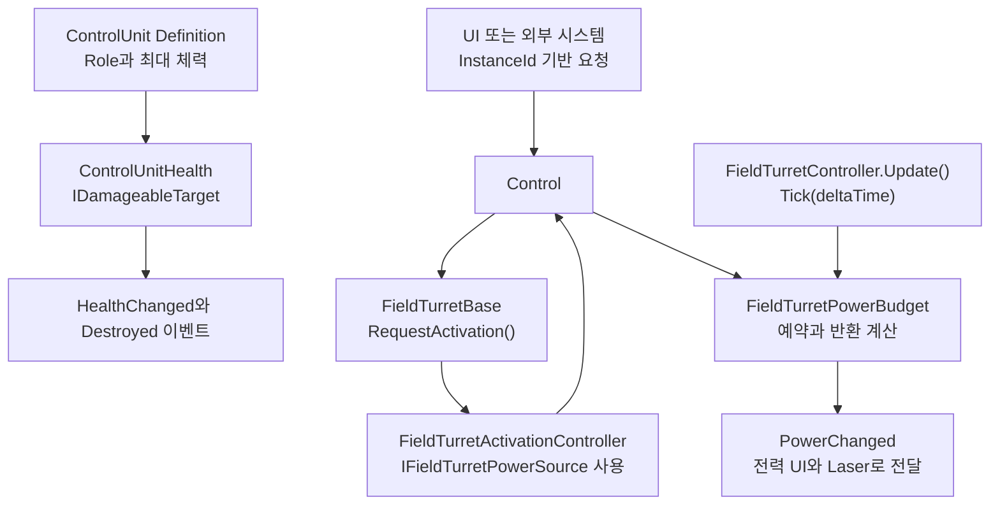

### PoC 프리팹의 몸체 콜라이더

`Assets/Prefabs/FieldTurrets/FieldTurrets`의 Canon·Missile·Laser 프리팹은 `Base` 자식에 몸체용 `PolygonCollider2D`를 둔다. Canon은 루트와 `Base`의 XY 좌표계가 같아 기존 꼭짓점을 그대로 사용한다. Missile은 `Base`의 1.3배 XY 스케일을 역으로 적용한 로컬 꼭짓점을 사용해 2D 월드 공간의 충돌 윤곽과 크기를 유지한다.

필드 터렛 프리팹의 `Base` 자식은 `TurretBase` 레이어를 사용한다. 최상위 오브젝트와 사거리 표시는 `Ignore Raycast` 레이어를, 포신과 발사대는 `Turret` 레이어를 사용한다. 기존 미니맵 표시는 `MiniMap`을 사용한다. 본편 HUD의 `StageTurretSelection`은 `Physics2D.AllLayers`로 몸체 콜라이더를 찾은 뒤 부모의 `FieldTurretBase`를 확인한다.

`Entities` Sorting Layer에서 필드 터렛의 루트 그룹(`Base`)은 Order 0, `PlayerBullet`·`SniperBullet`·`PlayerTurretProjectile`·`bullet`·`Missile`의 비행 스프라이트는 Order 1, 포신과 발사대의 루트 정렬 그룹은 Order 3을 사용한다. 플레이어 탄환의 명중 효과는 탄환보다 한 단계 앞인 Order 2에 표시된다. `SniperBullet`은 `Tracer Glow`와 탄환 본체를 하나의 Sorting Group으로 정렬한다.

현재 Enemy 타깃 선정은 등록된 `TargetableComponent`의 상태를 사용한다. 근접 공격의 사거리 판정은 대상의 활성 비트리거 콜라이더까지의 거리를 사용하며, 원거리 투사체의 피격은 Physics 2D 충돌 설정을 따른다.

터렛 데이터는 다음 세 종류로 나눈다.

| 종류 | 의미 | 저장 위치 | 예시 |
| --- | --- | --- | --- |
| Definition | 실행 중 원본을 바꾸지 않는 콘텐츠·밸런스 값 | `FieldTurretDefinition` ScriptableObject | 사거리, 기본 공격력, 최대 체력, 전력, 발사 속도 |
| Runtime State | 터렛 인스턴스마다 실행 중 바뀌는 값 | `FieldTurretRuntimeState` | 자동 발급 ID, 활성 상태, 현재 체력, 파괴 여부, 업그레이드 보정값 |
| Behavior-local State | 공격 동작 내부에서만 필요한 짧은 상태 | Canon/Missile 구현체 | 현재 Target, 발사 타이머, 현재 미사일 과열 수치 |

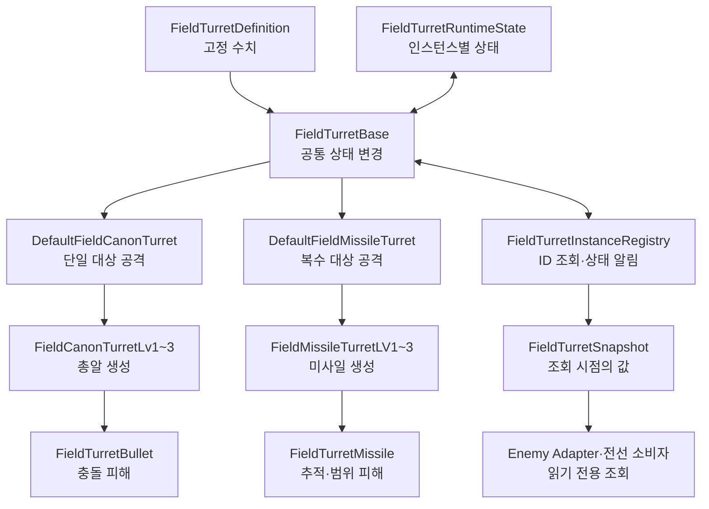

Definition 값을 실행 중 상태 저장소처럼 직접 수정하지 않는다. 반대로 Target, 활성 상태, 과열 진행도처럼 매번 달라지는 값은 Definition에 넣지 않는다.

## 3. 주요 타입과 책임

### 3.1 `FieldTurretDefinition`

파일: [`FieldTurretDefinition.cs`](../../../Assets/Scripts/Features/FieldTurrets/Core/FieldTurretDefinition.cs)

Stage와 Level별 터렛 Prefab이 참조하는 ScriptableObject다. Canon/Missile 정의 18개와 Stage 1 Laser 정의 1개가 있다.

| 필드 | 의미 | 작성 규칙 |
| --- | --- | --- |
| `Id` | Definition을 식별하는 고유 ID | 소문자 `snake_case`, 중복 금지 |
| `DisplayName` | UI에 표시할 이름 | 사람이 읽을 수 있는 이름 |
| `Level` | 터렛 레벨 | 1 이상 |
| `Damage` | 발사체에 전달할 기본 공격력 | 0 이상 |
| `Range` | 적 탐색과 Gizmo에 쓰는 실제 사거리 | 0 이상 |
| `RotationSpeed` | 포신 회전 속도 | 0 이상 |
| `TargetingAngle` | 발사를 허용하는 조준 오차 | Canon 10°, Missile 360° |
| `FireRate` | 초당 발사 횟수 | 0보다 커야 함 |
| `MaxHealth` | 터렛의 최대 체력 | 1 이상 |
| `Power` | 활성화할 때 필요한 전력 | 0 이상 |
| `OverHeatTime` | Canon 연속 사격 과열 기준 | 초 단위 |
| `OverHeatMissileCount` | Missile 과열 기준 발사 횟수 | Canon에서는 0 |
| `CoolTime` | Canon/Missile 과열 후 냉각 시간 | 초 단위 |

예시 ID는 `canon_stage1_lv1`, `missile_stage3_lv2`다. `Id`는 저장·조회용이고 `DisplayName`은 UI용이므로 서로 대신 사용하지 않는다.

Editor에서 Definition을 수정하면 전체 `FieldTurretDefinition`을 검사한다. ID가 비었거나 서로 다른 에셋이 같은 ID를 사용하면 Console에 오류가 표시된다.

### 3.2 `FieldTurretRuntimeState`

파일: [`FieldTurretRuntimeState.cs`](../../../Assets/Scripts/Features/FieldTurrets/Core/FieldTurretRuntimeState.cs)

각 터렛 GameObject가 독립적으로 가지는 실행 중 상태다.

| 상태 | 설명 | 변경 방법 |
| --- | --- | --- |
| `InstanceId` | 현재 실행에서 터렛 한 개를 식별 | Registry가 자동 발급 |
| `IsActivated` | 사용자가 켜서 전력을 예약한 상태인지 표시 | `RequestActivation` |
| `IsOperational` | 활성화됐고 과열·파괴·잠금 상태가 아닌지 표시 | 활성화·과열·파괴·잠금 흐름에서 자동 계산 |
| `IsLocked` | 해당 인스턴스를 켤 수 없는 상태 | `SetLocked` |
| `CurrentHealth` | 현재 남아 있는 체력 | `ApplyDamage`, `Repair`, `Restore` |
| `IsDestroyed` | 체력 0으로 파괴됐는지 표시 | `ApplyDamage`, `Restore` |
| `DamageBonus` | 퍼센트 보정 후 더하는 별도 수동 공격력 보너스 | `SetDamageBonus` / `AddDamageBonus` |
| `DamageModifierRatio` | 현재 단계의 기본 공격력 대비 보정 비율 | `ApplyUpgrade` / `DowngradeUpgrade` |
| `PowerModifierRatio` | 현재 단계의 기본 전력 대비 보정 비율 | `ApplyUpgrade` / `DowngradeUpgrade` |
| `RangeModifierRatio` | 기본 사거리에 더할 비율 보정의 합 | `ApplyUpgrade` |
| `SelectedUpgradeId` | 현재 선택한 세부 경로 ID. 0단계에서는 빈 문자열 | `ApplyUpgrade` / `DowngradeUpgrade` |
| `UpgradeLevel` | 프리팹 LV와 별개인 세부 단계 0~5 | `ApplyUpgrade` / `DowngradeUpgrade` |

Prefab의 `_instanceId` 기본값 `0`은 **미할당**을 뜻한다. Inspector에서 ID를 수동으로 정하지 않는다. 실제 ID는 Play Mode에서 등록될 때 양수로 자동 발급된다.

최종 공격력은 다음 규칙을 사용한다.

```text
Final Damage = max(0, ceil(Definition.Damage × (1 + RuntimeState.DamageModifierRatio)) + RuntimeState.DamageBonus)
Effective Power = max(0, ceil(Definition.Power × (1 + RuntimeState.PowerModifierRatio)))
Effective Range = max(0, Definition.Range × (1 + RuntimeState.RangeModifierRatio))
```

영구 연구 수치를 Definition에 덮어쓰지 않는다. Profile/Research 결과를 Match 시작 시 런타임 보너스로 변환하는 Adapter가 이후 필요하다.

### 3.3 `FieldTurretBase`

파일: [`FieldTurretBase.cs`](../../../Assets/Scripts/Features/FieldTurrets/Core/FieldTurretBase.cs)

Canon과 Missile이 공통으로 사용하는 Unity 표현 계층의 작은 base class다. 공통 Scene 참조와 Definition/RuntimeState 접근을 제공한다.

주요 책임은 다음과 같다.

- 포신, 회전 지점, Animator, SpriteRenderer, LayerMask 참조 보관
- Definition의 수치를 읽기 전용 property로 제공
- 활성화·전력 예약의 단일 요청 API 제공
- 잠금·해금과 활성화 거부 처리
- 체력 감소, 파괴, 복구 API 제공
- 최종 공격력 계산
- `OnEnable`/`OnDisable`에서 Registry 등록·해제

`FieldTurretBase`에 새 밸런스 값을 직접 추가하기 전에 먼저 다음을 판단한다.

1. 모든 인스턴스가 공유하는 고정 값이면 `FieldTurretDefinition`
2. 인스턴스마다 실행 중 바뀌며 여러 시스템이 읽어야 하면 `FieldTurretRuntimeState`
3. 한 공격 방식 내부에서만 잠깐 필요하면 Canon/Missile 구현체의 private field

### 3.4 `FieldTurretInstanceRegistry`

파일: [`FieldTurretInstanceRegistry.cs`](../../../Assets/Scripts/Features/FieldTurrets/Core/FieldTurretInstanceRegistry.cs)

씬에 존재하는 터렛에 로컬 `InstanceId`를 발급한다. AI와 전선 등 읽기 전용 소비자는 컴포넌트 대신 조회 시점의 값만 복사한 [`FieldTurretSnapshot`](../../../Assets/Scripts/Features/FieldTurrets/Core/FieldTurretSnapshot.cs)을 받는다. 스냅샷에는 `InstanceId`, Definition ID, 월드 위치, 활성·작동·파괴·잠금 상태, 현재·최대 체력, 유효 공격력, 실제 사거리와 유효 전력 비용 및 선택 경로 ID와 세부 단계가 들어 있다. `FieldTurretBase`, `FieldTurretRuntimeState`, `FieldTurretDefinition` 참조는 들어 있지 않다.

```csharp
if (FieldTurretInstanceRegistry.TryGetSnapshot(instanceId, out FieldTurretSnapshot snapshot))
{
    Debug.Log($"{snapshot.DefinitionId}: {snapshot.CurrentHealth}/{snapshot.MaxHealth}");
}
```

`GetAllSnapshots()`, `GetActiveSnapshots()`, `GetOperationalSnapshots()`는 각각 전체·활성·작동 가능한 터렛의 읽기 전용 목록을 반환한다. 각 호출 결과는 그 순간의 복사본이며, 보관한 스냅샷은 터렛이 이동하거나 상태가 바뀌어도 자동 갱신되지 않는다. 이동 중 위치가 필요하면 원하는 주기에 ID로 다시 조회한다.

Prefab 안의 Adapter처럼 자신의 `Transform`만 아는 소비자는 `TryGetInstanceId(transform, out int instanceId)`로 부모 터렛의 ID를 얻은 뒤 단건 조회를 사용할 수 있다. 이 보조 메서드도 터렛 컴포넌트를 반환하지 않는다.

`SnapshotChanged(int instanceId)`는 등록·해제·활성화·작동 상태·체력·파괴·복구·잠금·공격력 보너스·세부 업그레이드·레벨 변경 후 발생한다. 이벤트에는 객체 참조를 싣지 않는다. 구독자는 같은 ID로 `TryGetSnapshot`을 다시 호출한다. 해제 후에는 조회가 실패한다. 레벨 변경은 프리팹이 바뀌어도 ID를 유지하므로 기존 `FieldTurretBase` 참조 대신 ID로 새 값을 조회한다. 하나의 동작에서 상태가 여러 번 바뀌면 이벤트도 여러 번 발생할 수 있으므로 횟수에 의존하지 않는다.

기존 `TryGet`, `GetAll`, `GetActive`, `GetOperational` 및 `RegisteredInstances`는 기존 게임플레이·디버그 호출부의 호환을 위해 남아 있다. 이들은 `FieldTurretBase`를 반환하므로 새 읽기 전용 소비자에게 사용하지 않는다. 터렛 상태 변경은 별도의 기존 요청 API를 사용한다.

같은 Definition 에셋을 여러 터렛 인스턴스가 사용하는 것은 정상이다. 오류가 되는 경우는 **서로 다른 Definition 에셋이 같은 `Definition.Id`를 사용하는 경우**다.

Registry는 현재 PoC용 로컬 등록부다. AI 조회용 상태 집계, 전력 총합, 구역별 터렛 관리까지 책임지는 정식 Manager가 아니다. 제거한 전역 `TowerManager`와 같은 구조를 다른 이름으로 다시 만들지 않는다.

파괴된 터렛은 Registry에 남아 복구할 수 있지만 Active/Operational 조회에서는 제외된다.

### 3.5 Assembly 경계

Turret의 독립 가능한 계약과 공통 구조는 다음 두 assembly로 분리한다.

| Assembly | 포함 범위 | 허용 의존성 |
| --- | --- | --- |
| `TeamHJD.Game.FieldTurrets.Contracts` | `IFieldTurretActivationRequester`, `IFieldTurretPowerSource`, `FieldTurretKind`, 활성화 결과 | .NET BCL만 |
| `TeamHJD.Game.FieldTurrets` | Definition, RuntimeState, Base, Registry, Controller, PowerBudget, Snapshot, 활성화·탐색 공통 로직 | Contracts, Unity |

`Contracts`는 `noEngineReferences: true`를 유지한다. `Turrets`는 ScriptableObject와
MonoBehaviour를 포함하므로 Unity Engine을 참조한다. Canon/Missile/Laser concrete 구현은
`AudioManager` 등 legacy 코드 의존성과 PoC Enemy 컴포넌트 참조가 남아 있어 현재 `Assembly-CSharp`에
유지한다. 새 assembly에서 legacy `Assembly-CSharp`를 역참조하도록 설정하지 않는다.

Assembly와 namespace는 `TeamHJD.Game.*` 표기를 사용한다. 새 reference를 추가할 때는
편의를 위해 양방향 참조를 만들지 말고 위 표의 단방향을 유지한다.

### 3.6 `FieldTurretControllerSnapshot`

개별 `FieldTurretSnapshot`은 특정 터렛의 상태를 제공한다. `FieldTurretController.GetSnapshot()`은 해당 컨트롤러의 전력과 등록 터렛들의 집계를 제공한다. 두 타입은 공존하며 서로 다른 조회 단위를 담당한다. 결과는 조회 시점의 복사본으로 자동 갱신되지 않는다. 컨트롤러나 FieldTurretBase 및 Definition 참조는 포함하지 않는다.

| 항목 | 의미 |
| --- | --- |
| `MaximumPower` | 전체 전력 용량 |
| `AvailablePower` | 추가 예약에 사용할 수 있는 남은 전력 |
| `ReservedPower` | 현재 예약된 전력 |
| `PendingRecoveryPower` | 반환 대기 중인 전력 |
| `RegisteredTurretCount` | 이 컨트롤러를 전력 공급자로 사용하는 Registry 등록 터렛 수 |
| `ActivatedTurretCount` | 켜져 있으며 파괴되지 않은 터렛 수 |
| `OperationalTurretCount` | 실제 작동 가능한 터렛 수 |
| `ActivatedCountByType` | `FieldTurretKind`별 켜진 터렛 수의 읽기 전용 사전 |

`MaximumPower = AvailablePower + ReservedPower + PendingRecoveryPower`다. 과열된 터렛도 켜진 수와 예약 전력에는 포함되지만 작동 가능한 수에는 포함되지 않는다. 잠금과 파괴 상태의 터렛은 Registry에 남아 있다면 등록 수에 포함된다. 컴포넌트 비활성화나 Scene 제거로 등록 해제된 터렛은 제외된다.

종류는 레벨과 Stage에 관계없이 `FieldTurretBase.Kind`로 구분한다. Canon과 Missile의 공통 구현체가 각각 `Canon`과 `Missile`을 제공하며 나머지 공통 터렛의 기본값은 `Unknown`이다. 사전에는 `Unknown`, `Canon`, `Missile`, `Laser`, `Tesla`가 0부터 포함된다. `GetActivatedCount(FieldTurretKind)`는 해당 종류가 없으면 0을 반환한다. 사전은 내부 원본을 복사해서 ReadOnlyDictionary로 감싸므로 호출자가 값을 수정하거나 이후 집계가 기존 스냅샷을 바꿀 수 없다.

집계는 **같은 전력 공급자를 사용하는 등록 터렛**을 기준으로 한다. 다른 씬에 있어도 명시적으로 같은 컨트롤러에 연결되면 포함되고 같은 씬에 있어도 다른 컨트롤러면 제외된다. Stage 1 Laser도 같은 기준으로 집계한다.

```csharp
FieldTurretControllerSnapshot snapshot = controller.GetSnapshot();
int remainingPower = snapshot.AvailablePower;
int activeCanonCount = snapshot.GetActivatedCount(FieldTurretKind.Canon);
int activeMissileCount = snapshot.GetActivatedCount(FieldTurretKind.Missile);
```

위 예시는 `TeamHJD.Game.FieldTurrets`와 `TeamHJD.Game.FieldTurrets.Contracts` namespace를 사용한다. 조회는 Unity 메인 스레드에서 수행한다. 현재 전체 Registry를 한 번 순회하는 O(N) 조회이며 호출마다 복사본을 생성한다. 각 몬스터가 매 프레임 개별 호출하기보다 소비자 측에서 필요한 주기에 한 번 조회하고 공유하는 방식을 권장한다. 변경 이벤트와 캐시 및 네트워크 동기화는 이번 API에 추가하지 않았다.

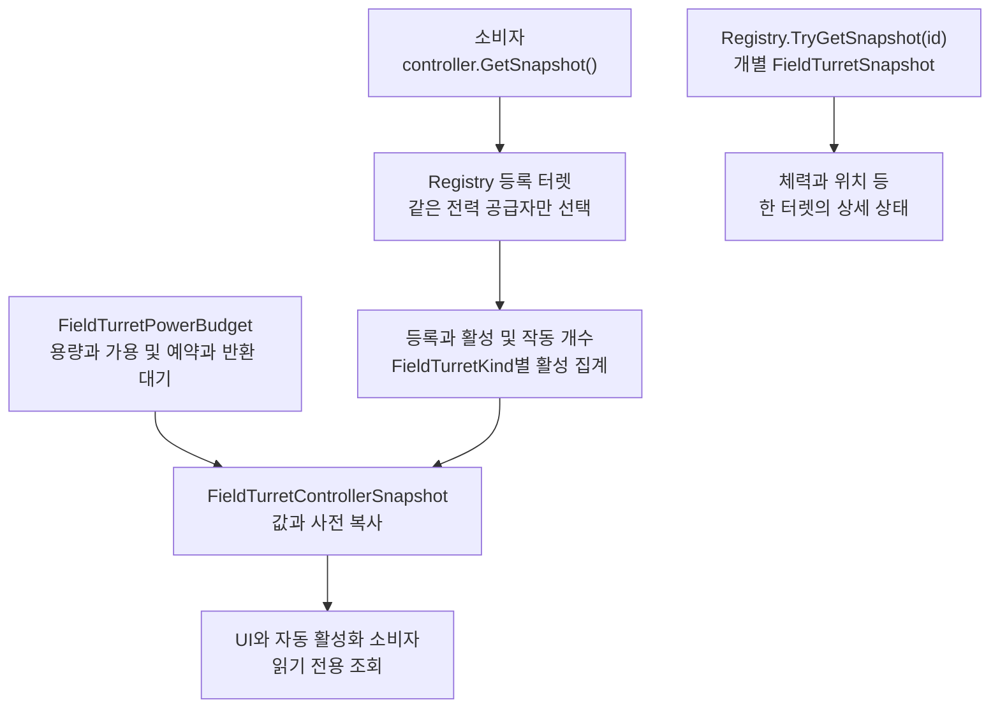

`FieldTurretTest` 화면 상단에서 전력 값과 컨트롤러별 등록 수 및 활성 수와 작동 수 및 종류별 활성 수를 확인할 수 있다. Debug UI는 패널이 보이는 동안 LateUpdate에 한 번 조회해서 동일 프레임의 IMGUI 호출이 집계를 반복하지 않도록 한다.

### 3.7 개별 터렛 선택 UI

`TurretInteractionUI`는 Scene의 터렛을 직접 클릭했을 때 선택·사거리 표시·정보 표시·개별 활성화 요청만 담당한다. `TowerManager`의 태그 기반 정적 목록과 Canon/Missile 구체 타입 분기는 제거했다. 클릭한 Collider의 부모에서 `FieldTurretBase`를 찾으므로 새 터렛도 공통 기반을 사용하면 별도 타입 분기 없이 같은 UI에 들어온다.

UI에는 Definition의 이름·레벨·발사 속도와 현재 유효 공격력·전력 비용을 표시한다. 전력은 `DataManager`의 CU 용량 비율이 아니라 해당 터렛의 `EffectivePower` 절대값이다. 상태 변경은 `RequestActivation(bool)`로만 요청하며 부족한 전력·잠금·파괴 결과를 UI에 반영한다. Scene에 있던 기존 UI 참조는 스크립트 GUID를 유지해 이전 연결을 이어받는다.

웨이브 종료의 전체 비활성화는 `InGameManager`가 Scene의 `FieldTurretController`에 InstanceId 명령을 보내 처리한다. 보상 계산에 필요한 CU 체력은 `InGameManager`가 `ControlUnitHealth`를 직접 참조하며 터렛 UI를 경유하지 않는다.

### 3.8 Canon과 Missile 구현체

| 타입 | 책임 |
| --- | --- |
| `DefaultFieldCanonTurret` | 단일 Target 탐색, 포신 회전, 발사·과열·냉각, 활성화 표현 |
| `FieldCanonTurretLv1~3` | Level별 발사구와 발사체 생성 |
| `DefaultFieldMissileTurret` | 복수 Target 탐색, 포신 회전, 발사 횟수 기반 과열, 활성화 표현 |
| `FieldMissileTurretLV1~3` | 발사구 수에 맞는 Target 배열과 미사일 생성 |
| `FieldTurretBullet` | Canon이 계산한 공격력을 받아 충돌 대상에 적용 |
| `FieldTurretMissile` | Missile이 계산한 공격력을 받아 폭발 범위 대상에 적용 |

Level 스크립트에서 `Damage = 10`처럼 밸런스 수치를 다시 하드코딩하지 않는다. 발사체를 생성한 직후 `Initialize(..., Damage)`로 Definition/RuntimeState에서 계산된 공격력을 전달한다. Canon은 발사 방향점 `Transform`을, Missile은 실제 몬스터 Target을 첫 번째 인자로 전달한다.

## 4. 실행 흐름

아래 흐름도는 **현재 Canon/Missile 구현의 실제 호출 경로**다. 상자는 클래스의 메서드 또는 변경되는 상태를 뜻한다. 실패 조건과 생략된 연출은 본문에서 따로 설명한다. Stage 1 Laser도 공통 활성화·전력·냉각 경로를 사용한다.

Canon·Missile·Laser의 과열 아지랑이는 `GunRenderer`의 현재 스프라이트를 중앙 기준으로 1.1배 확대하고, 그 윤곽 안에 보이는 포신과 주변 화면을 굴절시킨다. 열이 쌓이기 시작할 때부터 강해지고, 열이 0%가 되면 사라진다. 프리팹의 `Heat Wave Scale`로 윤곽 크기, 공용 머티리얼의 `Distortion (pixels)`로 최대 굴절 강도를 조절한다.

Laser는 사거리 안의 적을 향해 회전하고, 포신이 조준 허용각에 들어오면 얇은 빔을 포구에서 사거리 끝까지 펼친다. 발사 순간 빔이 굵어지고 포구 위치와 방향이 고정된다. 빔 스프라이트는 길이 방향으로 늘어나며, 전용 재질이 포구에서 끝까지 알파를 낮춘다. 시각적 페이드는 사거리와 피해 판정에 영향을 주지 않는다. 발사가 끝나거나 터렛을 끄면 빔이 얇아지면서 동시에 포구 쪽으로 짧아진다. 조준하던 적을 놓쳤을 때도 빔이 포구로 돌아온 뒤에 다시 회전한다. 빔이 완전히 접히면 `Beam Restart Delay`가 지난 뒤에 다시 펼칠 수 있다. 피해는 발사 중에만 적용하며, 포구부터 사거리 경계까지 회전된 박스로 적을 조회한다. 같은 적의 여러 Collider는 틱마다 한 번만 집계한다. Stage 1의 초기 설정은 폭 0.8 유닛, 발사 3초, 피해 간격 0.25초, 빔 길이 전환 0.2초, 폭 축소 0.1초, 재전개 대기 0.3초다. 폭·시간·간격은 프리팹의 Laser Settings, 틱당 피해량과 조준 시간에 사용하는 발사율은 Definition에서 조절한다.

### 4.1 생성과 등록

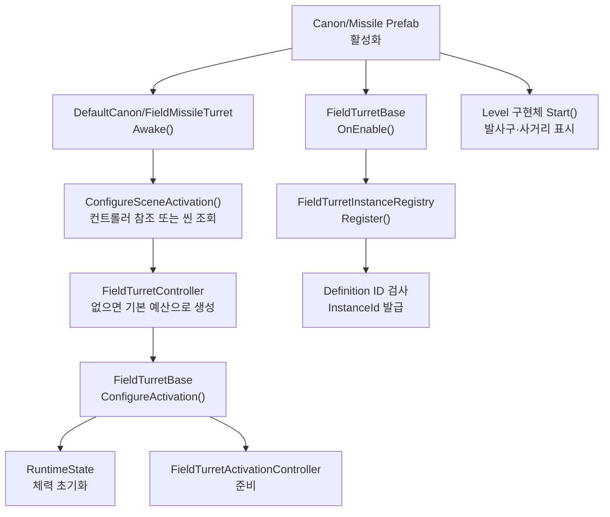

`Awake`에서 Definition 또는 유효한 전력 공급자가 없으면 초기화에 실패하고 터렛 컴포넌트를 비활성화한다. CU는 필수 조건이 아니다. 승급과 강등에서는 이전 전력 공급자를 새 프리팹에 전달해 예산이 바뀌지 않도록 한다. `InstanceId`는 Prefab에 수동 입력하지 않고 Registry가 로컬 실행 중 발급한다.

### 4.2 활성화와 전력

켜기와 끄기는 같은 `RequestActivation(bool)` API를 사용한다. 제품 UI와 FieldTurretTest UI는 `FieldTurretController.RequestActivation(instanceId, shouldActivate)`를 호출하고, Test UI는 그 외 잠금·피해·복구·승급·업그레이드도 `FieldTurretBase`의 실제 런타임 API를 호출한다. `FieldTurretTestController`는 UI와 표시만 담당하며 컨트롤러를 생성하거나 게임 규칙을 구현하지 않는다. 가로로 넓어져 글자가 잘리지 않도록 결과 흐름을 나눠 표시한다.

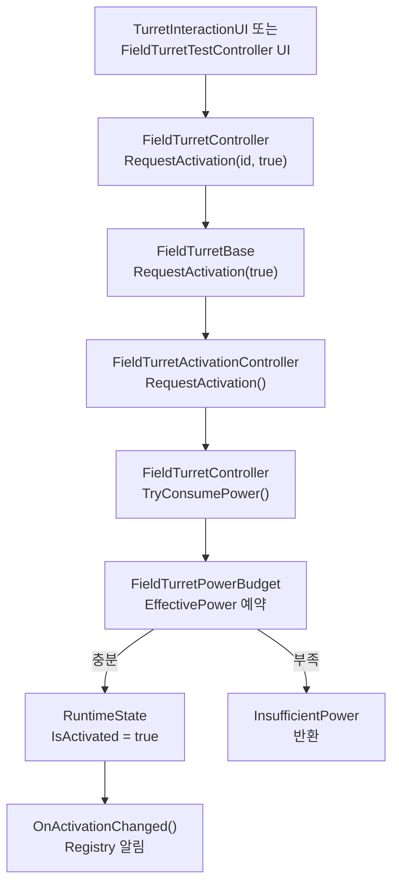

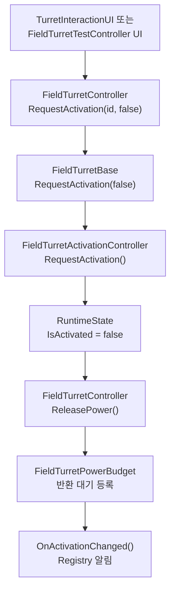

호출부는 전력을 먼저 검사한 다음 별도 활성화 메서드를 호출하지 않는다. 전력 확인과 상태
변경은 반드시 `RequestActivation` 한 경로에서 처리한다. 과열은 사용자가 끈 상태가 아니므로
`IsActivated`와 전력 예약을 유지하고 `IsOperational`만 일시적으로 `false`가 된다.
`FieldTurretPowerBudget.ReleasePower`는 반환 전력을 대기시키고 `Tick`으로 0.1초에 1씩 회복한다. 반면 업그레이드로
전력 사용량이 감소할 때의 차액은 `TryChangeReservation`에서 즉시 반환한다.

### 4.3 체력, 파괴와 복구

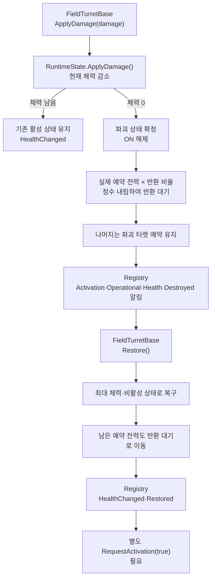

2026-10-29 사용자 결정으로 파괴 시 **반환 비율은 기본 50%**다. Scene의 `FieldTurretController` Inspector에서 `Destruction Power Return Percent`를 0~100%로 바꾸거나 `TrySetDestructionPowerReturnPercent(percent)`를 호출한다. 런타임 API는 범위 밖·NaN·Infinity를 거부하고 기존 설정을 유지한다. 외부 전력 대역처럼 해당 컨트롤러를 사용하지 않는 터렛에도 기본 50%를 적용한다. 파괴 시점의 실제 예약 전력에 비율을 곱한 뒤 정수 내림한다. 예를 들어 예약 41, 반환 50%면 20이 반환 대기에 들어가고 21은 해당 파괴 터렛에 예약된다. 설정 변경은 이후 파괴부터 적용한다.

미반환분은 영구 손실이나 최대 전력 감소가 아니라 **파괴 터렛에 묶인 예약**이다. `FieldTurretBase.ReservedPower`로 소유 예약량을 조회하며 컨트롤러의 `ReservedPower`에는 정상 활성 터렛과 파괴 터렛 예약이 함께 포함된다. 파괴 상태의 ON/OFF는 `Destroyed`로 거부하고 반복 피해·컴포넌트/오브젝트 비활성화로 잔여 예약이 풀리지 않는다. `Restore()`가 성공하면 나머지도 반환 대기로 옮기고 기존 최대 체력·OFF 규약으로 복구한다. 실제 GameObject 제거는 복구할 대상이 없어 남은 예약을 정리한다. 반환 전력은 모두 기존 `Tick`의 0.1초당 1 회복 경로를 따른다. 일반 OFF 후 이미 반환 대기 중인 터렛의 파괴에서는 추가 전력을 반환하지 않는다.

치명타는 파괴 상태와 부분 반환을 확정한 뒤 상태·체력 이벤트를 발행한다. 파괴 알림 중 `Restore()`를 다시 호출하거나 OFF 요청으로 잔여 예약을 우회 회수할 수 없다. 과거 #545의 손실률 표현은 `100 - 반환 비율`과 구분하며, 이번 구현은 미반환분의 예약 유지와 복구 후 반환을 따른다. 일반 OFF는 즉시 전력 반환을 시작하고 냉각을 동시에 진행하는 기존 동작을 유지한다(2026-10-29 황재동 정정). 시간 기반 Restore 진행도, 점유·저장·네트워크 규약은 이번 변경에 포함하지 않는다.

파괴된 터렛은 Registry에서 즉시 제거하지 않는다. 플레이어가 같은 인스턴스를 복구할 수
있도록 등록 상태를 유지하되 Active/Operational 조회와 활성화 요청에서는 제외한다. Scene
전환이나 실제 GameObject 제거는 `Unregistered`로 구분한다. 현재 `FieldTurretTestController`의 Damage·Destroy·Restore 버튼이 이 경로를 직접 호출한다. Enemy PoC는 `TargetableComponent.TryApplyDamage()`에서 `IDamageableTarget`을 찾아 일반 터렛과 CU에 같은 피해 명령을 전달한다.

#### 살아 있는 터렛의 지속 수리

`FieldTurretBase.Repair(float healthPerSecond, float deltaTime)`는 파괴 전 잃은 체력을 회복한다. 플레이어 측에서 상호작용 가능한 무기·입력 유지·거리 조건을 검사한 뒤 매 갱신에 호출한다. 초당 회복량은 인자로 받으며 10 HP/초를 연동 예시로 사용한다. 터렛은 무기나 플레이어를 조회하지 않고, 호출을 멈추면 회복도 멈춘다. [호출 예시와 결과값](api-reference.md#플레이어의-지속-수리)

main의 스패너 소비자는 `Repair(int amount)`로 정수 HP를 요청하며 실제 체력 증가 여부를 bool로 받는다. 외부 API는 호출부 호환을 위해 유지한다. 내부 `FieldTurretRuntimeState.TryRepair(int amount, int maxHealth)`는 실제 수리를 시도하고 체력 증가 여부를 bool로 반환하며, 회복량을 반환하는 `Repair(double amount, int maxHealth)`에 위임한다. 아래 그림은 시간 기반 API 흐름이다. 두 경로가 같은 회복 처리를 사용하므로 최대 체력 제한과 소수점 잔량 정리가 일치한다. 하나의 수리 동작에서는 두 외부 API 중 하나를 사용한다.

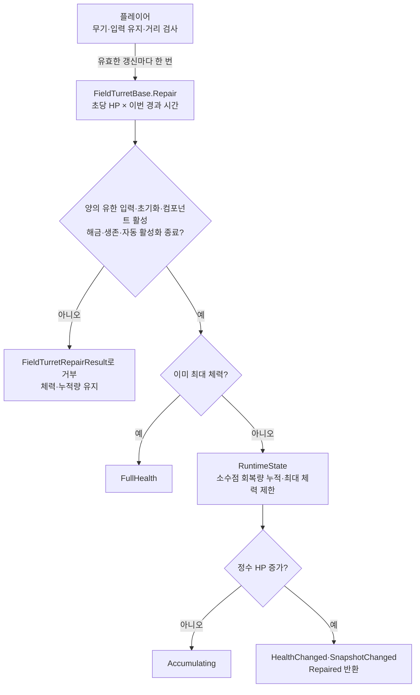

활성화·OFF·냉각 중 모두 허용하고 활성 상태·냉각·전력 예약을 유지한다. `CanRepair`는 수리 가능한 현재 터렛 상태를 제공한다. 잠금·파괴·자동 활성화 진행 중에는 회복량을 누적하지 않는다. GameObject/컴포넌트 비활성도 거부한다. 정수 HP 미만의 진행은 보관하지만 최대 체력 도달·파괴·복구·초기화·레벨 교체 시 잔량을 비운다. `Restored`는 일반 수리에서 발행하지 않는다.

이 변경은 터렛 API와 회귀 테스트 범위다. 플레이어의 무기·입력 연결과 서버의 요청 검증은 후속 연동이며, CU 체력 API는 변경하지 않았다.

### 4.4 탐색과 공격

`IsOperational`이 `true`일 때만 각 터렛의 `Update()`가 탐색·회전·발사·과열 확인을 수행한다. 실제 탐색은 `FieldTurretTargetingUtility.CollectByDistance()`가 사거리 안의 `enemyMask` Collider를 거리순으로 모으는 방식이다.

Canon의 산포는 매 발사마다 기준 조준점의 월드 X에 ±0.5를 더한 임시 위치로 계산한다. `bulletFirePoint`·`bulletFireDirection` Transform은 이동시키지 않아 연속 사격해도 조준점이 한쪽으로 누적 이동하지 않는다. 발사체의 기존 `Initialize(Transform, damage)` 호출도 유지한다.

#### 최소 사거리와 내부 공격 금지 범위

Canon과 Missile은 `FieldTurretBase.minimumRange` 안에 있는 몬스터를 새 타겟으로 선택하거나 발사하지 않는다. `[SerializeField, HideInInspector] private` 필드로 외부 코드에서 직접 변경할 수 없으며 일반 Inspector에도 표시하지 않는다. 읽기 전용 `MinimumRange`로 실제 clamp된 값을 조회한다. 원본과 PoC의 Stage 1~3 프리팹 모두 아래 월드 단위 반지름을 적용했다. 마지막 Canon 값은 사용자 목록 순서에 따라 LV3 값으로 해석했다.

| 터렛 | LV1 | LV2 | LV3 |
| --- | --- | --- | --- |
| Missile | 3.57 | 4.38 | 5.31 |
| Canon | 4.47 | 4.47 | 4.59 |

실제 공격 범위는 `MinimumRange <= 대상 중심까지의 거리 <= EffectiveRange`다. 대상 중심은 탐색으로 얻은 Collider의 Transform 위치를 기준으로 한다. `minimumRange`는 유효 최대 사거리 안으로 clamp되며 0이면 내부 금지 범위가 없다. 최대 사거리 0에서는 공격하지 않는다. 스펙 업그레이드는 최대 사거리만 변경한다. 프리팹 레벨 승급과 강등에서는 교체 대상 프리팹의 minimumRange를 사용하므로 새 레벨의 반지름이 적용된다. Snapshot의 기존 Range는 여전히 최대 사거리이며 최소 사거리 필드는 추가하지 않았다. Mermaid의 최소 및 최대 거리 판정 흐름은 유지한다.

이미 선택한 대상이 내부로 들어오면 Canon은 타겟을 해제하고 다시 탐색한다. Missile은 발사 전 슬롯 중 하나라도 내부 또는 최대 범위 밖으로 나가면 예약을 해제하고 다시 탐색한다. 이미 발사된 탄환과 미사일의 추적 및 폭발 피해는 변경하지 않는다. 따라서 내부 범위는 피해 면역 구역이 아니라 새 발사를 금지하는 구역이다. Laser의 공격 규칙에는 적용하지 않는다.

FieldTurretTest의 `Attack Range`에서 최소와 최대 사거리를 읽기 전용으로 확인한다. 맵에서 터렛을 선택하면 최대 사거리 원과 주황색 내부 원을 자동으로 표시하고 선택을 해제하면 숨긴다. `Show All Ranges`는 모든 터렛의 범위를 표시하는 별도 디버그 모드이며 `Selected Range Only`로 선택한 터렛만 표시하는 기본 모드에 돌아온다. 내부 원은 SpriteRenderer만 생성하며 Collider는 추가하지 않는다. minimumRange를 변경하는 런타임 API나 일반 Inspector 조절 항목은 제공하지 않는다.

검증 순서: 몬스터를 내부에만 놓았을 때 발사하지 않는지 확인한다. 내부와 외부에 동시에 몬스터를 놓으면 바깥 후보를 선택하는지 확인한다. 선택된 몬스터를 내부로 옮긴 후 새 발사가 중지되는지 확인한다. 미사일은 두 번째 발사 슬롯의 몬스터도 내부로 이동시켜 확인한다. 스펙 업그레이드 및 레벨 승급 후 범위 표시와 레벨별 지정값도 확인한다.

#### Canon: 한 대상을 조준하고 직진 탄환으로 피해

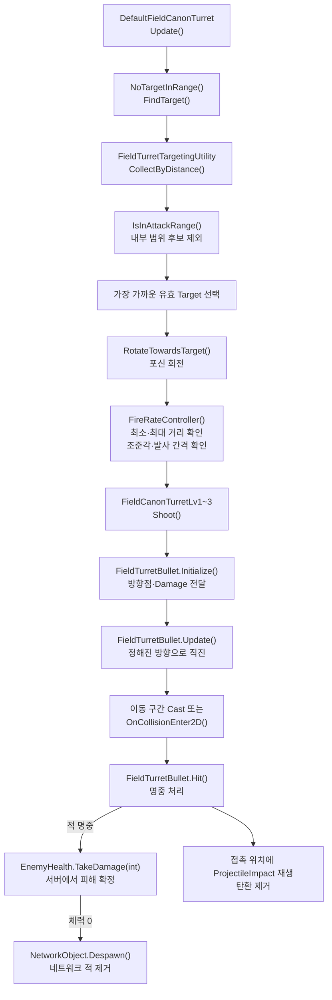

Canon 포신은 Target을 향해 돌지만, **발사된 `FieldTurretBullet`은 몬스터를 추적하지 않는다.** `Initialize()` 때 발사 방향점으로 방향을 정한 뒤 직진하며 충돌한 Collider와 그 부모에서 `EnemyHealth`를 찾아 피해를 전달한다. `EnemyHealth.TakeDamage()`는 서버에서 Network Spawn된 적에 대해서만 피해를 적용한다. 발사체의 float 피해량은 `Mathf.RoundToInt()`로 변환한다. 현재 터렛 Damage는 int에서 전달하므로 기존 정수 공격력은 유지된다. 같은 탄환의 중복 충돌 피해를 차단한다. Target이 죽거나 사거리를 벗어나면 다음 탐색에서 새 대상을 찾는다.

캐논 탄환은 이동 구간에서 탄환 콜라이더 모양으로 검사한다. 캐논 탄환을 막을 지형의 활성 비트리거 Collider2D 오브젝트에는 `FieldTurretBulletObstacle` 태그를 지정한다. 현재 `Default`와 `Forest` 물리 레이어의 지형을 검사하며, `Initial_Stage`와 `InitialStageTurretTest`의 나무·기물 타일맵에 태그가 지정되어 있다. 바닥은 태그 없이 둔다.

캐논 탄환은 적이나 장애물에 닿으면 플레이어 기본탄과 공유하는 `ProjectileImpact`를 접촉 지점에서 한 번 재생한다. 효과는 탄환과 같은 씬의 Sorting Layer에서 탄환보다 한 단계 앞에 그려진다.

#### Missile: 복수 대상을 지정하고 유도·범위 피해

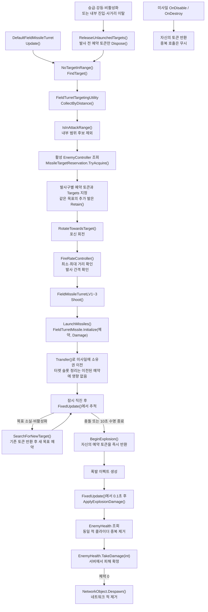

Missile은 적 수가 부족하면 첫 Target을 두 번째 발사 슬롯에서도 사용할 수 있다. 슬롯마다 별도 예약 토큰을 가지며 마지막 토큰이 반환될 때까지 다른 발사 묶음은 해당 적을 예약할 수 없다. **`Explode`는 시각·소리 연출이고, 실제 범위 피해는 `FieldTurretMissile.ApplyExplosionDamage()`에서 적용한다.** 두 공격 방식 모두 발사체 생성 시 위 공식으로 계산한 `EffectiveDamage`를 전달한다.

예약은 터렛 영역의 `MissileTargetReservation`이 관리하며 `EnemyController.IsTargeted`를 읽거나 변경하지 않는다. 발사 전에는 터렛이 토큰을 소유하고 `Initialize(예약, Damage)`가 `Transfer()`로 소유권을 가져간다. 발사 실패 시 미발사 토큰을 반환하고, 이미 이전된 토큰은 터렛 비활성화·승급으로 해제하지 않는다. `Initialize(Transform, Damage)`도 유지하며 직접 호출할 때는 미예약 목표를 새로 예약한다. 같은 목표에 여러 발을 의도적으로 발사할 때는 기존 토큰의 `Retain()`을 사용한다.

미사일의 초기 직진 시간, 10초 수명과 0.1초 폭발 피해 지연은 `Time.time`을 `FixedUpdate()`에서 확인한다. 예약 반환을 코루틴 완료에 의존하지 않으며 폭발 시작·비활성화·파괴에서 자기 토큰만 반환한다. 미사일을 비활성화했다가 재활성화하면 기존 예약은 되살리지 않고 다음 물리 갱신에서 새 목표를 탐색한다. 수명은 최초 발사 시각을 기준으로 유지한다. 이 예약은 로컬 프로세스 안에서만 유효하며 네트워크 복제를 제공하지 않는다.

미사일의 최초 탐색과 비행 중 재탐색은 Collider와 그 부모의 활성 `EnemyController`를 기준으로 한다. 최초 탐색은 EnemyController Transform의 최소 및 최대 사거리도 검사한다. 선택된 EnemyController의 Transform을 기존 유도 이동이 추적한다. 같은 Enemy의 여러 Collider가 최초 탐색 슬롯에 중복 등록되지 않도록 한다. 비행 중 재탐색은 기존 300 단위 탐색 반경을 유지하며 터렛의 최소 사거리를 다시 적용하지 않는다.

폭발 피해는 Collider의 부모까지 `EnemyHealth`를 조회하고 동일 적은 한 번만 피해를 적용한다. 기존 Enemy Tag 대신 EnemyHealth 존재 여부를 피해 대상으로 사용한다. 충돌 및 수명 종료가 겹쳐도 동일 미사일의 폭발 처리는 한 번만 수행한다. 발사체 이동과 서버 전용 피해 API를 연결한 PoC이며 터렛 및 발사체 전체의 네트워크 동기화나 권한 구조를 완성한 것은 아니다. Host에서 Network Spawn된 적을 대상으로 추적과 HP 감소 및 사망 Despawn을 검증해야 한다. 기존 Monster만 있는 적은 더 이상 이 피해 API로 체력이 감소하지 않는다.

### 4.5 과열과 냉각

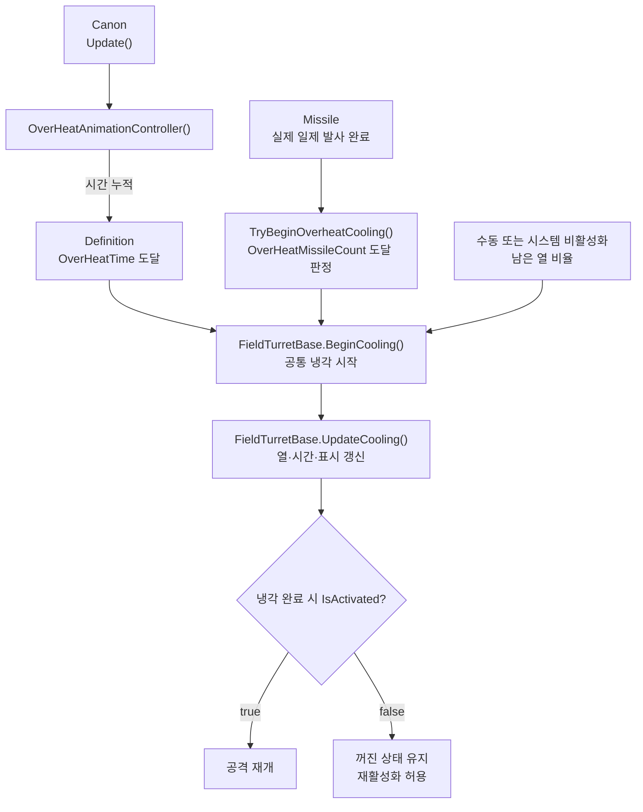

과열 중에는 `IsActivated`와 예약 전력을 유지하지만 `IsOperational`만 `false`다. 따라서 수동 비활성화와 과열을 같은 상태로 취급하지 않는다. Missile은 실제로 한 발 이상 발사한 일제 사격마다 카운트가 1씩 증가하므로 한 번에 여러 발을 쏴도 발사 1회로 센다. 과열까지 1회가 남았다면 해당 묶음을 모두 발사한 직후 타깃·시야각과 무관하게 냉각에 진입한다. 유효한 예약이 없어 한 발도 발사하지 못하면 카운트를 올리지 않는다. 과열 기준은 `OverHeatMissileCount`, 과열 후 냉각 시간은 `CoolTime`이 정한다.

냉각 시작 시 미발사 타깃 예약은 즉시 반환하며 이미 비행 중인 미사일의 예약은 유지한다. 발사 후 유효한 타깃을 다시 확보하는 과정에서는 열을 줄이지 않고, 탐색해도 타깃이 없을 때만 기존 자연 냉각을 적용한다.

Canon/Missile의 과열 냉각과 비활성화 후 냉각은 `FieldTurretBase.BeginCooling()` 및 `UpdateCooling()`으로 통합했다. `IsCoolingDown`은 두 경우 모두 냉각 여부를 나타내고, `CoolingDownRemaining`도 같은 타이머에서 남은 초를 제공한다. 별도 `_overheatCooldownRunning`과 `TotCoolTime`, 종류별 `OverHeat()`/`DeactivateProcess()`는 사용하지 않는다. 열 누적 기준은 각 터렛이 유지하고 `ApplyCoolingHeat()`로 공통 냉각 진행률을 적용한다.

일반 OFF는 즉시 `IsActivated`를 false로 바꾸고 예약 전력을 반환 대기로 옮긴다. 전력은 기존 `Tick`의 0.1초당 1 회복 경로로 반환하며, 남은 열의 냉각과 동시에 진행한다. 꺼질 때는 현재 열 비율에 비례한 냉각 시간이 적용된다. 이미 과열 냉각 중이면 끄더라도 기존 종료 시각을 유지해 남은 시간만 냉각한다. 냉각 중 꺼진 터렛의 켜기 요청은 `CoolingDown`으로 거부하고, 켜진 터렛은 예약 전력을 유지한 채 공격만 중지한다. 냉각 완료 시 켜져 있으면 공격을 재개하며, 꺼져 있으면 자동으로 켜지지 않는다. UI의 켜기 버튼은 `IsCoolingDown`을 차단 조건으로 사용할 수 있고, 끄기 버튼은 냉각 중에도 허용한다(자동 활성화 중의 수동 조작 차단은 별도다).

## 5. Prefab과 Definition 설정 방법

### 기존 수치 조정

1. 대상 Prefab이 참조하는 `_definition`을 확인한다.
2. 해당 `FieldTurretDefinition` 에셋에서 수치를 수정한다.
3. 같은 Level이라도 Stage별 Definition이 다르므로 수정 범위를 확인한다.
4. `Id`는 참조 키이므로 밸런스 조정만으로 변경하지 않는다.
5. Prefab의 발사구와 시각적 사거리 표시가 의도대로 동작하는지 `FieldTurretTest` Scene에서 확인한다.

### 새 Canon/Missile 변형 추가

1. 가장 가까운 기존 Prefab과 Definition을 복제한다.
2. 새 Definition에 고유 `Id`, `DisplayName`, Level과 전투 수치를 입력한다.
3. Prefab의 `_definition`을 새 에셋으로 교체한다.
4. 발사구 배열과 방향 Transform을 확인한다.
5. `_runtimeState._instanceId`는 `0`으로 둔다.
6. Gizmo 사거리와 실제 적 탐지 범위를 비교한다.
7. 활성화·비활성화, 전력 부족, 과열·냉각, Target 사망 후 재탐색을 검증한다.
8. 체력 감소, 파괴, 복구 후 수동 재활성화를 검증한다.
9. 새 에셋과 `.meta` 파일을 함께 커밋한다.

### 사거리 표시

실제 탐지와 원형 Sprite는 모두 `EffectiveRange`를 사용한다. `FieldTurretBase.RefreshRangeVisual()`은 Sprite의 월드 크기와 부모 Scale을 고려해 표시 원의 지름을 `EffectiveRange × 2`로 맞춘다. 세부 업그레이드로 사거리가 변하면 바로 다시 계산한다.

## 6. 업그레이드와 밸런스 규칙

- 기본 수치 조정: Definition 에셋 수정
- 한 판 동안 적용되는 강화·버프: `FieldTurretUpgradeDefinition`을 선택한 인스턴스의 RuntimeState에 적용
- 계정 영구 성장: Profile/Research에서 보관하고 Match 시작 시 RuntimeState 또는 immutable `MatchConfig`로 변환
- 발사체: 자신이 생성될 때 받은 최종 공격력만 사용

`FieldTurretUpgradeDefinition`은 업그레이드 ID와 표시 이름 및 호환 가능한 `FieldTurretDefinition.Id` 목록과 Damage/Power/Range의 단계당 비율 보정을 가진다. 호환 목록이 비어 있으면 모든 터렛 Definition에 적용할 수 있다. 기존 정수 `_damageModifier`와 `_powerModifier` 필드는 제거하고 에셋 4개를 `_damageModifierRatio`와 `_powerModifierRatio`로 이전했다.

```csharp
FieldTurretUpgradeResult result = turret.ApplyUpgrade(upgradeDefinition);
FieldTurretUpgradeResult rollback = turret.DowngradeUpgrade(upgradeDefinition);
```

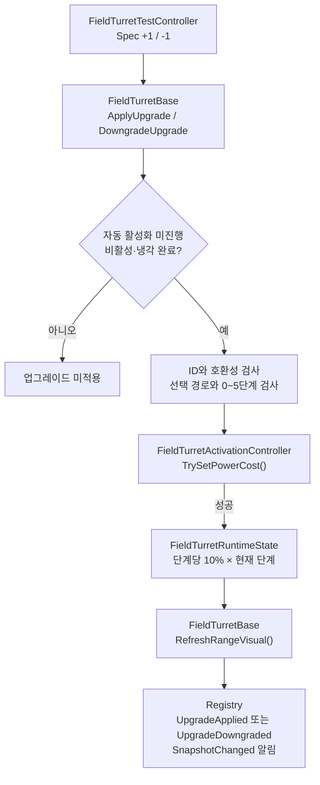

적용 규칙은 다음과 같다.

- 원본 `FieldTurretDefinition` ScriptableObject는 수정하지 않는다.
- 선택 경로와 단계 및 보정값은 인스턴스의 `FieldTurretRuntimeState`에만 저장된다.
- 기본 0단계에서 경로를 선택한다. 같은 경로는 `ApplyUpgrade` 호출마다 한 단계씩 최대 5단계까지 올라간다. 반대 경로 요청은 `BranchLocked`로 거부한다.
- `DowngradeUpgrade`는 선택 경로를 한 단계 낮춘다. 0단계로 돌아오면 경로 선택을 해제해 반대 경로를 다시 선택할 수 있다.
- 단계는 0~5로 Clamp한다. 경계에서 추가 요청은 `MinimumLevel` 또는 `MaximumLevel`을 반환하고 상태와 전력을 바꾸지 않는다. 기존 `AlreadyApplied` enum은 호환성을 위해 남겨두지만 이 경로에서는 반환하지 않는다.
- 단계별 보정은 에셋의 1단계 보정 × 현재 단계로 재계산한다. 누적 덧셈을 되돌리는 방식이 아니므로 반복 왕복 시 사거리 오차가 쌓이지 않는다. `HasAppliedUpgrade(id)`는 현재 선택 경로에 1단계 이상 투자되어 있는지를 뜻한다.
- 세부 상승·되돌리기는 비활성화 상태이며 냉각이 끝나야 가능하다. 활성 중에는 `RequiresDeactivation`, 꺼진 냉각 중에는 `CoolingDown`, 자동 활성화 중에는 `AutoActivationInProgress`로 거부한다.
- 업그레이드는 꺼진 터렛의 요구 전력만 변경하며 즉시 전력을 예약하거나 반환하지 않는다. 절전 경로를 되돌려 요구 전력이 증가한 경우 실제 전력 부족은 다음 활성화 요청에서 검사한다.
- 최종 Damage와 Power 및 Range는 0 미만으로 내려가지 않는다. Clamp된 최종값에서 보정량을 빼지 않고 원본 수치와 현재 단계로 다시 계산하므로 0단계에서 원래 수치로 복귀한다. 별도 최대 능력치 상한은 아직 없다.
- 외부 조회에는 `EffectiveDamage`, `EffectivePower`, `EffectiveRange`를 사용한다.
- 상승 성공 시 `UpgradeApplied`가 발생하고 하락 성공 시 `UpgradeDowngraded`가 발생한다. 두 경우 모두 `SnapshotChanged`가 발생한다. 스냅샷은 `SelectedUpgradeId`와 `UpgradeLevel`을 제공한다.

현재 제공하는 샘플은 Canon과 Missile 각각의 `Low Power`(단계당 Damage -10% / Power -10% / Range +10%)와 `High Firepower`(단계당 Damage +10% / Power +10% / Range -10%)다. 테스트용 수치이며 실제 밸런스 확정값은 아니다. 두 경로는 서로 배타적이다. 화력 경로 5단계는 기본 대비 Damage +50% / Power +50% / Range -50%이고 절전 경로 5단계는 Damage -50% / Power -50% / Range +50%다. 현재값에 매번 0.9 또는 1.1을 곱하는 복리 방식이 아니라 현재 Definition의 기본값에 단계 × 10%를 보정한다. 따라서 LV 교체 후에도 새 Definition의 기본값에 같은 비율을 적용한다. Damage와 Power는 정수이므로 소수점은 올림한다. 기본값이 양수라면 샘플의 절전 5단계만으로 0이 되지는 않는다. 발사 속도 보정은 아직 없다. 현재 스킬트리는 인스턴스당 단일 경로이며 서로 독립적인 복수 업그레이드 트리는 지원하지 않는다.

### 6.1 레벨 승급과 다운그레이드

`FieldTurretLevelUpgradeCatalog`은 현재 Definition과 양쪽 레벨의 프리팹을 연결한다. 현재 카탈로그에는 Stage 1 Canon/Missile의 LV1↔LV2, LV2↔LV3 경로만 등록되어 있다. `FieldTurretTest`의 `Level Up`과 `Level Down` 버튼으로 확인할 수 있다. Stage 2·3은 양방향 경로를 카탈로그에 추가해야 한다.

```csharp
if (catalog.TryGetNext(turret.Definition, out FieldTurretBase nextPrefab))
{
    FieldTurretLevelUpgradeResult result =
        turret.RequestLevelUpgrade(nextPrefab, out FieldTurretBase replacement);
}

if (catalog.TryGetPrevious(turret.Definition, out FieldTurretBase previousPrefab))
{
    FieldTurretLevelUpgradeResult result =
        turret.RequestLevelDowngrade(previousPrefab, out FieldTurretBase replacement);
}
```

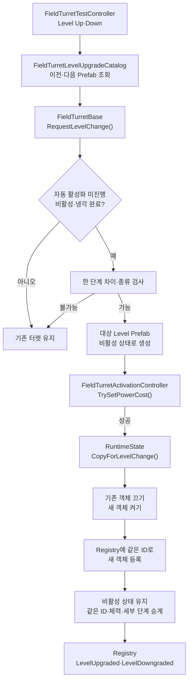

레벨 변경은 비활성화되고 냉각이 끝난 터렛만 이전 또는 다음 레벨 프리팹으로 교체한다. 같은 `InstanceId`, 위치, 현재 체력 비율, 세부 업그레이드 보정과 적용 이력 및 사거리 표시 설정을 이전하고 새 터렛도 비활성 상태로 유지한다. 활성 중에는 `RequiresDeactivation`, 꺼진 냉각 중에는 `CoolingDown`, 자동 활성화 중에는 `AutoActivationInProgress`로 거부하며 기존 객체와 전력은 유지된다. 체력 비율을 유지하므로 레벨 변경만으로 전체 회복되지는 않는다. 변경된 요구 전력은 다음 활성화에서 예약하며 전력 부족도 그때 검사한다. 성공하면 방향에 따라 `LevelUpgraded` 또는 `LevelDowngraded` 이벤트가 발생한다. 읽기 전용 소비자는 객체 참조 대신 같은 ID로 스냅샷을 다시 조회한다. 이미 발사된 총알·미사일은 기존 발사체로 남는다.

현재 레벨 변경 비용·시간, 멀티플레이 상태 동기화, 파괴된 터렛의 변경 규칙은 확정되지 않았다. 파괴된 터렛의 레벨 변경 요청은 거부한다. 제품 UI에서 변경 버튼을 노출하는 작업은 아직 별도다.

`FieldTurretTest`에서 Canon LV1 하나의 ID와 FieldTurretController 전력을 기록하고 활성화·Damage 후 비활성화한다. 냉각 중에는 세부 변경·승급·강등이 거부되고, 냉각 완료 뒤 세부 업그레이드와 `Level Up`이 가능해야 한다. LV2가 같은 ID와 체력 비율·보정값을 유지하고 꺼진 상태인지 확인한다. 이어 `Level Down`으로 LV1에 돌아와 같은 항목을 재확인한다. Missile도 같은 순서로 확인한다. 요구 전력이 커졌을 때 가용 전력이 부족하면 다음 활성화가 거부되는지 확인한다. 이 Play Mode 검증은 코드 컴파일 검사와 별개다.

### 6.2 잠금과 해금

잠금은 Definition의 고정 능력치가 아니라 터렛 인스턴스의 런타임 상태다. 기본값은 해금 상태여서 기존 Prefab 동작을 바꾸지 않는다. `SetLocked(true)`는 활성 터렛을 먼저 끄고 예약 전력을 반환한 뒤 잠근다. 잠긴 터렛의 `RequestActivation(true)`는 `Locked`를 반환한다. `SetLocked(false)`로 해금해도 자동으로 켜지지 않으며 플레이어가 다시 활성화해야 한다. 잠금 상태는 레벨 변경 시 이어받고 읽기 전용 스냅샷의 `IsLocked`에도 반영된다. `TurretInteractionUI`는 잠긴 터렛에 `Locked`라고 표시한다. `FieldTurretTest`에는 잠금·해금 버튼이 있지만 제품 UI의 해금 동작과 비용·영구 저장 규칙은 아직 적용하지 않았다.

잠긴 터렛은 세부 업그레이드·되돌리기와 레벨 승급·강등을 `Locked`로 거부하고, 피격·파괴·복구 및 공격력 보너스 변경도 처리하지 않는다. `FieldTurretUnlockZones`는 Core의 `BattlefieldGridConfiguration`을 재사용하지 않고 터렛 전용 `FieldTurretGridConfiguration`으로 CU와 터렛 위치의 셀을 계산한다. CU나 터렛은 `CellId`를 보관하지 않는다. `FieldTurretController` Inspector에서 그리드 중심, 맵 너비·높이, 셀 수, 해금 구역 수를 조정할 수 있다. 기본 맵 크기 275×275는 현재 `Initial_Stage`의 맵 크기에 맞춘 설정이고, 기본 셀 분할은 16×16, 구역 수는 4개다. CU 셀에서 상하좌우로 이동하는 최소 칸 수로 구역을 나누며 첫 구역만 처음부터 해금한다. `UnlockThroughZone(zone)`은 지정 구역과 더 가까운 구역을 해금한다. 새 터렛도 등록 시 현재 구역 잠금 상태를 적용받는다. Grid 밖 터렛은 잠기며, 해금만으로 활성화되거나 전력이 예약되지는 않는다.

`FieldTurretTest`는 가장 큰 Tilemap의 월드 경계를 덮는 터렛 전용 Grid를 구성한다. `unlockGridCellsX/Y`, `unlockZoneCount`, `Unlock Next Zone` 버튼과 Scene/Game 뷰 표시로 시험한다. 실제 Stage에서는 CU 위치를 확인한 뒤 `FieldTurretController.ConfigureUnlockZones(cuPosition)`을 호출하고, `FieldTurretController` Inspector의 전용 그리드 설정을 사용한다. Core Grid의 크기 변경은 터렛 Grid에 자동 반영되지 않으므로 맵 크기를 바꿀 때 두 설정을 맞춰야 한다. 현재 구역은 CU 중심의 셀 거리 구역이며 동부·서부 같은 명명 지역이나 Core `RegionId`/Cell→Region 매핑은 아니다. `SpawnPoint.AreaId`도 터렛 지역으로 쓰지 않는다. Research/Profile 저장과 지역 이름 정책은 별도다.

2026-10-10 회의에서는 잠긴 터렛은 파괴되지 않고, 해금 뒤 별도 수리 없이 사용할 수 있으며, 전력 부족으로 꺼진 터렛은 공격 가능한 대상으로 구분하는 제품 방향을 정리했다. 잠금 상태의 피해·파괴·복구 차단은 현재 코드에 반영되어 있다. 해금은 자동 활성화나 전력 예약을 하지 않는다. 설치 시 물·지형·다른 오브젝트와 겹치는지 판정하는 기술은 아직 조사 중이다. [회의 검토 기록](../../01_planning/01_meetings/2026/10/2026-10-10-regular-meeting.md)

2026-10-17 회의는 해금, 터렛 활성화, 지역 점유를 서로 다른 상태로 설명했다. CU에서 이어지는 점유 방향과 송신탑 해금 시제품은 제품 설계 검토이며 현재 터렛 Grid·Core 구현의 완료나 전제 1·2의 최종 선택을 뜻하지 않는다. 자세한 미정 사항은 [회의 검토 기록](../../01_planning/01_meetings/2026/10/2026-10-17-regular-meeting.md)을 따른다.

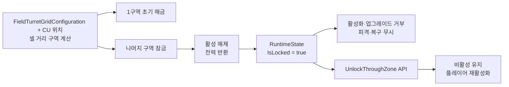

## 7. 멀티플레이 전환 시 주의점

현재 `InstanceId`는 각 프로세스에서 등록 순서대로 발급되는 **로컬 ID**다. Host와 Client에서 같은 터렛이 반드시 같은 숫자를 갖는다는 보장이 없다.

NGO 연동 시 다음 규칙을 적용한다.

- Host가 터렛 생성과 상태 변경의 Authority를 가진다.
- 네트워크 식별자는 NGO `NetworkObjectId` 또는 Host가 발급한 별도 ID를 사용한다.
- 활성화 요청은 Client가 직접 상태를 바꾸지 않고 Command/RPC로 Host에 요청한다.
- Host가 전력과 조건을 검증한 후 확정 상태를 복제한다.
- Definition 자체를 전송하지 않고 안정적인 `Definition.Id`와 필요한 Snapshot을 사용한다.
- 공격력 보너스와 파괴·수리 상태도 Authority가 확정한다.

현재 Registry의 로컬 `InstanceId`를 그대로 네트워크 ID로 보내면 안 된다. 실제 동기화 계약은 Co-op Milestone에서 `HostAuthority`, `MatchState`, NGO Adapter 경계와 함께 정한다.

## 8. AI·전선 시스템 연동 기준

Enemy PoC의 `EnemyTargetSelector`는 `TargetableComponent`를 수집한다. Canon, Missile, CU Prefab에는 `DamageableTargetAdapter`와 `TargetableComponent`가 연결된다. Adapter는 부모의 `IDamageableTarget`에서 현재·최대 체력과 파괴 상태를 읽는다. 무기 터렛은 활성 상태일 때만 후보가 되고 CU는 체력이 남아 있는 동안 항상 후보가 된다. Enemy의 실제 공격은 `TargetableComponent.TryApplyDamage(int)`를 거쳐 같은 `IDamageableTarget.ApplyDamage(int)` 계약으로 전달된다.

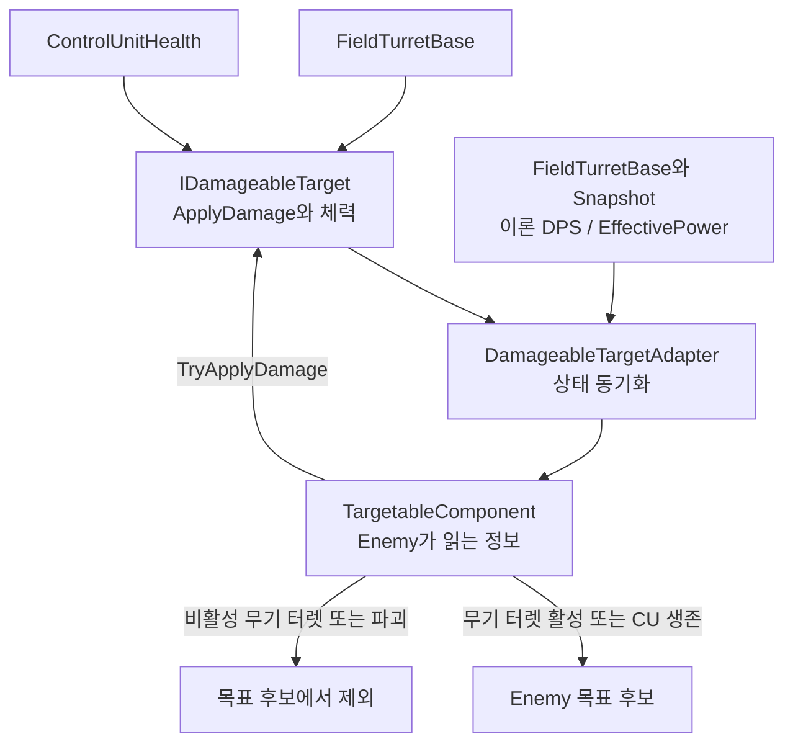

`FieldTurretBase.TheoreticalDps = EffectiveDamage × Definition.FireRate × ProjectilesPerShot`이며 `DpsPerPower = TheoreticalDps / EffectivePower`다. Canon과 Missile 모두 발사구 수를 발사당 최대 발사체 수로 반영한다. Canon LV1·LV2·LV3의 기본 프리팹은 각각 1·2·3발이다. 이는 연속 사격 이론값으로 과열·명중률·폭발 다중 피해는 포함하지 않는다. 전력 0은 효율 0으로 처리하며 CU도 0이다. Snapshot에도 동일 값을 제공한다. Adapter의 fake 값은 제거했다. Enemy의 기존 `FirepowerRatio` 이름은 호환을 위해 유지하지만 실제 값은 0~1로 제한하지 않는 DPS/전력이며 위협 가중치가 효율 단위에 곱해진다.

전선 시스템과 후속 AI 계약에 제공할 후보 데이터는 다음과 같다.

- Instance ID와 Definition ID
- 위치와 소속 구역
- 활성화·잠금 여부
- 현재·최대 체력
- 공격력, 사거리, 전력 비용
- 공격 가능 여부와 과열 상태
- AI 목표 평가용 위협도·방어 가치

현재 읽기 전용 스냅샷은 ID·위치·상태·기본 평가값을 제공한다. Enemy PoC 어댑터는 이 계약으로 체력과 활성 상태를 읽는다. 전선 시스템의 실제 소비 코드는 아직 없어 연결되지 않았다. 소속 구역과 위협도·방어 가치의 최종 계산 역시 포함하지 않는다. `FieldTurretRuntimeState`에 모든 Scene 참조와 AI 계산 결과를 무조건 넣지 않는다.

## 9. 검증 체크리스트

### 코드·에셋

- [ ] Definition ID가 비어 있지 않고 중복되지 않는다.
- [ ] Prefab에 올바른 Definition이 연결되어 있다.
- [ ] Stage 1 레벨 카탈로그의 네 경로가 실제 이전·다음 LV FieldTurretBase Prefab을 가리킨다.
- [ ] Stage 1 Canon/Missile Prefab에 PoCTargetable과 Adapter가 함께 있다.
- [ ] FieldTurretTest에서 활성화·피해·복구·세부 업그레이드·레벨 승급 전후 스냅샷을 ID로 재조회해 비교했다.
- [ ] `.cs`·`.asset`·Prefab의 `.meta`가 함께 존재한다.
- [ ] `TeamHJD.Game.FieldTurrets`가 Contracts 외의 legacy assembly를 참조하지 않는다.
- [ ] Level 스크립트에 Definition 수치가 중복 하드코딩되지 않았다.
- [ ] Laser Turret을 실수로 Canon/Missile 변경 범위에 포함하지 않았다.

### FieldTurretTest 조작 순서

왼쪽 테스트 패널에는 전체 전력·집계, 자동 활성화, 구역 해금, 전체 활성화·비활성화와 전체 사거리 표시를 둔다. UI 배율을 반영한 화면 높이에서 위아래 16의 여백을 남기며 공통 기능을 스크롤한다. 개별 터렛 목록과 조작 버튼은 왼쪽 패널에 표시하지 않는다.

맵의 터렛을 왼쪽 클릭하면 해당 터렛의 독립 창을 연다. 창에는 현재 수치·잠금·냉각·스냅샷, 개별 활성화·피해·파괴·복구, 호환되는 세부 업그레이드와 이전·다음 레벨 변경을 모아 표시한다. 다른 터렛을 클릭하면 같은 창의 대상이 바뀐다. 제목 표시줄을 드래그해 이동하고 Close 또는 Esc, 맵의 빈 공간 클릭으로 닫는다. F1은 왼쪽 공통 패널만 접거나 펼친다. UI 위 클릭은 뒤쪽 터렛 선택으로 전달하지 않으며 UI를 스크롤해도 카메라 이동 속도를 변경하지 않는다.

기본 모드에서는 선택한 터렛의 최소·최대 사거리만 자동 표시한다. 다른 터렛으로 전환하면 이전 범위를 숨기고 새 범위를 표시하며 창을 닫거나 선택 대상이 제거되면 숨긴다. 승급·강등으로 프리팹이 교체돼도 같은 선택 ID의 새 범위를 표시한다. 개별 창의 Show Range/Hide Range 버튼은 제공하지 않는다. 전체 범위를 비교할 때는 왼쪽 `Show All Ranges`를 사용하며 이 모드에서는 선택 해제 후에도 전체 표시를 유지한다. `Selected Range Only`로 돌아오면 선택이 없는 터렛의 범위를 숨긴다.

선택 대상과 조작 결과 및 Before 스냅샷은 `InstanceId`로 구분한다. 승급·강등 시 같은 ID로 교체된 실제 터렛을 다시 조회하므로 창의 대상과 수치가 새 프리팹을 따라간다. 등록이 해제되고 같은 ID의 대체 터렛이 없으면 프레임 후반에 창을 닫는다. 이 UI는 같은 씬의 등록된 터렛만 조작하며 게임 규칙과 조작 제한은 기존 `FieldTurretBase`·`FieldTurretController` API를 그대로 사용한다.

기존 맵을 유지한 채 `Assets/Scenes/Tests/FieldTurretTest.unity`를 열고 Play Mode에 진입한다. 현재 Scene에는 Canon/Missile 업그레이드 에셋 4개와 Stage 1 양방향 레벨 카탈로그가 연결되어 있다. Rebuild 메뉴도 기존 참조를 보존하면서 누락된 샘플만 추가한다. 이번 기능 확인을 위해 Scene을 재구성할 필요는 없다.

1. 맵에서 확인할 터렛을 클릭해 전용 창을 열고 `Capture Snapshot`으로 변경 전 값을 저장한다. 저장된 값은 ID별로 유지되므로 프리팹 교체 후에도 비교할 수 있다. 다시 누르면 비교 기준을 현재 값으로 바꾼다.
2. `Activate` 후 `Lock`을 누른다. 전력이 반환되고 현재 스냅샷의 Locked가 true인지 확인한다. `Request Activate`를 눌러 결과가 `Locked`인지 확인한다.
3. `Unlock` 후 자동 활성화되지 않는지 확인하고 직접 다시 켠다.
4. 터렛을 끄고 냉각이 끝난 뒤 `High Firepower` 또는 `Low Power` 옆 `+1`로 5단계까지 올린다. 반대 경로가 LOCKED로 표시되고 5단계에서 +1이 비활성화되는지 확인한다. `-1`로 0단계까지 내려 기본 수치로 돌아오는지 확인한 뒤 반대 경로를 선택한다. 현재 수치와 저장된 Before 값을 비교하고 선택 중인 터렛의 사거리 표시 원도 확인한다. 절전 경로를 되돌릴 때 요구 전력이 증가하며 실제 예약은 다음 활성화에서 수행되는지 확인한다.
5. `Level Up`과 `Level Down`으로 LV1↔LV2↔LV3를 왕복한다. ID와 보정값이 유지되는지 확인한다. LV1에는 Level Down이 없고 LV3에는 Level Up이 없다.
6. `Damage` → `Destroy` → `Request Activate` → `Restore`로 피해와 파괴 거부 및 복구를 확인한다. 복구해도 잠금 상태는 유지된다.
7. 패널의 All / Active / Operational 개수와 ID별 현재 스냅샷을 확인한다. Before 값은 이후 상태 변화에 따라 자동으로 바뀌지 않는다.

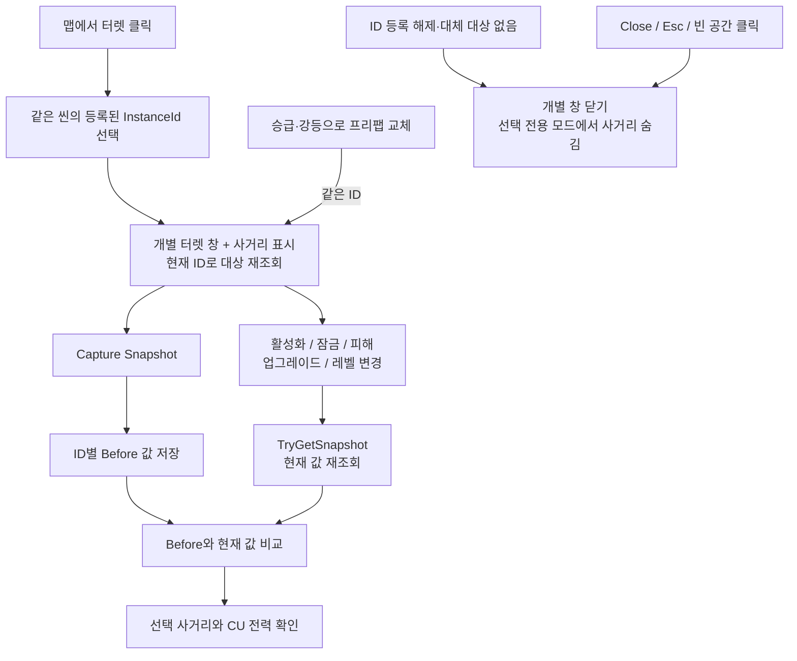

### Play Mode

- [ ] 6개 레벨별 터렛이 `FieldTurretTest` Scene에서 활성화된다.
- [ ] 전력이 부족하면 활성화가 거부된다.
- [ ] 활성 터렛을 잠그면 비활성화되고 예약 전력이 반환된다.
- [ ] 잠긴 터렛은 켜지지 않고 해금 후 수동으로 다시 켤 수 있다.
- [ ] 비활성화하면 전력이 반환된다.
- [ ] `Damage`로 현재 체력이 감소한다.
- [ ] ON 상태 파괴 시 기본 50%만 반환 대기로 이동하고 나머지는 예약된다. 반환 비율 0%·50%·100%, 홀수 예약량과 다른 활성 터렛의 예약 보존을 확인한다.
- [ ] 파괴된 터렛은 활성화할 수 없다.
- [ ] `Restore` 후 최대 체력·비활성 상태로 돌아오며 다시 활성화할 수 있다.
- [ ] 파괴와 복구 시 Registry 이벤트가 한 번씩 발생한다.
- [ ] Target이 사망하거나 범위를 벗어나면 새 Target을 찾는다.
- [ ] 미사일이 발사 전 적을 조준한 활성 상태에서는 승급·강등이 거부되며 현재 객체와 타깃 예약이 유지된다.
- [ ] 가장 가까운 적이 다른 미사일에 예약되어 있어도 다음 예약되지 않은 적을 선택한다.
- [ ] CU 없는 씬에서 Canon/Missile이 컨트롤러 전력만으로 초기화되고 활성화된다.
- [ ] 컨트롤러를 미리 배치하지 않아도 같은 씬의 터렛들이 하나의 자동 생성 컨트롤러를 공유한다.
- [ ] 비활성화 반환은 0.1초마다 1이며 꺼진 터렛의 업그레이드는 요구 전력만 바꾼다.
- [ ] 승급과 강등 후에도 같은 컨트롤러를 사용하고 전력이 이중 예약되지 않는다.
- [ ] 기존 CU 전력 UI가 컨트롤러의 전력 변경을 반영한다.
- [ ] 컨트롤러 스냅샷에서 종류별 활성 수 합계가 ActivatedTurretCount와 일치한다.
- [ ] 과열 시 ActivatedTurretCount는 유지되고 OperationalTurretCount만 감소한다.
- [ ] 서로 다른 컨트롤러에 연결한 터렛은 각 스냅샷에서 따로 집계된다.
- [ ] 이전 컨트롤러 스냅샷을 보관한 뒤 활성화 상태를 바꿔도 이전 값과 종류별 사전은 유지된다.
- [ ] 미사일 발사 후 승급·비활성화해도 이미 비행 중인 미사일의 타깃 예약을 풀지 않는다.
- [ ] Canon과 Missile의 표시 원·실제 탐지 범위가 EffectiveRange와 일치한다.
- [ ] 발사체 피해량이 Definition Damage와 Runtime Bonus를 반영한다.
- [ ] 과열 후 냉각과 재활성화가 정상 동작한다.
- [ ] 각 활성 터렛의 `InstanceId`가 0이 아니며 서로 다르다.
- [ ] Canon과 Missile을 각각 LV1→LV2→LV3으로 승급하며 발사구·공격 동작이 바뀐다.
- [ ] Canon과 Missile을 각각 LV3→LV2→LV1로 다운그레이드할 수 있다.
- [ ] 레벨 변경 전후 `InstanceId`, 체력 비율, 세부 업그레이드가 유지되고 새 터렛은 비활성 상태다.
- [ ] Canon과 Missile의 High Firepower는 Range -10%이고 Low Power는 Range +10%이며 탐지 범위와 표시 원에 즉시 반영된다.
- [ ] 세부 경로는 한 단계씩 0↔5를 왕복하고 반대 경로는 0단계 복귀 전까지 선택할 수 없다.
- [ ] 절전 경로 되돌리기는 비활성·냉각 완료 후 가능하고 증가한 전력의 부족 검사는 다음 활성화에서 수행된다.
- [ ] 프리팹 레벨 변경과 파괴/복구 후에도 선택 경로와 세부 단계가 유지된다.
- [ ] Capture Snapshot의 Before 값은 상태 변경 후에도 유지되고 같은 ID의 현재 스냅샷만 갱신된다.
- [ ] 활성·냉각·자동 활성화 중 승급·강등과 세부 변경이 거부되며 객체·단계·전력이 유지된다.
- [ ] 꺼지거나 파괴된 터렛은 Enemy PoC의 목표 후보에서 빠진다.

## 10. 현재 기술 부채와 후속 작업

현재 구현에는 다음 전환기 의존성이 남아 있다.

| 항목 | 현재 상태 | 후속 방향 |
| --- | --- | --- |
| 컨트롤러 구성 | Canon/Missile은 씬별 컨트롤러를 조회하거나 생성 | Match Composition에서 명시적으로 주입 |
| 등록부 | static 로컬 Registry | Match 수명주기의 조회 서비스로 이전 |
| 전력 변경 | `IFieldTurretPowerSource`로 독립 `FieldTurretPowerBudget` 사용 | Command와 Authority 검증으로 분리 |
| 파괴 시 예약 전력 | 기본 50% 반환·나머지 예약, Restore 성공 시 잔여분 반환. 컨트롤러 Inspector/API에서 0~100% 조정 | 시간 기반 복구·점유/저장/네트워크 연계 검증은 별도 |
| Target 평가 | concrete 코드가 Physics와 활성 `EnemyController`를 조회하고 터렛 측 예약 토큰 사용 | AI/Combat 계약과 평가 모델 분리 |
| Namespace | 일부 concrete 터렛이 전역 namespace | 이식 시 `Presentation` 경계로 정리 |
| 네트워크 | 로컬 상태만 존재 | Host authoritative 상태와 Snapshot 추가 |
| AI 화력 평가 | Stage 1 Adapter에서 `FirepowerRatio = 0.5` 임시 사용 | 조수빈과 계산식·갱신 시점을 확정 |
| 레벨 승급 | Stage 1 카탈로그와 테스트 UI만 연결 | 제품 UI, 다른 Stage 경로, 비용·시간 및 참조 갱신 정책 검증 |
| Laser | Stage 1 프리팹의 공통 생명주기, 고정 방향 관통 빔 및 주기 피해 | 레이저 전용 승급 경로 |

이 항목을 해결할 때 한 번에 전체 시스템을 다시 쓰지 않는다. observable behavior를 먼저 기록하고, 테스트 가능한 작은 Architecture Slice로 교체한다.

## 11. 관련 파일

- [`FieldTurretBase.cs`](../../../Assets/Scripts/Features/FieldTurrets/Core/FieldTurretBase.cs)
- [`FieldTurretController.cs`](../../../Assets/Scripts/Features/FieldTurrets/Core/FieldTurretController.cs)
- [`FieldTurretGridConfiguration.cs`](../../../Assets/Scripts/Features/FieldTurrets/Core/FieldTurretGridConfiguration.cs)
- [`FieldTurretPowerBudget.cs`](../../../Assets/Scripts/Features/FieldTurrets/Core/FieldTurretPowerBudget.cs)
- [`FieldTurretControllerSnapshot.cs`](../../../Assets/Scripts/Features/FieldTurrets/Core/FieldTurretControllerSnapshot.cs)
- [`FieldTurretKind.cs`](../../../Assets/Scripts/Features/FieldTurrets/Contracts/FieldTurretKind.cs)
- [`FieldTurretDefinition.cs`](../../../Assets/Scripts/Features/FieldTurrets/Core/FieldTurretDefinition.cs)
- [`FieldTurretRuntimeState.cs`](../../../Assets/Scripts/Features/FieldTurrets/Core/FieldTurretRuntimeState.cs)
- [`FieldTurretUpgradeDefinition.cs`](../../../Assets/Scripts/Features/FieldTurrets/Core/FieldTurretUpgradeDefinition.cs)
- [`FieldTurretLevelUpgradeCatalog.cs`](../../../Assets/Scripts/Features/FieldTurrets/Core/FieldTurretLevelUpgradeCatalog.cs)
- [`TurretLevelUpgrade_Stage1.asset`](../../../Assets/Data/FieldTurrets/FieldTurretLevelUpgrade_Stage1.asset)
- [`IDamageableTarget.cs`](../../../Assets/Scripts/Features/FieldTurrets/Contracts/IDamageableTarget.cs)
- [`DamageableTargetAdapter.cs`](../../../Assets/Scripts/Features/Enemy/Runtime/Targeting/DamageableTargetAdapter.cs)
- [`ControlUnit.asset`](../../../Assets/Data/FieldTurrets/ControlUnit.asset)
- [`FieldTurretTestController.cs`](../../../Assets/Scripts/Features/FieldTurrets/FieldTurretTestController.cs)
- [`FieldTurretInstanceRegistry.cs`](../../../Assets/Scripts/Features/FieldTurrets/Core/FieldTurretInstanceRegistry.cs)
- [`TeamHJD.Game.FieldTurrets.Contracts.asmdef`](../../../Assets/Scripts/Features/FieldTurrets/Contracts/TeamHJD.Game.FieldTurrets.Contracts.asmdef)
- [`TeamHJD.Game.FieldTurrets.asmdef`](../../../Assets/Scripts/Features/FieldTurrets/Core/TeamHJD.Game.FieldTurrets.asmdef)
- [`DefaultFieldCanonTurret.cs`](../../../Assets/Scripts/Features/FieldTurrets/Cannon/DefaultFieldCanonTurret.cs)
- [`DefaultFieldMissileTurret.cs`](../../../Assets/Scripts/Features/FieldTurrets/Missile/DefaultFieldMissileTurret.cs)
- [`FieldTurretBullet.cs`](../../../Assets/Scripts/Features/FieldTurrets/Weapons/FieldTurretBullet.cs)
- [`FieldTurretMissile.cs`](../../../Assets/Scripts/Features/FieldTurrets/Weapons/FieldTurretMissile.cs)
- [`MissileTargetReservation.cs`](../../../Assets/Scripts/Features/FieldTurrets/Core/MissileTargetReservation.cs)

## 자동 활성화 (2026-11-05 회의 방향 반영)

`FieldTurretController.TryStartAutoActivation()`은 같은 Scene·컨트롤러의 등록된 무기 터렛을 대상으로 한다. 잠금·파괴 후보를 제외하고 버튼 시점의 공격 가능 사거리 내 적 수를 저장한다. Missile 최소 사거리도 반영하고 동일 Rigidbody의 여러 Collider를 중복 집계하지 않는다. enemyMask에는 적 Collider만 포함해야 한다. Rigidbody 없는 적의 여러 Collider는 개별 집계될 수 있다.

적 수 내림차순 → 공격력/전력량 내림차순 → InstanceId 오름차순으로 버튼 시점에 고정한다. 화력 동률 비교는 10월 30일 회의의 공격력 기준이며 `DpsPerPower`와 구분한다. 현재 켜진 소속 터렛을 모두 끈 뒤 순서대로 활성화를 시도한다. 차례가 된 후보가 냉각 중이거나 전력이 반환 중이면 그 후보를 기다린다. 현재 전력과 반환 예정량을 합쳐도 켤 수 없는 후보만 제외하고 다음을 시도해 영구 대기를 막는다. 후보를 모두 처리하면 종료한다. 진행 중 잠금·파괴·제거된 후보는 제외하고 새 후보를 추가하거나 순위를 재계산하지 않는다. 자동 활성화 중에는 `IsManualOperationBlocked`가 true이며 사용자 개별 활성화·세부 업그레이드·레벨 변경은 `AutoActivationInProgress`로 거부한다. 수동 잠금·해금과 복구는 false, 공격력 보너스 변경은 미적용으로 처리하고 Console 로그로 알린다. 기존 `IsManualActivationBlocked`도 같은 값을 반환한다. 종료 후 수동 조작을 다시 허용하되 업그레이드에는 비활성·냉각 완료 조건이 계속 적용된다. UI는 `CanModifyUpgrades`로 세부/레벨 버튼을 제어한다. 자동화 내부 요청, 적의 피격과 이에 따른 파괴·시스템 비활성화, 게임 규칙의 구역 해금은 계속 처리한다. FieldTurretTest의 수동 피해·구역 변경 버튼은 진행 중 차단한다.

쿨타임은 요청 수락부터 게임 시간 60초이며 일시정지 동안 진행하지 않는다. 진행 중 재요청은 거부한다. 비활성화된 컨트롤러는 작업을 중단한다. `AutoActivationScoreProvider`는 이후 가중치 정책을 주입할 수 있는 경계이며 현재 기본 점수는 적 수다.

CU interaction의 UGUI Button에는 `FieldTurretAutoActivationButton`을 연결하고 OnClick에 `ActivateAutomatically()`를 지정한다. CU 체력 컴포넌트와 연결할 필요는 없다. `FieldTurretTestController`에도 테스트용 Auto Activate 버튼과 고정 후보 목록·쿨타임을 표시한다. 실제 CU interaction 화면과 네트워크 권한은 후속 연결 대상이다.

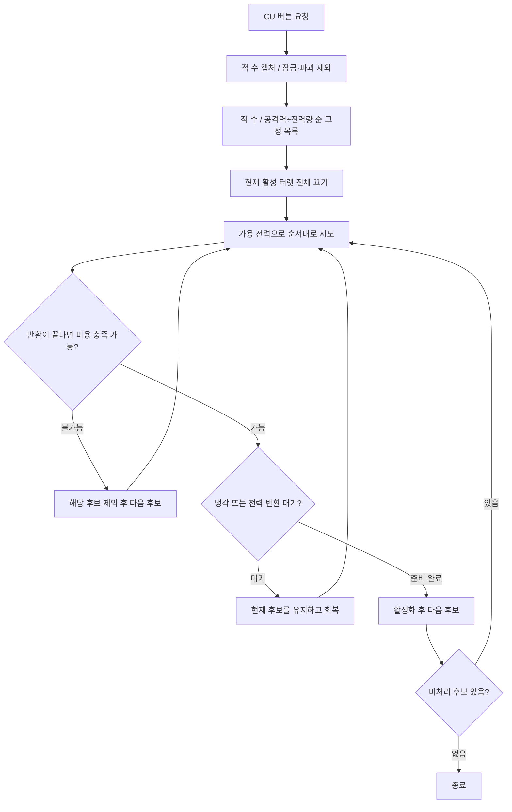

## 2026-10-27 연동 후속

터렛 조작은 Core/Match가 요청을 검증한 뒤 전달하는 방향으로 먼저 설계한다. 현재 로컬 수리·활성화 API 자체가 권한·거리·중복을 모두 검증하는 것은 아니다. 10월 27일에는 일부 반환이 후속 작업이었고, 10월 29일 사용자 결정으로 기본 50%·조정 API와 복구 후 잔여 반환을 구현했다. 해금 구역 Core 연결 반영 후 검증, 해금됐지만 꺼진 터렛의 Enemy 타깃 여부 확인과 레이저 후속은 별도다. 완료일·최종 서버 권한은 미정이다. [보고·담당·근거](../../01_planning/01_meetings/2026/10/2026-10-27-weekly-progress.md)
