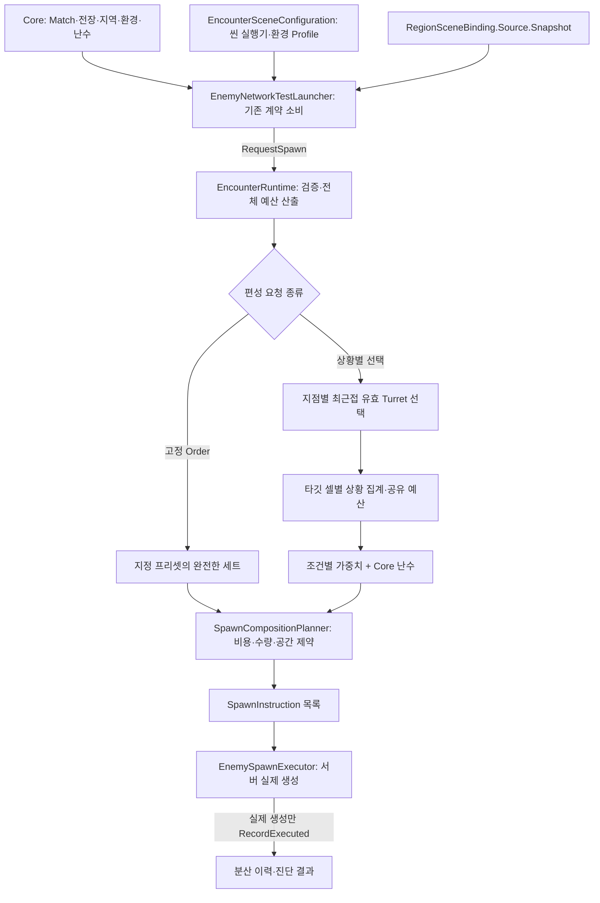

# Encounter 편성·예산 가이드

수정일: 2026-11-08
상태: #540 통합 브랜치의 현재 구현과 조정 지점. 최종 난이도 Director 또는 반복 요청 주기 확정 문서가 아니다.

[문서 목차](../../README.md) · [Enemy 구조](enemy-system-guide.md) · [콘텐츠·편성 목록](stage1-enemy-content-guide.md) · [공간 분산](spatial-spawn-distribution.md) · [명시적 생성 origin](encounter-spawn-origin-api.md)

## 전체 흐름과 역할



- Core는 전장 원시 자료·지역 점유·날씨/시간·권한·난수/취소 수명을 제공한다. 구체 몬스터 편성과 Instantiate는 Enemy가 담당한다.
- `EncounterRuntime`은 일반 C# 클래스다. Match ID·명시 Executor·SquadPresetCatalog·EncounterBudgetSettings를 생성자로 받는다. 씬에 컴포넌트로 붙이거나 Core가 이 구체 타입을 직접 참조한다고 설명하지 않는다.
- `SpawnCompositionPlanner`는 Definition 비용과 편성·상황·배치 제약으로 생성 명령을 만든다. NGO 객체를 만들지 않는다.
- `EnemySpawnExecutor`는 실행 시점의 지점 상태·정의·서버 권한을 다시 확인하고 생성·분대 등록·사망/제거를 추적한다. 실제 생성 결과만 Planner 이력에 반영한다.
- 현재 연결부는 테스트런처다. 새 운영용 Bridge/자동 주기 요청기는 이번 코드에 없다. 초기 1회 요청 또는 외부 요청/버튼이 있어야 생성한다.

## 두 요청 경로

| 진입점 | 현재 의미 |
| --- | --- |
| Game Debugger의 `Squad Preset Order` + Encounter 요청 버튼 | 입력한 Order를 그대로 지정하는 고정 편성. `Normal`이면 Normal만 나온다 |
| Match 시작 시 런처의 초기 요청 | `initialSquadOrder`로 지정한 고정 편성 1회. 현재 기본은 Normal |
| 런처의 `Plan & Spawn` / `RequestSpawn(out result)` | 최신 자료·Core 난수로 지점별 상황을 보고 서로 다른 편성을 선택 |
| origin 요청 | 기존 Core의 검증된 요청/환경/source/취소 경계를 거친 지정 편성. [상세 API](encounter-spawn-origin-api.md) 참조 |

Core의 `EncounterRequest.PresetId`는 현재 필수다. Game Debugger의 고정 요청을 상황별 선택으로 해석하지 않는다. 상황별 선택을 운영 요청 계약에서 어떻게 표현할지는 운영 소비자 분리 때 합의한다.

## 전체 비용 예산

현재 계산은 `SpawnBudgetPolicy.CalculateTotalBudget()`에 있다. Core가 확정한 `RegionGridSnapshot.CapturedCellCount`와 Grid 정의를 읽는다. Enemy가 점령 상태를 따로 판정하지 않는다. `MatchEnvironmentSnapshot`은 날씨/시간 정보이며 지역 점유 Snapshot과 다른 자료다.

```text
점유율 = CapturedCellCount / TotalCellCount
목표 예산 = baseBudget + floor((maximumBudget - baseBudget) × 점유율)
```

`EncounterBudgetSettings` 코드 기본값은 base 20, maximum 100, Static 증가폭 5다. Inspector의 현재 Scene 값은 기본값과 다를 수 있다. 현재 런처가 Inspector 값을 Runtime 설정 객체로 전달하고, 목표 산출과 증가 상태는 Runtime이 소유한다.

| 모드/조건 | 적용 예산 |
| --- | --- |
| Match의 첫 유효 예산 요청 | 그 시점의 목표 예산을 즉시 적용 |
| Dynamic | 매 요청마다 최신 점유율의 목표 예산 즉시 적용 |
| Static 목표 증가 | `min(이전 적용 예산 + staticIncreasePerRequest, 최신 목표 예산)` |
| Static 목표 감소 | 최신 목표 값으로 즉시 감소 |
| Match 종료/새 Runtime | 예산 초기화 상태를 공유하지 않음 |

증가 단위는 초가 아닌 요청이다. 최신 목표는 매번 다시 산출한다. 예를 들어 적용 예산 32에서 목표 63으로 바뀌고 증가폭 5라면 이후 요청에서 37→42→47…63으로 접근한다. 최초 요청부터 점유율 목표가 63이면 처음부터 63이다.

권한·Match·입력 검사를 통과한 뒤 예산을 갱신하고 계획한다. 이후 편성 비용/공간 문제로 계획이 실패해도 이미 갱신한 Static 예산이 되돌아가는 구조는 아니다. 예산은 요청별 생성 비용 한도이며 실제 플레이 재화나 요청 사이 누적 잔액이 아니다.

## 상황별 계획의 기준 타깃과 조사 범위

각 사용 가능한 스폰 지점에서 `EnemyTargetQuery.TryFindNearest(..., TargetType.Turret)`를 호출한다. `CanBeTargeted`가 참이고 Transform이 유효한 후보만 선택한다. CU도 어댑터에서 Turret으로 분류하므로 이 최근접 후보에 함께 들어간다. 일반 터렛 우선 후 CU fallback 순서를 따로 강제하지 않는다.

외곽 전선 상위 3개, 타깃 포화도, 위험도 점수로 기준 타깃을 고르지 않는다. 유효한 타깃 또는 Grid 안 타깃 위치가 없는 스폰 지점은 이 계획에서 제외된다.

| 자료 | 집계 기준 |
| --- | --- |
| 출현 셀의 현재 적 수 | 실제 스폰 지점이 속한 셀. 수용량 검사에 사용 |
| 주변 적 수 | 선택한 타깃 셀을 중심으로 `nearbyCellRadius` 사각 범위의 셀 EnemyCount 합 |
| 전체 등록 적 수 | Runtime의 `EnemySpawnExecutor.CountForMatch()` 결과. 현재 Core Grid 합계에서 가져오는 구현은 아님 |
| 주변 Player 유무 | 유효한 Player Targetable 위치가 위 타깃 주변 셀 범위에 하나라도 있는지 |
| 공격 유형 | 기준 타깃의 DamageableTargetAdapter.AttackType |

radius 1이면 타깃 셀과 상하좌우/대각선 최대 9개 셀을 조사하고 맵 가장자리에서는 실제 존재하는 셀만 읽는다. 같은 타깃 셀의 집계는 요청 안에서 재사용한다. 스폰 위치 주변의 터렛 수를 편성 판단으로 쓰는 구조가 아니다.

```text
주변 병력 비율(%) = 주변 적 수 / 전체 등록 적 수 × 100
적음 = 비율 <= sparseEnemyPercentage
많음 = 비율 > sparseEnemyPercentage
```

전체 등록 수가 0이면 비율은 0으로 처리한다. 기본 경계는 20%이며 Inspector에서 조절한다. 일반 Executor가 추적하지 않는 별도 소환 적은 분모에 포함되지 않는다. 서로 다른 집계 원본의 포함 범위가 같다고 가정하지 않는다.

현재 공격 유형은 CU=None, Canon=SingleTarget, Missile=Area, Laser/Tesla/수신자 미확인=Unknown이다. 미분류를 공격 능력 없음으로 취급하지 않는다. 실제 Laser/Tesla 공격 구현 변경 시 분류와 정책을 함께 검토한다.

## 타깃 지역별 예산 배분

1. 같은 **타깃 셀**을 향하는 스폰 지점들을 한 지역으로 묶는다. 같은 방향/같은 타깃 객체가 아니라 타깃의 Grid cell ID가 그룹 키다.
2. 실제 출현 셀이 비어 있거나 적합하며 완전 편성을 수용할 수 있는 지점만 지역 후보에 넣는다.
3. 지역의 최소 편성 비용을 먼저 확보한다. 예산이 부족하면 지역 가중치 내림차순, 기존 생성 이력 오름차순, ID 순으로 투입 가능한 지역을 선택한다.
4. 남은 예산을 지역 가중치 비율로 분배하고, 정수 나머지는 소수 잔여량 순으로 배분한다.
5. 같은 지역의 모든 지점이 배정 예산을 공유한다. 지점 수를 늘렸다고 지역 예산이 복제되지 않는다.

```text
지역 가중치 = baseBudgetWeight
            + (병력 적음 ? sparseBudgetBonus : 0)
            + (주변 Player 있음 ? playerBudgetBonus : 0)
코드 기본값: 1 + 조건별 1/2
```

투입 가능한 지역이 하나 이상 있으면 배정 예산 합계는 전체 예산과 같다. 아무 지역도 최소 비용을 감당하지 못하면 배정은 비어 있다. 배정 합계와 실제 소비 합계는 다르다. 세트 비용·잔여 마릿수·셀 용량 때문에 지역 잔액이 남을 수 있고, 잔액을 다른 지역으로 자동 재분배하지 않는다.

## 편성 선택 규칙

현재 `SquadSelectionPolicy`는 조건에 맞는 편성의 기본 `SelectionWeight`에 `preferredMultiplier`(기본 3)를 곱한다. 조건 미충족 편성도 예산·수량·공간 조건을 통과하고 기본 가중치가 양수면 후보로 남는다. 이는 확률적 우대이며 특정 상황의 편성을 강제하는 규칙이 아니다.

| Role / 현재 편성 | 우대 조건 |
| --- | --- |
| Patrol / Normal | 병력 적음 + 주변 Player 없음 + 기준 타깃 공격 유형 None |
| Assault / RushAssault | 병력 적음 + SingleTarget |
| Backline / BacklineGuard | 병력 적음 + Area |
| Summon / SummonEscort | 병력 적음 + SingleTarget |
| Sustain / SustainLine | 병력 많음 |
| Elite / EliteEscort | 병력 적음 + Area |
| Balanced / BalancedFormation | 추가 배율 없이 기본 가중치 |
| Ambush / AssassinSquad | 주변 Player 있음 |

먼저 비용·수량·셀 수용량을 통과한 완전 편성만 남기고 Core `enemy/squad-selection` 난수로 추첨한다. `Composition.Weight`는 수량, `SelectionWeight`는 확률 비중이다. 카탈로그 순서와 독립적인 Order 정렬 후 추첨하며 0 가중치는 제외한다.

[현재 비용 표](stage1-enemy-content-guide.md#프리셋과-비용)에서 Normal은 4, Assassin은 6, 나머지는 10~17이다. 작은 전체 예산을 여러 타깃 셀에 나누면 저비용 편성만 지역 후보에 남을 수 있다. 특정 적만 반복 등장할 때는 가중치를 바꾸기 전에 실제 지역 예산·후보 목록을 확인한다.

## 배치와 제한의 의미

- `MaxCount`/`maximumEnemyCount`는 **요청당 생성 수 상한**이다. 현재 등록 수를 빼는 전체 생존 상한은 구현하지 않는다. [Product Plan](../../00_product/PROJECT_PLAN.md#45-enemy와-전선)의 전체 개체 수 대신 스폰량을 조절하는 방향과 구분한다.
- `maxEnemiesPerCell`은 **출현 셀** 수용량이다. 현재 셀 Enemy 수 + 이번 요청 예정량을 비교하고, 같은 셀의 여러 지점은 예정량을 공유한다. 코드 기본값 20이며 Scene에서 조절한다.
- **공격인원 포화도**는 타깃을 공격할 적 수의 정책이다. 위 두 제한과 다르며 이번 구현 완료 항목이 아니다.
- 전체 예산과 지역 잔액, 요청 잔여 마릿수를 함께 차감한다. 예산에 맞춰 편성 일부만 잘라 생성하지 않는다.
- 고정 편성 경로는 지정한 세트 비용·수량 안에서 기존 공간 분산을 사용한다. 상황별 선택의 최근접 타깃 집계/지역 예산 규칙을 고정 경로에 적용했다고 설명하지 않는다.

실제 생성 지점의 선택은 기존 [공간 분산 정책](spatial-spawn-distribution.md)을 재사용한다. 낮은 셀/지점 서비스 부하와 현재·예정 병력을 우선하며, 전선 거리는 동률 보조다. 편성을 고르는 기준 타깃 선택과 실제 출현 지점의 분산을 혼동하지 않는다.

## Initial_Stage 연결과 확인

`Encounter Debug Network`의 런처에 `InitialStageCompositionRoot` 오브젝트의 `RegionSceneBinding`을 연결한다. `EncounterSceneConfiguration`이 지정한 현재 씬 Executor/환경 Profile은 Match 바인딩 전에 런처로 전달된다. persistent consumer는 씬 재진입 때 현재 참조로 갱신한다. Region 자료는 해당 binding의 `Source.Snapshot`으로 읽는다.

실제 호스트 연결과 Match 시작은 기존 App 흐름을 따른다. Core의 Match 바인딩과 Scene의 제작 참조 연결이 있어야 하며, Runtime 클래스 하나를 씬에 추가하는 방식이 아니다. 최신 전장·지역·요청의 Match ID가 다르면 생성하지 않는다.

1. 초기 고정 Normal 생성과 기존 Slime 동작을 확인한다.
2. `Plan & Spawn`으로 상황별 편성을 요청한다. Game Debugger의 Normal 고정 버튼으로 랜덤 편성 동작을 판단하지 않는다.
3. `[EncounterBudget]`의 mode/점유율/목표/적용 예산, `[SpawnBudget]`의 지역별 합계, `[SquadSelection]`의 기준 타깃·상황·통과 후보·최종 가중치와 선택을 확인한다.
4. 생성 결과의 planned와 spawned, 실제 Enemy의 분대/목표/공격을 비교한다. 실제 수량은 비용·마릿수·수용량 및 실행 실패에 따라 계획과 다를 수 있다.
5. Static은 같은 Match에서 점유 상태를 바꿔 요청당 증가·목표 도달·감소를 확인하고, Dynamic은 최신 목표 즉시 적용을 확인한다.

반복 요청 도구는 게임용 자동 스폰 주기 정책이 아니다. [반복 스폰 디버깅](../../05_tooling/encounter-repeat-debugging.md)을 참고한다. 이번 브랜치 검증 결과와 미완료 항목은 [콘텐츠 가이드](stage1-enemy-content-guide.md#검증과-남은-작업)에 기록한다.
