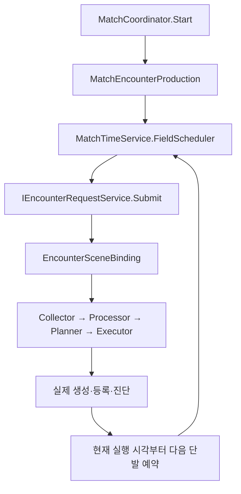

# Match 정규 Encounter 생산

## 누가 요청하는가

`InitialStageCompositionRoot`가 현재 Host의 `IEncounterRequestService`를 `MatchCoordinator`에 연결한다. Coordinator가 소유한 `MatchEncounterProduction`이 Field 게임 시간 예약으로 요청하며, `EncounterSceneBinding`은 요청을 받는 연결부다. Game Debugger를 켜거나 버튼을 누르지 않아도 Stage_1에서 생산이 시작된다.

- Core의 시작 예약은 기본 **0.5 게임 초**, 이후 **15 게임 초** 간격이다. `InitialStageCompositionRoot` Inspector의 `encounterProduction`에서 다음 Match 기본값을 바꾼다. 실행 중 Inspector 변경이 현재 예약에 즉시 적용되지는 않는다.
- 요청당 `MaximumEnemiesPerRequest=500`은 요청 마릿수의 최댓값이다. 500마리를 반드시 만들거나 전체 생존 적을 500마리로 제한하는 값이 아니다. 실제 생성은 기존 비용 예산·편성 단위·공간/셀 수용량을 모두 만족해야 한다.
- 기존 비용 예산 20~100, 정적 요청당 최대 +5의 접근 방식은 유지한다. 점유율에 따른 이 난이도 곡선의 분모는 기존 전체 Grid이며, 진행 HUD의 **점유 가능한 셀 분모**와 다르다.
- 요청의 Source는 `MatchProduction`이다. 수동 요청·Debugger 연속 요청은 별도 Source로 같은 권한·최신 공간·환경·실행 경계를 이용한다. 수동 요청이 정규 예약을 새로 시작하거나 취소하지 않는다.
- Scene의 옛 첫 요청은 `IEncounterProductionConsumer.UseMatchProduction()`으로 끈다. 독립 시험 Scene의 첫 요청과 네트워크 테스트 UI는 여전히 독립 시험 용도로 사용할 수 있다.

## 정지·긴 프레임·완료

예약은 기존 `IMatchScheduler.Schedule`을 사용한다. 한 회차가 끝난 **현재 게임 시각**에서 다음 회차를 잡는다. 오랫동안 정지했거나 프레임이 지연되어도 놓친 회차를 한 번에 생성하지 않는다. Match 완료/폐기에는 예약 lease와 gameplay token이 취소된다. Client는 이 생산 소유자를 만들지 않는다.

`MatchTime`은 Player·낮밤이 읽는 공용 시간이다. `FieldSimulationClock`은 그 시각에서 기존 Field의 보류 구간만 빼는 투영이며 새 SDK/NGO 시계가 아니다.

| 읽는 대상 | 시간 |
| --- | --- |
| Player, 낮밤/날씨 시간 계약 | 공용 `MatchTimeService.Clock` |
| 기존 Field Enemy·터렛·자식 투사체, 정규 생산·지연 출현, 정적 확보 | `MatchTimeService.FieldClock` |
| 표현/진단 | Scene의 `MatchTime`과 `FieldTime`을 구분해 읽음 |

Core의 단계 소유자는 `MatchTimeService.SetFieldHeld(bool)`로 기존 Field만 보류한다. `CanAdvance`만 끄는 것과 달리 Field 절대 시각도 멈추므로 냉각·투사체 수명·예약 deadline이 재개 순간 만료되지 않는다. 보스전에서 어느 Scene을 보류할지는 후속 Stage 단계 연결에서 결정한다. **공용 시간과 Field 시간은 서로 다른 anchor로 Client에 전달하는 기반을 구현했다. 실제 원격 Player를 포함한 두 게임 실행의 Field 보류 인수는 후속 범위다.**

## 환경과 저장

자동 편성도 `EncounterEnvironmentProfile`을 읽는다. 기존 `budgetScale`은 이름과 달리 **마릿수 상한의 배율**이며 비용 예산을 추가로 곱하지 않는다. `presetOverride`가 있으면 그 편성 안에서 비용·수량·수용량을 검사한다. 일치 규칙/프로필이 없으면 중립이다. 이 연결만으로 실제 날씨별 가중치나 새로운 편성 데이터를 만들지는 않는다.

- `world/encounter` v3: 실제 생성 분산 이력·현재 예산 증가 단계·대기 요청의 자동/고정 편성 구분에 추가 출현 쿨다운·준비 편성/비용/영역·원인·예고를 저장한다. v1/v2 읽기를 유지하며 v1 예산은 미초기화로 이관한다.
- `world/encounter-production` v1: 다음 요청까지 남은 Field 게임 초와 요청 회차. 복원 후 새 실행 세대에 하나의 예약을 등록한다.
- `world/field-time` v1: Field 경과 시각과 보류 상태. actor·예약보다 먼저 적용하며, 실패 rollback도 Field 시각을 먼저 원복한다.

전체 체크포인트에는 실제 Feature writer가 모두 필요하다. **현재 실제 Stage_1의 `world/weather` writer가 누락되어 전체 저장은 차단된다.** 위 세션/생산 상태의 개별 왕복을 전체 월드 저장·재실행 완료로 읽으면 안 된다. 새 필수 section이 없는 과거 전체 저장의 호환은 성장/월드 통합 배치에서 별도로 다룬다.

## 어디서 확인하는가

`Tools → TeamHJD → Game Debugger`의 Encounter 패널에 Match 정규 생산 상태, 다음 요청/간격, 회차/마지막 결과, 공용/Field 시각을 표시한다. Statistics/요청 표의 `MatchProduction` 계획/실제 수량을 함께 확인한다. Debugger 버튼은 추가 수동 요청이며 정규 생산의 시작 버튼이 아니다.

이번 단계는 **지속 생산·자동 환경 조건·Field 시각·공통 예산 내 추가 출현과 저장 경계**를 연결했다. 33·66·100%의 진행 사실·저장/실제 사망 전달은 [Stage 진행 API](../02_match/stage-progression-api.md)를 따른다. Field 생성 서비스와 명시적인 Scene 준비 API는 구현했으며, 실제 Boss 콘텐츠/진입로·Boss Scene/연출은 미지정이다. 사용자 확정에 따라 최종 Scene 자동 진입·자동 승리·별도 결과 저장은 연결하지 않는다.

검사 조건과 실제 관측은 [통합 실행 기록](../../01_planning/02_implementation-records/2026/11/2026-11-13-encounter-stage1-integration.md)을 따른다.

## 점유 확장에 따른 추가 출현

`RegionRuntime`이 소유한 최근120 Field초/최대64개 변경 이력을 Collector에 전달한다. 첫 CU·복원·Grid 교체는 성장 사건이 아니며 기본으로 순증15%·확장2회·관측30초를 만족해야 한다. 단 한 번의 정적 구역 확보로 반복 출현하지 않는다.

Planner의 마지막 정책이 이미 편성된 완성 분대 하나를 **같은 총예산의 최대50% 내에서** 점유 내부 영역으로 옮긴다. 나머지 정상 편성을 최소 하나 유지한다. 비용을 새로 더하거나 Enemy 스킬 소환의 편성을 바꾸지 않는다. 영역은 점유 외곽 인접 셀·NavMesh·빈 Player/Turret 셀·Player 거리8을 검사한다. 후보가 없으면 정상 계획을 유지한다.

`EncounterSceneBinding` Inspector의 additionalSpawnSettings에서 순증·관측·비중·90초 쿨다운·3초 예고를 조절한다. 현재 예약의 잠긴 편성을 재선정하지 않으며 다음 자동 요청부터 적용한다. 실행 환경 Snapshot은 새로 읽되 Enemy 종류/수량·비용은 예고한 그대로다.

점유 내부에는 기존 주황 원 Sprite를 그린다. 예고는 Source `SituationEvent`와 부모 요청 ID로 Statistics/Timeline에 기록되며, 예정 수량은 실제 생성·생존으로 세지 않는다. Field 보류/복원은 남은 대기를 보존하고 Grid 교체/종료는 예약과 표시를 제거한다. 재개 후 공통 요청 서비스→Executor가 최신 권한/배치를 확인한다. 자동 편성에 명시 origin을 붙이는 조합은 `UnsupportedOrigin`이며 고정 또는 준비 편성을 사용한다.

**현재 원격 예고 전송이 없어 내부 추가 출현은1인 Host만 지원한다.** 멀티에서는 예고 없는 내부 생성을 하지 않고 일반 계획을 유지한다. Ground/Air 연출도 별도 adapter 없이는 Unsupported다.

## 실제 공간 입력 확인

`EnemySpawnExecutor.CaptureEnemyPositions`를 Root가0.1 unscaled초마다 읽고, 개체/셀 점유가 바뀌면 App/MatchSession을 거쳐 Grid revision을 갱신한다. 셀 안에서만 이동한 것으로는 불필요한 revision을 만들지 않는다. 다음 정규 요청은 이 snapshot을 Collector/Planner에 그대로 전달한다.

실제 Stage_1 요청3회에서 직전 실제 적/Grid/계획 기록은0/0/0 →12/12/12 →24/24/24, 입력/계획 revision은4/4 →25/25 →54/54였다. 분배 후보41개씩의 밀도 수치123개가 같은 Grid와 일치했고 각 요청은12/12를 생성했다. 같은 자료를 Game Debugger의 요청별 Spawn Decision에서도 확인했다. 이는 실제 입력 연결의 증거이며 보스/멀티/밸런스 전체 완료를 의미하지 않는다.
