# Encounter 정식 연결과 시험 도구

## 정식 게임 경로

```mermaid
flowchart LR
  Network[InitialStageNetworkBinding / App network session] --> Root[InitialStageCompositionRoot]
  Root --> Coordinator[MatchCoordinator]
  Coordinator --> Production[MatchEncounterProduction / Field scheduler]
  Production --> Request[EncounterRequestService]
  Request --> Binding[EncounterSceneBinding]
  Binding --> Pipeline[Collector → Processor → Planner → Executor]
  Pipeline --> Actual[실제 Enemy·분대·진단·공간 입력]
```

`EncounterSceneBinding`은 Scene 참조와 현재 Match의 전장/지역/환경/난수/시간을 연결하고 검증된 요청을 Pipeline에 전달한다. 이 객체 생성·BindMatch만으로 Host를 열거나 첫 적을 만들지 않는다. 정규 생산의 0.5초/15초 설정은 기존 Core 생산 설정을 그대로 사용한다. 기존 예산·분대·점유 그룹 제외·추가 출현·소환·진단·저장 경계는 유지한다.

연결 종료는 App session 소유자의 책임이다. Match 해제는 그 Match가 생성한 Enemy와 구독·예약을 정리하며, App 연결을 닫지 않는다.

## 독립 시험 버튼이 필요할 때

시험 Scene에서 현재 `EncounterSceneBinding`이 붙은 객체에 **Enemy Network Test Controls**를 명시적으로 추가한다. Add Component 경로는 `TeamHJD → Testing → Enemy Network Test Controls`다. 게임 Scene/Prefab에는 자동 설치하지 않는다.

- `EnemyNetworkTestControls`만 기존 `EnemyNetworkTestLauncher`를 생성하고 GUI를 표시한다.
- Start Host/Start Client는 수동 시험 연결이다. Plan & Spawn은 이미 바인딩된 Match의 공통 자동 계획 API로 1회 요청한다. Match나 전장 자료를 가짜로 만들지 않는다.
- Core가 App 연결 소유권을 지정했다면 시험 GUI·종료 동작을 실행하지 않는다.
- 독립 시험의 자동 첫 고정 분대 출현은 제거했다. 자동 생산을 검증하려면 실제 MatchCoordinator를 사용한다.
- 기존 `EnemyNetworkTestLauncher.cs`와 `.meta`는 수정·복원하지 않았다.

수동 기본 상한은 `EncounterSceneBinding.manualEnemyLimit`이다. 예전 `initialEnemyLimit`은 `FormerlySerializedAs`로 읽어 기존 수동 상한을 보존한다. 정규 생산 상한은 별도 Core `encounterProduction` 설정이다.

## 저장 호환

정규 생산의 다음 예약/요청 수는 기존 `world/encounter-production` writer가 저장·복원한다. `world/encounter` v1~v3의 첫 bool/double은 옛 시험 첫 요청 슬롯이다. 이전 payload의 슬롯을 소비·검증하고 새 저장에는 false/0을 기록한다. 이를 시험용 추가 스폰으로 재실행하지 않는다. 나머지 예약·분산 이력·예산·추가 출현 쿨다운은 같은 형식을 유지한다. 실제 Weather writer를 포함한 전체 월드 복원 완료를 뜻하지 않는다.

## Scene 제작 경계

이 분리는 Scene·Prefab·Script GUID를 변경하지 않는다. Stage_1 제작 변경은 #727에서 #726 이전으로 되돌렸으며 팀원 제작이 끝나기 전 자동 저장·재직렬화하지 않는다.
