# Encounter 정식 연결과 시험 도구

## 정식 게임 경로

```mermaid
flowchart LR
  Network[InitialStageNetworkBinding / App network session] --> Root[InitialStageCompositionRoot]
  Root --> Coordinator[MatchCoordinator]
  Coordinator --> Production[MatchEncounterProduction / Field scheduler]
  Production --> Request[EncounterRequestService]
  Request --> Binding[EncounterSceneBinding]
  Binding --> Pipeline[Collector → Processor → Planner → Executor]
  Pipeline --> Actual[실제 Enemy·분대·진단·공간 입력]
```



`EncounterSceneBinding`은 Scene 참조와 현재 Match의 전장/지역/환경/난수/시간을 연결하고 검증된 요청을 Pipeline에 전달한다. 이 객체 생성·BindMatch만으로 Host를 열거나 첫 적을 만들지 않는다. 정규 생산의 0.5초/15초 설정은 기존 Core 생산 설정을 그대로 사용한다. 기존 예산·분대·점유 그룹 제외·추가 출현·소환·진단·저장 경계는 유지한다.

연결 종료는 App session 소유자의 책임이다. Match 해제는 그 Match가 생성한 Enemy와 구독·예약을 정리하며, App 연결을 닫지 않는다.

## Scene 변경 없이 준비한 정식 네트워크 연결

`EncounterSceneBinding`은 NetworkManager를 직접 찾거나 같은 객체에 자동 추가하지 않는다. Core가 기존 `NgoNetworkSession`을 `INetworkConnectionStatus`라는 읽기 전용 계약으로 전달한다. 새 네트워크 세션을 하나 더 만드는 구조가 아니다.

- 계약은 실제 IsListening/IsServer/IsClient/IsHost와 서버의 실제 연결 수만 제공한다. StartHost/Shutdown/Dispose는 제공하지 않는다.
- `InitialStageNetworkBinding`이 App 연결을 소유하고 `UseAppNetworkOwnership(ConnectionStatus)`를 Match 바인딩 전에 호출한다. 일반 Feature 호출자는 이 초기화를 중복 수행할 필요가 없다.
- Match 바인딩 중에는 다른 연결로 교체할 수 없다. 해제 후 새 App 연결을 선택할 때도 App 소유권 API를 사용해야 하며 시험 도구의 상태 교체는 거부한다.
- 내부 추가 출현의 1인 Host 조건은 실제 SDK 접속 수로 계속 검사한다. 준비 완료 인원 수로 바꾸지 않는다.

Stage_1은 #731의 지형·터렛 제작본을 인수한 뒤 다음처럼 분리한다. NetworkManager와 Transport의 기존 참조는 보존한다.

```text
Stage Network          NetworkManager + Transport
Encounter Runtime      EncounterSceneBinding
InitialStageCompositionRoot + InitialStageNetworkBinding
                       ├─ _manager → Stage Network
                       └─ _encounterConsumerBehaviour → Encounter Runtime
EnemySpawnRoot         EnemySpawnExecutor + 실제 SpawnPoint
```

Core는 Scene의 명시 소비자를 우선하고, 미지정된 이전 Scene/NGO 재로드에서만 기존 App 네트워크 루트의 소비자 하나를 사용한다. 잘못되거나 비활성인 명시 참조를 다른 객체로 조용히 대체하지 않는다. Encounter consumer의 기존 Script GUID와 컴포넌트 참조를 유지하면서 네트워크 객체에서 분리했다.

## 수동 시험과 실제 스폰 지점

옛 `EnemyNetworkTestLauncher`와 이를 감싸던 `EnemyNetworkTestControls`는 제거한다. App의 연결은 기존 Core 네트워크 API로 시작하고, 수동 스폰은 **Game Debugger → Encounter**의 공통 요청을 사용한다. Enemy 전용 시험은 기존 `Tools → TeamHJD → The Developer → Enemy Test` 창을 사용한다. 게임 Scene에 IMGUI Host/Client 버튼이나 자동 첫 고정 출현을 다시 추가하지 않는다.

- Stage_1의 제작 지점은 `EnemySpawnRoot/Spawn_LaneA_01`처럼 표시한다. 고유 `spawnPointId`는 기존 `LaneA_01`을 유지하므로 이름 변경으로 저장·진단의 식별자가 달라지지 않는다.
- 종전 `Encounter Debug Spawner`의 Executor와 36개 지점을 제거한다. 그 지점들은 이름만 Debug였고, 기존에는 같은 Scene 수집 규칙 때문에 정식 계획에도 들어갈 수 있었다.
- 같은 Scene의 모든 SpawnPoint를 자동 발견하는 규칙은 유지한다. 앞으로 지점을 복제해도 등록되며, 8개 고정 목록이나 이름 필터를 사용하지 않는다.
- 등록과 사용 가능 여부는 다르다. 비활성·수동 금지·점유 Region·점유 셀 반경 제한은 최신 정책으로 거른다. 기존 `LaneA_02`의 수동 비활성은 보존한다.
- 정적 Region 그룹은 지점의 XY를 실제 Region Grid에 대입해 정한다. `AreaId` 문자열이나 Hierarchy 이름을 실제 그룹 원본으로 사용하지 않는다.

수동 기본 상한은 `EncounterSceneBinding.manualEnemyLimit`이다. 예전 `initialEnemyLimit`은 `FormerlySerializedAs`로 읽어 기존 수동 상한을 보존한다. 정규 생산 상한은 별도 Core `encounterProduction` 설정이다.

## 저장 호환

정규 생산의 다음 예약/요청 수는 기존 `world/encounter-production` writer가 저장·복원한다. `world/encounter` v1~v3의 첫 bool/double은 옛 시험 첫 요청 슬롯이다. 이전 payload의 슬롯을 소비·검증하고 새 저장에는 false/0을 기록한다. 이를 시험용 추가 스폰으로 재실행하지 않는다. 나머지 예약·분산 이력·예산·추가 출현 쿨다운은 같은 형식을 유지한다. 실제 Weather writer를 포함한 전체 월드 복원 완료를 뜻하지 않는다.

## Scene 제작 경계

초기 코드 분리 #728은 Scene을 변경하지 않았다. 이번 재접합은 팀원 #731을 먼저 병합한 뒤 Stage_1의 연결 객체만 수정한다. 지형·타일·NavMesh·터렛 배치와 원본 프리팹을 재작성하지 않는다. 필드 점유 경계는 기존 `FieldTerritoryRenderer.Attach`가 지도와 같은 Grid 경계를 사용해 생성한다. 새 씬에 없는 옛 카메라 마커는 복원하지 않고 기존 Grid bounds fallback을 사용하며 `SceneryRenderers`만 실제 `Environment_Obj`로 연결한다.
