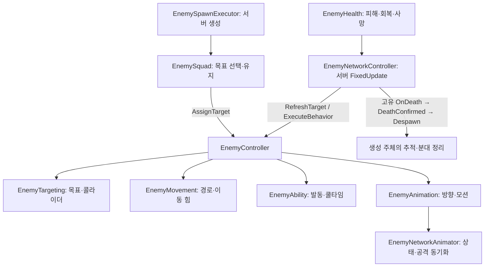
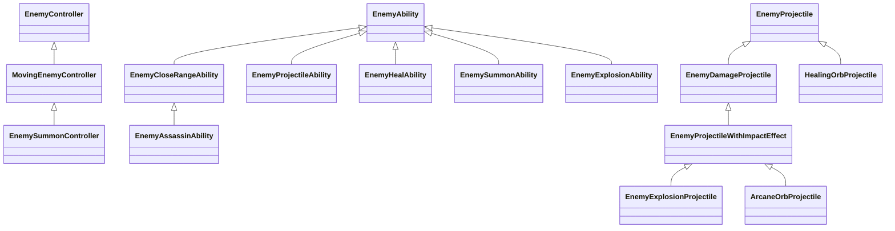

# Enemy 시스템 가이드

수정일: 2026-11-10
상태: #540 통합 브랜치 구현 기준. 밸런스 확정·전체 네트워크 인수 완료를 의미하지 않는다.

[문서 목차](../../README.md) · [Stage 1 콘텐츠와 등록](stage1-enemy-content-guide.md) · [Encounter 편성·예산](encounter-planning-guide.md)

이전 설명은 [#540 갱신 전 보관본](../../99_archive/2026-11-08/enemy-system-guide-before-540.md)에 고정 커밋과 함께 보존했다.

## 스크립트 폴더

```text
Features/Enemy/
├─ Contracts/             # 다른 Feature와 공유하는 계약
├─ Effects/               # Enemy 효과 전용 어셈블리
├─ Runtime/
│  ├─ Abilities/           # 근접·원거리·회복·소환 능력
│  ├─ Controllers/        # 몬스터 행동 조율
│  ├─ Health/              # 체력·피격 규칙
│  ├─ Movement/            # 이동 및 경로 탐색
│  ├─ Networking/          # 네트워크 권한·상태·생성
│  ├─ Presentation/        # 애니메이션·깊이 정렬
│  ├─ Projectiles/         # 공격·회복 투사체와 충돌 효과
│  └─ Targeting/           # 타깃·감지·분대
├─ Encounter/
│  ├─ Data/                # Definition·Catalog·편성 데이터
│  ├─ Planning/            # 편성 선택·공간 분배·예산
│  ├─ Spawning/             # 스폰 실행·지점 등록·배치
│  └─ EncounterRuntime.cs  # Encounter 진입점
├─ Editor/
│  ├─ Authoring/           # Scene 및 SpawnPoint 제작 도구
│  └─ Tests/               # EditMode 테스트
├─ Legacy/Targeting/       # 현재 사용하지 않는 점수 기반 타깃 코드
└─ Testing/                # PlayMode·씬에 붙이는 테스트 드라이버
```

스크립트 이동은 클래스 이름·네임스페이스를 바꾸지 않았으며 `.meta` GUID를 보존했다. `Contracts`와 `Effects`의 asmdef 위치도 유지한다.

## 책임과 실행 흐름

`EnemyAIBrain`을 거치지 않고 컨트롤러가 행동을 조율한다. 공통 참조는 `EnemyController`, 이동형 조율은 `MovingEnemyController`, 실제 기능은 Targeting·Movement·Ability·Animation·Health가 소유한다. 몬스터 이름마다 컨트롤러를 만들지 않고 행동이 달라지는 지점에 능력 또는 컨트롤러를 추가한다.



단일 플레이도 Host로 실행하는 현재 게임 흐름을 따른다. 로컬/네트워크 Driver와 운영 프리팹을 별도로 완성한 구조가 아니다. Core 연결은 여전히 `EnemyNetworkTestLauncher`가 기존 계약을 구현해 담당한다. 운영용 연결 컴포넌트 분리는 후속 작업이다.

## 스크립트와 프리팹 상속



스크립트 상속과 Prefab Variant 상속은 각각 관리한다. `Base/EnemyRoot.prefab → MovingEnemy.prefab → MeleeEnemy.prefab 또는 RangedEnemy.prefab`이 공통 제작 계층이다. 지원·특수·암살자도 필요한 컴포넌트를 조합하고, 소환형처럼 이동 이후 상태 전이가 다를 때 컨트롤러를 분리한다. 구체 에셋은 [콘텐츠 가이드](stage1-enemy-content-guide.md)를 따른다.

## 컴포넌트 책임

| 컴포넌트 | 현재 역할 |
| --- | --- |
| `EnemyController` | 공통 참조, `AssignTarget`, 분대 참여·갱신 요청, 능력 사용·애니메이션 연결, 고유 `OnDeath` 진입점 |
| `MovingEnemyController` | 실행 중 능력은 정지 대기. 발동 조건을 충족하면 능력을 시도하고, 아니면 목표로 이동 |
| `EnemySummonController` | 이동 → 변태 → 위치 고정 상태 전이. 변태 완료 후 소환 능력 실행 |
| `EnemyTargeting` | 목표 Transform과 대상 Collider 목록·유효성 관리 |
| `EnemyMovement` | NavMesh 경로 요청, waypoint 방향, Rigidbody2D 이동 힘 적용 |
| `EnemyAbility` | `CheckCondition`, `Activate`, 쿨타임, 실행 권한, 공통 Collider 거리 검사·기즈모 |
| `EnemyAnimation` | 네 방향 선택, 이동 속도 파라미터, 능력 모션 재생 |
| `EnemyNetworkController` | 서버 행동 실행, Match 시간·수명 연결, 체력 사망 및 폭발 제거 처리 |
| `EnemyNetworkAnimator` | 이동 상태를 NetworkVariable로 전달, 공격 Trigger를 서버 실행 및 RPC로 전달 |
| `EnemyHealth` | 체력 초기화, 피해·회복, 중복 사망 방지, `Died` 알림 |
| `EnemyDamageRule` | 공격자 종류에 따른 피격 허용 정책. Health의 특정 몬스터 분기를 피한다 |
| `EnemyDepthSorting` | 발 BoxCollider2D의 월드 중심 Y를 현재 씬 지면 bounds에 정규화. 기본 Z 범위 65~70 |

`EnemyRoot`의 `footCollider`에는 발 충돌용 BoxCollider2D를 연결한다. Variant는 이 참조를 상속하며, 발 콜라이더를 교체한 경우 정렬 참조도 다시 연결한다. 각 몬스터의 발 중심을 같은 바닥 기준으로 맞춰 몸통 높이에 따라 앞뒤 순서가 달라지지 않게 한다.

## 타깃·분대·이동

`ITargetable.TargetabilityLost`는 `TargetableComponent.CanBeTargeted`가 true에서 false로 바뀔 때 해당 타깃을 인자로 한 번 알린다. `SetHealth()`와 `OnEnable()`·`OnDisable()`에서 전환을 확인하므로 체력 0, 비활성화, 활성 대상 파괴를 처리하고 같은 불가 상태의 반복 갱신은 중복 통지하지 않는다. 타깃 가능 상태로 회복한 뒤 다시 불가능해지면 새 전환으로 알린다. 구독자는 `target.TargetabilityLost += OnTargetabilityLost`로 연결하고 타깃 교체·구독자 종료 시 같은 핸들러를 `-=`로 해제한다. `EnemySquad.TryChangeTarget()`은 최초 지정·플레이어 전환·저장 복원에서 구독과 구성원 전달을 함께 처리하고 마지막 구성원이 제거되면 구독을 해제한다.

목표 선택은 `EnemySquad`가 담당한다. 배정된 목표가 있으면 주기적으로 `CanBeTargeted`를 검사하거나 구성원을 순회하지 않는다. 타깃 불가 이벤트를 받으면 기존 목표와 구독을 해제하고 분대 중심에서 가장 가까운 유효 후보를 즉시 한 번 검색한다. 후보가 없을 때만 기존 행동 갱신 경로의 대표 활성 구성원이 `RefreshTarget()`으로 현재 코드의 간격인 1초마다 재시도하며 새 Update나 코루틴을 추가하지 않는다. 여러 분대가 같은 목표를 잃으면 해당 이벤트 시점에 각 분대의 검색이 발생하며 프레임별 검색량을 분산하는 스케줄러는 아니다. 일반 스폰·소환 적·테스트 적 모두 `JoinSquad`로 연결한다. Executor는 생성 직후 최초 목표를 지정하고 분대 목록을 보관하지만, 별도의 Update에서 분대 목표를 반복 갱신하지 않는다.

`EnemySquad`는 합류·제거와 `EnemyController` 활성 상태 변경 시 대표를 선택한다. `EnemyNetworkController`는 `IsSquadRepresentative`인 구성원만 `RefreshTarget()`을 호출하며, 반복 갱신 중 대표를 찾기 위한 구성원 순회를 하지 않는다. 대표가 제거되거나 비활성화되면 남은 활성 구성원이 갱신을 이어받는다. 대표 교체는 분대의 목표·배정 인원·다음 재검색 시각을 초기화하지 않으며, 타깃 상실 이벤트의 즉시 재검색은 대표 여부와 관계없이 실행한다. 1인 분대는 호출 수가 줄지 않는다.

`EnemyDefinition.SquadMode`는 공동 분대/개별 분대, `TargetRule`은 PlayerOrTurret/PlayerOnly를 선택한다. 일반 스폰도 타깃 규칙이 다른 구성원은 같은 분대에 섞지 않는다. BlackWolf는 개별 PlayerOnly 분대다.

현재 분대 선택 경로는 최단거리 조회를 사용한다. `EnemyAIProfile`과 점수 평가용 옛 클래스 파일이 남아 있다는 사실을 현재 분대가 점수식을 사용한다는 뜻으로 해석하지 않는다.

재검색은 **타깃 교체**다. `AssignTarget()`은 `SetDestination()`으로 이전 경로를 비우고 새 타깃의 첫 경로를 즉시 계산한다. 같은 플레이어를 추적하는 동안에는 `MovingEnemyController`가 이동 중에만 경로를 갱신한다. 감지 중심에서 현재 타깃 위치까지의 거리가 센서 반경 안이면 짧은 주기, 밖이면 긴 주기를 적용한다. 인스펙터 초기값은 범위 안 0.25초, 밖 1초, 타깃 최소 이동 거리 0.2이며 밸런스 확정값이 아니다. 경로가 없으면 이동량과 관계없이 재시도한다. 같은 타깃의 갱신 실패는 기존 경로를 유지한다. 실제 게임 실행에서는 기존 FieldSimulationTime을 사용한다.

첫 반복 갱신 시점은 몬스터 InstanceID로 엇갈리게 배치하며 새 타깃의 첫 계산을 지연하지 않는다. 이는 프레임당 계산 수 제한이나 결정적인 재실행을 보장하는 스케줄러가 아니다. 타깃별 공격 인원 제한은 아래 배정 API와 분대 연결을 사용하며 별도 경로 계산 스케줄러는 후속 작업이다.

`TargetableComponent`의 `Max Attackers`는 타깃별 최대 배정 인원 설정이며 `ITargetable.MaxAttackers`로 조회한다. 초기값 10은 임시 값이고 플레이어·터렛·CU마다 조절할 수 있다. 현재 배정 인원은 실행 중 값인 `AssignedAttackerCount`로 조회한다. `TryAssignAttackers(count)`는 타깃이 유효하고 요청 인원이 양수이며 남은 인원 안에 들어갈 때만 배정 수를 늘린다. `UnassignAttackers(count)`는 양수만 해제하고 결과를 0 이상으로 제한한다. 배정 인원은 주기적으로 집계하거나 비활성화 시 자동 초기화하지 않는다. 호출자는 자신이 배정한 인원을 관리하고 반환해야 한다.

`EnemyDefinition.IsIncludedInAttackerLimit`은 몬스터별 공격 인원 집계 설정이며 기본값은 true다. `BomberSlime` Definition만 false로 설정한다. 일반 스폰·소환 생성·저장 복원은 Definition의 값을 `EnemyController.JoinSquad()`에 전달한다. 설정은 최초 등록 시 적용하고 소속 중에는 바꾸지 않는다. 같은 분대의 중복 등록은 그대로 유지하고 다른 분대로의 자동 이동은 거부한다. `LeaveSquad()`는 사망·Despawn 시 소속과 배정을 정리하는 데 사용한다. 인자를 생략하는 테스트용 등록은 기본값 true를 사용한다.

`EnemySquad.SetTarget()`은 검색 시점에 활성 `TargetableComponent` 후보를 조회하고 타깃 유형과 `GetAttackerCount()`로 계산한 집계 대상 수를 `TeamHJD.Game.Enemies.Targeting.EnemyTargetSelector.TryFindNearest()`에 전달한다. 제외 대상도 같은 분대와 타깃을 공유하지만 배정 수에는 반영하지 않는다. 봄버만 있는 분대는 집계 인원이 0이므로 유효한 포화 타깃도 선택할 수 있다. Encounter의 편성 판단용 타깃 조회도 기본 인원 값 0으로 인원 제한을 적용하지 않는다. 호출부에서는 Legacy의 동명 클래스와 구분하도록 `RuntimeTargetSelector` 별칭을 사용한다.

분대는 별도 누적 카운터 없이 검색·타깃 변경 시에만 집계 대상 구성원을 계산한다. `TryChangeTarget()`은 새 타깃에 집계 대상 수만큼 배정할 수 있을 때 이전 배정과 구독을 반환하고 전체 구성원의 목표를 바꾼다. 타깃 불가 이벤트에서는 이전 목표와 배정을 먼저 해제한 뒤 재검색하며 후보가 없으면 목표 없이 재시도한다. 감지한 플레이어로 우선 전환할 때는 집계 대상 수를 수용할 수 없으면 기존 유효 타깃을 유지한다. 합류·제거 시에는 해당 몬스터가 집계 대상인 경우에만 한 명을 추가·반환한다. 합류 인원을 수용하지 못하면 목록 추가 전에 기존 집계 대상의 배정을 반환하고 전체 분대가 재검색한다. 저장 복원은 같은 타깃에 중복 배정하지 않고 다른 타깃으로 교체할 때 이전 배정부터 반환한다. 집계 설정은 Definition에서 다시 읽으며 저장 형식은 변경하지 않는다.

배정 API는 Test Runner의 EditMode에서 `EnemyTargetAttackerLimitTests`를 선택해 실행한다. 별도 Preview Scene에서 최대 인원을 10으로 설정하고 배정 한계·해제 후 재배정·0 및 음수 인원·과도한 인원·체력 0 및 비활성 상태·체력 회복 후 배정을 검사한다. 분대의 실제 배정이나 네트워크 동작을 검증하는 테스트는 아니다.

`EnemyPlayerSensor`는 개체별 CircleCollider2D Trigger의 진입 이벤트로 플레이어를 전달한다. 이미 겹친 상태의 분대 합류나 기존 타깃 무효화는 Stay 이벤트로 보완한다. 센서는 `EnemyNetworkController.CanExecuteBehavior`로 서버/명시적 로컬 테스트 및 시뮬레이션 진행 권한을 검사한 뒤 `EnemyController.NotifyPlayerDetected()`에 전달한다. 공통 컨트롤러는 네트워크 컴포넌트를 직접 참조하지 않고 소속 분대에 전달한다. `EnemySquad.TryPrioritizePlayer()`는 검색 주기를 기다리지 않고 플레이어로 전환하며, 기존 플레이어가 유효하면 유지한다. 범위 이탈만으로 타깃을 해제하지 않는다.


이동은 XY NavMesh 경로를 구하고 서버의 FixedUpdate에서 `AddForce`로 가속한다. `moveSpeed`는 이동 방향의 목표 속도, `moveAcceleration`은 최대 이동 가속도다. 목표 속도에 도달하면 이동 힘을 더하지 않으며 외부에서 밀린 속도를 강제로 잘라내지 않는다. 사거리에서는 컨트롤러가 `Move()`를 호출하지 않아 이동 힘이 추가되지 않으며, 다른 적의 충돌에는 밀릴 수 있다. 남은 속도는 EnemyRoot의 Rigidbody2D `Linear Damping`으로 줄인다(초기 조정값 5). 실제 이동 속도와 정지 거리는 감쇠 및 충돌의 영향을 받는다. `CheckCondition()`은 쿨타임과 독립적이므로, 사거리에 도착한 적은 쿨타임 중에도 이동 입력을 멈춘다. 변태를 완료한 소환형은 기존대로 위치를 고정한다.

이동에 사용하지 않던 정지 플래그와 `EnemyMovement.Stop()`은 제거했다. 체크포인트는 경로와 경유점 진행도를 복원한다. 기존 저장 데이터와의 바이트 배열 형식을 유지하기 위해 과거 정지 플래그 자리는 쓰기 시 `false`로 채우고 읽기 시 소비한 뒤 버린다.

## 능력·투사체·애니메이션

`CheckCondition()`은 효과를 쓸 상황인지 판단하고, `Activate()`는 실행 성공 여부를 반환한다. `TryUse()`가 성공했을 때 공통 쿨타임을 시작하며 컨트롤러가 능력 모션을 재생한다. `IsExecuting`은 진행 중인 공격·소환 등을 기다리는 데 사용한다. `FacingTarget`은 회복할 아군처럼 이동 목표와 다른 대상을 바라볼 때 사용한다.

`MovingEnemyController`는 행동 실행마다 전투 타깃의 사거리를 한 번 계산해 `CheckCondition(bool isInTargetRange)`와 `MoveToTarget(bool isInTargetRange)`에 전달한다. 근접·원거리·폭발 능력은 이 결과를 재사용한다. 조건 통과 직후의 내부 실행 경로는 `TryUse(true)`로 조건 재검색을 생략하지만 권한·시뮬레이션 진행·쿨타임·실제 발동 검사는 유지한다. 인자 없는 `TryUse()`는 기존처럼 조건을 직접 검사한다. 힐 능력은 별도 아군 조건을 검사하고, 소환사는 이동 상태에서 계산한 거리 결과를 변태와 이동 판단에 함께 사용한다. 거리 결과는 해당 행동 실행 안에서만 사용하며, 지연 공격·명중 시점의 검사는 재사용하지 않는다.

공통 범위 필드는 `activationRange`다. 몸통과 대상의 활성 비트리거 Collider 사이 표면 거리를 비교한다. 몸통은 명시적으로 연결한 Trigger도 사용할 수 있으며 Bomber는 CapsuleCollider2D를 사용한다. 발동 거리와 폭발 피해 반경은 별개다.

`EnemyHealAbility`는 `allyHitboxLayers`에 지정한 아군 피격 레이어만 후보로 조회하고, 같은 아군의 여러 콜라이더는 한 번만 처리한다. 검색 시 가장 가까운 회복 가능한 아군을 선택한 뒤 체력·활성·사거리 조건이 유효한 동안 대상과 콜라이더 목록을 유지한다. 기존 대상을 잃으면 즉시 한 번 재검색하고, 대상이 없을 때는 `targetSearchInterval`(PartyMushroom 기본 0.2초)마다 다시 찾는다. 간격은 Match 시계를 사용하며 능력 쿨타임과 별개다. 유효한 치료 대상이 있으면 쿨타임 중에도 발동 조건을 유지해 정지·바라보기 판단을 보존한다. 프리팹에는 HitBox 자식의 실제 레이어를 연결하며, 새 몬스터 제작 시 이 마스크도 확인한다.

`EnemyProjectileAbility`는 발사 위치·방향·피해량을 정하고 `EnemyProjectileGenerator`에 생성을 요청한다. 생성 후 이동·명중·수명은 투사체가 담당한다. 애니메이션 이벤트 발사를 사용하는 프리팹은 `OnProjectileFireAnimationEvent()`와 `OnProjectileAttackAnimationFinished()`를 연결한다.

`EnemyProjectile`은 공통 권한·수명·Match 시계·깊이 정렬을, `EnemyDamageProjectile`은 피해량·속도·방향 동기화·충돌을, `HealingOrbProjectile`은 아군 추적과 도착 회복을 담당한다. 공격 투사체 방향 파라미터는 `DirectionX`/`DirectionY`다. FX가 필요한 공격은 `EnemyProjectileWithImpactEffect`를 조합한다. FX 종료 이벤트와 비반복 클립을 확인한다.

본체 Animator는 `MoveX`, `MoveY`, `IsMoving`, `MoveAnimSpeed`, `Attack`을 사용한다. `EnemyAnimation`은 네트워크 애니메이터가 스폰돼 있으면 서버 경로로 재생하고, 로컬 테스트에서는 Animator Trigger를 직접 재생한다. 서로 완전히 독립된 컴포넌트라고 가정하지 않는다.

## 피격 계약과 사망

다른 파트가 적을 공격할 때는 [IAttackableEnemy](../../../Assets/Scripts/Features/Enemy/Contracts/IAttackableEnemy.cs)의 `CanBeAttackedBy(AttackSourceType)`와 `TryTakeDamage()`를 사용한다. 공격자 종류를 잃는 기존 `TakeDamage(int)`는 Unknown으로 전달되므로, 암살자의 Player 전용 피격 정책을 통과하지 못한다. 새 호출자는 공격자 종류를 정확히 전달한다.

`EnemyHealth`는 공통 활성/사망 상태를 검사하고 `EnemyDamageRule`에 정책을 위임한다. 암살자 규칙은 `EnemyAssassinDamageRule`이 담당한다. 탐지자 등록은 `IDetectableTarget.RegisterDetector/UnregisterDetector`로 제공하고, 서버 결과는 `EnemyNetworkDetection`의 NetworkVariable로 전달한다. 플레이어 반경 검출과 터렛의 후보 제외는 해당 파트가 이 계약을 소비해야 한다. 은신 셰이더는 후속 작업이다.

적이 Player/Turret에 주는 피해는 `TargetableComponent.TryApplyDamage()` 또는 `IDamageableTarget` 공통 수신 계약으로 전달한다. 현재 근접 코드는 PlayerInfo 직접 호출 방식이 아니다. Mage 감속은 `ISlowEffectReceiver.ApplySlow()`를 호출하며, 실제 이동/공격속도 변경은 대상 수신자가 담당한다. Enemy에서 API를 호출한다는 사실을 모든 터렛 수신 구현 완료로 해석하지 않는다.

일반 사망은 `EnemyHealth.Died → EnemyNetworkController → controller.OnDeath → DeathConfirmed → Despawn` 순서다. 고유 사망 반응 또는 관측자의 예외가 나머지 제거를 막지 않도록 처리한다. `Despawned`는 사망 외 제거도 알린다. Bomber는 폭발 피해를 먼저 적용하고, 모션 종료 시 `RemovalRequested`로 제거하므로 일반 체력 사망과 구분한다.

## 실행 권한과 시간

일반 행동·피해·네트워크 생성은 서버 권한이다. 공통 능력 쿨타임과 투사체 수명은 연결된 `FieldSimulationTime`을 사용하고, 투사체는 생성자에게서 Match 시간·종료 수명을 전달받는다. 모든 새 능력이 공용 시간과 저장에 완전히 연결됐다고 주장하지 않는다. 예를 들어 `EnemyAssassinAbility`의 공격 준비 대기는 아직 `WaitForSeconds`를 사용한다.

체크포인트 병합에서는 기존 공격 투사체 저장을 `EnemyDamageProjectile`에 연결하고 분대 복원 시 Definition의 분대/타깃 규칙을 유지했다. 회복 구슬·소환사의 고유 진행 상태·탐지 상태·Runtime의 점진 예산 상태까지 전체 저장/복원을 완료한 것은 아니다. 이 부분은 새 지원 범위를 담당자와 따로 확인한다.

## 테스트 모드

- `EnemyNetworkController.runOffline`과 `testTarget`: 몬스터 하나를 배치해 이동·모션을 확인하는 임시 로컬 경로. 네트워크가 실행 중이면 서버 경로를 따른다.
- `EnemySquadTester`: 배치한 몬스터를 각각 1인 분대에 등록한다. `initialTarget`이 없으면 규칙에 맞는 타깃을 찾고, 목표 무효화 후 재검색도 확인할 수 있다.
- `EnemyTestDriver`: 기존 별도 로컬 행동 실행기. `runOffline` 실행과 중복 사용하지 않는다.
- `EnemyDetectionTester`: 탐지자 A/B 등록·해제로 여러 플레이어의 탐지 해제 조건을 확인한다.

Host/Client 검증에서는 로컬 실행 플래그를 끄고 실제 NetworkObject Spawn·Network Prefab 등록·효과 동기화를 확인한다. 상세 순서와 이번 브랜치 검증 기록은 [콘텐츠 가이드](stage1-enemy-content-guide.md#검증과-남은-작업)를 따른다.

## Match 귀속 초기화와 정상 로그

서버의 일반 생성/Checkpoint 재생성은 `SetSimulationMatch → NetworkObject.Spawn` 순서를 유지한다. `SetSimulationMatch`는 Match ID와 Executor ID를 일반 필드에 준비한다. NGO가 NetworkVariable을 초기화한 뒤 `OnNetworkSpawn → NotifySpawned`에서 서버가 두 값을 반영하고, 그 다음 Match 시간 등록 구독자에게 알린다. Client는 최초 Spawn 패킷의 값을 읽고 덮어쓰지 않는다. 이미 Spawn된 적의 귀속 변경은 거절한다.

`EnemyNavMeshPathfinder`는 경로 성공을 반환값/경로로 전달한다. 개체별 성공 로그와 `EncounterRuntime.ExecutePlan`의 장문 정상 결과 복사 로그는 출력하지 않는다. NavMesh 실패 경고/오류, 요청 반환 문자열과 구조화된 SpawnPlan/Actual·통계·Timeline은 유지한다. 편성/예산의 선택적 진단은 기존 설정을 따른다.

이 초기화/로그 수정은 물리·AI 최적화나 실제 Enemy Pool 구현을 포함하지 않는다. 검증 범위와 코드 읽는 순서는 [PR 설명 문서](../../team/reviews/ngo-spawn-initialization-20261111.md)를 따른다.
