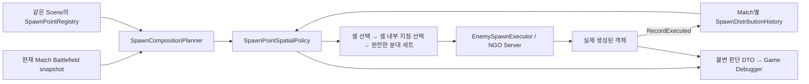

# Spatial Spawn Distribution

수정일: 2026-11-13
상태: 기존 공간 분산 정책과 #540 상황별 편성 연결 참고. 적용 대상은 Battlefield snapshot을 사용하는 Encounter 요청이다.

[Enemy 시스템](enemy-system-guide.md) · [Encounter 편성·예산](encounter-planning-guide.md)

## #540에서 추가된 단계

고정 편성은 지정된 세트를 아래 공간 정책으로 분산한다. 상황별 선택은 Runtime이 스폰 지점별 최근접 유효 Turret을 고른 뒤, **그 타깃 셀 주변**의 병력/Player/공격 유형을 보고 지역 예산과 편성을 선택한다. 출현 셀의 현재·예정 병력은 아래 분산/수용량 검사에 사용한다.

타깃 셀별 예산 그룹과 출현 셀별 공간 공유는 서로 다르다. 같은 타깃 셀을 향하는 여러 지점은 지역 예산을 공유하고, 같은 출현 셀의 여러 지점은 수용량·서비스 부하를 공유한다. 조건·비용·가중치·Static/Dynamic 예산은 [Encounter 가이드](encounter-planning-guide.md)를 기준으로 읽는다.

## 목표와 경계

스포너 개수가 아니라 **적합 Grid 셀의 공간 분포**를 기준으로 생성 기회를 분산한다. 같은 셀에 지점을 복제해도 그 셀이 배수의 생성 비중을 얻지 않는다. 활성 적 밀도가 낮은 셀을 선호하지만, 적이 스폰 셀을 떠났다는 이유로 매번 같은 가까운 지점만 선택하지 않는다.

Core는 Grid의 원시 점유와 전선 기하만 계산한다. 생성 정책과 이력은 Enemy/Encounter가 소유하고, Editor는 그 결과만 관측한다. Influence Map·전술적 우세·최종 난이도 Director는 이번 변경에 포함하지 않는다.

## 흐름과 수명

- `EnemyNetworkTestLauncher`의 Match Bind/Unbind가 `EncounterRuntime`을 생성/해제한다.
- Runtime의 Planner 한 개가 Policy와 History를 소유한다. 정적 서비스나 Editor 기록에 의존하지 않는다.
- 다른 Match ID 또는 XY Grid 설정 변경(중심·폭·높이·셀 수)이면 이력을 초기화한다. 표시용 Z 변경, revision/전선 모양 변경만으로 이력을 지우지 않는다.
- 제거·비활성·공간 제외된 후보는 이력에서 정리한다. 새로 추가/재활성된 셀은 현재 적합 셀의 최소 service부터 시작한다. 같은 셀의 신규 지점도 해당 셀의 기존 지점 최소 service부터 시작한다. 과거 미참여 기간을 보상하는 catch-up 스폰은 하지 않는다.

## 정적 Region별 스폰 허용 API

`SpawnPointRegistry.Initialize(points)`로 지점을 등록한 뒤, Match의 최초 `RegionGridSnapshot`이 준비되면 `InitializeRegionGroups(regionSnapshot)`을 한 번 호출한다. 각 지점의 XY 좌표를 Region Grid 셀로 변환하고, 같은 `Definition.RegionIds[cellIndex]`를 가진 지점끼리 묶는다. Grid 밖과 Region ID 0은 그룹에서 제외하고, 비활성 지점은 그룹에 포함한다. `SpawnPoint.AreaId`는 이 그룹의 기준으로 사용하지 않는다.

Core가 점령 상태를 판단한 뒤 `SetRegionSpawnEnabled(regionId, enabled)`를 호출하면 해당 그룹의 모든 지점에 스폰 허용 상태를 적용한다. 그룹이 없으면 `false`를 반환한다. 지점의 GameObject를 끄는 동작은 아니며, 기존 Planner/Executor의 `CanSpawnEnemies` 검사로 생성을 제한한다.

`EnemyNetworkTestLauncher`는 기존 `regionBinding`과 `TryReadRegion()`으로 현재 Match의 Static Region 자료를 읽고 최초 한 번 그룹을 초기화한다. Runtime 생성 시 자료가 아직 없으면 이후 읽기에 성공했을 때 초기화하고, Match 종료 시 초기화 기록을 해제한다. 점유 Snapshot의 revision 갱신만으로 그룹을 다시 만들지는 않는다.

그룹 조회 시 초기화하는 경로는 없다. 초기화 이후 등록 지점 목록이나 Region 정의가 바뀌면 `InitializeRegionGroups()`를 다시 호출해야 한다. Core의 점령 판단과 `SetRegionSpawnEnabled()` 호출은 아직 연결되지 않았으며, 점령에 따른 자동 차단은 후속 연결 사항이다.

### Region 그룹 수동 확인

1. `EnemySpawnExecutor`가 있는 오브젝트에 테스트용 `EnemySpawnRegionTester`를 추가한다. 같은 오브젝트면 Executor 참조는 자동으로 연결된다.
2. Static 모드에서 Host를 시작하고 기존 스폰 버튼으로 첫 요청을 실행한다.
3. 테스터 컴포넌트의 메뉴에서 `Region 테스트/전체 그룹 상태 출력`을 실행한다. Console에서 Region ID·소속 지점 ID·스폰 가능 수를 확인한다.
4. Inspector의 `Region Id`에 확인한 그룹 ID를 넣고 `선택 Region 스폰 끄기`를 실행한다. 해당 그룹만 스폰 가능 수가 0인지 확인한다.
5. 기존 스폰 버튼으로 다시 요청해 차단된 그룹의 지점에서 새 몬스터가 생성되지 않는지 확인한다. 기존에 생성된 몬스터는 제거되지 않는다.
6. `선택 Region 스폰 켜기`를 실행하고 지점이 다시 후보가 되는지 확인한다. 활성화만으로 즉시 생성되지는 않으며, 편성·예산·공간 정책을 통과해야 한다.

테스터는 `GetRegionGroups()`로 초기화된 그룹만 조회하며, 점령 상태를 판단하거나 그룹을 대신 초기화하지 않는다. 상태 변경은 Host/Server에서만 허용한다.

## 배정 규칙

1. 생성 불가, Grid 밖, Player/Turret 점유 셀, 중복/누락 ID를 제외한다. 반지름 전체가 아니라 지점 중심의 셀 판정이라는 기존 계약은 유지한다.
2. 적합 후보를 Grid cell ID로 묶는다. 같은 셀의 현재 Enemy 수와 이번 요청 예정량은 **공유**한다.
3. 셀 내부 대표 후보: `point service + 이 요청의 지점 예정량`이 가장 작은 지점, 동률이면 전선 최단 거리 → ordinal ID. 같은 셀 안에서도 특정 지점만 반복 사용하지 않는다.
4. 셀 비교: `cell service + 현재 Enemy 수 + 이번 요청의 셀 예정량`이 작은 셀. 동률이면 현재/예정 Enemy 부하가 작은 셀 → 대표 지점의 전선 거리 → ordinal ID.
5. 선택한 셀에 프리셋 한 세트를 배정하고 **셀 공유 예정량**을 증가시킨다. 전체 예산을 초과하거나 프리셋을 부분 분해하지 않는다.
6. Executor 종료 후 실제 생성 객체 수만 service에 더한다. 미실행·실패 계획은 소비하지 않고 부분 성공은 성공한 객체 수만 반영한다. 서버의 공통 Encounter 경로에서 요청당 한 번 commit한다.

`service`는 생성 분산을 위한 **가상 서비스 부하**다. 초기 후보에는 실제 생성 누계와 같지만 신규 후보에는 시작 기준값이 포함된다. 처치/생존 수 또는 난이도 점수가 아니다. 적이 이동하거나 죽어도 이미 사용한 생성 기회가 초기화되지 않는다. 현재 적 수를 함께 비교하므로 정확히 동일한 지점별 수량을 매 순간 강제하지 않는다.

전선 거리는 생성 기회와 밀도가 같을 때 쓰는 보조 기준이다. 가까운 전선의 한 지점을 항상 최우선으로 고르는 정책이 아니다. 전선이 없으면 거리 값 0과 안정적인 ID를 사용하며 전술 위험도처럼 해석하지 않는다.

## 진단과 확인

Statistics → Spawn decisions / distribution → Candidates에서 다음을 확인한다.

| 열 | 뜻 |
| --- | --- |
| Enemies | 요청 당시 셀의 현재 적 수 |
| Cell service | 요청 시작 시 셀의 서비스 부하 |
| Cell pending | 요청 전체 배정 후 해당 셀의 예정 적 수. 셀 내부 모든 후보에서 동일 |
| Final cell score | service + 현재 적 + 최종 예정량. 개별 세트 선택 순간의 점수가 아님 |
| Point service | 요청 시작 시 그 지점의 서비스 부하 |
| Sets / Frontline units / Decision | 이 지점의 세트 수, 전선 거리, 선택/미선택 사유 |

이전 JSON 기록 및 제외 후보는 service 값을 추정하지 않고 N/A로 표시한다. 계획/실제 결과를 함께 비교해야 하며, 후보 service와 최종 예정량을 실제 생성 통계에 더하지 않는다.

동일 조건의 반복 실험에서는 **지점별 합계만 아니라 셀별 합계**를 비교한다. 한 셀에 지점 4개, 다른 셀에 1개라면 셀 합계는 비슷하되 앞의 네 지점은 셀 비중을 나눠 갖는 것이 정상이다. 따라서 모든 지점의 개별 생성 수가 같은 것은 목표가 아니다.

검증 및 회귀 기록: [2026-10-08 수정 결과](../../99_archive/planning-links/2026-10-08-spawn-distribution-fix.md).
