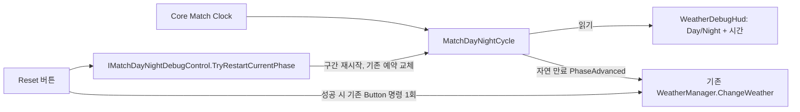

# 인게임 날씨 디버그 타이머

기준일: 2026-11-05. `Initial_Stage`에 있던 좌측 하단 날씨 변경 Button을 재사용합니다. 별도 카운트다운 코루틴이나 전역 타이머를 만들지 않았습니다.

## 화면과 사용법

```text
   Day / Night       ← 현재 낮밤, 작은 글씨
      5:00           ← 현재 구간의 남은 게임 시간
     Reset           ← 디버그: 현재 구간 재시작 + 기존 날씨 변경 1회
```

- 기본은 **Day 5분 → Night 5분 → 반복**입니다. 0초 경계를 넘으면 다음 단계와 5분으로 돌아가며 기존 Weather의 다음 항목을 선택합니다.
- **Reset은 현재 Day/Night를 유지**하고 그 구간을 5분부터 다시 시작합니다. 같은 요청에서 기존 날씨 변경 버튼의 명령을 한 번 실행합니다.
- 타이머가 표시된 기존 버튼 자체를 누르면 이전처럼 날씨만 변경합니다. 타이머 재시작까지 하려면 아래 Reset을 누릅니다.
- 날씨는 기존 예고 큐의 다음 항목으로 진행합니다. 큐에 같은 날씨가 연속으로 있으면 화면의 날씨 종류는 같을 수 있습니다. 이를 피하려고 진태님 추첨/가중치/큐 규칙을 바꾸지는 않았습니다.
- 필드 시간의 정지·배속을 따릅니다. 우주선 안에서 필드 시간이 멈추면 카운트다운도 멈춥니다. Reset은 공용 Match 경과 시각이나 다른 Feature의 타이머를 초기화하지 않습니다.
- Host 권한이 없거나 Match가 종료되면 Reset은 비활성화됩니다. 현재 Client 환경 복제는 낮밤 단계만 제공하므로 남은 시간이 제공되지 않는 Client는 `--:--`를 표시합니다. Client 권위 요청 RPC를 추가한 기능은 아닙니다.

## 연결 구조



`WeatherDebugHud`는 Scene에 직렬화된 Weather 객체에서 좁은 인터페이스를 받습니다. 다른 Scene의 Weather나 AppRoot를 전역 검색하지 않습니다. 기존 Button의 TMP 폰트·sprite·색 전환을 재사용하고, 작은 Game View에서도 화면 밖으로 나가지 않도록 좌측 하단 기준으로 배치합니다. Reset 복제 버튼의 persistent 클릭 목록은 비워 두어 날씨 명령이 두 번 실행되지 않습니다.

## 수정 파일

| 파일 | 역할 |
| --- | --- |
| `Assets/Scripts/UI/WeatherDebugHud.cs` | 기존 버튼을 시간 표시로 쓰고 Day/Night와 Reset을 생성·정리 |
| `Assets/Scripts/Core/Contracts/Environment/IMatchDayNightDebugControl.cs` | Host 디버그 재시작 요청 경계 |
| `MatchDayNightCycle.cs` | 현재 구간 재시작, 기존 예약 취소 후 새 예약 하나 등록 |
| `DayNightCycle.cs` | Night 중 재시작도 표현하는 시작 구간과 epoch 계산 |
| `MatchDayNightCycle.Checkpoint.cs` | 재시작 상태 저장. v2 쓰기, 기존 v1 읽기 지원 |
| `Initial_Stage.unity` | 기존 Weather 객체에 HUD를 붙이고 실제 Button/Weather 참조 연결 |

진태님 `WeatherManager.cs`, `CountTick.cs`, 날씨 추첨·큐·효과·Weather 저장 writer를 이번 HUD 작업에서 수정하지 않았습니다. Core의 `world/time-of-day` 저장은 `world/weather`와 별개입니다.

## 함께 반영한 페이드 시간

우주선↔Initial_Stage 페이드는 최신 요청대로 **0.3초 암전 → 최소 0.3초 이동 → 0.3초 복귀**, 기본 약 **0.9초**로 줄였습니다. 실제 Scene 준비가 더 길면 가운데 완전 암전만 연장합니다. [우주선 이동 설정](../03_scene-flow/spaceship-travel-api.md)을 참고합니다.

## 검증

실제 UI·버튼 명령·Core 시간 경계와 이전 저장 호환을 격리 Unity에서 검사합니다. 제품 Scene 기본값은 300초를 유지하고, 자동 만료 UI 검사는 격리 Scene의 구간을 단축해 수행합니다. 최종 결과는 아래에 추가합니다.


- `weather-hud-final.xml`: **11/11 통과, Unity 종료 0**. 실제 UI/자식 Collider 출입·타이머 자동 전환·Reset 1회 실행·게임 정지·기존 예약 교체·낮밤 유지·v1/v2 저장 복원과 0.9초 페이드를 포함합니다.
- Scene 기본 300초 및 Reset 직후 `5:00`을 확인했고, 자연 만료 UI 검사는 격리 Scene의 주기만 단축했습니다. 실제 5분을 실시간으로 기다린 검사라고 표기하지 않습니다.
- GPU 1280×720 캡처에서 좌측 하단 글자/버튼이 화면 안에 렌더되는 것도 검사했습니다. 기존 중앙 기준 절대 배치는 이 해상도에서 화면 밖으로 나가므로 HUD가 하단 앵커를 적용합니다.
- 초기 단축 fixture의 Day/Night 전환이 너무 빨라 프레임 지연에서 여러 경계를 건너뛴 실패는 `weather-hud-first.xml`에 보존했습니다. 자동 만료 검사의 격리 구간을 조정한 뒤 위 최종 검사를 통과했습니다. 제품 주기 300초는 바꾸지 않았습니다.

[좌측 하단의 실제 Day·5분 타이머·Reset 렌더](https://github.com/Team-HJD-21/unity-6-the-developer/blob/6ed4f15650965830dda1139b0a1b4b3baa0e1f78/Docs/images/core/2026-11-05-weather-debug-hud.png)

Windows Standalone도 `native-build-weather-hud.log`에서 **Build Success / 종료 0**을 확인했습니다. PR/push/merge는 하지 않았습니다.
