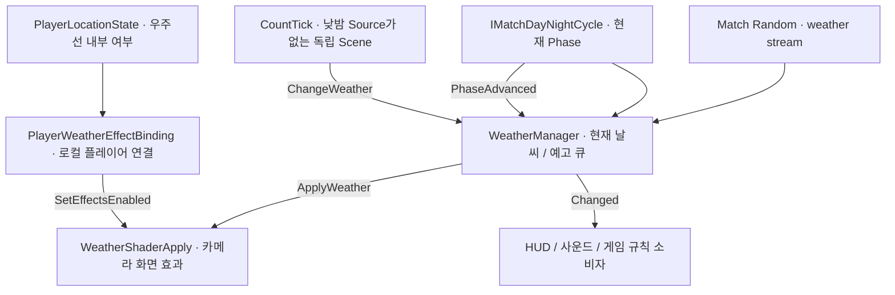

# 날씨 시스템 설계와 API 사용법

기준일: 2026-11-15
상태: 현재 작업 트리의 구현을 기준으로 한 사용 설명서. 다른 브랜치의 통합 구현이나 PR의 계획을 현재 동작으로 간주하지 않는다.

이 문서는 날씨를 **언제 변경하는지**, **다음 날씨를 어떻게 선택하는지**, **결과를 화면과 다른 기능에 어떻게 전달하는지** 설명한다. 대상은 현재 작업 트리의 `WeatherManager`, `CountTick`, `WeatherShaderApply`, `PlayerWeatherEffectBinding`이다.

## 1. 설계와 책임

날씨 상태, 변경 간격, 화면 표현, 로컬 플레이어 위치 연결을 분리한다.

| 구성 요소 | 책임 | 소스 |
| --- | --- | --- |
| `Map.WeatherManager` | Match 난수 연결, 현재 날씨·예고 큐 관리, 낮/밤별 가중치 추첨, 변경 알림, 셰이더 적용 요청 | [WeatherManager.cs](../../../Assets/Scripts/Map/WeatherManager.cs) |
| `Map.CountTick` | 낮밤 Source가 없는 독립 Scene에서 Match scheduler 또는 Unity 시각으로 변경 간격 관리 | [CountTick.cs](../../../Assets/Scripts/Map/CountTick.cs) |
| `MatchDayNightCycle` | Match 공용 시계로 낮/밤 전환, `PhaseAdvanced` 발행 | [MatchDayNightCycle.cs](../../../Assets/Scripts/Core/Bootstrap/SceneComposition/MatchDayNightCycle.cs) |
| `WeatherShaderApply` | 카메라에 날씨 Material 적용, 화면 전환 보간, 효과 표시/숨김 | [WeatherShaderApply.cs](../../../Assets/Scripts/Map/WeatherShaderApply.cs) |
| `PlayerWeatherEffectBinding` | 로컬 플레이어 위치 알림을 카메라 효과 표시 여부에 연결 | [PlayerWeatherEffectBinding.cs](../../../Assets/Scripts/Map/PlayerWeatherEffectBinding.cs) |
| `PlayerLocationState` | 우주선 내부 여부 보관, 변경 시 알림 | [PlayerLocationState.cs](../../../Assets/Scripts/Features/Player/PlayerLocationState.cs) |



`WeatherManager`에서 날씨가 바뀌는 것과 카메라 효과가 보이는 것은 별개다. 우주선 안에서 효과를 숨겨도 현재 날씨, 큐, 변경 타이머는 계속 진행한다. 비 피해·이동 속도·몬스터 능력치 같은 게임 효과를 이 셰이더가 적용하지는 않는다. 필요한 기능이 날씨를 읽거나 변경 알림을 받아 자신의 규칙을 적용한다.

## 2. 초기화와 변경 흐름

### 2.1 시작할 때

1. `WeatherManager.Awake()`는 Inspector의 `WeatherShaderApply`를 확인하고, 연결이 비었거나 카메라 태그가 다르면 `Camera.main`의 컴포넌트를 찾는다.
2. Match 조립부가 `IRandomConsumer.BindRandom()`으로 `"weather"` 스트림을 주입하면 `WeatherManager`가 예고 큐를 채운다. Match 스코프에서 사용할 난수가 없으면 큐 채우기가 대기한다.
3. `WeatherManager.Start()`는 변경 권한이 있으면 예고 큐를 채우고 Inspector의 현재 날씨를 카메라에 적용한다. 초기 상태는 `CurrentWeather`나 `WeatherId`에서 읽는다.
4. Core 환경 조립부가 `WeatherManager.BindAuthority()`를 호출한다. 같은 GameObject에 `IMatchDayNightCycle`이 있으면 `PhaseAdvanced`에 `ChangeWeather()`를 구독하고, 없을 때만 `CountTick` 예약을 연결한다.

현재 구현에서는 시작 날씨를 새로 뽑지 않는다. Inspector의 `currentWeather`를 사용하고, 앞으로 사용할 큐 항목을 추첨한다. 다른 컴포넌트의 `Start()`와 실행 순서는 별도로 보장되지 않으므로, 초기 구독자가 예고 큐까지 즉시 받을 수 있다고 가정하지 않는다.

### 2.2 시간이 지나거나 수동 호출했을 때

`ChangeWeather()`는 다음 순서로 동작한다.

1. Match 난수 스트림을 사용할 수 없으면 변경하지 않고 반환한다.
2. 현재 `IMatchDayNightCycle.Phase`를 읽는다. 같은 GameObject에 구현체가 없으면 `Day`로 처리한다.
3. 이전에 큐를 채운 Phase와 현재 Phase가 다르면 기존 예고를 비운다.
4. 해당 Phase의 가중치로 큐를 목표 개수까지 채운다.
5. 큐의 맨 앞 날씨를 꺼내 `currentWeather`로 설정한다.
6. 같은 Phase의 가중치로 큐를 다시 목표 개수까지 채운다.
7. 카메라의 `ApplyWeather(currentWeather)`를 호출한다.
8. 인스턴스 이벤트 `Changed`를 발행한다. 구독자는 `CurrentWeather` 또는 `WeatherId`와 읽기 전용 `Forecast`에서 최신 값을 읽는다.

큐는 먼저 들어간 항목이 먼저 적용되는 FIFO 구조다. 같은 날씨가 연속으로 들어갈 수 있고, 현재와 같은 날씨가 나와도 변경 알림은 발생한다. 카메라는 같은 날씨를 재적용할 때 전환을 다시 시작하지 않는다.

기본 Match Scene에서는 `MatchDayNightCycle`이 낮/밤 경계에서 `PhaseAdvanced`를 발생시키고 `WeatherManager.ChangeWeather()`를 호출한다. `MatchDayNightCycle`이 없는 독립 Scene에서만 `CountTick`이 Match scheduler 또는 `Time.timeAsDouble` 기준으로 변경 간격을 관리한다.

### 2.3 현재 추첨 규칙

| 값 | 의미 |
| --- | --- |
| `Weather.SUNNY` | 맑음 (`0`) |
| `Weather.RAIN` | 비 (`1`) |
| `Weather.THUNDERSTORM` | 뇌우 (`2`) |
| `Weather.HEATWAVE` | 폭염 (`3`) |
| `Weather.WEATHER_COUNT` | 개수 표시용 값 (`4`). 실제 날씨로 사용하지 않음 |

비공개 `GetWeather(phase)`는 선택한 Phase의 `WeatherWeight[]`에서 전체 가중치를 더하고, Match의 `"weather"` 난수 스트림으로 `0` 이상 합계 미만의 정수를 한 번 뽑는다. 각 항목의 가중치를 순서대로 빼다가 음수가 되는 항목의 날씨를 반환한다. 가중치가 `0`인 항목은 선택되지 않는다.

```text
항목 확률 = 항목 weight / 같은 Phase의 전체 weight 합
```

낮 기본값은 `SUNNY 5`, `RAIN 2`, `THUNDERSTORM 1`, `HEATWAVE 2`로 각각 50%, 20%, 10%, 20%다. 밤 기본값은 `SUNNY 6`, `RAIN 2`, `THUNDERSTORM 2`, `HEATWAVE 0`으로 각각 60%, 20%, 20%, 0%다. 전체 가중치 합이 0이면 오류를 남기고 `SUNNY`를 반환한다.

낮/밤 Phase가 바뀌면 `PhaseAdvanced`가 `ChangeWeather()`를 호출한다. `FillWeather()`가 기존 큐 전체를 버리고 새 Phase의 가중치로 다시 채운 뒤 첫 항목을 현재 날씨로 적용한다. 같은 Phase에서 Inspector 값을 바꿔도 이미 채운 항목은 유지되며 이후 보충 항목부터 반영된다. `InitialStageCompositionRoot`는 날씨 Source가 있고 시간대 Source가 없으면 같은 GameObject에 `MatchDayNightCycle`을 추가한다.

## 3. Scene 설정

1. `WeatherManager`를 날씨 원본 GameObject에 둔다. 낮밤 소스 없이 간격으로 실행할 독립 Scene에는 같은 객체에 `CountTick`을 둔다.
2. 실제 화면을 렌더링하는 `MainCamera` 태그의 Camera에 `WeatherShaderApply`를 붙인다.
3. `WeatherManager`의 `_weatherShaderApply`에 해당 컴포넌트를 연결한다. 비어 있으면 `Awake()`에서 `Camera.main`의 컴포넌트를 찾지만, 이후 새 카메라로 자동 재연결하지 않는다.
4. 날씨별 Material과 전환 Material을 카메라 컴포넌트에 지정한다.
5. 우주선 내부 효과 숨김이 필요하면 같은 카메라에 `PlayerWeatherEffectBinding`을 두고, 로컬 플레이어 조립부에서 actor를 연결한다.

### Inspector 설정표

| 컴포넌트 / 필드 | 코드 기본값 | 의미 |
| --- | --- | --- |
| WeatherManager / `currentWeather` | `SUNNY` | 시작 날씨. 읽기는 `CurrentWeather` |
| WeatherManager / `weatherQueueSize` | `5` | 예고 큐 목표 개수. 채울 때 최소 1 적용 |
| WeatherManager / `_dayWeatherWeights` | 맑음 5·비 2·뇌우 1·폭염 2 | 낮에 사용하는 날씨별 가중치 목록 |
| WeatherManager / `_nightWeatherWeights` | 맑음 6·비 2·뇌우 2·폭염 0 | 밤에 사용하는 날씨별 가중치 목록 |
| CountTick / `weatherChangeTime` | `5`초 | 자동 변경 간격. Inspector 최소 0.01 |
| WeatherShaderApply / 날씨별 Material | 지정 필요 | 맑음·비·뇌우·폭염 화면 효과 |
| WeatherShaderApply / `_transitionMaterial` | 선택 사항 | 이전·다음 화면 합성. 없으면 즉시 새 효과 렌더링 |
| WeatherShaderApply / `_transitionDuration` | `1.5`초 | 전환 시간. 0이면 즉시 적용 |

이 표는 **필드의 코드 기본값**이다. 실제 Scene/Prefab에 저장된 값이 있으면 그 값이 사용된다. `CountTick`에는 `RequireComponent`나 누락 방어가 없으므로 같은 객체에 WeatherManager가 있는지 확인한다. 같은 Match의 날씨 원본을 하나로 유지한다.

현재 [Stage_1 Scene](../../../Assets/Scenes/Gameplay/Stage_1.unity)은 `WeatherManager`와 독립 타이머용 `CountTick`을 같은 객체에 배치한다. 개발용 날씨 버튼은 `ChangeWeather()`를 호출한다. 기존 Scene에 `Map.WeatherChangeEvent` 직렬화 표기가 남아 있어도 런타임 구독은 `WeatherManager.Changed`를 사용한다. MainCamera에는 날씨 화면 효과 컴포넌트가 연결돼 있다. 새 가중치 배열은 코드 기본값을 가지며 Scene에서 별도 override한 값이 있으면 해당 값을 사용한다. 이는 저장된 참조 확인 결과이며 실행 검증 결과는 아니다.

## 4. 팀원용 API 사용법

### 4.1 현재 날씨 읽기

`WeatherManager` 참조를 Inspector에서 연결하거나 소유 조립부에서 전달받아 사용한다. `CurrentWeather`는 읽기 전용이다.

```csharp
using Map;
using UnityEngine;

public sealed class WeatherReaderExample : MonoBehaviour
{
    [SerializeField] private WeatherManager weatherManager;

    public bool IsRaining()
    {
        return weatherManager != null
            && weatherManager.CurrentWeather == WeatherManager.Weather.RAIN;
    }
}
```

위 판정은 `RAIN`만 포함한다. 뇌우도 비로 취급할지는 소비 기능이 `THUNDERSTORM` 조건을 추가해 결정한다.

### 4.2 변경 알림 구독하기 — HUD·사운드·게임 규칙

로컬 Host 표현에서 `WeatherManager.Changed`에 구독하고 초기값을 직접 읽는다. 현재 날씨와 예고는 같은 컴포넌트의 읽기 API를 사용한다.

```csharp
using Map;
using UnityEngine;

public sealed class WeatherListenerExample : MonoBehaviour
{
    [SerializeField] private WeatherManager weatherManager;

    private void OnEnable()
    {
        if (weatherManager == null)
            return;

        weatherManager.Changed += Refresh;
        Refresh();
    }

    private void OnDisable()
    {
        if (weatherManager != null)
            weatherManager.Changed -= Refresh;
    }

    private void Refresh()
    {
        var current = weatherManager.CurrentWeather;
        var forecast = weatherManager.Forecast;
        // 현재 날씨와 읽기 전용 예고로 뷰를 갱신한다.
    }
}
```

`Forecast`는 다음 날씨가 첫 번째인 읽기 전용 복사본이다. 원격 Client HUD는 Core의 환경 snapshot을 읽는다. `ApplyReplica()`는 복제된 날씨·예고와 카메라 표현을 갱신하며, Host 변경 이벤트는 발행하지 않는다.

### 4.3 다음 날씨로 진행시키기

```csharp
weatherManager.ChangeWeather();
```

이 호출은 **큐의 다음 날씨로 진행**한다. 원하는 날씨를 인자로 지정하는 함수는 아니다. `CallWeatherChange()`도 내부에서 같은 함수를 호출하며 Unity Button의 `OnClick` 같은 Inspector 연결에 사용할 수 있다.

현재 공개 API에는 `SetWeather(RAIN)`, 예고 큐 교체, 런타임 가중치 setter가 없다. 임의 추첨, 특정 날씨 강제 지정, 단순 화면 미리보기는 서로 다른 요구이므로 `ChangeWeather()`를 무조건 대신 사용하지 않는다. 난수 스트림이 바인딩되지 않았거나 현재 권한에서 사용할 수 없으면 `ChangeWeather()`는 아무 날씨도 소비하지 않는다.

### 4.4 카메라 효과만 바꾸거나 숨기기

```csharp
// 아래 weatherEffects는 Inspector/조립부에서 받은 WeatherShaderApply 참조다.
weatherEffects.ApplyWeather(WeatherManager.Weather.RAIN);
weatherEffects.SetEffectsEnabled(false); // 화면 효과 숨김
weatherEffects.SetEffectsEnabled(true);  // 현재 보관 중인 날씨 효과 다시 표시
```

`ApplyWeather`는 카메라 표현만 바꾼다. WeatherManager의 상태·큐·알림을 갱신하지 않으므로 실제 날씨 변경 용도로 사용하지 않는다. 다음 Manager 갱신 시 화면은 Manager의 날씨로 다시 적용된다.

첫 적용은 즉시 반영하고 이후 서로 다른 날씨 사이를 보간한다. 효과를 다시 켜면 맑음 화면에서 현재 날씨로 전환한다. 해당 날씨 Material이 없으면 원본 화면을 그대로 출력한다. URP 2D의 [StageCameraEffectsFeature](../../../Assets/Scripts/Map/StageCameraEffectsFeature.cs)가 카메라에 연결된 날씨 효과를 Render Graph 패스로 그린다. 같은 카메라에 DayNightShaderApply가 연결되어 있으면 날씨 합성 후 낮밤 효과를 적용한다.

**낮밤 타이머와 화면 효과는 별도 연결이다.** Core는 WeatherManager 옆에 `MatchDayNightCycle`을 확보하지만 카메라 효과를 자동 추가하지 않는다. Stage_1의 Main Camera에는 `DayNightShaderApply`를 붙이고 `_weatherManager`에 같은 Scene의 WeatherManager, `_dayNightMaterial`에 `Assets/Shader/DayNight/DayNight.mat`을 지정한다. 이 연결이 없으면 타이머와 환경 snapshot은 갱신되어도 밤의 색조·비네트가 화면에 나오지 않는다. `DayNightShaderApply`는 공용 주기를 읽어 `_EffectBlend`만 계산하며 별도 시간을 누적하지 않는다.

낮밤과 날씨는 다른 축이다. 가중치 추첨에서 같은 날씨가 다시 나오는 것은 허용되며, 그때 비·폭염 효과가 그대로여도 낮밤 효과는 독립적으로 진행해야 한다. 밝기 변화는 구간 전체에서 보간되므로 Night 레이블이 바뀌는 순간 최대 어둠으로 전환되는 구조는 아니다.

`MainCamera` 태그가 아닌 객체에 붙이면 `Awake()`에서 해당 Camera와 컴포넌트를 비활성화한다. 뇌우의 번개 위치 계산은 카메라의 `orthographicSize`를 사용한다. 이 번개는 화면 연출이며 피격·데미지 판정 API가 아니다.

### 4.5 우주선 내부에서 로컬 효과 숨기기

`PlayerWeatherEffectBinding`은 `ILocalPlayerActorConsumer`를 구현한다. 로컬 플레이어 조립부가 다음 API로 연결한다. 일반 HUD나 다른 기능에서 매번 호출할 필요는 없다.

| 메서드 | 동작 |
| --- | --- |
| `PrepareLocalActor(MatchId, PlayerId)` | 이전 위치 구독 정리, 효과 표시 상태 복구 |
| `BindLocalActor(MatchId, PlayerId, GameObject)` | actor의 `PlayerLocationState` 구독, 현재 위치 즉시 반영 |
| `UnbindLocalActor(MatchId)` | 현재 연결된 Match가 같을 때 구독 해제 |

연결된 로컬 actor에서 `LocationChanged(true)`가 오면 숨기고, `false`면 다시 표시한다. 위치 시스템은 `PlayerLocationState.CheckLocation(bool)`으로 상태를 갱신한다. 같은 값이면 알림을 반복하지 않는다. actor에 `PlayerLocationState`가 없으면 경고를 남기고 위치 연결은 이루어지지 않는다.

이미 이 바인딩이 연결돼 있다면 입출구 코드에서 `SetEffectsEnabled`를 중복 제어하기보다 기존 위치 변경 경로를 사용한다. 바인딩 해제·파괴 시에는 이전 구독을 제거하고 효과를 다시 표시한다. 이 기능은 로컬 화면에만 영향을 주며 전역 날씨를 맑음으로 변경하지 않는다.

현재 추적된 `Assets`의 C# 코드에서는 `CheckLocation(bool)`을 호출하는 곳을 확인하지 못했다. 따라서 **위치 상태를 전달받아 효과를 숨기는 연결은 있지만, 실제 포털 진입만으로 자동 호출된다고 보장할 수는 없다.** 입출구 담당자는 기존 위치 흐름을 확인하고 필요한 지점에서 해당 로컬 actor의 상태를 갱신해야 한다.

### 4.6 Stage1 태양과 타일맵 기물 그림자

[StageTileShadows](../../../Assets/Scripts/Map/StageTileShadows.cs)는 `WeatherManager`와 같은 GameObject의 `IMatchDayNightCycle`을 읽어 `Sunlight 2D`의 위치와 `Environment_Obj` 기물의 그림자를 갱신한다. 씬 시작 때 타일의 스프라이트 메시를 읽어 같은 텍스처를 서브메시로 묶는다. 런타임에는 바닥 접점을 기준으로 빛의 반대 방향에 실루엣을 투영한다. 낮에 방향과 길이가 변하고 밤에는 빛과 그림자가 서서히 사라진다.

Stage1 Hierarchy의 `Tile Ground Shadows`에서 `Stage Tile Shadows (Script)`를 확인한다.

| Inspector 필드 | Stage1 저장값 | 단위와 동작 |
| --- | ---: | --- |
| Noon Shadow Length | 0.38 | 정오 투영 길이, 월드 유닛 |
| Horizon Shadow Length | 1.42 | 아침과 저녁의 투영 길이, 월드 유닛 |
| Horizontal Offset Pixels | -1.2 | 원본 스프라이트 픽셀, 양수는 오른쪽 |
| Vertical Offset Pixels | 1.2 | 원본 스프라이트 픽셀, 양수는 위 |

Play 중 오프셋을 바꾸면 다음 그림자 갱신에서 메시 전체에 적용된다. 값은 각 스프라이트의 PPU를 기준으로 변환한다. 확정한 값은 편집 모드에서 입력하고 Scene을 저장한다. 그림자 길이와 위치의 조정은 기물의 Collider나 NavMesh와 별개다.

## 5. 현재 구현과 Core API의 관계

현재 `WeatherManager`는 `IRandomConsumer`, `IMatchWeatherSource`, `IMatchScheduledEnvironmentFeature`를 구현한다. Host는 Match 난수와 낮밤 전환 신호로 날씨를 확정하고 `Changed`로 환경 snapshot을 갱신한다. Client는 `ApplyReplica()`에서 Host가 확정한 현재 날씨와 예고를 표현에 적용하며 새 난수를 소비하지 않는다. 날씨·Queue 저장을 위한 `ICheckpointParticipant` 구현은 아직 없다.

Core 환경·시간·난수 문서에는 별도 통합 단계의 설명이 포함돼 있다. 해당 계약이 존재하는 것과 현재 Map 구현에 연결된 것은 구분해야 한다.

| 항목 | 이 문서 기준 구현 | Core 연동 시 확인할 경계 |
| --- | --- | --- |
| 날씨 추첨 | `IRandomConsumer`로 주입된 `"weather"` 스트림 | Host 권한 범위에서만 난수 사용 가능 |
| 변경 시점 | `PhaseAdvanced`, 독립 Scene에서는 `CountTick` | Match clock/scheduler |
| 날씨 읽기 | `CurrentWeather`, `Changed`, `IMatchWeatherSource` | 불변 환경 snapshot |
| 권한/복제 | Host만 추첨, Client는 `ApplyReplica()` | 확정 snapshot 적용 |
| 저장/복원 | 현재 Map 클래스에 구현 없음 | 현재 날씨·큐·타이머와 Core 난수 상태 각각 저장 |

외부 기능이 Core에서 확정된 현재 날씨만 필요하면 `IMatchEnvironmentSource.TryGetCurrentWeather(matchId, out weatherId)`를 사용한다. source·snapshot·날씨가 없거나 다른 Match의 snapshot이면 `false`와 빈 ID를 반환한다. 이 API는 `WeatherManager`나 셰이더를 직접 조회하지 않고, Host의 `WeatherManager.Changed`를 통해 갱신된 환경 snapshot을 읽는다.

참고 계약: [Random API](../01_core/core-random-api.md), [Match 시간 API](../02_match/match-time-api.md), [Match 환경 API](../02_match/match-environment-api.md), [체크포인트 실행 API](../05_checkpoints/checkpoint-execution-api.md).

## 6. 문제를 확인할 때

| 증상 | 확인할 내용 |
| --- | --- |
| 자동 변경이 안 됨 | Match 난수 바인딩과 쓰기 권한, 낮밤 Phase 또는 독립 Scene의 CountTick 예약, GameObject 활성 상태 확인 |
| 시작 날씨 알림이 안 옴 | Start는 알림을 발생시키지 않음. 초기 현재 값은 `CurrentWeather`로 읽기 |
| 예고가 달라지거나 사라짐 | 낮밤 전환으로 큐가 다시 채워졌는지, 올바른 Match 환경 snapshot을 읽는지 확인 |
| 같은 날씨가 계속 나옴 | 중복 허용 추첨임. 현재 Phase의 `WeatherWeight[]`와 이미 채워진 큐 확인 |
| 밤 가중치가 사용되지 않음 | 같은 GameObject의 `IMatchDayNightCycle` 구현체와 `Phase` 확인. 구현체가 없으면 `Day` fallback 사용 |
| 내부 날씨는 바뀌는데 화면은 그대로 | 카메라 참조, MainCamera 태그, 날씨 Material, 효과 숨김 상태, 렌더 경로 확인 |
| 우주선 안에서도 효과가 보임 | 로컬 actor 연결, actor의 PlayerLocationState, 실제 위치 변경 알림 확인 |
| 수동 변경 직후 다시 바뀜 | 낮밤 경계 예약 또는 독립 Scene의 `CountTick` 예약 시점 확인 |
| 변경 이벤트에서 일부 기능만 갱신됨 | 구독 대상 인스턴스, 구독 해제 누락, 구독자의 Console 예외 확인 |

## 7. 문서 확인 범위

위 소스의 공개 멤버, 초기화 순서, 호출 지점과 데이터 소유권을 대조했다. 설명용 API 예제는 현재 선언에 맞춰 작성했다. 이번 문서 갱신에서 Unity PlayMode·원격 Host/Client 실행·화면 효과 검증은 수행하지 않았다. 다른 브랜치에서 구조가 바뀌면 해당 소스를 확인해 기준 버전과 이 문서를 함께 갱신한다.
