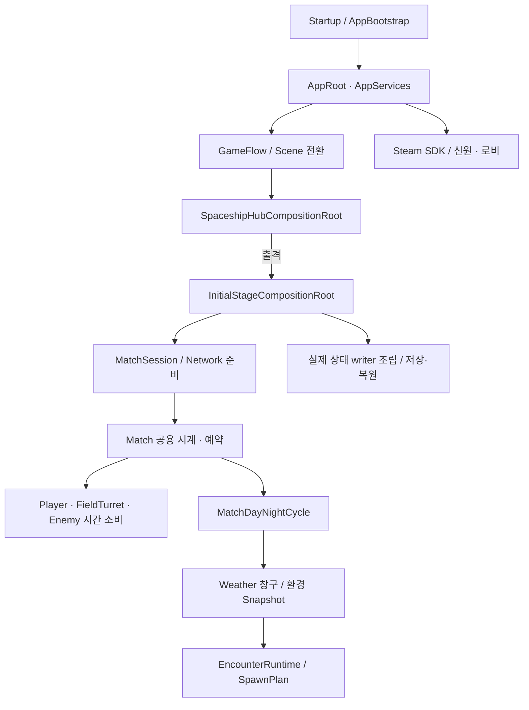

# Core 구현의 main 전달 — 리뷰 안내

- PR: [#656 — fix(core): deliver reviewed runtime integration to main](https://github.com/Team-HJD-21/unity-6-the-developer/pull/656)
- 관련 이슈: #602. 아래 후속 이슈는 이 PR로 닫지 않는다.
- base: `main` (`ea3d7714bf234588424fba601758c98b172bfce8`)
- head: `codex/core-main-recovery`
- 복구 원본: `codex/core-08-spaceship-ui-20261105`, `5b87142ae9f209644175ffd726e35eb255ad33e7`
- 목적: 중간 작업 브랜치에만 병합된 기존 구현을 최신 main으로 전달한다. 기존 리뷰 이력과 사용자 수동 인수·영상을 보존한다. 병합은 별도 승인 후 사람이 진행한다.

## 왜 이 PR이 필요한가

#623은 main에 반영됐지만 #624~#631은 앞 단계의 작업 브랜치로 병합됐다. GitHub의 Merged 표시와 실제 main 포함 여부가 달랐다. 이 PR은 그 누락을 복구한다. 과거 작업을 취소하거나, 미구현 후속 기능을 새로 완성했다고 주장하는 PR이 아니다.

사용자 PR 121건을 실제 main 조상 관계와 대조했다. 직접 main으로 병합된 97건은 모두 포함되어 있었다. 중간 브랜치 대상 이력 중 main에서 빠진 16건에는 오래된 대체 구현도 포함되므로 이를 전부 재적용하지 않고, 아래 최종 검토 코드와 현재 main을 합쳤다.

## 기존 리뷰를 이어서 볼 곳

| 기존 PR | 전달하는 내용 | 먼저 볼 파일 |
| --- | --- | --- |
| [#624](https://github.com/Team-HJD-21/unity-6-the-developer/pull/624) | FieldTurret/CU 공용 시간·권한·실제 상태 저장. 복원 후 소유 Controller 연결 보완 포함 | `FieldTurretBase.cs`, `FieldTurretController.cs`, 각 `*.Checkpoint.cs` |
| [#625](https://github.com/Team-HJD-21/unity-6-the-developer/pull/625) | Player 제어·피해·감속·스킬/발사체 저장. 폭발한 폭탄의 collider 복원 보완 포함 | `PlayerInfo.Checkpoint.cs`, `PlayerSlowEffects.cs`, `PlayerBombExplosion.Checkpoint.cs` |
| [#626](https://github.com/Team-HJD-21/unity-6-the-developer/pull/626) | Encounter 정식 요청·환경 조건·World 영역 배치·Enemy 원본 저장 | `EncounterRuntime.cs`, `SpawnCompositionPlanner.cs`, `EnemySpawnExecutor.Checkpoint.cs` |
| [#627](https://github.com/Team-HJD-21/unity-6-the-developer/pull/627) | Core 저장 참여자 조립·새 Match 복원·Scene/Network 준비 및 실패 정리 | `AppRoot.Checkpoints.cs`, `InitialStageCompositionRoot.Checkpoints.cs`, `InitialStageNetworkBinding.cs` |
| [#628](https://github.com/Team-HJD-21/unity-6-the-developer/pull/628) | 낮 5분/밤 5분, 공용 시간 정지·배속, 날씨 전환 창구·타이머/Reset | `MatchDayNightCycle.cs`, `CountTick.cs`, `WeatherManager.Core.cs`, `WeatherDebugHud.cs` |
| [#629](https://github.com/Team-HJD-21/unity-6-the-developer/pull/629) | Steam 초기화·신원·2인 로비. 취소 후 늦은 성공 응답의 재참가 정리 보완 포함 | `SteamPlatformService.cs`, `SteamPlatformService.Lobbies.cs` |
| [#630](https://github.com/Team-HJD-21/unity-6-the-developer/pull/630) | Startup→우주선→Mission, 카메라·왕복 fade·기존 UI 재사용·인수 문서 | `AppGameFlowHost.cs`, `SpaceshipTravelService.cs`, `SceneFadePresenter.cs` |
| [#631](https://github.com/Team-HJD-21/unity-6-the-developer/pull/631) | 기존 범용 Random의 가중 선택 사용법·날씨 확률 예제 | [가중 선택 문서](../../02_architecture/01_core/random-weighted-selection.md) |

기존 PR의 리뷰 스레드·승인 상태는 변경하지 않았다. `Submit` 범용 명령 제거와 PlayerSceneAdapter의 Bind/Unbind 유지도 최종 소스 그대로다. 예전 PR 전체를 다시 읽기 전에 다음 통합 차이와 실행 경로부터 확인하면 된다.

## 이번 main 통합에서 달라진 부분

1. main #642의 **조준 Transform을 움직이지 않는 포탑 발사**를 유지했다. 공용 Random으로 산포값을 뽑고 별도 `aimPosition`을 `FieldTurretBullet.Initialize`에 전달한다. 탄환 공용 시계와 방향 저장도 유지한다.
2. main #642의 **새 타깃을 찾은 프레임은 냉각으로 세지 않는 미사일 처리**를 유지했다. 냉각 경과량만 Match 공용 시간으로 읽는다.
3. 서로 다른 신규 `.meta`를 Git이 이름 변경으로 오인한 충돌은 각 최종 소스의 GUID로 정리했다. 삭제된 `LocalAuthority`를 되살리지 않았다.
4. main의 기획·회의록·문서 보관 구조, Weather 가이드, CI·자동 리뷰·CODEOWNERS·PR 템플릿은 유지했다. 오래된 아키텍처 원문을 현행 문서로 되돌리지 않았다.
5. `AGENTS.md`와 팀 Workflow에 **base=main 명시 및 생성 후 재조회**를 넣었다. 과거 분할 게시 문서도 이 복구 경로로 연결했다. 별도 작업 중인 AI 리뷰 정책 초안 3개와 개인 미커밋 파일은 섞지 않았다.
6. `InitialStageEncounterIntegrationTests`가 임의의 Executor를 고르던 검사를 고쳤다. Scene에는 Executor가 2개이며 실제 Match 실행기에서 자동 10마리 생성이 확인됐는데, 다른 실행기의 0마리를 읽어 실패했다. `launcher.ExecutionTarget.CountForMatch`로 현재 Match의 결과를 확인한다. Runtime 스폰 규칙은 변경하지 않았다.

## 실행·데이터 흐름

- 초기화와 실패 경계: `AppBootstrap → AppRoot → GameFlow → Scene composition → Match 준비`. Scene 로드만 끝났다고 입장 성공으로 반환하지 않는다.
- 실제 상태 소유: Player/터렛/Enemy의 원본 상태는 각 Feature가 갖는다. Core는 writer를 조립하고 저장·복원 순서와 실패를 관리한다.
- 우주선 임시 방문: 진행 중 Match와 actor를 유지하고 위치를 보고한다. 개인 메뉴와 Match 정지는 분리한다. 왕복은 0.3초 fade-out → 최소 0.3초 black 이동 → 0.3초 fade-in이다.
- Steam 로비와 NGO 게임 접속은 별개다. 로비 생성 성공을 2인 게임 입장 성공으로 표시하지 않는다.

전체 API·연결은 [Core 지도](../../02_architecture/01_core/core-lifecycle-and-api-guide.md), [Feature 통합](../../02_architecture/01_core/core-feature-integration-guide.md), [저장 실행](../../02_architecture/05_checkpoints/checkpoint-execution-api.md)을 함께 본다. 자동 생성 `.meta`와 과거 인수 문서는 신규 알고리즘 검토 대상이 아니지만 GUID·링크 검사는 필요하다.

## 검증 — 이번 통합과 과거 근거를 구분

Unity 6000.3.23f1 격리 프로젝트에서 실행했다. 사용자 Editor·작업 폴더·stash를 검증 준비에 사용하지 않았다. 임시 실행 도우미는 PR에서 제외했다.

<!-- main-recovery-validation:start -->
- 최신 main 통합 전체 C# 컴파일: 오류 0. EditMode 선택 검사 **42개 중 41개 통과**, 자동 첫 스폰 검사의 잘못된 Executor 조회 1개 실패를 재현했다.
- 검사 조건 보완 뒤 자동 첫 스폰·Scene/UI/Debug 요청·반복 요청·사망/제거 기록·종료 수집을 포함한 해당 통합 검사 **1/1 통과**, Unity 종료 0. Runtime 소스를 바꾸거나 실패한 검사를 제외한 것이 아니다.
- 42개 검사 중 통과한 범위: main의 포탑/미사일 회귀, Player 바인딩 정리 6개, 실제 프리팹의 폭발 전/후 폭탄 복원 2개, 공간 분배 정책 12개, 실제 Scene 반복 배분, 단일 App/Match와 참가자 기반 공용 시계 정지·재개.
- 터렛 전용 PlayMode 검사 **2/2 통과**, Unity 종료 0: `OwnerClock_FactoryCoolingFollowsInjectedTimeAndPause`, `OwnerClock_CheckpointRecreationKeepsCoolingAndNewProjectileBound`. EditMode 선택에 들어가지 않는 PlayMode assembly는 별도로 실행했다.
- 실제 Scene 배분: 고정 Snapshot 48회/480마리, 적합 셀 **30/30 사용**(셀당10~25마리). 최신 Grid 24회/240마리, **26/30 셀 사용**. 이는 해당 Scene·예산·실행 구간의 결과이며 모든 조건의 균일 분포를 보장한다는 뜻이 아니다.
- `.meta` 대응·GUID 검사 오류 0, 충돌 표시 없음, 최신 main의 CI/CodeOwners/새 터렛 회귀 파일 보존 확인. Unity 생성 `.meta`의 기존 빈 필드 공백은 유지했다.
- 실행 근거(로컬 제외 경로): `Docs/Local/Review/PrTargetAudit/validation/full-main-01.xml`, `autospawn-diagnosis-01.log`, `autospawn-final-01.xml`, `turret-owner-final-01.xml`. 자동 실행 결과와 기존 PL 수동 인수는 구분한다.
- 이번 복구에서 새 Windows Build·실계정 Steam·2프로세스 플레이는 실행하지 않았다. 기존 수동 인수 소스를 유지하면서 main 충돌과 직접 영향 경계를 검사한 결과다.
- 검증 뒤 게시 중 추가된 main #655도 반영했다. `9912b85ba → ea3d7714b`는 자동 리뷰 workflow/AGENTS 안내만 바뀌었고 Assets·Packages·ProjectSettings 차이는 없다. 이 문서·CI 변경 때문에 같은 Unity 실행을 반복하지 않았다.
<!-- main-recovery-validation:end -->

과거 근거: PL은 Startup/Initial_Stage 수동 확인을 완료했다고 승인했다. [게임 Flow·5:00 타이머·날씨 전환 영상](https://github.com/Team-HJD-21/unity-6-the-developer/blob/6ed4f15650965830dda1139b0a1b4b3baa0e1f78/Docs/videos/core/2026-11-05-game-flow-day-night.mp4)과 [인수 기록](../../01_planning/02_implementation-records/2026/11/2026-11-05-core-local-review.md)을 보존한다. 과거 최종 누적 코드의 Windows Build 성공·HUD/왕복 검사 11/11, Steam 취소 응답 대역 검사 12/12는 해당 시점의 결과다. 이번 main 통합 코드의 새 Build·실제 Steam 지연·2프로세스 검증으로 바꾸어 쓰지 않는다.

## 이 PR로 닫는 범위와 남는 범위

- #602: 기존 검토 구현의 main 전달, 실제 API/수명 안내 및 통합 검증. PR이 main에 병합될 때 종료하며 지금 직접 닫지 않는다.
- #599: 실제 Weather 상태 writer는 Weather 담당 작업이다. 필수 writer가 없으면 **전체 운영 Save는 거부**된다. 저장 실행기의 존재를 전체 저장 완료로 표시하지 않는다.
- #528: 실제 원격 Player 본체/HUD 연결·인수는 별도다.
- #619~#622: Steam 게임 transport, Client 개인 출입, Client 낮밤 기준, Backend 인증은 후속이다.
- #420: 팀 전체 플레이·Build/Gate와 재미 검증은 별도다. #637~#641의 Camera/CU/Boss/복구 정책/종료 저장도 이 PR 범위에 새로 넣지 않는다.

## 영향과 되돌림

Scene·Prefab·공용 계약·저장 참여자·Network·시간 API가 함께 연결된다. 일부 Feature 파일만 골라 되돌리면 호출부와 저장 형식이 어긋날 수 있다. 문제 발생 시 이 main 전달 묶음을 기준으로 의존 변경을 함께 되돌린다. 이전 중간 브랜치와 커밋, 로컬 원본 및 stash는 보존한다. 이 문서는 PR 번호·링크와 실제 검증 상태가 달라지면 같은 PR에서 갱신한다.
