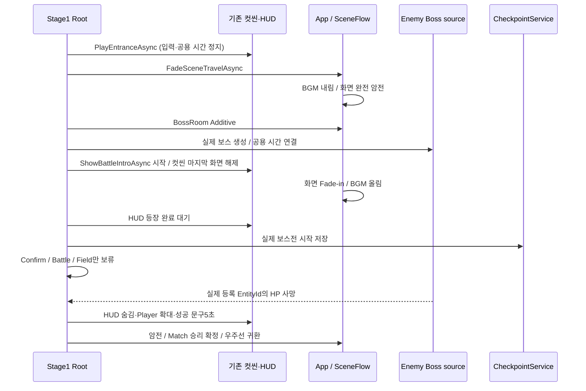
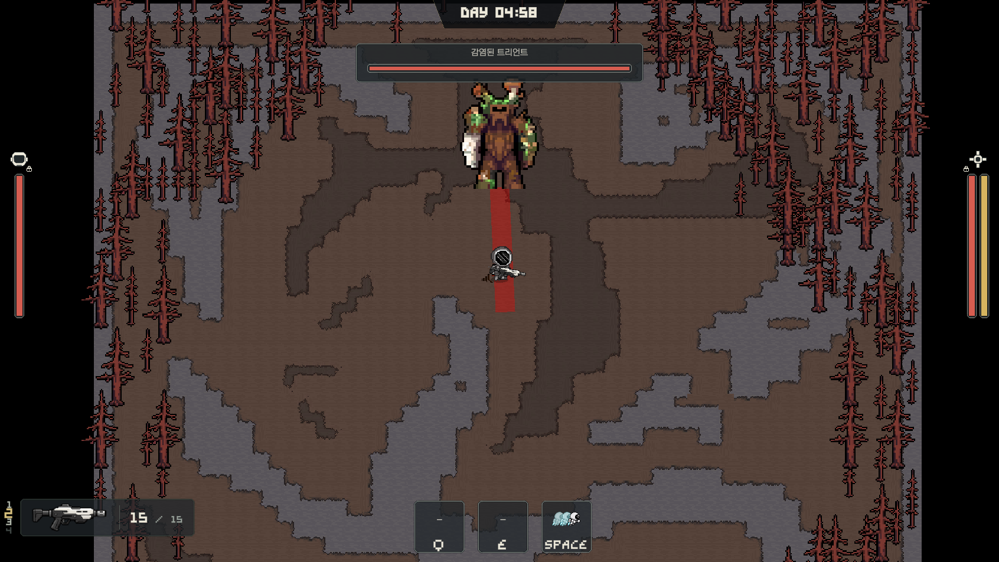
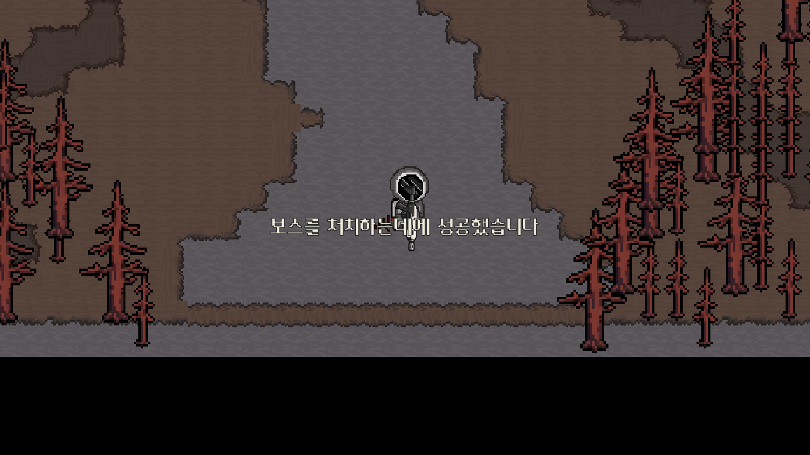

# Stage1 보스전·음악 전환 통합 검토

PR: [#750](https://github.com/Team-HJD-21/unity-6-the-developer/pull/750), base `main`. 이 문서는 코드와 실제 Scene의 연결을 확인하는 자료다.

## 11/17 점유 100% 표시와 자동 진입 재확인

실제 Startup → 우주선 → Stage1 Host Play에서 HUD가 완료를 먼저 표시하는 문제를 재현했다. 아래 HUD·Debugger 보완은 [#761](https://github.com/Team-HJD-21/unity-6-the-developer/pull/761)에서 검토하며, #750의 최종 진입 조건을 낮추거나 Scene 연결을 바꾼 변경은 아니다.

| 실제 점유 셀 | 실제 점유율 | 수정 전 HUD / 자동 진입 | 수정 후 HUD / 자동 진입 |
| --- | --- | --- | --- |
| 200 / 201 | 99.502487…% | 100% / 대기 | 99% / 대기 |
| 201 / 201 | 100% | 100% / 자동 진입 | 100% / 자동 진입 |

- 원인: `CombatHudHeader.SetConfirmedOccupancy`는 정수 반올림으로 99.5% 이상을 100%로 표시했다. `StageProgressSnapshot.CanEnterFinalBattle`는 실제 점유율 1을 요구하므로 마지막 한 셀이 남으면 컷씬이 시작되지 않는 것이 맞다. HUD도 실제 전체 셀 완료 전에는 최대 99%로 표시하도록 맞췄다. 1% 미만의 기존 소수점 표시는 유지한다.
- Debugger의 Checkpoint 패널에서 오래된 `자동 이동 없음` 안내를 제거하고, 실제 점유 셀 수·보스 진행 단계·진입 오류를 표시한다. 중간보스 생성 확인이 최종 진입 조건이라는 오래된 설명도 정정했다.
- 수정 후 실제 `Entrance → Preparing → Intro → Battle` 순서를 관측했다. 컷씬 재생, BossRoom Additive 로드, Player 도착, HP 6000인 실제 Stage1Boss와 보스 시작 체크포인트까지 12.73초에 완료했다. 직접 보스 진입 메서드를 호출하지 않고 Root의 정상 Update가 자동 진행했다.
- 점유는 동일한 런타임 Grid의 복원 API로 200개/201개를 구성한 **제어된 통합 QA**다. 자연 전투로 전 지역을 확보한 인수나 원격 Client·Standalone 검증은 아니다. Player/CU의 임시 디버그 무적은 이 Play에서만 사용했다.
- 회귀 검사: 마지막 한 셀·전 셀 완료·초기/잘못된 분모 등 HUD 7/7, Stage 진행 9/9 통과. 수정 후 통합 검수 구간의 새 Console Error 0건, 컴파일 실패 없음. 앞선 Pipeline 명령 timeout 오류는 게임 Runtime 오류와 구분하고 Console에서 지우지 않았다.
- Scene·Prefab·Bake·보스 콘텐츠는 이번 보완으로 수정하지 않았다. 로컬 증거는 공유 제외 `Docs/Local/Review/BossEntry-20261117/`의 `200-of-201-before.json`, `verification-after.json`, `header-tests.json`, `progression-tests.json`에 있다.

## 이번 변경

**11/16 보완:** 정식 게임에서 수동 컷씬 미리보기 Button/Label을 제거했다. `IsConfigured`와 재생·정리에서 버튼 의존도 없앴다. 실제100% 경로는 기존 `PlayScriptedAsync`를 그대로 사용하며 Scene 자체는 수정하지 않는다.

제거 후 컷씬 회귀5/5와 실제 Startup→우주선→Stage1→100%→컷씬→보스전→사망·시작 복원→승리→우주선까지 다시 통과했다. 각 단계의 미리보기 버튼 수0, 새 Runtime Error0, 최종 GameFlow=Spaceship·Music gain1을 확인했다. 점유는201개 유효 셀을 시험 API로 채운 통합 QA다. 원본은 공유 제외 `Docs/Local/Review/BossBattle-20261116/`에 보존한다.

현재 점유100% → 기존 입장 컷씬 → BossRoom Additive → 보스전 시작 저장 → 전투 → 실제 보스 사망 → 성공 연출5초 → 우주선 귀환을 연결한다. 사용자 확정에 따라33/66% 중간보스는 이번 최종 진입을 막지 않는다. 보상 수치·새 결과 화면·중간보스 콘텐츠를 추가하지 않는다.

## 읽는 순서와 실행 흐름

1. `Assets/Scripts/Core/Bootstrap/SceneComposition/InitialStageCompositionRoot.BossBattle.cs`: 실제 진행 주체. `PumpStageBossBattle`가 현재 점유를 읽고, `EnterStageBossBattleAsync`가 연출·이동·시작 저장을 기다린다. `FinishStageBossBattleAsync`는 실제 등록 보스의 사망을 확인한 뒤 승리·귀환을 연결한다.
2. `InitialStageCompositionRoot.FinalScene.cs` → `FinalBattleSceneDriver`: 같은 Match로 실제 BossRoom을 로드하고 참가자를 이동한다. 제작 누락/취소 시 참가자 위치·Scene·물리를 원복하고 자신이 추가한 Scene만 닫는다.
3. `FinalBattleBossSource` → `EnemySpawnExecutor.FinalBattle.cs`: Enemy 담당자의 실제 보스를 공용 MatchTime에 연결한다. 별도 보스 AI를 만들지 않는다.
4. `Assets/Scripts/UI/Hud/StageBossBattlePresentation.cs`: 기존 Player 컷씬·양쪽 HUD 등장·보스 HP·성공 문구·Player 확대를 소유한다. 점유율·승패는 결정하지 않는다.
5. `InitialStageCompositionRoot.Recovery.cs`: 기존 안전장치 선택 이후 같은 BossRoom의 시작 상태를 복원하고 새 보스 HP 원본을 HUD에 연결한다.
6. `AppRoot.cs` / `GameAudioManager.Music.cs` / `GameplayMusicPlayer.cs`: 실제 Scene 교체 경계의 BGM bus fade와 기존 두 voice 음악 재생을 확인한다.

## Scene과 실제 원본

- Field: `Assets/Scenes/Gameplay/Stage_1.unity`. Root의 `enableStage1BossFlow`를 켜고 같은 오브젝트에 driver와 presentation을 연결했다. 기존 터렛·맵·스포너 설정은 이 기능을 위해 재작성하지 않는다.
- Arena: `Assets/Scenes/Gameplay/BossRoom/Stage_1_BossRoom.unity`. 기존 `PlayerTransitionPoint`, `BossSpawnPoint` 위치를 사용한다. 두 번째 참가자 도착점은 PlayerTransitionPoint의 자식이다. `Boss Encounter`에 Scene NetworkObject·전용 Executor·source·layout을 둔다. BossRoom도 Build Settings에 등록한다.
- 실제 보스: `Assets/Data/Enemies/Spawning/Definitions/Stage1Boss.asset` → `Assets/Prefabs/Enemies/Runtime/Boss/Stage1Boss.prefab`(#742). `Reference/Stage_1/InfectedTreant.prefab`은 외형·Animator·충돌체만 있는 참고 원본이다.
- BGM: `Assets/Audio/Music/OriginalSoundtrack/Boss1FirstLineOfDefense.wav` → `Assets/Audio/Configuration/GameplayMusic.asset`의 Boss. 제공 WAV를 Streaming·스테레오·background load/no preload로 사용한다.

두 Additive 맵의 좌표가 겹쳐도 Field의 Renderer·Collider2D·NavMesh가 보스전과 섞이지 않도록 전투 동안 보류하고 실패/종료 때 원래 상태로 되돌린다. BossRoom 제작 Camera/AudioListener는 꺼두고 기존 Player CameraManager의 출력1개를 사용한다. FieldClock은 정지하지만 보스·참가자는 공용 MatchTime을 사용한다.

BossRoom에는 시설이 없으므로 전용 최종 보스 분대는 PlayerOnly 규칙을 쓴다. 소환 분대도 이 규칙을 상속한다. Field 생성·일반 분대·Enemy Definition의 기존 타깃 규칙은 바꾸지 않는다. 실제 검수에서 옛 Field 터렛을 목표로 잡아 BossRoom NavMesh에 없는 목표를 검색하던 오류를 이 경계에서 고쳤다.

## 연출과 수명

- 입장 컷씬의 마지막 화면은 유지한다. 완전 암전 콜백에서 보스 HUD Task를 시작해 마지막 컷씬 화면을 해제하고, Fade-in 뒤 HUD Task 완료를 기다린다.
- “보스를 처치하세요”와 기존 Stage1 HUD 등장 연출을 재사용한다. 점유/전술 UI는 보스전 동안 숨기고, 실제 EnemyHealth에 연결한 기존 보스 체력바를 표시한다.
- 승리에서는 “보스를 처치하는데에 성공했습니다”를5초 유지한다. Player 확대·HUD 숨김·문구는 다음 암전에 인계할 때까지 유지하여 시점이 번쩍이지 않게 한다.
- 승리는 기존 MatchCoordinator·네트워크 완료 게시를 사용한다. 이 전용 귀환만 일반 결과 패널을 생략한다. 다른 패배/결과 화면은 유지한다. 결과 전송이 대기하면 최대30초 기다리며 실패를 성공 귀환으로 보고하지 않는다.
- Stage1 직접 실행에는 GameFlow가 없을 수 있어 기존 App Scene 교체 API로 우주선에 돌아간다. Startup 실행에는 기존 GameFlow의 ReturnToSpaceship을 사용한다.

## 사망·보스 시작 안전장치

`boss-start-<Mission 실행 ID>` 슬롯은 **컷씬 이후 실제 도착·보스 생성·HUD 등장 완료 시점**을 기록한다. 실제 저장이 성공해야 Battle을 시작한다.

참여 원본은 전용 Executor의 `world/enemies`, 각 참가자의 `world/player/<slot>/actor|weapon|loadout|movement-effects`, `core/random`이다. 개인·공용 성장과 안전장치 사용 기록은 기존 비환급 원본에 유지한다. 복원 전에 성장 쓰기를 flush한다.

안전장치 수락은 기존 시도의 공격을 이어가는 의미가 아니다. 시간·입력을 정지한 채 `IFinalBattleBossSource.AbandonAttemptForRecovery`로 전용 Executor의 보스·소환·투사체를 정리한 뒤 실제 시작 저장을 복원한다. 일반 Enemy 저장기가 보스 공격 애니메이션 중간 상태를 저장하지 못하는 보호 조건을 우회하지 않는다. 복원 실패는 정지 상태에서 이유를 남기며 같은 시작 저장으로 재시도한다. 입장 컷씬을 다시 재생하지 않는다.

NGO Despawn은 GameObject 파괴를 프레임 끝까지 늦출 수 있다. 따라서 복원 직후에는 같은 논리 ID 중 `NetworkObject.IsSpawned`인 새 개체만 선택해 HUD를 연결한다. 옛 개체와 새 개체를 중복으로 취급하지 않는다. 복원 HUD 등장 중에도 보스 시간은 정지한다.

이는 **같은 Match에서의 보스전 재도전**이다. 미완성 Weather/world writer나 앱 재시작 전체 월드 이어하기를 대신하지 않는다. 기존 Field 전체 저장 API와 분리했다.

## BGM 전환

App의 실제 이동 경계가 Music bus를0.3초간 내린 뒤 이동하고0.3초간 올린다. 사용자 음량 설정·clip 재생 위치와 기존 두 voice crossfade는 보존한다. DSP 시각을 사용하여 정지·배속과 별개로 진행하고, 새 요청이 옛 fade를 교체한다. 실패·취소에도 이동 소유자가 gain을 복구한다. Main의 기존 음악도 실제 Scene 교체까지 유지한다. SFX/Cinematic bus는 이 fade에 포함하지 않는다.

## 검증 기록

- Unity 점유 진행9/9, 최종 전환 수명9/9, BGM 회귀10/10 통과.
- UI 세션: 보스 연출2/2, 기존 컷씬5/5, Mission UI3/3 통과. 800×600·1920×1080에서 긴 승리 문구 배치 확인.
- 실제 Stage_1 직접 실행과 Startup→우주선→Stage_1의 정식 GameFlow 두 경로를 CLI로 검수했다. 점유 API로 유효201셀/100%를 구성한 **제어된 통합 QA**이며 자연 전투로 모든 셀을 점유했다는 의미는 아니다.
- 두 경로에서 컷씬→BossRoom Additive→Player 도착(-330.15,-139.39)→실제 HP6000 보스 생성·이동→Boss BGM→실제 시작 저장→Player HP0→기존 안전장치 선택→Player HP400/보스 시작 상태 복원→실제 보스 HP0→승리 확대·문구→허브 귀환을 확인했다. 입장 컷씬을 복원 때 재실행하지 않았다.
- 성공 문구 단계부터 허브 Scene 로드까지6.66초(직접 실행)를 기록했다. 여기에 요청한5초 hold와 기존 문구 fade-in·Scene fade/로드가 포함된다. Startup 최종 안정 상태는 GameFlow=Spaceship, 우주선 BGM, Music gain1, Camera/AudioListener 각각1개다.
- 보완 후 Startup 경로의 새 Runtime Error0건. CLI console cursor276 이후 결과를 별도 보존했다. 앞서 실패한 Field 목표 경로/지연 Despawn 중복 조회/공격 중 backup capture 거절은 실패 원본과 수정 이유를 함께 보존했다.
- 최신 main 통합 후 보스명 한글·실제 공격 예고를 화면에서 재확인했다. Scene 이동 실패·취소 후 Music gain1 복구와 재호출 성공도 확인했다. 음악 fade를 화면의0.3/0.3/0.3초와 겹쳐 별도 지연을 더하지 않으며, 빈 이동 callback의 실제 전환은0.967초였다. Scene 도착과 전체 fade 완료는 서로 다른 시점이다.
- Windows Standalone·실제 원격2인·스피커 청감은 실행하지 않았다. Editor Host 경로와 구분한다.
- 로컬 원본 증거: `Docs/Local/Review/BossBattle-20261115/`, UI 증거: `Docs/Local/Validation/BossBattlePresentation20261115/`. 두 경로는 공유 제외이며 요약 결과는 이 문서에 남긴다.

## 남은 확인 범위

실제 원격2인 도착·각 Client의 컷씬/HUD·플랫폼별 청감·Standalone은 별도 인수다. 이번 Host 실행 결과를 이 검증으로 바꾸어 보고하지 않는다. Field 중간보스 제작, 별도 캠페인 보상/클리어 영속화, 전체 Weather/world 새 실행 복원도 이 변경에 포함하지 않는다.

## 되돌리기

자동 진행만 끄려면 Stage1 Root의 `enableStage1BossFlow`를 끈다. 전체 롤백은 이 PR의 Core·Enemy 보스 접점·UI presentation·Scene authoring·BGM 연결을 함께 되돌린다. 음원만 제거한다면 Library.Boss 참조를 먼저 정리한다. 기존 사용자 Startup·폰트·별도 Prefab 작업은 포함하지 않는다.

## 실제 화면

