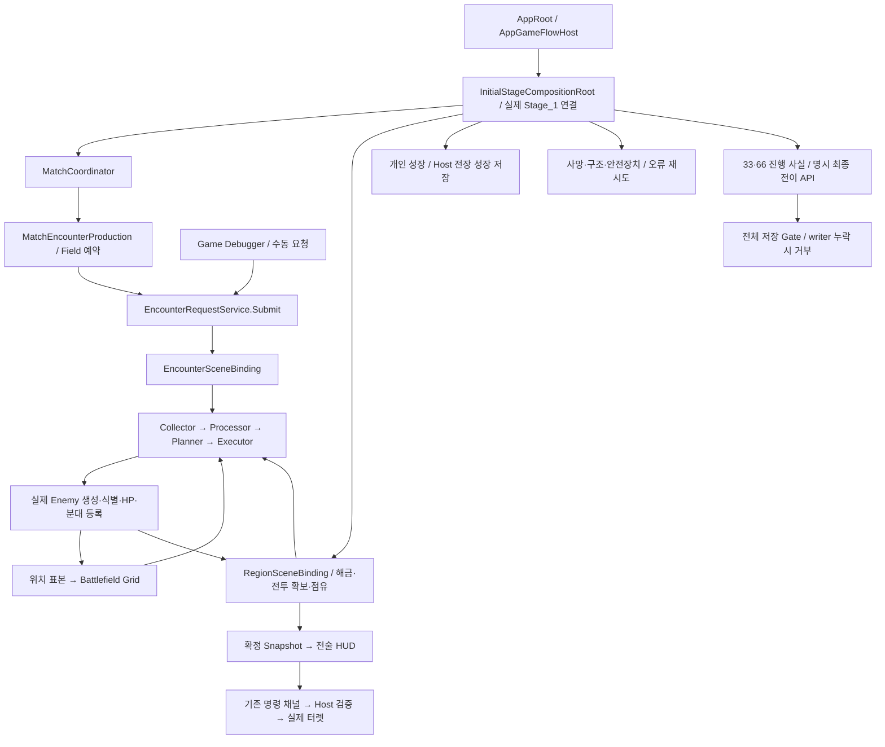
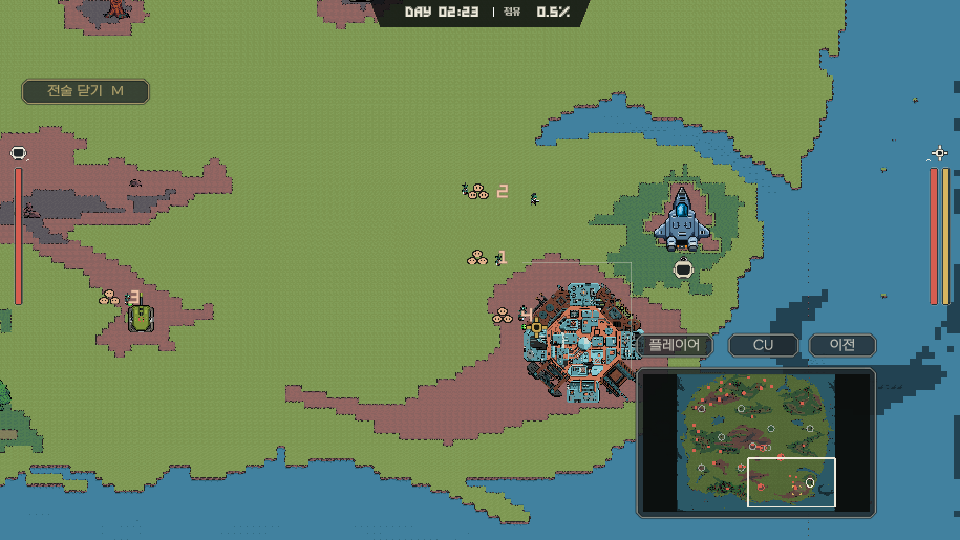

# Encounter·Stage1 Core와 전술 UI 통합 검토

기준일: 2026-11-14. PR: **생성 전**. 대상은 `feature/core → main`이다. 최신 main `b529a02d3`(#724 Player, #725 Enemy)을 병합해 전달한다. 생성 직후 실제 PR 번호와 링크를 기록한다.

## 이번에 들어가는 것

Stage_1의 실제 공간·점유 정보를 읽어 정규 Enemy 생산을 실행하고, 지역 확보·성장 저장·실패 복귀를 연결한다. 같은 변경에 전술 화면, 공용 HUD 보강, Unity 기본 오디오와 낮밤·허브 OST를 함께 전달한다. UI 작업의 `7e04cd93a`, `f794d7709`, `12c3d1370` 및 오디오 기반 `3812e02d3`가 작업 브랜치에 포함돼 있다.

**Stage1 전체 게임 완료 PR은 아니다.** 사용자 확인에 따라 최종 보스 Scene 자동 진입·최종 사망 자동 승리·별도 결과 저장은 연결하지 않았다. 명시적인 전이 API와 진행 사실만 유지한다. 실제 Weather writer, 보스 콘텐츠, 원격 Player 원본이 없는 부분은 아래에 구분했다.

처음 볼 때는 [현재 Core 실행 지도](../../02_architecture/01_core/core-runtime-map.md), [배치별 준비 상태](../../01_planning/02_implementation-records/2026/11/2026-11-14-encounter-stage1-readiness.md), [전술 화면 구현·검증 기록](../../01_planning/02_implementation-records/2026/11/2026-11-13-tactical-command-view.md)을 순서대로 읽으면 된다. 상세 API 설명을 이 문서에 중복하지 않고 실제 호출 경계를 안내한다.

## 코드 진입점과 실제 자료 흐름

| 먼저 볼 파일 | 읽을 함수·역할 |
| --- | --- |
| [InitialStageCompositionRoot.cs](../../../Assets/Scripts/Core/Bootstrap/SceneComposition/InitialStageCompositionRoot.cs) | `Compose`와 `Update`. Player·터렛·환경·공용 시간·요청 서비스의 실제 Scene 연결과 해제를 시작한다. Growth/Recovery/Checkpoints/FinalBattle partial은 기능별로 이어 읽는다. |
| [MatchCoordinator.cs](../../../Assets/Scripts/Core/Application/MatchCoordinator.cs), [MatchEncounterProduction.cs](../../../Assets/Scripts/Core/Application/Encounter/MatchEncounterProduction.cs) | Match 시작/종료가 생산 예약을 소유한다. Field 시간에 최초 0.5초, 이후 15초마다 요청하며 Client는 생산자를 만들지 않는다. |
| [EncounterRequestService.cs](../../../Assets/Scripts/Core/Application/Encounter/EncounterRequestService.cs) | `Submit`. 게임·디버그·지연 출현의 공통 요청 경계, 현재 Match/권한/환경과 요청 수명을 확인한다. |
| [EncounterPipeline.cs](../../../Assets/Scripts/Features/Enemy/Encounter/Pipeline/EncounterPipeline.cs) | `SpawnRequest` → `Run`. Collector/Processor/Planner/Executor 순서를 조율한다. 수집·정책·생성 책임을 다시 한 관리자 안에 합치지 않는다. |
| [EncounterPlanner.cs](../../../Assets/Scripts/Features/Enemy/Encounter/Pipeline/EncounterPlanner.cs) | `TryPlan`, `TryDetermineBudget`. 기존 예산 곡선 → 공간 배분/편성 → 같은 예산의 추가 출현 순이다. 실제 생성 결과만 분산 이력에 돌려준다. |
| [RegionSceneBinding.cs](../../../Assets/Scripts/Core/Bootstrap/SceneComposition/RegionSceneBinding.cs) | 정적 해금과 점유를 분리한다. 실제 NavMesh 유효 셀, 팀 전투 성과·참가자·적 압력으로 확보하고 다음 구역을 해금한다. |
| [GrowthSaveService.cs](../../../Assets/Scripts/Core/Application/Persistence/GrowthSaveService.cs) | XP 합치기·중요 변경 즉시 저장·순차 IO. 개인 성장과 Host 공용 성장을 월드 rollback에서 분리한다. |
| [MatchRecovery.cs](../../../Assets/Scripts/Core/Application/MatchRecovery.cs), [AppRoot.Recovery.cs](../../../Assets/Scripts/Core/Bootstrap/AppRoot.Recovery.cs) | 구조 조건/예산과 안전장치 사용을 관리한다. 기술 실패는 실제 메뉴에서 재시도하며, 취소된 이전 IO가 새 요청을 덮지 않게 한다. |
| [StageProgression.cs](../../../Assets/Scripts/Core/Application/StageProgression.cs), [InitialStageCompositionRoot.FinalBattle.cs](../../../Assets/Scripts/Core/Bootstrap/SceneComposition/InitialStageCompositionRoot.FinalBattle.cs) | Field 사건의 생성 확인·실제 HP 사망을 기록한다. 최종 전이는 명시 API이며 `Update`나 최종 개체 사망에서 자동 승리하지 않는다. |
| [TacticalCommandController.cs](../../../Assets/Scripts/UI/Tactical/TacticalCommandController.cs) | `Awake`/전술 열기·닫기. 확정 읽기 자료로 표시하고 기존 Host 요청으로 ON/OFF·강화·CU 일괄 명령을 보낸다. Camera/Commands partial을 함께 본다. |
| [GameAudioManager.cs](../../../Assets/Scripts/Core/Presentation/Audio/GameAudioManager.cs), [GameplayMusicPlayer.cs](../../../Assets/Scripts/Core/Presentation/Audio/GameplayMusicPlayer.cs) | AudioSource 풀·분류·수명·설정과 음악 문맥 선택. 날씨 판정·게임 난수·피해 판정의 원본을 대체하지 않는다. |

## 기능별 변경과 확인할 경계

| 기능 | 이번 변경 | 사용법·상세 근거 |
| --- | --- | --- |
| 정규/수동 생산 | Debugger를 켜지 않아도 실제 Stage_1에서 예약 생산한다. 요청당 상한 500은 생존 적 총량 상한이나 강제 생성 수량이 아니다. 실제 비용·완성 분대·공간 조건을 적용한다. | [Encounter 생산](../../02_architecture/08_encounter/encounter-production-api.md) |
| 점유와 그룹 | 첫 구역은 해금, CU 유효 셀 1개만 점유한다. 구역당 30초 확보, 이탈 유예 180초, 적 우세 30초가 기본값이다. 확보된 Region ID의 스포너 그룹과 점유에 반경+여유가 닿는 지점을 후보에서 빼고 생성 직전 다시 확인한다. | [정적 지역 확보](../../02_architecture/02_match/static-region-capture.md) |
| 추가 출현/소환 | 확장 이력으로 공통 예산 일부를 예고한 점유 내부 출현에 배정한다. 원격 예고가 없는 현재는 1인 Host만 지원한다. Enemy 스킬 소환은 기존 종류·수량·타깃 의도를 유지하고 공통 생성만 사용한다. | [추가 생성 원점](../../02_architecture/08_encounter/encounter-spawn-origin-api.md) |
| 시간 | 공용 Match 시각과 Field 보류 시각을 분리한다. Field 냉각·생산·지연 출현은 같은 Field 시각을 읽는다. 두 anchor의 Client 복제 기반도 분리했다. | [공용 시간](../../02_architecture/02_match/match-time-api.md) |
| 성장 저장 | 실제 XP/스탯은 개인 슬롯, 터렛/CU 성장은 Host·캠페인·Stage 슬롯이다. XP는 기본 2초 합치기, 중요한 변경은 즉시 캡처한다. 최신 강화로 전력이 부족하면 기존 규칙대로 OFF와 이유를 표시한다. | [성장 저장](../../02_architecture/01_core/growth-save-api.md) |
| 실패·구조 | 실제 Player/CU 사망, 안전장치 사용 예산, 같은 복귀 재시도와 오류 메뉴를 연결한다. 구조는 입력 유지 3초/복귀 HP 30% 시험값이며 실제 원격 조작 인수는 별도다. | [구조·복귀](../../02_architecture/02_match/match-recovery-api.md) |
| Stage 사건/최종 접점 | 33/66 사건 생성 중복 방지, 등장 전/처치 후 저장 Gate와 실제 HP 사망 연결이 있다. 실제 보스 Definition/위치는 비어 있다. 최종 Scene 준비/실패 원복 API는 유지하되 자동 진입·승리·결과 저장은 제외했다. | [Stage API](../../02_architecture/02_match/stage-progression-api.md), [범위 정정](../../01_planning/02_implementation-records/2026/11/2026-11-14-explicit-stage-transition-scope.md) |
| 전술/HUD | 전체도·목표·터렛 정보·원격 요청·CU 일괄 선택·카메라 경계/보간을 제공한다. 전투 HUD·Alert·스킬 피드백·설정도 보강했다. UI는 점유·전력·명령 성공을 먼저 확정하지 않는다. | [Player UI API](../../02_architecture/06_player/player-ui-api.md), [에셋 규칙](../../94_art/tactical-ui-assets-2026-11-14.md) |
| 오디오/OST | 공용 믹서·재생 큐/풀·Music/Effects 설정, Main/Credits/Day/Night/허브 문맥 재생을 추가했다. 시각·판정과 청감 인수는 구분한다. | [오디오 API](../../02_architecture/01_core/game-audio-api.md), [실제 음악 검수](../../01_planning/02_implementation-records/2026/11/2026-11-13-day-night-soundtrack.md) |
| 정리/계측 | 사용하지 않는 Core 그림자 상태·전투/Wave 사건 11개와 임시 전투 중 허브 방문을 제거했다. 기존 Debugger의 실제 생성·분배/밀도·Timeline 및 Profiler marker를 사용한다. 새 진단 전용 GameManager를 두지 않았다. | [Core 지도](../../02_architecture/01_core/core-runtime-map.md), [Debugger](../../05_tooling/game-debugger-guide.md) |

## 영향을 받는 제작물과 다른 파트

- Scene: `Assets/Scenes/Gameplay/Stage_1.unity`, Startup/우주선 흐름과 기존 GameFlow 연결. Stage_1 카메라 두 경계 참조는 main #722의 실제 오브젝트를 사용한다. 이번 마감 직렬화는 Core 필드의 코드 기본값을 명시하고 사라진 출입구 필드를 제거한다. 최종 보스 driver/Field 콘텐츠 참조를 임시값으로 채우지 않는다.
- Prefab/Asset: Player·터렛·Enemy의 연결 경계, 전술/공용 UI 프리팹·폰트·스프라이트, AudioVoice·믹서/큐·음악 라이브러리. 기존 GUID/.meta를 보존한다. 변경 목록의 반복된 Sprite·Importer·대형 Scene YAML을 먼저 전부 읽기보다 위 연결 코드와 제작 참조부터 확인한다.
- Enemy/Encounter: 요청 연결부·Pipeline·공통 생성/HP/저장 경계가 변경된다. 기존 AI 이동·공격·스탯의 최적화를 완료했다는 뜻은 아니다.
- Player: 실제 성장·생존·구조/저장 port와 로컬 UI/카메라 연결을 확인한다. 실제 원격 Player NetworkBehaviour 구현을 대신하지 않는다.
- Defense: 활성/전력·강화·성장 writer와 실제 HP 사건을 사용한다. 기존 OFF·냉각 완료 강화 조건은 유지한다.
- World/Weather: 현재 환경 읽기와 시간 계약을 소비한다. 김진태의 실제 Weather 큐/writer 작업을 대체하지 않는다. 필수 `world/weather`가 없어 전체 Save/Resume는 거부된다.
- Network: Host만 생산/점유/명령을 확정한다. 준비 wire v3/지역 wire v2 및 Field 시간 anchor 변경 때문에 같은 Build로 검수해야 한다. 실제 원격 Player·2개 실행 파일의 통합 통과를 주장하지 않는다.

저장은 `world/spatial` v2, `world/region-start` v2, `world/encounter` v3, `world/encounter-production`/`world/field-time` v1 등의 실제 writer를 함께 확인한다. 지원되는 구버전 이관과 필수 section 누락의 거부는 각 API 문서를 따른다. 모든 과거 전체 저장이 자동 호환된다고 쓰지 않는다.

## 검증 결과와 실행 조건

같은 수정에 대한 여러 번의 검사를 한 번의 전체 통과로 합산하지 않는다. 아래 Core와 UI 검수는 각 기록 시점의 실행이며 새 원격 PR CI/Windows Build 결과가 아니다.

| 확인 | 결과 | 조건/한계 |
| --- | --- | --- |
| 실제 일반 생산·공간 입력 | 3요청에서 실제 적/Grid/계획 입력 0→12→24, 각 요청 생성 12/12. 입력/계획 revision 4/4→25/25→54/54, 후보 밀도 123개 불일치 0 | Player/CU 개발 보호 사용. 정상 난이도·장시간 성능 보장이 아니다. |
| 실제 정적 확보 | 유효 201/256셀, 시작 1셀, 시험 확보 51셀과 다음 구역 해금. 점유 Region1 일반 할당 0, 일반 적은 점유 밖 생성 | 보호·위치/확보 2초 시험 조건. 현행 30초/유예/상실은 별도 규칙 검사다. |
| API 한정 정정 | 17개 순수 NUnit 직접 실행 통과. 실제 HP 사망 뒤 Match Running/결과 없음, 100% 시험 상태에서 자동 진입 없음, 명시 API의 누락 driver 거부와 입력/정지 해제 확인 | 현재 Editor assembly의 직접 실행이다. Unity TestRunner 17개 실행이나 실제 보스 플레이로 표시하지 않는다. |
| 성장·실패 복귀 | 성장 서비스 TestRunner 6/6. 실제 XP/스탯 새 actor 재로드, 안전장치 소진/실패 메뉴·재시도·파일 누락 거부를 개별 실행 | QA 저장 원본 33개 전체 해시 보존. Weather 포함 전체 월드 복원은 미완이다. |
| 전술 카메라/명령 | 최신 전술 자동 8/8, 실제 Stage 명령 Scene 검사 6/6. 카메라 742표본 경계 이탈 0. 실제 마우스 열기·전체도 클릭·닫기와 Host 명령 관측 | native 키/held drag는 도구 관측 한계로 사용자 직접 인수 대기. 상세 실행/fixture는 UI 기록 참조. |
| HUD/오디오 | UI 세션의 기능별 회귀·실제 렌더/음악 전환 기록을 인계받았다. 원본 OST 9개 해시 검수 | 각각 별도 실행. 스피커 청감·Standalone·실제 Client 2실행 인수는 수행하지 않았다. |
| 이번 저장소 검사 | Python 3.13.3에서 50/50, 전체 Unity .meta 0오류. 프로젝트 설정·Build Scene·충돌/생성물·링크 검사는 함께 확인 | CI의 Python 3.12/Ubuntu 실행을 대신하지 않는다. |
| 이전 Editor 재연결 시도 | 실패: main-thread 대기 시간 초과 후 CLI가 해당 프로젝트 Pipeline 인스턴스를 찾지 못함. 실제 Unity 창에는 저장 대화창이 없었음 | 새 컴파일/통합 smoke를 통과로 기록하지 않는다. 기존 성공 증거는 위 실행과 구분한다. 화면 조작 종료. |

배치별 전체 범위는 [준비 상태](../../01_planning/02_implementation-records/2026/11/2026-11-14-encounter-stage1-readiness.md), UI native/회귀/수동 경계는 [UI 실행 기록](../../01_planning/02_implementation-records/2026/11/2026-11-13-tactical-command-view.md)에 있다. 개인 원본은 공유 제외 `Docs/Local/Execution/EncounterStage1-20261113`와 `Docs/Local/Validation/Tactical20261113`, 이번 저장소 검사 원본은 `Docs/Local/Review/CoreUiIntegration-20261114`에 보존한다.

### 사용자에게 남기는 최소 확인

1. 실제 키로 M/Esc·WASD/방향키·Home·G를 확인한다. 전술 화면 중 Player 이동/공격 차단과 닫은 뒤 복구를 확인한다.
2. 전체도/중간 버튼 held drag, 휠과 Q/E 스킬 배정·교체·영역 밖 취소를 확인한다. 버튼 callback/가상 UI 입력 검사를 실제 held drag 통과로 대신하지 않는다.
3. Pipeline 재연결 후 통합된 최신 HEAD의 Stage_1 일반 생산과 전술 열기/닫기를 한 번 확인한다. 기존 성공 기록만으로 이번 새 실행 결과를 채우지 않는다.

## 이슈·위험·되돌리기

### 후속 보완: 성장 복원 뒤 OFF 터렛 색상

일반 게임 화면의 실제 표본에서 정적 해금은 [1], 12개 터렛 중 10개는 Locked, 전부 OFF였지만 본체 RGBA는 모두 (1,1,1,1)이었다. 전체 해금이 아니라 성장 재로드가 기존 Core의 무기별 복원 함수를 호출해 열 0을 흰색으로 덮은 간접 회귀였다. `DefaultFieldCanonTurret.Checkpoint.cs`/`DefaultFieldMissileTurret.Checkpoint.cs`만 보완해 기존 `SetGunHeatTint`로 열기 상태를 복원하고 OFF·열 0이면 회색을 유지한다. 팀원의 본체 Update/Shader·해금·전력 규칙은 변경하지 않았다. main #664의 과열 굴절 효과가 투명하게 보이는 문제는 별개이며, 이 차가운 표본의 Heat Wave는 비활성이므로 그 현상의 실제 재현으로 쓰지 않는다.

실제 제작 프리팹과 Feature writer의 메모리 왕복 검사 `FieldTurretRestoreVisualTests` 2/2가 Unity Editor TestRunner에서 통과했다. 월드/성장 복원 전후의 OFF(잠금·해금) 회색/잠금 보존과 ON·냉각 중 OFF의 과열색/Heat Wave를 확인했다. 최초 검사 코드의 base 메서드 호출 컴파일 오류 1개는 수정 후 재컴파일했으며 최종 compileFailed=false다. 종료 후 Play/compiling/updating=false, Stage_1 clean을 확인했다. 실제 파일 저장·전체 Stage1 인수는 이 검사의 범위가 아니다. 원본 JSON/XML과 소스 해시는 공유 제외 `Docs/Local/Review/CoreUiIntegration-20261114/turret-tests-*`에 있다. 이 후속 수정과 관련 테스트를 이번 통합에 포함한다. 이전 HEAD 검사와 구분한다.

현재 열린 본인 이슈 중 #599(전체 Weather 저장), #639(지역/보스/결과), #640(안전장치/협동), #641(종료/이어하기), #637(Camera), #528(실제 Client HUD), #620(허브 접근)과 관련된다. 부분 구현/수동·외부 원본 인수가 남아 이번 준비안은 **Relates to만 사용**한다. Steam/Backend·동일 Build 전체 인수는 이 PR의 완료로 묶지 않는다. 이슈 수정·종료는 수행하지 않았다.

통합 전 main 버전을 기준으로 롤백한다. UI는 `7e04cd93a`/`12c3d1370`, 음악은 `f794d7709`, 오디오 기반은 `3812e02d3`로 출처를 찾되, 서로의 Prefab/Scene/코드 참조가 있으므로 커밋 하나를 무조건 단독 revert하지 않는다. Core 생산·저장·Scene 조립도 연결된 범위를 함께 되돌리고 재컴파일한다. 실제 저장 파일은 삭제하지 않고 백업한다. 최종 전이 자동 연결을 제외한 `8ebce2093`의 결정을 뒤집지 않는다.

원래 스테이징의 Python 캐시 8개, 기존 폰트 동적 캐시/렌더러/Prefab importer 변경은 이 통합 커밋에 포함하지 않았다. 해당 사용자 변경은 작업 트리에 보존한다. 사용자가 UI 제작기 작업까지 포함한 PR 생성·CI 후 main 병합을 승인했다. 실제 원격 결과는 PR에 기록한다.

## 최종 UI·점유 경계 통합 보완

아래는 위의 이전 실행 이후 추가된 실제 구현과 검수다. 이전의 연결 실패를 최신 검수 결과와 혼동하지 않는다.

- Field와 전술 지도는 `RegionBoundaryGeometry.Build`가 만든 같은 점유 Grid 경계를 사용한다. 초록 내부·빨강 외부의 반투명 띠는 Map 위/Territory 레이어, 그 외 오브젝트 아래에 렌더링한다. 전술 화면 중 Field 띠는 숨긴다. [경계 구현·검수](../../01_planning/02_implementation-records/2026/11/2026-11-14-field-territory-boundary.md).
- 확보 기본값은 현재 **30초**다. 팀 피해 성과·생존 참가자·현지 적 압력 판정을 유지하며, 미점유/잠금/적 압력 중단을 UI에서 구분한다. [정적 확보 API](../../02_architecture/02_match/static-region-capture.md).
- 안전장치는 실패 인식만으로 차감하지 않고 명시 사용에서 한 번만 차감한다. 같은 실패의 기술 재시도는 추가 차감하지 않는다. 실제 패배 이유, 선택/결과 UI, 새 실행으로 재시작, Pause 메인 복귀와 첫 전장 진입 연출을 포함한다. 자동 승리 조건은 추가하지 않았다. [승패·안전장치 UI](../../01_planning/02_implementation-records/2026/11/2026-11-14-mission-outcome-ui.md).
- 최신 UI 자동 검사는 분할 실행한 고유 **23개 통과**다. 실제 OS 마우스로 안전장치 3/3→2/3, HP400 복귀, 새 실행 3/3, 누락 저장에서 중복 차감/거짓 성공 없음, CU 파괴 사유와 명시 Victory UI, Hub/Field 메인 복귀를 확인했다. 상세 조건은 위 실행 기록을 따른다.
- Field 경계 검사는 5개 통과(3×3 점유 마스크 512개 포함), 실제 GPU 색/오브젝트 가림과 native 지도 열기·닫기, Field/지도 경계 좌표 일치를 확인했다. OFF 터렛 복원 표현은 2개 통과했다. 개별 검사를 전체 프로젝트/Standalone 통과로 합산하지 않는다.
- 원격 선택 RPC, 전체 Weather 저장·복원, 실제 두 Client와 Standalone, 최종 보스 자연 플레이 인수는 남아 있다. 새 MatchResult 사유 payload는 새 reader의 이전 payload 읽기를 검증했으며 혼합 Build 호환을 보장하지 않는다.
- 포함하지 않는 기존 변경: staged Python 캐시 8개, TMP 동적 atlas/Examples, NetworkMatchAnchor·HealOrb 직렬화 Hash, Renderer PostProcessData 자동 변경. 해당 로컬 내용은 삭제하지 않고 보존한다.

## 전술 화면 예시

기존 UI 실제 마우스 검수의 Game View다. 보호/시험 setup을 사용한 UI 검수 화면이며 자연 플레이로 해당 진행을 달성했다는 증거는 아니다. 모든 Core 기능의 이번 최종 실행 화면으로 읽지 않는다.
