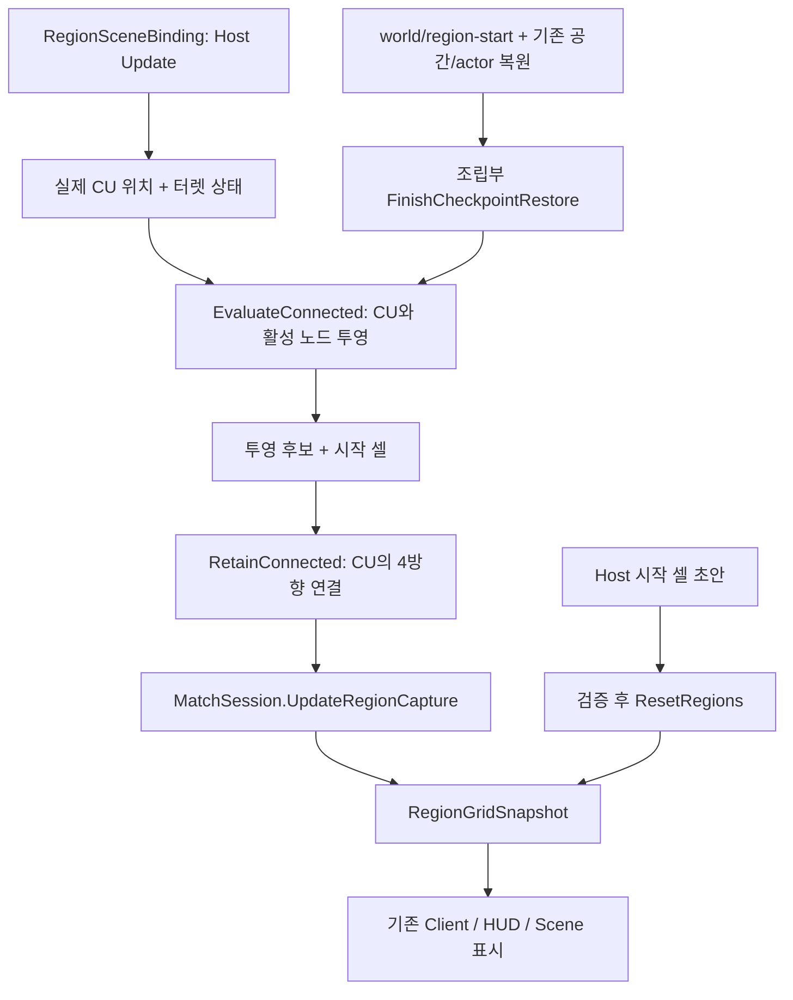

# CU 동적 점유 변경 검토

기준일: 2026-11-12. PR: [#701](https://github.com/Team-HJD-21/unity-6-the-developer/pull/701), `feature/core → main`. 생성 직후 실제 base/head를 다시 조회했다. 기준 main: `88bc2c58e`. 이 문서는 실제 변경과 검증 범위를 요약한다. CI와 병합 상태는 PR의 실제 결과를 확인한다.

먼저 [구현 결과의 코드 읽기 순서와 QA](../../01_planning/02_implementation-records/2026/11/2026-11-12-cu-connected-regions-results.md)를 따라 보면 된다. 사용법은 [지역 API](../../02_architecture/01_core/core-sprint-region-and-request-api.md#cu-시작-영역-설정과-저장)와 [Game Debugger](../../05_tooling/game-debugger-guide.md#cu-시작-영역-확인)에 있다.

## 주요 실행·자료 흐름

삼각형과 Battlefield 밀도 Grid를 새 점유 원본으로 추가하지 않는다. 최종 지역 셀만 기존 snapshot에 발행한다. Client는 계산/설정 권한 없이 기존 확정 결과를 받는다. FieldTurret의 HP·전력·냉각·활성 원본은 유지한다. 초기 영역 편집은 Host 런타임 설정이며 Scene 저장이 아니다.

## 확인할 경계

- 시작 목록은 현재 CU 셀 포함·4방향 연결·Grid 범위를 검사한다. 기본값/명시 목록/모드 Reset의 차이를 확인한다.
- 동일 셀 결과는 revision을 바꾸지 않을 수 있다. 기하 진단을 기다릴 때는 새 평가 객체도 확인한다.
- 새 `world/region-start` section이 필수다. 옛 Checkpoint를 무시하고 기본값으로 복원하지 않는다. 지형 마스크·실제 Weather writer가 필요한 범위를 확인한다.
- Player 변경은 승인받은 통합 테스트 한 메서드뿐이다. 게임 코드·Scene·Prefab은 변경하지 않았다.
- 별도 HOTFIX는 App/Play 종료의 취소 예외와 파괴 UI 접근만 정리한다. 명시 Fade 취소는 계속 취소된 Task로 전달된다.

## 검증과 미확인

도메인 14/14, 바인딩 6/6, 실제 Stage Play·Editor UI·취소 1/1. 회귀는 최초 47/48이며 승인 후 기존 가정을 수정한 해당 1개가 재검사 1/1이다. 원본 실패를 숨기거나 48/48 단일 실행으로 바꾸지 않는다. [공유 검사 요약](cu-connected-regions-20261112.results.json)에 실행별 결과와 소스 SHA256을 기록한다.

실제 새 CU 정책의 두 Client/HUD 인수·전체 저장·Windows Build·지형 마스크·Enemy 일반 스폰 제한은 이번에 확인/구현한 기능이 아니다. 따라서 Refs #638로 연결하며 Issue 완료를 과장하지 않는다. 기존 검사만으로 클라이언트 실게임을 인수하지 않는다. 검토 범위에서 추가 결함은 발견하지 못했으며, 외부 연결 대기는 결과 문서의 표를 따른다.
