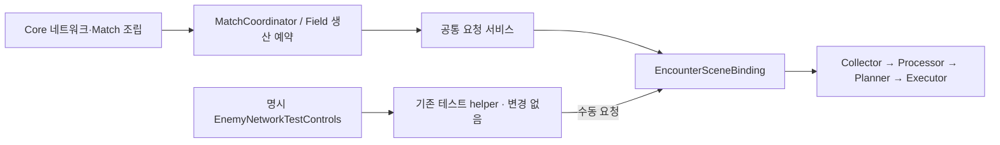

# Encounter 정식 연결·테스트 런처 분리 검토

PR: [#728](https://github.com/Team-HJD-21/unity-6-the-developer/pull/728). base main. #727의 Scene 원복 이후를 기준으로 하며 이 PR은 Scene을 변경하지 않는다.

## 왜 바꾸는가

11/13 `9a9ab30d7`에서 기존 EnemyNetworkTestLauncher의 게임 연결을 EncounterSceneBinding으로 분리했지만, 정식 연결부가 여전히 테스트 helper를 생성하고 독립 Host/첫 고정 스폰을 관리했다. 실제 Stage_1은 이미 App 네트워크와 Core 정규 생산을 쓰므로 이 시험 경로는 필요하지 않다.

기존 `EnemyNetworkTestLauncher.cs`·`.meta`는 수정·복원하지 않는다. 런타임→테스트 참조를 제거하고, 기존 시험 버튼이 필요한 경우에만 새 `EnemyNetworkTestControls`를 직접 붙인다. 테스트 도구에서 정식 API를 호출하는 방향으로만 의존한다.

## 먼저 볼 코드와 흐름

1. [EncounterSceneBinding.cs](../../../Assets/Scripts/Features/Enemy/Encounter/Scene/EncounterSceneBinding.cs): Awake는 NetworkManager 참조만 읽는다. Bind는 Match/전장/환경/난수를 연결하며 NGO 연결이나 첫 스폰을 시작하지 않는다. Unbind는 해당 Match 적·예약·구독만 정리한다.
2. [InitialStageCompositionRoot.cs](../../../Assets/Scripts/Core/Bootstrap/SceneComposition/InitialStageCompositionRoot.cs): 기존 MatchCoordinator/MatchEncounterProduction의 Field 예약이 유일한 정규 생산자다. 불필요해진 첫 요청 억제 계약 IEncounterProductionConsumer와 호출을 제거했다.
3. [EncounterSceneBinding.Checkpoint.cs](../../../Assets/Scripts/Features/Enemy/Encounter/Scene/EncounterSceneBinding.Checkpoint.cs): v1~v3의 옛 bool/double 슬롯은 계속 읽고 검증하지만 시험 첫 요청으로 재실행하지 않는다. 새 저장에는 false/0을 기록하며 나머지 형식은 유지한다. 정규 예약의 별도 writer는 그대로다.
4. [EnemyNetworkTestControls.cs](../../../Assets/Scripts/Features/Enemy/Testing/EnemyNetworkTestControls.cs): 명시 시험 Scene의 수동 UI만 기존 helper에 위임한다. App 소유 연결에는 UI·종료 조작을 적용하지 않는다. 자동 설치·자동 Host·별도 생산 루프를 만들지 않는다.

예산 곡선·점유 그룹 제외·환경/난수·공통 생성·소환·추가 출현·진단의 실제 정책은 변경하지 않았다. 수동 기본 상한의 옛 직렬화 이름은 FormerlySerializedAs로 보존한다. [사용법](../../02_architecture/08_encounter/encounter-runtime-and-testing.md)을 참고한다.

## 실제 확인

- Editor 자동 검사: 새 분리/옛 저장 슬롯 4개, 기존 연결/지역/난수/Pipeline 6개, 정규 생산/정지/재예약/복원 6개. **고유 16개 통과**이며 전체 프로젝트 테스트 합산이 아니다.
- 실제 Startup → 우주선 → 정식 LaunchMissionAsync → Stage_1 진입 성공. App Host=true, Mission, 테스트 컴포넌트0. MatchProduction 3회 각각 planned12/actual12, DebugWindow 1회 planned9/actual9. 마릿수 상한10에서 편성 단위로9마리를 생성한 정상 결과다. 독립 MatchStart 요청은 없었다. Player/CU는 개발용 피해 보호를 사용했다.
- 정상 실행의 Console cursor619 이후 Error0. 최종 컴파일 실패false, Play 종료, Startup clean. 기존 오디오 장치 FMOD 경고/이전 컴파일 로그를 새 성공 구간과 구분한다.
- 첫 QA 시도는 Editor가 첫 프레임에서 Pause되어 준비 timeout이 발생했다. 잘못된 QA eval 명령도 고친 뒤 Pause 해제·새 실행으로 위 결과를 확인했다. 실제 Match 종료/연결 유지의 추가 live 계측은 QA 타입 경로 오류로 실행되지 않았으며 통과로 주장하지 않는다. Bind/Unbind의 비개설 경계는 자동 검사로 확인했다.
- 원본 Checkpoints35개를 백업하고 종료 후35개 모두 원래 해시로 복구했다(변경 파일1개 복구). Scene 저장은 하지 않았다. Stage_1 blob은 #726 이전/원복 main과 동일하다.
- 실제 Editor에는 별도 UI 작업 커밋8bcd0693b가 있는 상태로 검증했다. 이 PR의 코드·문서 범위만 main 위에 추출하며 그 UI 커밋·동적 폰트·staged 캐시는 포함하지 않는다.

검수 원본은 공유 제외 `Docs/Local/Review/EncounterRuntimeSeparation-20261115`에 있다. 전체 Weather 저장·원격2인·Release/Standalone 검수는 이 변경에서 수행하지 않았다.

## 영향과 되돌리기

Scene·Prefab·기존 GUID는 변경하지 않는다. 독립 시험에서 버튼이 필요하면 명시 컴포넌트를 추가해야 하며 옛 자동 첫 고정 스폰은 제공하지 않는다. 일반 게임의 생산 설정/주기는 그대로다. 문제 시 이 PR 범위만 되돌리되 #727의 Scene 원복은 유지한다.
