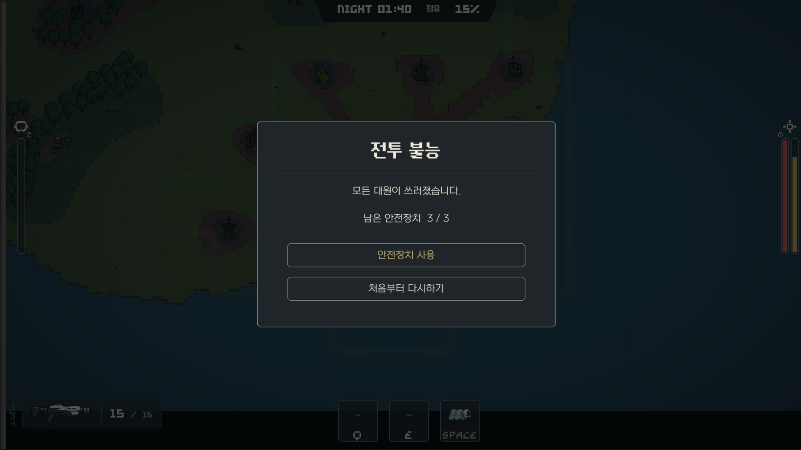

# 안전장치 재검수 — 2026-11-15

PR: 게시 후 번호 기입. 기준: main #732와 이번 Stage_1 재접합.

## 실제 연결

실제 전멸/CU 파괴를 `MatchRecovery`가 관측하면 시간을 멈추고 선택을 기다린다. `AppRoot.UseMissionSafetyAsync` → `InitialStageCompositionRoot.UseSafetyAsync` → `RetryRecoveryAsync`가 진입점이다. 명시 선택해야 3회 예산 중 1회가 차감된다.

- 유효 저장 링크가 있으면 slot과 CheckpointId를 모두 검사하고 전체 writer로 복원한다. Field 시계를 먼저 적용하고 actor를 재생성한 뒤 상호 참조를 연결한다.
- 링크가 처음부터 없으면 같은 Mission을 새로 조립한다. 같은 실행 ID·차감 기록과 최신 성장을 유지한다. 이것은 과거 월드 복원이 아니다.
- 파일 누락/교체·writer 누락은 초기 전장으로 대체하지 않는다. 정지와 오류를 유지하며 같은 실패의 기술 재시도는 추가 차감하지 않는다.
- 개인 성장/재화와 Host 공용 성장은 월드 rollback에서 기본 유지한다. 최신 강화로 전력이 모자라면 기존 우선순위에 따라 OFF로 복원하고 이유를 표시한다.

## 이번 수정

최신 Stage_1 터렛은25개, 기존 전장 성장 파일은12개였다. 공통 ID5개는 같은 무기 계열인지 확인해 적용하고, 새20개는 제작 기본값, 제거된7개 기록은 저장에 보존한다. 다른 터렛에 성장을 옮기거나 파일을 삭제하지 않는다. 이 정책은 성장에만 적용하며 과거 월드 배치를 자동 이관하지 않는다.

미사일 터렛은 생성 직후 Start 전에도 캡처될 수 있다. 기존 writer는 이때 Targets가 null이면 발사 슬롯0개를 기록해 스스로 저장 검증에 실패했다. CaptureCombat이 제작 발사구 수와 빈 참조를 기록하도록 수정했다. 잘못된 슬롯·열·투사체 검증은 유지한다.

## 전체 복원을 막는 연결

실제 WeatherManager는 아직 `world/weather`의 ICheckpointParticipant를 제공하지 않는다. 조립부는 실제 Weather source가 있으면 이 writer를 필수 요구한다. 따라서 현재 Stage_1의 전체 월드 Save/Restore는 writer 연결 전까지 거부되어야 한다. 필수 목록을 지우거나 임시 writer로 성공을 만들지 않았다.

진태님 쪽에 필요한 것은 현재 날씨·예보 큐 등 실제 원본의 Capture/PrepareRestore/Apply/참조 연결이다. Core의 시간·Random writer를 재사용하고 별도 시간 누적이나 Time.timeScale 변경을 추가하지 않는다.

## 검사 결과와 한계

규칙 검사: MatchRecovery12개, 비환급 기록 저장2개, App 재시도 경쟁2개, Field 시간1개, 성장/월드 병합6개, 실제 터렛 writer3개 통과. 원격2인 구조·선택 RPC, Weather 포함 전체 복원 성공을 뜻하지 않는다.

실제 최신 Scene에서 전체 저장은 RequiredFeatureWritersUnavailable/world/weather로 거부됐다. 실제 Player 피해로 전멸 후 선택 대기에서 사용0·Field 시각500.121755초가600ms 동안 그대로였다. 명시 사용 후 같은 실행 ID·새 Match·사용1·HP400·XP1890/레벨19 유지·CU 초기1셀을 확인했다. 마지막 저장 링크가 없으므로 초기 전장 재입장이며 전체 월드 rollback 성공이 아니다. 기존 저장은 검수 전 백업/해시를 보존한다.

## 우선 볼 코드

1. `Assets/Scripts/Core/Application/MatchRecovery.cs`: 선택·횟수·중복 실패.
2. `Assets/Scripts/Core/Bootstrap/SceneComposition/InitialStageCompositionRoot.Recovery.cs`: 저장 복원/재입장/기술 실패.
3. `Assets/Scripts/Core/Bootstrap/SceneComposition/InitialStageCompositionRoot.Checkpoints.cs`: 실제 writer 등록·필수 목록.
4. `Assets/Scripts/Core/Application/Persistence/CheckpointService.cs`: 준비·시계·적용·참조·rollback.
5. `Assets/Scripts/Features/FieldTurrets/Core/FieldTurretController.Growth.cs`: 성장/전력과 과거 월드 병합.
