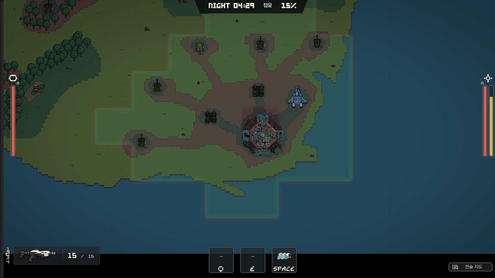
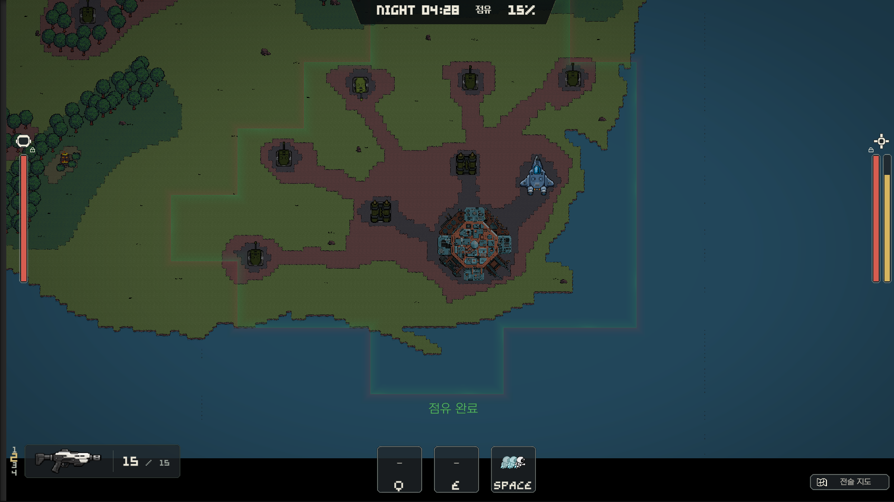

# Stage_1 정식 스폰·낮밤·필드 표시 재접합

초기 기준: main #731 `49ee14dc3`. 후속 검수는 #732 `8ccd60401`을 병합한 트리다. 아래 첫 검사와 성장 오류는 당시 기록이며 후속 수정/추가 검수와 구분한다. PR: [#734](https://github.com/Team-HJD-21/unity-6-the-developer/pull/734).

## 먼저 볼 곳과 실제 흐름

1. `Assets/Scenes/Gameplay/Stage_1.unity`: Stage Network, Encounter Runtime, EnemySpawnRoot, Main Camera의 참조를 확인한다.
2. `InitialStageNetworkBinding.Initialize` → 명시 `EncounterSceneBinding`에 App 연결 상태 주입 → Match 바인딩. NetworkManager·Transport는 기존 객체를 유지하고, 소비자만 별도 객체로 분리했다.
3. `MatchCoordinator/MatchEncounterProduction` → 공통 요청 → EncounterPipeline → EnemySpawnExecutor. 수동 Game Debugger 요청도 같은 실행 경계를 사용한다.
4. `InitialStageCompositionRoot.PrepareEnvironmentSources` → WeatherManager 옆 MatchDayNightCycle → Main Camera의 DayNightShaderApply → StageCameraEffectsFeature → DayNight 재질의 `_EffectBlend`.
5. `TacticalCommandController` → 같은 Region Grid snapshot → 지도/FieldTerritoryRenderer. 점유 원본은 바꾸지 않고 표현만 연결한다.

삭제 파일 두 개는 더 이상 참조하지 않는 옛 네트워크 시험 helper와 Controls다. 후속에는 점유 사유/표시, 터렛 성장 및 생성 직후 저장 writer, 우주선 접촉 레이어가 추가되었다. AI 이동·공격·터렛 전투 규칙, UI 프리팹·폰트는 변경하지 않았다.

## 변경 내용

| 대상 | 변경과 보존한 사항 |
| --- | --- |
| 네트워크 | `Encounter Debug Network`를 `Stage Network`로 표시하고 기존 NetworkManager/Transport를 보존했다. EncounterSceneBinding을 별도 `Encounter Runtime` 객체로 옮기고 기존 Script GUID·컴포넌트 참조를 유지했다. |
| 중복 생성기 | 정식 설정이 참조하지 않는 `Encounter Debug Spawner`와 자식 36개 지점을 제거했다. 기존에는 이들도 같은 Scene의 자동 수집에 들어갔으므로 단순한 화면용 Gizmo가 아니었다. |
| 실제 지점 | EnemySpawnRoot의 8개를 `Spawn_LaneA_01` 형식으로 표시한다. 기존 ID·위치·반경과 LaneA_02 수동 비활성을 보존했다. 신규 복제 지점의 자동 등록은 유지하며 8개 고정 목록을 만들지 않았다. |
| 낮밤 화면 | 카메라에 기존 DayNightShaderApply와 WeatherManager/DayNight.mat 참조를 연결했다. 타이머는 이미 있었지만 화면 소비자가 없었다. Weather 추첨·가중치·5분 주기를 변경하지 않았다. |
| 표현 참조 | 추가 출현 예고 Sprite와 전술 지도 Environment_Obj 참조를 연결했다. 필드 경계 코드·재질·Sorting Layer는 이미 존재해 중복 추가하지 않았다. |
| 새 씬 제작 | #731에 들어 있던 Core 생산·구조·추가 스폰 설정은 유지했다. 지형·NavMesh·터렛 배치를 이전 Scene으로 되돌리지 않았다. 삭제된 옛 카메라 마커를 재생성하지 않고 기존 Grid bounds fallback을 사용한다. |

## 확인 결과

| 검사 | 관측한 결과 |
| --- | --- |
| Unity 컴파일 | 오류 0, 경고 0 |
| 정적 검사 | Unity .meta 검사 오류 0, 갱신한 사용법 문서 링크 누락 0, diff 공백 검사 통과 |
| 실제 Scene 제작 참조 | Stage1EncounterAuthoringTests 4/4 통과 |
| 바인딩·연결 소유권·이전 저장 형식 | EncounterRuntimeSeparationTests 6/6 통과 |
| 실제 게임 진입 | Startup → 우주선 → Stage_1 정상 진입. 아래 설명한 별도 QA 캠페인 사용 |
| 자동 생산 | 첫 실행에서 15/15, 15/15 계획·실제 생성. 재진입 후에도 15/15, 15/15 |
| 수동 요청 | Normal 상한 10으로 9/9 생성. 분대 1세트 단위의 기존 정책 결과이며 10마리 강제 생성으로 바꾸지 않음 |
| 지점 | 등록 8개. LaneA_02의 ManuallyDisabled 유지. Debug 지점은 후보에서 사라짐 |
| 낮밤 화면 | Night 전환 후 실제 렌더 재질 생성·`_EffectBlend=0.526913643`, Day 복귀 후 0. Day/Night 화면을 각각 캡처해 확인 |
| CU 자동 활성화 | CU에서 2유닛 떨어진 실제 Player로 기존 HUD API 요청 수락. 이후 터렛 25개 중 가동 3개 확인 |
| 지도·필드 경계 | 같은 GridId 확인. CU 점유 1셀·경계 4변 표시. 지도 표시 중 필드 띠 숨김 확인 |
| 복귀·재진입 | 우주선 복귀 시 Enemy 0·Host 유지·NetworkManager 1개. 재진입 후 NetworkManager 1개·Executor 1개·새 Match 생산 정상 |
| Match 해제 | 적 76 → 0, 바인딩 해제, Host/Listening 유지 |
| 정리 | Play 종료·Startup 복귀. 원래 저장 35개 모두 해시 일치로 복구, QA 전용 파일은 검수 폴더로 보관 |

낮밤은 디버그 Phase 전환으로 실제 source·날씨 알림·렌더 경로를 확인했다. 이번 검수에서 실제 10분을 기다려 두 자동 경계를 모두 관측한 것은 아니다. 원격 2인 접속과 최종 보스·승패는 이번 검수 범위가 아니다.

## 별도 문제: 기존 성장 저장으로 새 맵 진입

처음 기존 캠페인으로 진입하면 다음 예외가 발생했다.

```text
InitialStageCompositionRoot.ComposeAuthority
  → BindGrowthSaves
    → GrowthSaveService.Load / Restore
      → FieldTurretController.GrowthParticipant.PrepareRestore:177
        InvalidDataException: The authored turret set changed; growth migration is required.
```

새 제작 Scene의 터렛 목록과 예전 Host 전장 성장 저장의 대상 목록이 달라 기존 검증이 복원을 거부한다. 데이터 손실을 막기 위해 이 검증을 우회하거나 기존 저장을 지우지 않았다. 실제 실행 검수는 공개 API `AppRoot.SelectCampaign`으로 별도 `qa-stage1-wiring-20261115` 슬롯을 선택해 진행했다. 기존 저장을 사용하는 정상 시작 경로까지 해결되었다고 읽으면 안 된다.

후속에서는 공통 ID·무기 계열을 검사해 성장을 적용하고, 새 배치는 기본값을 사용하며 빠진 ID의 기록은 보존하도록 수정했다. 임의 초기화나 자동 환급은 하지 않는다. [안전장치/저장 재검수](mission-safety-audit-20261115.md)에서 정책과 검사 결과를 확인한다.

또한 첫 Startup의 MenuSoundtrack.PlayScheduled에서 기존 FMOD 출력 장치 초기화 오류가 1회 발생했다. 씬 진입을 막은 성장 저장 오류와 구분한다. QA 캠페인 실행·복귀·재진입에서는 새 게임 예외가 발생하지 않았다.

## 검수 자료

로컬 보관: `Docs/Local/Review/Stage1HandoffPreparation-20261115/`.

- `authoring-tests.json`, `separation-tests.json`
- `runtime-spawn-and-phase.json`, `runtime-night-render.json`, `runtime-day-and-map.json`, `runtime-map.json`
- `runtime-hub-return.json`, `runtime-reentry.json`, `runtime-cleanup.json`
- `runtime-errors-initial.json`, `checkpoint-restored.json`, `scene-edit-report.json`
- `stage1-day.png`, `stage1-night.png`, `stage1-map.png`

로컬 검수 자료와 원본 저장 백업은 커밋 대상이 아니다. PR 작성 시 필요한 캡처만 첨부하고 이 문서에 PR 번호를 추가한다.

## 후속 실제 확보·안전장치·렌더 검수

- 원래 캠페인으로 Startup→허브→물리 출구 접촉→Stage_1 진입. 터렛20개 신규 기본값/7개 보존 경고를 확인했다. 저장 삭제로 회피하지 않았다.
- 정기 요청8회 후 실제 터렛 피해100이 정적 성과에 기록됐다. 현지 적30일 때 확보 시간0으로 정지했다. 보호한 Player/CU·생산 중단 및 실제 적의 외곽 이동/고정을 사용한 **통제 시험**에서 적 압력0·기본30초 후 점유1→30/201셀, Region2 해금·StaticSecured 후 Unlock의 변경 사유 보존·추가 요청10마리 생성을 확인했다. 자연 플레이 밸런스 검수는 아니다.
- 화면에서 바닥 확장→정착과 기존 Alert 위치의 `점유 완료`를 촬영했다. 지도/상단 점유15%는 확정값을 즉시 읽는다.
- 후반 후보 부족: 기존 지점의 실제 Region은1~4뿐이었다. 실제 NavMesh 경로가 확인된 Outer_01(5번 구역)을 추가했다. 실제 Pipeline 요청에서 Outer_01의 BlackWolf2마리가 생성됐다. 복사 Snapshot으로 구역1~4 확보를 조회하면 Outer_01만 남고,5번까지 조회하면0이었다. 이 통제 조회는 실제 후반 지역 확보 완료가 아니다.
- 안전장치 실제 선택/재입장·성장 유지와 미연결 Weather writer는 [별도 기록](mission-safety-audit-20261115.md)에 구분했다. #599/#640/#641을 전체 완료로 닫지 않는다.
- 자동 낮밤 경계의 source 전환은 확인했지만 재입장에서 화면 효과가 생략되는 사례를 찾았다. active color를 읽는 RenderGraph pass가 `requiresIntermediateTexture`를 명시하도록 수정했다. 숨긴 창의 material0은 렌더 미실행과 구분했다. source 자동 전환은 약300/600초, 실제 카메라 렌더의 Night blend0.4719를 별도로 확인했다. 추가 비 방향·야간 조명은 [별도 GPU 검수](weather-lighting-20261115.md)를 따른다.




원격2인·보스/중간보스 콘텐츠·전체 Weather 월드 복원·자연 플레이 난이도는 이 PR의 완료 주장에 포함하지 않는다.

최종 통합 트리의 전술 GPU10·Stage 제작6·충돌4·점유 표시17·실제 지도 연동3과 실제 터렛 writer3개를 확인했다. 별도 검수 Editor에서 나온 SearchDatabase 초기화 예외1개는 같은 소스의 원본 Editor3/3 결과와 구분해 원본 기록에 남겼다. Runtime 게임 예외나 저장 실패를 무시하도록 테스트를 바꾸지 않았다. 기존 저장35개는 SHA256으로 원복 일치를 확인했다.
