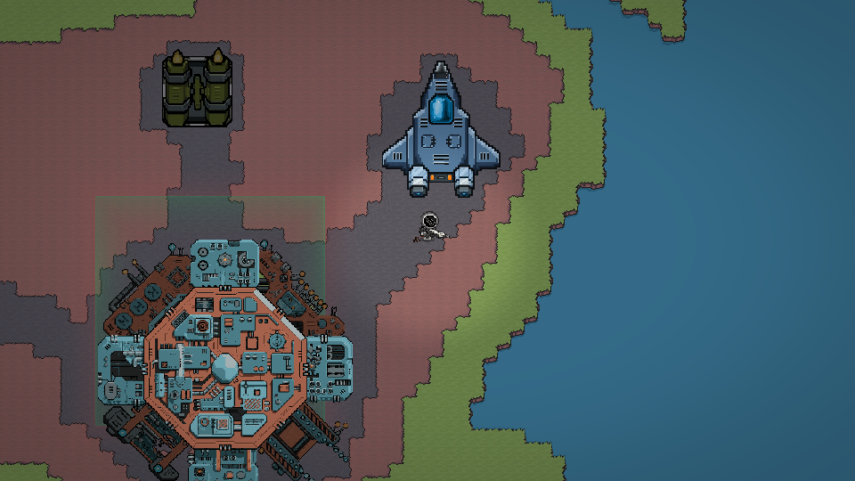
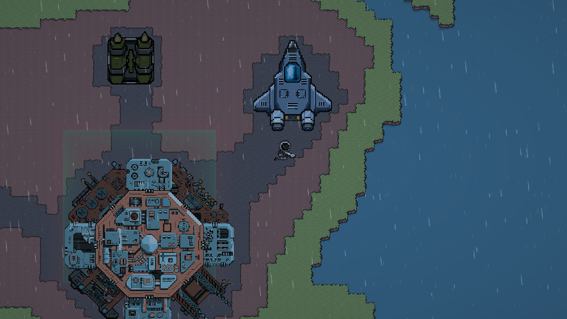
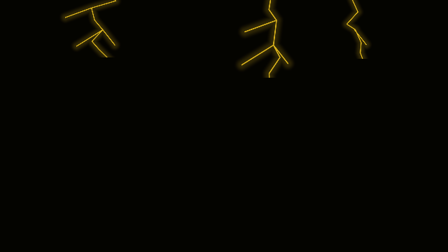

# 날씨 방향과 플레이어 야간 조명 — 2026-11-15

PR: [#734](https://github.com/Team-HJD-21/unity-6-the-developer/pull/734). 실제 Unity6000.3.23f1/URP/Windows DX11 GPU 출력 기준이다.

## 먼저 볼 파일

1. `Assets/Shader/Weather/WeatherCoordinates.hlsl`: 출력 픽셀과 역 ViewProjection으로 월드 XY를 구한다. Blit 입력 텍스처의 반전과 무늬/중력 방향을 분리한다.
2. `Rain.shader`: 실제 월드 -Y 낙하. 화면 원본은 기존 texcoord로 샘플링한다.
3. `DayNightShaderApply`: 기존 Core의 ILocalPlayerActorConsumer로 주입받은 로컬 Player와 상태를 읽는다. 전투/시간/Random을 소유하지 않는다.
4. `DayNight.shader`: 안쪽 반경은 밤 감광0, 바깥쪽으로 smoothstep 감쇠. 별도 광원/Canvas를 생성하지 않는다.
5. `StageCameraEffectsFeature`: 화면 색상을 읽는 패스에 중간 색상 대상을 명시한다.

## 게임에서 달라지는 부분

- 비/번개/폭염의 무늬 방향과 위치가 Blit 버퍼 반전에 뒤집히지 않도록 같은 월드 좌표 기준을 사용한다. 기본 직교2D XY 게임 기준이다.
- Player 주변 안쪽5유닛은 같은 날씨의 낮 색상을 유지하고, 추가4유닛에서 기존 밤으로 부드럽게 이어진다. Inspector의 야간 Player 조명에서 조절한다. 줌이 바뀌어도 월드 반경은 같다.
- 우주선 내부·사망·로컬 actor 해제에는 꺼진다. 새 Player/Match에는 기존 조립부가 다시 바인딩한다. 원격 Player나 고정 화면 중앙을 광원으로 대신 사용하지 않는다.
- 밤은 마지막 화면 셰이더에서 어두워진다. PointLight2D만 추가하면 이 감광을 상쇄하지 못하며 Unlit sprite에도 닿지 않으므로 동일 패스에 로컬 조명을 넣었다. 낮 밝기까지만 복구하며 색을 하얗게 더하지 않는다. 비/폭염 색감을 지우는 기능은 아니다.

## 직접 GPU로 확인한 결과

숨긴 Editor의 Game View는 게임 Update가 돌아도 매 프레임 렌더되지 않을 수 있다. material 값0이나 오래된 backbuffer만으로 화면 결함을 단정하지 않고 실제 Camera.Render→RenderTexture→ReadPixels로 확인했다. 카메라 target과 전역 active RT는 매번 복구했다.

| 검사 | 실제 결과 |
| --- | --- |
| 비 이동 | 640×360 연속 프레임9쌍. 약0.083초마다 아래로18px, 긴 구간19px. 정규화 상관0.82~0.84. 고정 카메라·검은 배경·비 무늬만 분리한 통제 GPU 검사 |
| 야간 조명 안쪽 | 실제 Player 주입 확인. 중앙60px 안의 낮 대비 RGB 평균 차이0.0. 조명 없는 밤보다 평균17.19 밝음(0~255 채널) |
| 조명 바깥 | 조명 유무 RGB 평균 차이0.0. 낮보다 평균25.01 어두움. 화면 전체를 밝힌 결과가 아님 |
| 맑음/비/폭염 | 실제 Scene 카메라로 네 weather enum 중 유효4종을 각각 렌더링. 비 무늬·색감·우상단 폭염 광원/아지랑이 확인 |
| 번개 두 재질 | 35프레임씩. Thunder/Thunder1의 실제 번개 픽셀886/959개, 화면 상단에서 아래로 이어짐. 활성 버전과 별도 제작 재질을 구분해 검사 |
| Shader | Night/Rain/Thunder/Thunder1/HeatWave 실제 렌더 중 오류 없음 |
| 시간 | 기존 자동 source는 약300/600게임 초에 전환. 이 검사에서 시간/날씨 선택 규칙은 수정하지 않음 |

사용자 기존 Material의 밀도/색/속도 설정은 유지했다. 비 이동 계측에서만 임시 복제 재질의 파문/바람을 꺼서 방향을 분리했고 원본 재질을 수정하지 않았다. Windows Standalone·다른 그래픽 API의 완전한 인수를 대신하지 않는다.

## 팀원 전달

- 진태님: Rain/Thunder/HeatWave/DayNight의 좌표 계산과 화면 조명만 바꿨습니다. WeatherManager의 난수·선택 확률·CountTick·저장 writer는 안 건드렸습니다. Main Camera의 DayNightShaderApply에서 안쪽 반경/감쇠 폭을 조절하면 됩니다.
- 영빈님: Player 프리팹이나 이동/공격 코드는 안 바꿨습니다. 조명이 Player를 검색하지 않고 Core가 현재 로컬 actor를 카메라에 주입합니다.
- UI: Overlay HUD의 색상을 밝히는 기능이 아닙니다. 필드 화면에만 적용되며 지도 전환/UI 제작본과는 별도 범위입니다.

검수 PNG·프레임·수치 원본은 로컬 `Docs/Local/Review/CaptureExpansion-20261115/weather/`에 보관한다. 전체 Weather 월드 저장 writer의 미연결 문제를 이 수정으로 해결했다고 표기하지 않는다.

