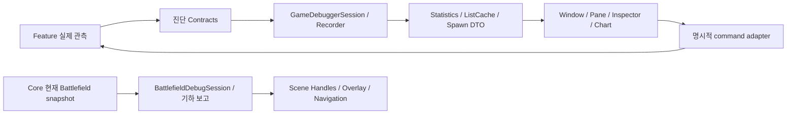

# Game Debugger · Design

2026-10-08 · Game Debugger / Statistics 창 / Battlefield Scene Overlay와 Handles의 공통 기준.

[사용법](../game-debugger-guide.md) · [구현·검증 기록](../../99_archive/planning-links/2026-10-08-game-debugger-batch-results.md)

## 도구의 목적과 범위

개발자가 **상태 관측 → 이상 발견 → 사건/요청 선택 → 공간 확인 → 증거 공유**를 한 흐름으로 수행하도록 한다. 게임 UI의 복제나 가상의 시뮬레이터가 아니다. 공용 기록·시간·경고 도구에 게임별 읽기 전용 패널을 붙이는 구조다.

현재 제공되는 공간/스폰 검사는 이 프로젝트의 Match·Turret·Enemy 계약을 사용한다. 다른 게임에 그대로 이식 가능한 범용 디버깅 패키지라고 주장하지 않는다. CPU/GPU 성능 분석은 Unity Profiler, 일반 오류/stack trace는 Console, 최종 전투 규칙은 해당 Feature 테스트가 담당한다. 이 도구의 기능이 이들을 대체하지 않는다.

| 개발 상황 | 진입 경로 | 실제로 얻는 자료 |
| --- | --- | --- |
| 맵 크기/배치 오류 | Battlefield + Scene Overlay | 중앙 기준 Grid, 선택 셀 bounds/점유/OOB ID, 전체/셀 Frame |
| 전선 형상 이상 | Battlefield → Frontline geometry | 실제 Core 외곽선, 안정적인 변 ID, 면적·길이·법선·삼각형 연결군 |
| 생성 분포 이상 | Encounter + Statistics → Spawn decisions | 동일 요청의 후보·사유·배정·계획/실제 수량·생성 XY |
| 생성량/생존/전력 추이 | Overview + Time series | 서버 수치, 요청/생성/사망/제거 사실, 시간 구간·N/A·A/B |
| 반복 조건 시험 | 시간 toolbar + Encounter repeat | 배속/Pause/Step, 간격/횟수·실패/Match 종료 중지 |
| 재현 자료 공유 | Copy context / Copy evidence / Export | Scene·Match·revision·Grid·Build 라벨, 당시 요청 자료·CSV/JSON |

## 디자인 포맷

### 글꼴과 수치

- Unity 기본 Editor 글꼴과 UI Toolkit 상속을 사용한다. 외부 웹 폰트·프로젝트 게임용 폰트·별도 폰트 다운로드는 사용하지 않는다.
- UI Toolkit 본문/기록 배지는 12px, 보조 문구·축 설명·footer는 11px, 주요 실시간 계기 숫자는 17px bold다. IMGUI 표/필드는 `EditorStyles` 기본 글꼴을 따른다.
- 큰 글자는 생존·전력·시간·가동 수처럼 현재 판단에 필요한 값에만 사용한다. 설명은 foldout/tooltip, 상세 자료는 선택 뒤 나타나는 박스에 둔다.
- 단위는 s, 객체 수/bin, world 좌표, u/u², 비율을 명시한다. 요청 횟수와 생성 객체 수를 같은 종류의 값처럼 명명하지 않는다.
- N/A는 모르는 값이고 0은 관측된 0이다. 손실/중간 수집은 PARTIAL, 현재 실행은 LIVE, 종료 자료는 ARCHIVE, 외부 자료는 IMPORTED로 구분한다.
- 긴 ID는 목록 전체를 채우지 않게 제한하되 상세·선택 가능한 텍스트·Copy/Export에서 접근할 수 있어야 한다. 핵심 사유를 tooltip에만 숨기지 않는다.

### 색상과 레이아웃

- Unity native toolbar·button·field·foldout·helpBox를 사용한다. 어두운 중립 배경, 1px 경계, 6~8px 범주 간 여백을 기본으로 한다. 꾸밈용 대형 배너·그라데이션·아이콘을 추가하지 않는다.
- Dark/Light skin별 데이터 선 색을 분리한다. 동일 의미의 선은 같은 색을 쓰고 A/B는 실선/점선으로도 구분한다. 색만으로 결과를 표현하지 않는다.
- 요청=황토, 생성=초록, 사망=빨강, 일반 제거=보라. 전선=주황, 배정 지점=파랑, 미배정=회색, 선택=명도 강조다. 미배정에는 예산 소진도 포함되므로 모두 실패/제외로 칠하지 않는다.
- `GameDebugVisualStyle`는 의미 색·캐시된 숫자 스타일, `GameDebugger.uss`는 창 배치·간격·테두리·본문 계층을 담당한다. 폰트·색을 개별 패널에서 임의로 증식시키지 않는다.
- 분할 패널 최소 폭은 240px이다. 좁은 창에서는 Single/상하 배치를 권장한다. 긴 표는 열 폭을 줄여 정보를 지우지 않고 상하좌우 scroll한다. 헤더와 본문은 같은 scroll 공간을 사용한다.
- 그래프 기본 높이는 390px(min 280), 확대 Statistics 창은 이용 가능한 높이에 맞춘다. 필터는 접을 수 있으며 독립 조회 창도 공용 Collector를 재사용한다.

## 조작 계약

### 그래프

기본은 최신 60초 Follow latest, 표시 중인 가시 구간 series의 최대값 + 최소 15% 여유로 Auto Y다. 사용자의 X 탐색은 Follow를 해제하고 Y 탐색은 Auto Y를 해제한다. 다시 켜면 자동 범위로 돌아간다. 축 단위·범례·클릭 구간의 값이 화면에 있어야 한다. 기록이 부분적이거나 사망 계약이 없으면 선을 0으로 연결하지 않는다.

Client 표본에서 서버 관측값이 없으면 생성·사망·제거의 미관측 0을 N/A로 표시한다. 실제 양수 이벤트가 기록된 경우 그 사실은 유지한다. 이것은 Client로 서버 이벤트를 복제하는 기능이 아니다.

### Snapshot 검사

- 선택 요청·Follow·몬스터 필터·검색·지도 zoom/pan은 `GameDebugSpawnViewState`로 영역별 보존한다. 창 재구성/직렬화 복원 시 초기화하지 않는다.
- 고정한 요청의 상세가 최근 32개 보존 범위에서 사라지면 명확하게 unavailable로 표시한다. 다른 요청을 동일한 선택처럼 보여주지 않는다. 다시 선택하거나 Follow를 켜서 이동한다.
- 요청 ID는 Match ID와 함께 해석한다. Match를 바꾸면 이전 요청의 동일 번호를 이어서 선택하지 않는다.
- 지도 4px 이하 움직임만 클릭으로 취급하고 그 이상은 이동이다. 중간 버튼 이동, 휠 확대/축소, Frame snapshot을 지원한다. 실제 개체를 선택하면 해당 점도 강조한다.
- 당시 지도는 불변 생성 위치를 보여준다. 현재 Scene에서 객체 선택은 활성 Match만 허용하며, 제거된 개체나 모호한 ID를 임의 대상으로 대체하지 않는다. Scene의 현재 위치를 과거 snapshot처럼 표시하지 않는다.
- Copy request evidence는 선택한 관측 DTO의 JSON이다. 게임 저장·결정론적 Replay·상태 복원 파일이 아니다.

### Scene 도구

- Unity Scene View의 Gizmos와 도구의 Scene layers가 모두 켜져 있을 때만 그리기/선택을 수행한다. Scene 카메라 Alt 탐색을 가로채지 않는다. Grid cell/전선 edge 선택은 상호 배제한다.
- Frame Grid/Frame Cell은 Scene 카메라만 이동한다. Transform·Match·authoring asset을 변경하지 않는다. 셀 ID/bounds는 실제 현재 Grid에서 조회한다.
- Overlay/창/Scene Handles는 같은 선택과 레이어 상태를 공유한다. 창이 없다고 Collector나 Core 계산을 중지하지 않는다.
- Cell/OOB ID는 박스·스크롤 목록으로 표시한다. 표시 상한을 넘은 자료는 숨긴 수를 알리고 Copy evidence에서 전체 ID를 제공한다.
- Play Mode LIVE, Edit Mode PREVIEW, Statistics의 요청 당시 자료를 혼동하지 않는다. 기하 외곽·원시 적 밀도는 실제 교전 전선·전술 우세·위험도로 명명하지 않는다.

### 게임 변경과 안전성

Request/Repeat/Grid override/timeScale은 명시적 command이고 조회·Frame·Copy·Export와 분리한다. Repeat는 최신 Match 계약을 호출하며 pause/실패/Match 종료·변경/소유 pane 해제/reload에서 대기 또는 중지한다. Capture는 새 게임 변경 명령을 숨기지만 기존 반복 요청·무장 조건부 정지를 자동으로 취소하는 모드가 아니다. 살아 있는 적 총량을 요청당 예산과 혼동하지 않는다.

## 코드 구조와 확장 규칙

- Runtime→Editor 참조는 금지한다. Editor용 `SceneNavigation`, `VisualStyle`, `ListCache`, `SpawnViewState`는 Domain/Core 서비스가 아니다.
- Collector/Match 수명은 pane 수와 관계없다. pane별 상태는 serialized view state, 공용 Scene 선택/수집/시간은 Session으로 구분한다. readonly 확대 창을 열어 실행을 중복시키지 않는다.
- 목록 정렬/검색은 자료가 바뀔 때만 계산한다. IMGUI Layout/Repaint마다 전체 8,192 이벤트를 반복 정렬하지 않는다. cache는 runtime 저장/Export에 섞지 않는다.
- Feature별 공통 확장은 먼저 실제 진단 계약에 사실을 추가하고, 보존/손실·집계·상세를 붙인 뒤 화면을 추가한다. 로그 문장을 파싱하거나 Editor에서 가짜 정책 결과를 계산하지 않는다.
- 현재 Enemy 타입/SpawnPoint Scene 선택은 named asmdef에서 Assembly-CSharp를 참조하지 않기 위한 좁은 reflection adapter다. 미래에 공식 entity-resolution 계약이 생기면 이 경계만 교체한다. 다른 게임의 ID 규칙을 추정하는 범용 탐색기는 만들지 않는다.

## 확인 기준과 남는 인수

자동 검사: 상태 직렬화/재구성, 고정 자료 소실·Match 전환, bin 입력 보정, 클릭/드래그 임계값, 표 cache 갱신, XY Frame bounds/ID evidence, Dark/Light 그래프 선 대비, Statistics·Snapshot·native 표 GUI 렌더링. 이전 실제 Spawn/사망/이동 통합 증거는 결과 문서에 따로 기록한다.

사람 확인: OS/Editor DPI와 한글 glyph, Dark/Light 전체 배치, 240px 분할·좁은 dock, 표 가로 탐색/긴 ID 선택, Scene Gizmos toggle/Alt 탐색/경계 pick, 축 드래그와 Follow 복귀, 영상 캡처. 자동 geometry/GUI 검사가 실제 화면의 심미성이나 교전 재미를 인증하지 않는다.

실행 도구의 한계: 일반 AI 상태/타깃 reasoning, 피해/DPS, 네트워크 packet/authority 상세, 성능 trace, 실제 전술 압력/승패 검증은 아직 제공하지 않는다. 필요해지면 해당 Feature가 실제 관측 계약을 제공한 뒤 확장한다. 디자인 검수 과정에서 게임의 미결정 정책을 임의로 확정하지 않는다.

## 레퍼런스

Unity Profiler의 사건/시간 선택→상세 조회 패턴을 Inspector 구성에 적용하고, Scene 위치 이동은 native SceneView.Frame, 월드 표시와 선택은 Handles를 사용한다. 엔진 도구 전체를 복제한 것이 아니라 작업 흐름을 참고했다.

- [Unity Profiler 탐색](https://docs.unity.com/en-us/engine/6000.0/manual/analysis/profiler/window-navigating)
- [Unity SceneView.Frame](https://docs.unity3d.com/6000.0/Documentation/ScriptReference/SceneView.Frame.html)
- [Unity Handles](https://docs.unity3d.com/6000.0/Documentation/ScriptReference/Handles.html)
- [전선 디자인과 Unity/UE 참고 자료](../frontline-visualization-design.md)
