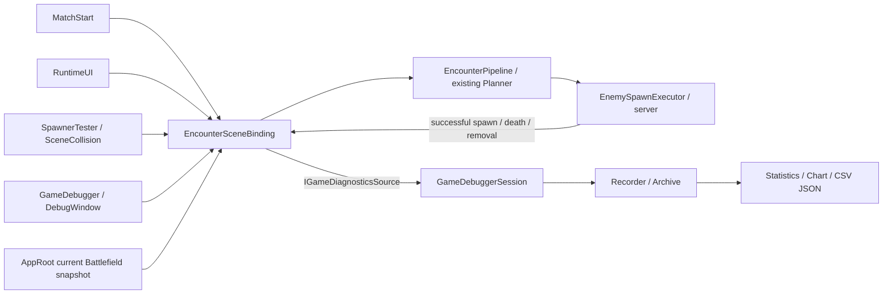

# Game Debugger 사용·연동 가이드

11월 12일 추가: **Battlefield → 지역 Grid · 점령 원본 → 동적 시작 영역 · Host 설정**에서 동적 점유의 시작 셀을 편집할 수 있다. 아래 [CU 시작 영역 확인](#cu-시작-영역-확인)을 참고한다.

11월5일 추가: Overview의 **APP · GAME FLOW**에서 시작/허브/출격/귀환과 저장 슬롯의 새 Mission 복원을 호출한다. **Checkpoint**에서는 등록/필수/누락 writer와 명시 Save/Restore를 확인한다. 현재 Weather writer 누락으로 전체 저장은 비활성이다. [실제 Feature 통합·수동 확인 순서](../02_architecture/01_core/core-feature-integration-guide.md)를 함께 본다. 자동 저장 사건을 추가한 것은 아니다.

기준일: 2026-10-08 · 상태: 기존 집중 검사 54/54·Scene 통합 1/1 성공, 후속 사용성 검사 40/40·관측 보완 검사 31/31 성공(검사 범위 중복 포함) · 화면 조작·영상 인수 확인 별도

[배치 계획](../99_archive/planning-links/2026-10-08-game-debugger-batch-plan.md) · [구현 결과·검증](../99_archive/planning-links/2026-10-08-game-debugger-batch-results.md) · [Core README](../../Assets/Scripts/Core/README.md)

세부 사용법: [반복 Encounter 요청](encounter-repeat-debugging.md) · [요청별 Spawn 판단 검사](game-debugger-spawn-inspection.md) · [전선 디자인/기하 시각화](frontline-visualization-design.md).

[Design.md](00_game-debugger/Design.md)는 글꼴·색·레이아웃뿐 아니라 실제 개발 관측 흐름, 상태 보존, 읽기/명령 경계, 확장 구조와 확인 기준을 규정한다.

이 문서는 **Game Debugger 전체 사용 매뉴얼**이다. 처음 사용하는 팀원은 아래 빠른 시작과 목적별 사용 순서부터 읽는다. 코드/API 경계와 보존 상한은 뒤쪽에 정리했다.

2026-10-15 연결 변경: Initial_Stage의 SinglePlayerHost는 App 소유 연결과 Match를 순서대로 시작한다. 기존 Enemy Network Test 화면의 연결 버튼은 이 경로에서 표시하지 않는다. 단계를 나눌 때는 재생 전에 InitialStageCompositionRoot의 InitialStageNetworkBinding을 Manual로 바꾸고 재생 후 해당 Inspector의 Host/Client 연결 → Match 준비 → Host Match 시작 버튼을 사용한다. Game Debugger의 Encounter 버튼은 여전히 **이미 시작한 Host Match**에 요청할 뿐 서버를 열지 않는다. [현재 검증/미완료 경계](../99_archive/planning-links/2026-10-15-core-sprint-implementation.md).

터렛 논리 ID 연결 후 Scene 정점/선택 전선의 라벨은 `T:01234567`처럼 표시용으로 축약한다. 선택 전선 패널의 tooltip과 Copy 결과, Capture·요청 데이터는 전체 원본 ID를 유지한다. 짧은 라벨을 네트워크/저장 키로 사용하지 않는다. Scene에 터렛을 복제했다면 재생 전 `Tools > TeamHJD > The Developer > Configure Turret Identities`로 누락/중복 제작 키를 명시적으로 정리한다.

## 처음 사용할 때 · 빠른 시작

1. `Initial_Stage`를 열고 Scene 변경을 저장한다. 별도 Battlefield Debug 창을 찾지 말고 `Tools > TeamHJD > Game Debugger`를 연다.
2. 상단 `Monitor ×4`로 Overview / Battlefield / Encounter / Statistics를 동시에 표시한다. 좁으면 `Encounter + Stats` 또는 `Battlefield + Stats`를 사용한다.
3. Play를 누른다. Overview에 활성 Match와 **SERVER**, 생존 수/게임 시간/수집 상태가 나타나는지 확인한다. 첫 자동 Encounter가 이미 생성됐을 수 있으므로 시작부터 0마리라고 가정하지 않는다.
4. Encounter에서 `Squad Preset Order`와 `Max Enemy Count`를 지정하고 `Request Encounter from Current Match Snapshot`을 누른다. 입력한 Order의 **고정 편성**을 요청하며 이 수량은 **요청당 생성 마릿수 상한**이다. #540의 비용 예산은 Runtime이 지역 점유율로 별도 산출한다. 상황별 다른 편성 선택을 시험할 때는 Enemy 런처의 `Plan & Spawn`을 사용한다. [요청 경로와 예산](../02_architecture/08_encounter/encounter-planning-guide.md)
5. Statistics는 기본 `Time series`로 요청·실제 생성·사망 추이를 보여 준다. `View`를 `Spawn decisions / distribution`으로 바꾸면 **왜 이 지점/종류/수량으로 생성됐는지** 후보와 실제 결과를 확인한다.
6. Scene View로 이동해 Gizmos를 켜고 Battlefield의 `Scene layers`를 켠다. `Frame Grid`로 전장을 맞춘 뒤 Grid/외곽과 실제 객체 배치를 비교한다.
7. 이상을 찾으면 요청을 고정하고 `Copy request evidence` 또는 `Copy context`로 자료를 남긴다. 종료/재시작 전에 기록을 보관하려면 Capture / Compare에서 JSON을 Export한다.

재시작할 때마다 창을 다시 열 필요는 없다. 창을 닫는 것과 Match를 종료하는 것은 다르다. 단, 반복 실행을 시작한 pane을 닫거나 재구성하면 그 반복은 중지된다.

## 목적별 작업 순서

### 실시간 상태와 배속 시험

Overview에서 생존/전력/가동 터렛/게임·실제 시간/revision/영역 면적을 확인한다. `연결 및 수집 상태`를 펼치면 Match, authority, 이벤트·표본 수, 손실, 경고를 볼 수 있다. 터렛 표의 ID 버튼으로 현재 Scene 객체를 선택/Frame한다.

상단 시간 toolbar의 배속 또는 직접 입력으로 시험 속도를 조정한다. `Pause`로 Editor를 정지하고 `Step`으로 한 프레임 진행, `Resume`으로 재개한다. `Restore`로 이 도구가 변경한 시간값을 복원한다. 게임시간과 실시간의 변화가 다른 것은 정상이며, 네트워크의 다른 Client까지 멈추는 도구가 아니다. `timeScale = 0`은 Editor Pause와 다르므로 Step을 사용할 수 없다.

### Grid와 전선 형상 확인

1. Battlefield의 `Scene 표시 / 레이어`를 펼친다. 빠른 버튼 `Grid` 또는 `Topology`로 기본 표시 조합을 적용한다.
2. `Uniform Grid`, `Territory`, `Frontline`, `Cell occupancy`, `Geometric normals`, `Vertex labels`를 필요한 것만 켠다. 겹쳐 보이면 labels/occupancy부터 끈다.
3. `Pick cell (left click)`을 켜고 Scene에서 셀을 클릭한다. 또는 `선택 셀 / 범위 초과 개체`의 Cell ID를 직접 입력한다. `Frame Cell`로 선택 셀에 이동한다.
4. 셀의 bounds/Player·Turret·Enemy ID와 OOB(범위 밖) 목록을 확인한다. `Copy cell / OOB evidence`는 화면 표시 상한과 무관하게 전체 ID를 복사한다.
5. Frontline geometry Inspector에서 변을 선택해 강조·양쪽 법선을 확인한다. Grid 셀 pick과 전선 변 pick은 서로 배제된다. Alt를 이용한 Scene 카메라 탐색은 유지된다.
6. Scene 안의 `Battlefield` Overlay도 동일한 표시·선택 상태를 사용한다. Overlay가 숨겨져 있으면 Scene View의 Overlays 메뉴에서 Battlefield를 표시한다. 창과 Overlay의 설정은 공유하므로 별도로 맞출 필요가 없다.

**Edit Mode는 PREVIEW**로 정적 터렛 배치를 보여 주고, **Play Mode는 LIVE**로 실제 Match snapshot을 보여 준다. 통계 화면의 요청 당시 지도는 이 둘과 달리 과거 자료다. 외곽선/법선은 기하 정보이며 실제 교전 방향이나 방어 우세도를 확정하는 값이 아니다.

Grid 크기를 바꾸려면 `공용 Grid 기본값 / 에셋`에서 Center XY, Map Width/Height, Cells X/Y를 편집한다. Center는 좌측 하단이 아닌 **Grid 중앙**이다. 에셋 값은 이후 생성되는 Match 기본값이며, 활성 Match 변경은 `현재 Match Grid override / 명시적 적용`에서 값을 입력한 뒤 `Apply to Active Match`를 눌러야 한다. `Restore Authored Defaults`로 해당 Match를 기본 설정에 맞춘다.

### 일회 스폰 → 반복 실험 → 원인 확인

1. Encounter에서 preset/요청 예산을 정하고 한 번 Request한다. 최근 요청 표에서 source, 계획/실제 수량, 성공·실패를 확인하고 요청을 선택해 상세를 펼친다.
2. 자동 반복은 `연속 Encounter 요청 / 시뮬레이션`에서 간격/최대 횟수/clock을 정하고 `Start repeat`한다. 첫 요청은 한 간격 뒤다. `0`회는 무제한이며 생존 적이 누적될 수 있다. 종료는 `Stop repeat`다.
3. Statistics를 `Spawn decisions / distribution`으로 바꾸고 Request를 선택한다. `Follow latest`를 끄면 보고 있는 요청이 새 요청 때문에 바뀌지 않는다.
4. `Candidates · eligibility and allocation`에서 지점별 cell/초기 적 수/Cell service·pending·final score/Point service/전선 거리/배정 세트/Reason을 확인한다. 새 정책은 같은 셀의 예정량을 공유하고 실제 생성 이력을 유지해 반복 편중을 막는다. 상세는 [Spatial Spawn Distribution](../02_architecture/08_encounter/spatial-spawn-distribution.md). 검색은 지점 ID 또는 사유, `Monster`는 계획/실제 개체와 지도 실제 점을 필터링한다.
5. `Planned composition · actual result`로 계획 대비 실제 수를, `Actual objects · immutable spawn positions`로 종류/Network ID/생성 XY를 확인한다. 지도는 휠 확대·드래그 이동, `Frame snapshot`으로 전체 범위를 다시 맞춘다.
6. 표/지도에서 지점 또는 개체를 선택하고 `Select ... in Scene`으로 현재 Scene 대상을 찾는다. **같은 활성 Match**만 가능하며 종료·Imported 기록의 과거 객체를 임의로 선택하지 않는다.
7. `Copy request evidence`로 판단 자료를 공유한다. 고정한 요청의 상세가 최신 32개 보존 범위에서 사라졌다면 다른 요청을 선택하거나 Follow latest를 켠다.

스폰 지점은 이름이 Left/Right인 두 개로 제한되지 않는다. **같은 Scene의 모든 `SpawnPoint` 컴포넌트**를 계획 요청 직전에 등록하므로 계층 밖의 배치, 추가/복제/삭제도 다음 요청에 반영된다. 비활성/점령 지점은 등록 자료에 남되 스폰 후보에서는 제외된다. Editor에서 복제·빈 ID는 고유 ID로 자동 보정되어 Scene 저장에 포함되고 Undo할 수 있다. Play Mode 복제는 객체 수명 동안만 별도 ID를 유지한다. 다른 Scene의 지점은 섞지 않는다.

**등록 = 모든 지점에서 매번 생성**은 아니다. Grid 밖/Player·Turret 점유/비활성/점령, 기존 적 밀도, 전선 거리, preset 세트 크기와 요청 예산에 따라 일부 지점에만 배정된다. 미배정은 회색이며 후보의 `Reason`이 실제 근거다. 모든 지점을 시험하려고 필터를 우회하거나 예산을 지점마다 곱하지 않는다. 자세한 정책은 [Spawn 판단 검사](game-debugger-spawn-inspection.md), 반복 종료 규칙은 [연속 요청](encounter-repeat-debugging.md)을 참고한다.

### 그래프 분석과 큰 화면

Statistics에서 `View = Time series`, 기록 A를 LIVE/종료 Match/IMPORTED 중 선택한다. 기본은 요청·생성·사망을 함께 표시한다. 다른 지표는 `Chart settings / filters`에서 `Requests / Spawned / Died together`를 끄고 `Single metric`을 선택한다. Bin은 한 점이 집계하는 초 단위 구간이다.

최신 추적은 `Follow latest`, Y 자동 범위는 `Auto Y`다. 과거를 가로 스크롤하면 Follow가 꺼지므로 최신으로 돌아올 때 다시 켠다. `Open in window`로 Statistics만 크게 띄우면 같은 기록을 독립 필터/축으로 조회할 수 있다. X/Y 조작과 단축 입력은 아래 그래프 탐색 항목을 참고한다. 수량 비교는 같은 clock/bin과 필터를 맞추고 B 기록을 지정한다. B는 점선이며 실시간 수집기를 추가로 생성하지 않는다.

### 사건에서 멈추고 기록 공유

Timeline에서 검색 후 사건 행을 선택해 상세를 확인한다. 특정 상황 전후를 찾을 때 `Bookmark`로 메모를 남긴다. 요청 실패/터렛 파괴/OOB 조건을 무장하면 신규 관측 시 Editor가 한 번 정지한다. 원인 확인 후 Resume하고, 다음 조건도 잡으려면 `Rearm`으로 재무장한다.

Capture / Compare에서 Commit/Build 라벨을 입력하고 `Stamp build/commit label on live record`로 기록에 반영한다. `Scene Capture preset`은 공유용 표시 프리셋이지 자동 screenshot/영상 녹화가 아니다. 화면을 직접 캡처하고 `Export run JSON + metadata`, `Export events CSV`, `Export samples CSV`로 자료를 저장한다. 이전 JSON은 `Import read-only comparison JSON`으로 불러와 A/B로 비교한다. Import는 게임을 복원하거나 다시 실행하지 않는다.

팀원 공유에는 **화면 + Scene/Match/revision + 문제 Request ID + preset/예산 + JSON 또는 CSV**를 함께 남기는 것을 권장한다. Editor 완전 종료 전 Export하지 않으면 SessionState 기반 기록은 다음 Editor 세션에 보존되지 않는다.

## 빠른 문제 해결

| 증상 | 먼저 확인할 것 |
| --- | --- |
| NO RECORD / N/A | Play Mode, 활성 Match/진단 source, SERVER 권한. Client 미관측 수치는 0으로 해석하지 않음 |
| Request 비활성/실패 | Capture mode 해제, 현재 Match/NGO Host/Executor/catalog 준비, preset/예산, 화면의 반환 사유 |
| 스포너를 늘렸는데 생성이 적음 | 후보 표에 ID가 있는지 확인 → Reason/완전한 preset 세트/전체 요청 예산 확인. 지점 수만큼 예산이 자동 증가하지 않음 |
| Scene Grid/전선이 안 보임 | Scene Gizmos + Scene layers + 해당 레이어, `Frame Grid`, LIVE/PREVIEW 상태. 전선은 유효한 비공선 터렛 3개 이상 필요 |
| 과거 선택이 unavailable | 상세 보존 상한에 의해 제거됐는지 확인. 다른 요청/Follow latest 또는 이미 Export한 기록 사용 |
| 그래프가 최신으로 안 움직임 | 수동 X 탐색으로 Follow latest가 꺼졌는지 확인 |
| 반복이 중지됨 | 실패/준비·권한 상실/Match 변경/reload/소유 pane dispose와 표시된 중지 사유. 설정 변경 후 Stop→Start |
| Frame은 되는데 과거 개체를 못 찾음 | 종료/Imported 기록 또는 제거된 개체인지 확인. 당시 XY는 지도에서 조회 |

## 여러 기능 동시 보기

상단 `Layout`에서 `Single`, `2 · Columns`(좌우), `2 · Rows`(상하), `4 · Panels`를 선택한다. 기본은 좌우 2분할이다. 분할 경계선을 드래그해 크기를 조절할 수 있다. 각 영역의 `P1~P4` 옆 드롭다운으로 표시할 기능을 선택하며 **같은 Statistics 기능을 두 영역에 열어 서로 다른 지표를 비교**할 수도 있다.

- `Battlefield + Stats`: 공간/터렛 상태와 통계를 동시에 표시한다.
- `Encounter + Stats`: 요청 버튼·요청 결과와 실제 생성량을 동시에 표시한다.
- `Monitor ×4`: Overview / Battlefield / Encounter / Statistics를 한 화면에 배치한다.
- 클릭·키보드 포커스한 영역에 강조 테두리가 표시된다. 좌측 탐색 메뉴는 `ACTIVE · P#` 영역의 기능만 바꾼다.
- 기능 선택, A/B 기록 선택, 지표, 필터, bin/clock, 검색·북마크 입력과 기능별 스크롤 위치는 **영역별** 상태다. Single로 바꾸어 숨긴 영역도 다시 열면 설정을 유지한다. 창/domain reload의 직렬화 대상이며 게임 저장 데이터는 아니다.
- Spawn Inspector의 선택 요청·Follow·몬스터 필터·검색·zoom/pan도 영역별 보존한다. 오래된 고정 자료가 상한으로 사라지면 다른 요청으로 조용히 전환하지 않고 unavailable 안내를 표시한다.
- Match·기록 수집·Imported 기록 슬롯·시간 도구·Scene 표시 옵션/셀 선택·조건부 정지의 무장 상태는 **공유**한다. 여러 Battlefield 영역에서 명령을 실행하더라도 같은 활성 Match/에셋에 적용된다. 분할은 별도 Match나 별도 Scene 시뮬레이션이 아니다.

기능 상태는 `GameDebuggerPaneState`, 영역 UI는 `GameDebuggerPane`, 창 배치·공용 toolbar는 `GameDebuggerWindow`가 담당한다. 레이아웃 전환은 UI 구독만 재구성하고 공용 Collector/Recorder를 다시 만들거나 Encounter 요청을 발행하지 않는다. 좁은 dock에서는 Single/상하 배치가 편리하며, 4분할은 넓은 창을 권장한다.

## CU 시작 영역 확인

1. `Initial_Stage`에서 Host Match를 시작하고 Battlefield의 **지역 정책**을 `Dynamic`으로 바꾼다. Reset 확인창을 승인해야 적용된다. 기본은 CU가 있는 셀 하나이며 정적 거리 잠금은 적용하지 않는다.
2. **Scene 점령 Grid**를 켠다. **임시 판정 삼각형**은 계산에 쓴 기하를 보는 옵션이다. 실제 점유 원본은 Grid 셀이다. CU도 위치 정점으로 참여하므로 CU와 터렛 두 개가 비공선이면 삼각형을 만들 수 있다.
3. **동적 시작 영역 · Host 설정**을 펼친다. 빈 목록은 CU 1셀 기본값이다. `셀 추가`는 CU 셀 좌표로 행을 만든다. X/Y는 월드 좌표가 아닌 현재 지역 Grid의 셀 인덱스다. CU 셀을 포함하고 상하좌우로 연결되게 편집한다. 32행마다 페이지를 나눈다.
4. **시작 셀 적용 / 점유 Reset**을 누르고 확인한다. 편집만으로 게임 상태가 바뀌지는 않는다. 범위 밖·CU 미포함·대각선만 연결된 목록은 거부하고 기존 설정과 점유를 유지한다. **CU 1셀 기본값**도 목록을 비울 뿐이므로 적용 버튼을 눌러야 한다.
5. **CU 시작 / 연결 제외 셀**을 확인한다. 시작 영역과 활성 터렛의 투영 후보를 합친 뒤 CU에서 상하좌우로 연결되지 않은 후보는 제외한다. 터렛 OFF/파괴 후에도 CU 시작 영역은 남고 다른 터렛의 활성·전력 예약은 유지한다. 과열을 OFF로 취급하지 않는다.

모드 변경과 **CU 지역 Grid 설정 다시 읽기 / Reset**은 명시 시작 셀을 지우고 기본값으로 돌아간다. Client에서는 설정을 바꾸지 못하며 Host의 확정 점유만 표시한다. 런타임 편집은 Scene/Prefab에 저장되지 않는다. 시작 설정의 Checkpoint writer는 추가됐지만 실제 Weather writer 등 필수 원본이 없으면 전체 Save는 계속 차단된다. 물·이동 불가 셀 마스크와 일반 Enemy 스폰 제한은 이번 도구의 완료 범위가 아니다. [API·저장 호환성](../02_architecture/01_core/core-sprint-region-and-request-api.md#cu-시작-영역-설정과-저장)을 함께 참고한다.

## 창 구성과 데이터의 뜻

핵심 수치는 Overview의 큰 계기 카드로, 터렛·요청·Timeline은 고정 높이의 스크롤 표로 표시한다. 요청/이벤트를 선택하면 하단 상세를 펼칠 수 있으며 긴 메시지는 기본 목록에 풀어쓰지 않는다. Grid 기본값/override, 연결 정보, 필터/설명은 범주별 Foldout으로 구분한다. Unity Editor의 기본 toolbar·표·접힘 구조와 Dark/Light 색상을 사용한다.

| 패널 | 제공 기능 |
| --- | --- |
| Overview | LIVE/PREVIEW, authority, 게임/실제 경과, 수집/손실, 생존 수·귀속 불명 수, 전력, 영역 면적·외곽 길이, 연결 경고, 터렛 목록 |
| Battlefield | 기존 공용 Grid authoring/current override, 레이어·셀 상세·Scene 설치 명령, 현재 터렛 표 |
| Encounter | 기존 snapshot Request, 최근 200개 요청 결과의 구조화된 표/선택 상세, 명시적 연속 요청 도구 |
| Statistics | 요청/실제 생성/실제 사망/제거 선 그래프, 기타 단일 지표·A/B, 당시 Spawn decisions / distribution, 큰 독립 통계 창 |
| Timeline | Match/요청/실제 생성·사망·제거/터렛 파괴·복구/snapshot revision을 시간순 표로 표시, 선택 상세·검색·북마크·조건부 정지 |
| Capture / Compare | Scene 캡처 메타데이터, 조회용 차트, JSON/CSV 내보내기, import·A/B 비교 |

상단 시간 도구는 로컬 Editor 전용이다. 0.25/0.5/1/2/4배 또는 0~8 직접 입력, Pause/Resume/Step/Restore를 제공한다. `fixedDeltaTime`, FPS, 네트워크 시간을 자동 조절하지 않는다. timeScale=0이면 게임시간만 멈추므로 Step은 비활성이다. Step은 Unity 한 프레임이며 결정론적 Match tick이 아니다. Host의 Pause가 다른 Client를 멈추지는 않는다.

Capture mode에서는 시간·기존 게임 변경 명령을 비활성/숨김 처리한다. 표시 옵션, 기록의 조회/Export와 메타데이터 라벨은 게임 상태를 변경하지 않는다. 이미 무장한 조건부 정지는 별도 상태다. 시간 변경은 창을 닫아도 유지하며 Restore, Play 종료, assembly reload 또는 Editor 종료 때 소유한 값만 복원한다. 외부가 timeScale을 바꾸었다면 그 값을 덮어쓰지 않는다.

## 집계·누락·보존

### 그래프 탐색 / 큰 통계 창

- `Open in window`는 Statistics 전용 창을 연다. 현재 영역의 조회 설정을 복사하고 동일 Collector/기록을 조회한다. 이후 필터·축·기록 선택은 독립적이며 Game Debugger를 닫아도 공용 수집은 유지된다. 별도 Battlefield 창을 복구한 것이 아니다.
- `Follow latest`는 기본으로 최신 60초를 따라간다. 가로 scrollbar·가운데 드래그·Shift+휠로 과거를 탐색하면 Follow를 끈다. 다시 켜면 최신 구간으로 복귀한다. X+/X− 또는 Ctrl+휠로 시간 폭을 확대/축소, Fit으로 전체 기록을 표시한다.
- `Auto Y`는 **현재 X 가시 구간의 표시 중인 series** 최댓값에 최소 15% 여유와 보기 좋은 눈금을 둔다. 세로 scrollbar·휠/가운데 드래그 또는 Y+/Y−/Alt+휠은 수동 범위로 전환한다. Auto Y를 다시 켜면 가시 구간에 맞춘다.
- X축은 Game/Real seconds, Y축은 수량/bin 또는 선택 지표의 단위다. 요청은 **요청 횟수**, 생성/사망/제거는 **객체 수**다. 범례로 각각의 선을 끌 수 있으며 비교 기록 B는 점선으로 구분한다. 선택한 구간의 A/B 값을 그래프 아래 표시한다.
- [Spawn 판단/분포 Inspector](game-debugger-spawn-inspection.md): 요청 시점의 Grid 점유·전선·후보 적합성/제외 이유·계획/실제 수량·실제 생성 XY를 조회한다. 현재 Scene 상태로 과거 snapshot을 다시 계산하지 않는다. 같은 지점/몬스터의 반복 계획 항목은 합산해 actual과 비교한다.

- 실제 생성은 서버의 `NetworkObject.Spawn()` 성공 후, 사망은 `EnemyHealth`가 HP 소진을 확정했을 때, 제거는 Executor의 untrack/Despawn 사실이다. 한 사망 뒤 제거도 기록될 수 있으며 같은 사건을 합산한 처치 수가 아니다. 현재 생존 수 차분이나 로그 파싱으로 생성/사망량을 추측하지 않는다. 사망 계약 없는 이전 기록은 N/A다.
- 서버 현재 생존 수는 해당 Match에 귀속된 Executor 추적 수다. 무 context 생성은 별도 귀속 불명 수이며 차트에 현재 Match 생성 사실처럼 넣지 않는다. Client에 서버 집계 계약이 없으면 N/A다.
- 서버 관측 불가 표본이 있는 시간 구간에서 생성/사망/제거/누적의 관측 없는 0은 N/A다. 실제 수신한 양수 사실은 버리지 않는다. 현재 Client에 서버 전체 사건 복제 계약이 제공된다는 뜻은 아니다.
- 수치 표본은 0.25초 실제 시간 간격, 연결 검사는 1초, UI 갱신은 최대 4Hz. 터렛 topology 면적/외곽 길이는 geometry 변경 때 재계산한다. 정적 데이터와 동적 점유 revision을 혼동하지 않는다.
- 기본 bin은 게임시간 5초. Real clock은 실제 경과시간으로 구간을 바꾼다. bin 상한 2,048개를 넘으면 실제 폭을 늘리고 축에 표시한다. 표본이 없는 bin은 N/A, 없는 값을 0으로 잇지 않는다.
- source/preset/type/point 필터는 **이벤트**에만 적용한다. Alive/Power/Ratio/Area/Length는 Match 전체 표본이다. type/point별 계획 수 계약이 없으므로 해당 필터에서 Planned/Executed/Failures 차트는 N/A다.
- `PARTIAL`은 중간 수집 시작, sequence gap, 상한 초과 또는 정상 종료 마커 부재를 뜻한다. partial 기록의 이벤트 수는 남아 있는 관측량이며 총량 보장이 아니다. 관측 없는 event bin을 0으로 표시하지 않는다.
- Runtime 최근 이벤트 4,096개. Editor 실행 8개, 실행별 이벤트 8,192개·표본 7,200개·마커 512개 상한. overflow 상태를 표시한다. JSON import는 16MiB 이하/schema 1, 동일 Match ID와 유효 시간/수량을 검사한다.
- 종료 기록은 snapshot/활성 Match와 분리된다. domain reload/다음 Play에서도 Editor `SessionState`에 최대 8MiB를 보존하며 초과하면 오래된 실행을 버린다. Editor를 완전히 종료하기 전 필요한 기록은 JSON Export한다. 게임 상태·Replay·영속 저장 기능이 아니다.
- JSON에는 Scene/Unity/수동 Commit·Build 라벨/seed/content/stage/difficulty/mode/초기 Grid/clock policy와 원시 이벤트·표본·마커가 담긴다. 런타임 Grid override의 모든 설정 이력을 재현하는 파일은 아니다. CSV는 사실 이벤트와 표본을 각각 내보내고 숫자는 invariant culture, 문자열은 따옴표·수식 실행 방어를 적용한다.

## 조건부 정지

Timeline에서 요청 실패, 터렛 파괴, Grid OOB를 각각 무장한다. 한 조건이 발생하면 로컬 Editor를 한 번 정지하고 이유를 기록한다. Resume만 누르면 계속 재정지하지 않는다. `Rearm conditions`를 눌러 다음 관측을 기다린다. 과거 buffer 재생은 정지를 발생시키지 않는다. 이미 파괴됐던 터렛을 뒤늦게 수집했다고 신규 파괴를 만들지 않는다. OOB가 지속 중이면 재무장 후 다시 정지할 수 있다.

## Runtime / Editor API 경계

`IEncounterDebugCommandTarget.TryRequestCurrentEncounter(preset, max, source, out result)`는 bound 최신 snapshot을 사용한다. 명시적 snapshot과 source를 받는 overload, 이전 signature도 유지한다. Match ID와 Host/Executor 준비를 검사한다. 준비가 안 된 수동 요청은 즉시 사유를 반환하며 공간 검사를 우회하지 않는다.

`IGameDiagnosticsSource`는 bounded recent buffer, sequence, bound Match, 게임/실제 clock, 서버 권한, 생존/귀속 불명 수와 `DiagnosticEmitted`를 제공한다. `GameDiagnosticEvent`는 MatchId/revision/RequestId/source/preset/type/point/entity/planned/actual/time/message의 불변 사실이다. RequestId는 이 런처의 Match 내 상관 ID이며 **조수빈의 PlanId나 재시도 idempotency token이 아니다**. 요청 revision은 계획 입력 버전이지 생성 순간 최신 revision 보장이 아니다.

`EncounterExecutionContext`는 실제 Executor 기록과 요청을 연결한다. 기존 `Execute(instruction)`/`Spawn()`는 독립 Feature 호환용으로 유지하나 네 프로젝트 진입점은 context·snapshot 공통 경계를 사용한다. 다른 Feature가 직접 호출하면 telemetry coverage는 별도로 연결해야 한다. 관측 subscriber 예외는 실제 생성 흐름을 중단하지 않는다.

## 구현하지 않은 지표 / 별도 인수

10월 15일 정식 Encounter API에 GUID RequestId 기반 중복 실행 방지를 추가했다. 통계의 정수 RequestId는 여전히 실행 상관 번호이며 GUID/조수빈의 PlanId와 다르다. 아래 기존 지표의 미구현 표기는 정식 API의 중복 Ledger까지 미구현이라는 뜻이 아니다. [정식 요청 규약](../02_architecture/01_core/core-sprint-region-and-request-api.md)

실제 후보별 셀 점유/전선 거리/ID 순위·제외 사유·배정은 이제 Snapshot Inspector에서 확인한다. 가상의 통합 위험 점수, 공식 PlanId·중복 실행 방지, 피해/DPS/전술 압력·우세도는 여전히 N/A다. 연결 경고는 SpawnPoint ID/위치, topology 부족, OOB, 진단 소스 수와 TargetableComponent 존재를 검사하며 공격 성공까지 인증하지 않는다. 정확한 snapshot 발행 timestamp는 없으므로 observed age와 구분한다.

## 2026-10-15 지역 정책 비교

Battlefield 패널의 **지역 Grid · 점령 원본**에서 Static/Dynamic 모드를 선택한다. 기본값은 Static이며 변경/설정 다시 읽기는 확인 후 새 Grid 세대로 적용한다. Static으로 돌아가면 첫 구역부터 적용하므로 구역 밖 활성 터렛은 잠기고 꺼질 수 있다.

`Scene 점령 Grid`는 Match가 확정한 셀을 녹색으로 표시한다. `임시 판정 삼각형`은 Dynamic 입력 계산 자료를 별도로 표시한다. 셀 원본은 RegionRuntime이고 Editor가 점령을 계산해 저장하지 않는다. Battlefield 참가자 밀도 Grid와 다른 데이터다. Dynamic에서는 터렛을 지역 잠금으로 제한하지 않고, OFF/파괴 시 점령만 회수하며 남은 활성/전력을 유지한다.

실제 Initial_Stage의 정책 전환·3개 활성/1개 OFF는 자동 검증했다. Scene Drawer의 색상/겹침·해상도별 시각 인수와 실제 Host/Client 지역 전송은 별도다. [API·경계](../02_architecture/01_core/core-sprint-region-and-request-api.md)

## 사용성 레퍼런스

[Unity Profiler의 선택 구간→상세 패널](https://docs.unity.com/en-us/engine/6000.0/manual/analysis/profiler/window-navigating)과 [Unreal Insights의 그래프 탐색/축 조정](https://dev.epicgames.com/documentation/unreal-engine/using-the-timing-panel-in-unreal-insights-for-unreal-engine?lang=en-US)을 참고하여 공용 toolbar, 접힘 설정, 선택 가능한 표/상세, 축 탐색과 최신 추적을 적용했다. 엔진 성능 지표를 모방하지 않고 실제 게임 관측 사실에 적용한 사용성 설계다.

자동 통합 검사는 충돌 adapter 메서드를 직접 호출했다. 독립 Statistics 창의 GUI 렌더링/레이아웃 검사는 통과했다. 물리 `OnCollisionEnter2D`, 실제 Game UI 클릭, 다중 Client 동기화, 그래프 시각 인수·dock layout·영상은 별도 시각/조작 확인이다. 전체 전투·지역 해금·승패 한 사이클 완료를 이번 도구 배치 완료와 동일시하지 않는다.

## 11월5일 추가 — Steam과 낮밤

Overview의 **PLATFORM · STEAM**에서 Steam 설정 에셋을 선택하고 Use Steam/AppID를 설정한다. 새 Play에서 실제 초기화 상태·사용자와 실패 이유를 확인한다. 친구 공개2인 로비 생성/ID 참가/초대 Overlay/나가기 API를 제공하며 로비 참가가 NGO 게임 접속을 시작하지는 않는다. [Steam 사용법](../02_architecture/04_networking/steam-api.md)을 따른다.

**Match 환경 · 현재**는 day/night와 Host의 다음 전환까지 남은 게임 초를 표시한다. 기본은 낮300/밤300초이며 정지/배속은 공용 필드 시계를 따른다. [낮밤 API](../02_architecture/09_world/day-night-api.md)에서 Weather/저장 연결과 기존 CountTick의 차이를 확인한다.

APP · GAME FLOW의 시작/출격/귀환은 검은 배경·하단 바의 로딩 화면을 사용한다. 자동 확인을 마친 항목과 PL 최소 확인은 [최신 결과](../01_planning/02_implementation-records/2026/11/2026-11-05-day-night-steam-results.md)에 정리했다.

## 정적 확보와 장시간 연결 검사

현재 메뉴는 `Tools → TeamHJD → Game Debugger`다. Battlefield의 지역 Grid 패널에서 유효 지형 기준 점유율, 별도의 해금 목록, 구역별 확보 초·실제 팀 피해·생존 참가자/적·정지 이유를 확인한다. 펼친 ‘확보 시험값’은 현재 Host Match에만 적용한다. 기본 규칙과 데이터의 의미는 [정적 확보 API](../02_architecture/02_match/static-region-capture.md)를 먼저 확인한다.

‘검증용 Player / CU 피해 보호’는 Play 중 현재 Host 객체에만 붙이는 개발 표식이다. 이동·전투·시계는 계속 진행하고 일반 Release에서는 무효다. Scene/Prefab에 저장하지 않으며 Play 종료로 해제된다. 보호·배속·짧게 바꾼 확보 시간 등 시험 조건을 캡처 기록에 명시한다. 이 결과를 정상 난이도·사망/안전장치 통과로 보고하지 않는다.

### 정규 생산 확인 (2026-11-14)

Stage_1의 정식 Match는 Game Debugger 없이도 자동 생산한다. Encounter 상단의 **Match 정규 생산** 박스에서 다음 요청/간격(게임 초), 요청 회차/마지막 결과, 공용/Field 시각을 확인한다. Statistics의 `MatchProduction` Source가 실제 정규 요청이다. 아래 수동/연속 버튼은 추가 검수 요청이며 자동 생산을 시작하는 버튼이 아니다. 기본값·권한·저장/제약은 [정규 생산 API](../02_architecture/08_encounter/encounter-production-api.md)를 따른다.

### 점유 확장과 내부 추가 출현 확인

Encounter 패널의 최근 점유 추세는 Field 기준 관측 시간·순증·확장 횟수다. 정적 확보 한 번, 복원, 첫 CU는 연속 확장이 아니다. additionalSpawnSettings를 열면 다음 자동 계획의 관측/비중/예고/쿨다운을 조절할 수 있다. 원격 예고 연결 전에는1인 Host에서만 내부 정책이 동작한다.

Timeline/Statistics의 `SituationEvent`에서 RequestScheduled는 예고·준비 편성이며 아직 actual0이다. 같은 원인 요청과 World 영역을 확인하고, 이후 RequestCompleted의 계획/실제를 대조한다. 주황 원은 실제 출현 예정 영역을 둘러싼 표시다. 정규 적과 별도 예산을 더한 것이 아니며 중간 보스/Enemy 스킬 소환과 구분한다. JSON·CSV에는 원인 ID와 영역 XY/크기도 포함된다.

### 개인 / Host 성장 저장 상태

Overview의 CHECKPOINT 아래 ‘개인 / Host 성장 저장’을 펼친다. experience/base-stats는 개인, field-turrets는 Host 캠페인/Stage 성장이다. 요청 revision과 디스크 완료 revision이 같아야 해당 쓰기가 끝난 상태이며, 대기 XP는 기본2초 합치기다. 오류는 실패로 표시한다. 아래 월드 저장/복원 버튼은 필수 writer가 모두 있어야 사용할 수 있고, 성장 저장 성공과 전체 월드 성공은 별개다. 전력 부족으로 과거 ON이 OFF 복원된 사유는 기존 Alert와 Controller.GrowthRestoreWarnings에서 확인한다.
