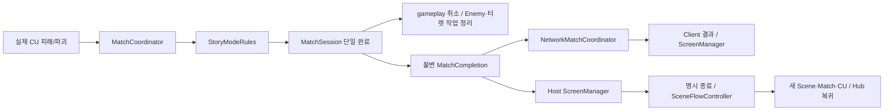
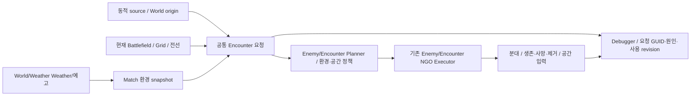

> 보관 문서 · 2026-11-05 교체 전 스냅샷
> 기준 커밋: `1a03e9a9164e5db94cbc8775162467d08cf63a3b`. 당시 설명·검증 근거이며 현행 실행 지시가 아니다.

# Core 5·6주차 구현 인수 — 2026-10-26

상태: 로컬 Core 배치 B0~B9 기술 검증 완료, 팀/PR 인수 대기. 아래 10/26 검증은 당시 커밋의 이력이다. 10/28에는 CU 초기화 PR #569가 main에 반영됐으며 전체 Core 통합은 로컬에 있다.

**10/28 PL 인수 갱신:** 현재 실제 프로젝트의 요청된 수동 확인은 사용자 보고 기준으로 완료됐다. [인수 범위와 PR 조건](https://github.com/Team-HJD-21/unity-6-the-developer/blob/1a03e9a9164e5db94cbc8775162467d08cf63a3b/Docs/planning/2026-10-28-core-acceptance.md)을 최신 기준으로 읽는다. 아래에 남은 팀/PR 인수는 분리 head·Code Owner·실제 Client/팀 Build 범위이며 기존 수동 조작을 다시 처음부터 수행하라는 뜻이 아니다.

## 현재 작업 프로젝트 — 2026-10-28 갱신

실제 작업·수동 확인은 `D:/Dev/Unity/Unity_3D_CBC`의 `codex/core-sprint-20261026-integration`에서 한다. 최신 main `7802e0c6`을 포함하며 이전 통합 후보의 기능과 사용자 글꼴·개인 문서를 보존했다. Validation worktree는 과거 검증 이력으로 남기며 작업 프로젝트를 그쪽으로 바꾸지 않는다.

이 프로젝트의 `Assets/Scenes/Gameplay/Initial_Stage.unity`를 실행한 뒤 Game 화면을 클릭하고 Escape를 누르면 운영 메뉴가 열린다. `AppRoot.Update → AppScreenPresenter.Render → ScreenManager.ShowMenu/Back` 경로다. 현재 원래 폴더에서도 이 구현을 사용할 수 있다.

## 검증 기준과 작업 위치

- 기준 main: `1560df6c`. 2026-10-26 재조회에서도 추가 변경이 없었다.
- 최종 검증 코드: `534961d06fb1554c3069f2468e1babea845a6cd3`. 이후 커밋은 Docs 인수 자료만 변경한다.
- 구현 브랜치: `codex/core-sprint-20261026-integration`.
- 현재 구현/검토 프로젝트: `D:/Dev/Unity/Unity_3D_CBC`. 10/26 검사 당시 프로젝트는 `Validation/core-sprint-20261026`이었다.
- 사용자 폰트 수정과 YGDocs를 보존했다. 10/28에 실제 작업 폴더로 통합 브랜치를 옮겼으므로 위 현재 프로젝트를 연다.
- Unity: `6000.3.23f1`. Packages/ProjectSettings는 기준 main과 차이가 없다.
- 원격 main 병합 후의 결과나 배포 완료를 뜻하지 않는다. 병합 때 main이 바뀌면 직접 영향 범위를 다시 검증한다.

## 개발 결과

| 배치 | 실제 결과 | 복구 커밋 |
| --- | --- | --- |
| B0 | main에 누락된 이전 Core 후속 통합, 최신 Player/Enemy/Weather/HUD/Scene 콘텐츠 보존 | `1663f7cf` |
| B1 | 관리 책임·원본 writer·수명/Phase·이름 확정 | `a34d91b3` |
| B2 | Host Match lease 뒤 CU 구역 명시 초기화, 읽기 전용 준비 검사와 실패 rollback | `1d122366` |
| B3 | Host 최종 결과/보상 제안의 Client 전달, gameplay gate, 이전/중복 거부·backpressure·정리 | `cfa65b49` |
| B4 | 실제 CU 파괴 → MatchCoordinator/Rules → Session 단일 완료·취소·Feature 정리 | `695ae8da`, `f45edbfe` |
| B5 | SceneFlowController·Unity/단독 Host NGO 전환·입력 lease·실제 재시작/Hub 복귀 | `24f36a1d` |
| B6 | ScreenManager·실제 UGUI 결과/로딩/개인 메뉴·focus/back·불변 결과와 버튼 연결 | `3edcf9d9` |
| B7 | 실제 날씨 → 불변 환경 → Host/Client/Enemy 소비·환경 revision/규칙 기록 | `580ddcc4` |
| B8 | 명시 Enemy 실행 대상, World 점/영역·지점/source 실제 생성·지연/취소·공통 추적 | `8128e800`, `fe899e76` |
| B9 | 공간/plan/spawn 계측, 거부/수량 미확정 진단, 같은 소스의 전체 관련 검사·Windows Build·두 프로세스 검증·인수 자료 | `68cca544`, `534961d0`, 본 인수 문서 |

B4의 `f45edbfe`는 완료 후 정상 터렛 lease 해제를 권한 손실로 오인하지 않게 한 수정이다. B4 PR에서 함께 가져가야 한다.

## 확인한 실행 경로

| 시나리오 | 직접 증거 | 확인 범위 |
| --- | --- | --- |
| S1 CU 실패/결과/복귀 | 최종 GPU EditMode, Windows 두 프로세스 | 실제 FieldTurret 피해 API → 단일 결과·Host/Client 결과 화면 상태·gameplay 차단. Editor에서는 실제 결과 버튼으로 새 CU/Match 및 Hub 복귀까지 실행 |
| S2 환경 소비 | 최종 GPU EditMode, SDK/Windows 환경 전달 | 실제 World/Weather Weather/예고 → Match snapshot → Enemy/Encounter 정책. 별도 검증 rain/0.5 규칙으로 한도 10에서 실제 5마리 생성. 시간대 원본 없음은 미제공 |
| S3 포인트 밖 생성 | 최종 GPU EditMode 실제 Scene | 제작 SpawnPoint에서 떨어진 NavMesh의 점/영역/source 생성, 기존 추적/공간/사망, 게임 시간 지연·Pause·취소·부분1마리/replay추가0, CU 정리/재시작, JSON 보존 |

S2의 정책 수치는 검증용이며 production 기본은 중립이다. S3 source는 검증용 논리 source이고 실제 Enemy 생성기는 Enemy/Encounter 구현이다. 나무를 심는 AI·공중/지면 연출·착지는 만들지 않았다. Windows 두 프로세스의 원격 상호작용 actor는 개발 fixture이며 Player/UI의 실제 Player 이동/전투 복제가 아니다.

## 고정 후보의 검증 증거

로컬 증거는 원본 workspace의 `Docs/Local/Validation/CoreSprint20261026/`에 있다. 이 디렉터리는 Git 공유 대상이 아니다.

| 자료 | 결과 |
| --- | --- |
| `b9-final-editmode.xml` | GPU 모드 215/215. Core 계약, 실제 S1/S2/S3, HUD·지역·Scene/UI·정리 및 Explicit 실제 자동/UI/Scene 요청·몬스터 이동 포함 |
| `b9-final-playmode.xml` | 네트워크 SDK/codec 21/21. 실제 두 SDK·초기/변경·권한/과거 상태 거부·재시작 |
| `b9-final-windows-build.log` / `b9-final-candidate.json` | Windows Development Build 성공. Build 크기 342,939,762 bytes |
| `b9-final-win-20261025T213244Z-d31f4152/verified.json` | 실제 Host PID 28452 / Client PID 27856, 양쪽 종료 0·Success=true·runtimeErrorSignatures=0 |
| 같은 Run의 `host.json`, `client.json` | 같은 설정·지역/표시·환경, 실제 CU 패배/결과 해시·결과 화면, 정리/연결 해제. actor fixture 한계 원문 포함 |
| `b9-final-repository-checks.json` | 최종 코드의 로컬 Repository checks 상당 검사. GitHub Actions 성공으로 표시하지 않음 |
| `b9-final-meta-validator-tests.log`, `b9-final-meta-pairs.log`, `b9-final-guid-audit.json` | 검사기 9/9, 모든 .meta 짝 오류0, 중복 asset GUID0 |

- Windows Build GUID: `b7985232a9fc4005a36c0a4a67d5dc8b`.
- EXE SHA-256: `C10CAFDC73918748BA8A5C17C554CC894CCBC0626E7FFA0C14FECB3A26FBFBCB`.
- 전체 Build 파일 manifest: `b9-final-build-files.json`, SHA-256 `9F285828A07C7156A52D1965310261406238D3FC3CF34A935C8C273363649BC4`. EXE는 Unity native launcher이므로 EXE hash만으로 C# 변경을 구분하지 않으며 실제 Managed DLL을 포함한 manifest와 Build GUID를 함께 사용한다.
- Assets tree: `5f2fc5471d7491a82ca01812a55adb89044becef`.
- Packages tree: `daead7d951cfd0a483bfbca8afa1233fd643892e`.
- ProjectSettings tree: `d88cba2467c1b41ef29743ba8aa04e3c0f1ca66a`.

최초 broad 검사는 nographics로 창을 열어야 하는 4개가 실패했다. GPU에서 해당 4/4를 확인한 뒤 이전 `68cca544` 후보의 GPU 전체 213/213을 실행했다. 실패 자료도 보존했고 오류를 Expect로 숨기지 않았다. 메타 검사기의 첫 Python TemporaryDirectory sandbox 오류는 같은 검사 코드를 workspace 임시 경로로 실행해 해결했다. submodule 보조 MSYS 셸 거부는 승인된 읽기 전용 native 실행으로 확인했다. 전역 인증/ACL/sandbox 설정은 변경하지 않았다.

후속 Explicit 검사에서는 정상 자동/UI/Scene 스폰 뒤 잘못된 요청의 조건부 정지만 실패했다(`b9-explicit-game-routes.xml`, 1통과/1실패). `534961d0`에서 실행 전/공통 거부도 진단에 연결했고, 예외 수량은 N/A로 보존했다. `b9-rejection-diagnostics.xml` 13/13에 이어 위 최종 215/215에서 실제 잘못된 Feature 환경 규칙의 예외·미확정 수량·JSON 보존과 두 Explicit 경로를 함께 확인했다. 앞선 `68cca544` 후보의 XML/Build/두 프로세스 자료도 그대로 보존하며 최종 자료와 중복 합산하지 않는다.

최종 Windows 로그에는 종료 시 `GarbageCollector disposing of ComputeBuffer` 경고가 Host/Client 각 1건, 총 2건 있다. 두 프로세스는 정상 종료했지만 경고를 없는 것으로 표시하거나 억제하지 않았다. 원인 stack이 없는 headless 종료 경고만으로 특정 Feature의 누수를 확정하지 않으며, 실사용 성능/자원 점검 때 재관측할 항목으로 남긴다.

최종 S3 Editor 표본은 생존 적 50마리/요청 7개에서 공간 수집 마지막 0.103ms, 계획 평균 1.701ms, 생성/이력 반영 평균 5.586ms다. 게임 시간 0.34초의 짧은 자동 검증 표본이므로 실제 프레임 시간·최대 부하·장시간 성능 기준으로 사용하지 않는다.

관련 검사는 범위가 겹치므로 배치별 숫자를 모두 합산해 고유 테스트 수로 표시하지 않는다. 사람의 조작/가독성·모든 화면 해상도·WAN/Steam·장시간 성능은 이 증거에 포함하지 않는다.

## 읽고 확인할 순서

1. [관리 책임](https://github.com/Team-HJD-21/unity-6-the-developer/blob/1a03e9a9164e5db94cbc8775162467d08cf63a3b/Docs/architecture/match-management-responsibilities.md)과 [Core README](https://github.com/Team-HJD-21/unity-6-the-developer/blob/1a03e9a9164e5db94cbc8775162467d08cf63a3b/Assets/Scripts/Core/README.md). App/연결/Match/Scene/화면 수명을 구분한다.
2. `AppBootstrap → AppRoot.Initialize → AppServices`, `InitialStageCompositionRoot.Compose/ComposeAuthority`, `InitialStageNetworkBinding`의 연결→준비→시작.
3. `ConfigureUnlockZones`, `MatchCoordinator.Start/EvaluateProgress/Tick`, `StoryModeRules.Evaluate`, `MatchSession.Complete`와 실제 CU Port.
4. [Scene API](https://github.com/Team-HJD-21/unity-6-the-developer/blob/1a03e9a9164e5db94cbc8775162467d08cf63a3b/Docs/architecture/scene-flow-api.md), [화면 API](https://github.com/Team-HJD-21/unity-6-the-developer/blob/1a03e9a9164e5db94cbc8775162467d08cf63a3b/Docs/architecture/screen-management-api.md). 완료/결과 대기와 Session 폐기·Scene 교체는 다른 단계다.
5. [환경 API](https://github.com/Team-HJD-21/unity-6-the-developer/blob/1a03e9a9164e5db94cbc8775162467d08cf63a3b/Docs/architecture/match-environment-api.md). `MatchEnvironmentSceneScope`, `EnvironmentReplicationSession`, 실제 Weather와 Enemy 소비.
6. [origin/source API](https://github.com/Team-HJD-21/unity-6-the-developer/blob/1a03e9a9164e5db94cbc8775162467d08cf63a3b/Docs/architecture/encounter-spawn-origin-api.md). `EncounterRequestService.Submit`, source lease/generation, `SpawnCompositionPlanner.TryPlanOrigin`, 실제 Executor·지연 핸들.

수동 화면 인수는 PL이 맡는다. 현재 프로젝트의 `Assets/Scenes/Gameplay/Initial_Stage.unity`와 [Game Debugger 가이드](https://github.com/Team-HJD-21/unity-6-the-developer/blob/1a03e9a9164e5db94cbc8775162467d08cf63a3b/Docs/tooling/game-debugger-guide.md)를 기준으로 기존 HUD, 개인 메뉴/결과/로딩의 가독성·키보드/마우스·해상도 변화, World origin/지연·Statistics 객체 선택을 확인한다. CU 결과는 실제 전투 또는 FieldTurret 피해 API로 재현할 수 있으며, 자동 검사는 실제 FieldTurret API를 호출했다. Client의 실제 Player와 일반 멀티 조작은 Player/UI 연계 후 별도 인수한다.

## 서비스·소유권과 미결

| 항목 | 현재 구현 / 다음 담당 |
| --- | --- |
| Core AppServices | 실제 Scene flow, 화면/입력 수명, Network Match/지역/표시/환경 연결. AppServices는 내부 typed composition container |
| Profile/Platform | FakeProfileService/FakePlatformService 유지. Backend 검증·binary 저장·Steam 인증/매칭·실제 보상 반영 완료가 아님 |
| Content | Core ContentCatalog resource가 없으면 빈 FakeContentCatalog. 실제 Enemy/Turret Feature catalog와 혼동하지 않음 |
| Player | Player/UI 이영빈: 실제 NetworkBehaviour·Host가 신뢰할 actor 등록/교체/Despawn 및 이동/전투. fixture로 대신 완료하지 않음 |
| Turret/CU | FieldTurret 황재동: 상태/전력·생성/교체/수리·실제 전투 복제. Core는 Match 임대/권한·지역 projection/명령 전달 |
| Encounter/Enemy | Enemy/Encounter 조수빈: 실제 Planner/Executor/AI·배달/착지 전이와 source 콘텐츠. Core API는 새 공용 경계 |
| World/Weather | World/Weather 김진태: 날씨/표현 유지, 실제 시간대 source·지형/행성 콘텐츠. 나무/공중 전이의 위치·연출은 Enemy/Encounter 파트와 조율 |
| NGO Scene 이동 | 단독 Host의 결과→재시작/Hub는 구현. 다중 참가자 공동 이동·종료 ACK/준비·임시 Hub 전장 시간 정책은 미결 |
| 최종 제품 | 승리/보스 게이트·수리 정책·최종 밸런스·Backend·Steam/Host Migration/PvP는 별도 Gate |

현재 Enemy `DamageableTargetAdapter`는 활성 의도 `IsActivated`로 타깃을 허용한다. 예전 문서의 IsOperational/IsActivated 불일치를 현재 사실로 반복하지 않는다. `TargetableComponent`의 타깃 가능 상실 사건(#518), 터렛 파괴 전력 손실률(#545), 미사일 예약/테스트 제어 분리(#547)의 제품 완료는 해당 Owner가 확인해야 하며 이 Core 배치가 자동 종료하지 않는다.

## Issue별 PR 인수 판단

2026-10-26 GitHub 원문/상태를 읽기 전용으로 대조했다. 아래는 미래 PR 설명의 후보이며 지금 이슈를 닫은 상태가 아니다. 각 종료 문구는 해당 PR의 전체 선행 변경과 리뷰가 main에 반영될 때 사용한다.

| Issue | 기술 상태 / 제안 |
| --- | --- |
| #388 / #389 | 이미 closed. 과거 수명/동결 이력으로 참고하며 새 완료로 세지 않음 |
| #442 | Core Host/Client 설정·권한·최소 NetworkObject·터렛 요청/상태·결과/환경·정리 기술 증거 확보. 실제 Player 연계와 Core 기반 완료를 구분해 Owner 리뷰 후 종료 후보 |
| #444 | 관리 책임·선택 서비스 구성/수명/실사용과 Fake 잔여 문서화. B4~B8 포함 후 종료 후보 |
| #495 | 실제 FieldTurret 연결·CU 명시 초기화·정적/동적·과열 점유·재진입 검증. Core·FieldTurret 계약 검토 후 종료 후보 |
| #496 | 실제 게임/기존 UI/Scene/Debugger 공통 요청, Enemy/Encounter 실행·진단·중복/오류·정리 연결. Enemy/Encounter API 인수 후 종료 후보 |
| #555 | 실제 CU 사건·단일 완료·취소/중복/정리/같은 head 검증 확보. 종료 후보 |
| #556 | 구현한 명시 전환·재시작/복귀·취소/실패/소유권 조건 확보. 단독 Host 범위와 미대체 임시 경로를 명시하고 종료 후보 |
| #558 | Host/Client 확정 환경·실제 World/Weather·Enemy/Encounter 소비, 시간대 미제공·초기/과거/종료 검증 확보. 최종 날씨 효과와 분리해 종료 후보 |
| #559 | 실제 포인트 밖 생성/추적·세대/취소/권한/중복/부분 결과와 전달 전이 한계 확보. 나무/공중 콘텐츠와 분리해 종료 후보 |
| #557 | 자동 기술 검증과 10/28 PL의 요청 수동 UI 확인 완료. 해당 구현 전체·분리 head 검사·리뷰가 포함될 때 종료 후보 |
| #528 | 로컬 HUD/요청과 PL 수동 확인 완료. 실제 Client actor/HUD 연계와 Owner 인수는 별도이며 완료 전 Closes 보류 |
| #420 | 팀 공통 같은 Build 플레이·가설/관찰 기록이 남음. Core 미구현 이슈가 아니고 원문의 미확정 승리 조건을 새 장애물로 추가하지 않음 |
| #560 | 이번 문서로 Gate/상태/Owner/다음 행동 제시. PL/관련 Owner의 최종 검토와 실제 main Gate는 인수 대기 |
| #518 / #545 / #547 | Enemy/Encounter·FieldTurret 소유 작업. 현재 배치로 종료/재배정하지 않음 |

## PR 경계와 되돌리기

PR Template의 `type(area): short English summary`와 영역/담당/직접 확인/CI/되돌리기 구분을 따른다. Code Owner/영역 리뷰와 원격 Repository checks는 PR 발행 후의 단계다.

| PR | 목적 / 코드 경계 | 제안 Issue 관계 |
| --- | --- | --- |
| A | `feat(core): integrate core foundation follow-ups` — `1663f7cf`, 최신 main 보존 통합 | Refs #442 #495 #496 #528 |
| B | `docs(core): define match lifecycle ownership` — `a34d91b3`, 책임 ADR | Refs #444 #555 #560 |
| C | `fix(core): initialize CU regions in match composition` — `1d122366` | #495 종료 근거 일부, Refs #442 |
| D | `feat(network): replicate authoritative match completion` — `cfa65b49` | #442 종료 근거, 실제 Player 제외 |
| E | `feat(core): coordinate match completion and cancellation` — `695ae8da` + `f45edbfe` | Closes #555 후보, Refs #444 |
| F | `feat(core): coordinate scene transitions and input leases` — `24f36a1d` | Closes #556 후보 |
| G | `feat(ui): bind screen lifecycle and result actions` — `3edcf9d9` | Refs #557 #528, 수동 인수 보류 |
| H | `feat(core): provide match environment context` — `580ddcc4` | Closes #558 후보, Refs #496 |
| I | `feat(core): support scoped world spawn requests` — `8128e800` + `fe899e76`, 계측/빌드 검사 `68cca544`·거부/미확정 진단 `534961d0`와 최종 인수 문서 동반 | Closes #559 후보, #444/#495/#496/#442의 전체 인수 근거, Refs #420 #560 |

기본은 이 선행 순서를 유지하는 stack이다. 독립 main 대상 PR로 임의 분리하면 계약 누락/중복 diff가 생길 수 있다. 실제 PR 분리 시 각 head의 컴파일·직접 영향 검사와 base를 확인하며, 현재 전체 후보의 녹색 결과를 모든 미생성 PR head의 검사로 복사하지 않는다.

되돌리기는 종속 후속 → 선행 순서다. B4 취소/완료를 따로 되돌리고 B5/B6 UI를 유지하거나, 새 Contracts를 없애고 Enemy/Encounter 소비 코드를 유지하는 부분 revert는 하지 않는다. Source/Scene/Profile 원본을 강제로 초기화하는 복구를 추가하지 않았다.

## 다음 인수

1. PL의 현재 작업 프로젝트 수동 확인은 10/28 보고로 완료했다. 해당 인수 범위와 위 Issue 후보를 분할 PR 설명에 연결한다.
2. 승인 후 PR stack/검토 경계를 확정하고 해당 head 검사를 수행한다. 현재 원격 게시 권한 요청을 대신해 PR을 만들지 않는다.
3. 리뷰·main 병합 후 실제 main/동일 팀 Build를 기준으로 #420/#560의 팀 관찰과 Owner별 잔여를 인수한다.

이 문서는 사용자 수동 승인·팀 관찰·Code Owner 승인·GitHub CI 또는 실제 Release Gate의 완료 기록이 아니다.
