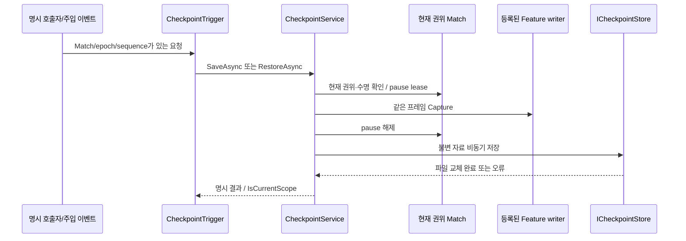
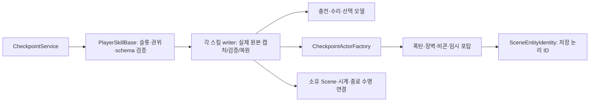

# 체크포인트 실행·요청 API

갱신: 2026-11-02. 실행기와 요청 관찰자는 구현했고 계약 검사 15개, payload 검사 3개를 통과했다. **실제 Scene Feature의 저장·복원 통합은 진행 중이다.** 이 문서의 계약 검사 결과를 실제 전투 전체 복원 완료로 읽지 않는다. 파일 형식과 저장소는 [저장소 API](checkpoint-storage-api.md)를 참고한다.

## 책임과 호출 순서

`CheckpointService`는 저장 시점을 고르지 않는다. `ICheckpointParticipant`는 자신이 소유한 실제 원본을 제공하며, 저장소나 다른 Feature의 상태를 직접 수정하지 않는다. `MatchCheckpointRuntime`은 현재 Session·시간 서비스·Scene 조립부에 실행 권한과 복원 전후 처리를 연결한다. 전역 Singleton 조회는 필요하지 않다.

1. Scene 조립부가 현재 Match에 실행기를 만들고 Feature writer를 `Register`한다. 반환 lease를 해당 Scene/actor 수명에서 해제한다. 중복 키·등록 후 메타데이터 변경은 거부한다.
2. Host의 명시 호출자는 `SaveAsync(slot, cancellation)`을 사용한다. 캡처 동안만 독립 pause lease를 잡고, 캡처한 불변 자료를 작업 스레드 저장소에 전달한다. 파일 쓰기를 기다리며 필드를 멈추지 않는다.
3. 같은 Match에서 `RestoreAsync(slot, policy, cancellation)`을 호출할 수 있다. 재실행 복원은 먼저 저장 metadata로 대상 Match를 준비한 뒤 `Restore(data, policy)`를 사용한다.
4. 복원은 **모든 schema·정의·대상 값을 먼저 검증하고 백업을 준비**한다. 이후 과거 예약·요청을 닫고 게임 시각/epoch를 갱신한 뒤 순서대로 적용한다. 마지막에 공간·환경 등의 읽기 자료를 재구축한다.
5. 적용 실패는 백업 시각과 모든 준비된 Feature를 역순으로 복구한다. 아직 Apply하지 않은 Feature도 이전 예약이 취소됐으므로 Rollback에서 재연결한다. 백업 복구나 정리 실패는 `Fault`로 부분 상태의 재개를 막는다. 승패·보상을 임의 생성하지 않는다.

`RestoreOrder`는 선행 상태의 적용 순서이며 같은 순서는 ordinal 키 순서다. 실제 writer가 필요한 참조를 `PrepareRestore`에서 검증해야 한다. `Dispose`는 준비 자원 정리만 하며 적용 상태를 바꾸지 않는다. CPU 객체를 통째로 직렬화하지 않고 각 writer가 명시 schema의 바이너리를 작성한다.

## 경제 정책과 결과 해석

- World는 복원한다. Progression은 현재 값을 유지한다. Currency도 기본적으로 현재 값을 유지하며 `CurrencyRestorePolicy.RestoreCheckpoint`를 명시한 경우에만 저장값으로 되돌린다.
- Stage·난이도·모드·seed·content version·참가자 수가 다른 Match에는 그대로 덮어쓰지 않는다. 과거 `SourceMatchId`는 진단값이며 새 실행 ID와 일치할 필요는 없다.
- `Saved`는 파일 교체 완료, `Restored`는 적용 완료다. `NotFound`, `Busy`, `Rejected`, `Cancelled`, `Failed`, `Faulted`를 구분한다. `RestoreRolledBack`은 실패한 적용을 백업으로 복구한 결과다.
- 비동기 완료 시 `IsCurrentScope`를 확인한다. 이미 파일 교체가 완료된 저장은 Scene이 종료됐다는 이유로 거짓 실패로 바꾸지 않는다. 과거 실행 결과로 현재 UI/Match를 변경하지 않는다.
- 동기 게임 API와 결과 이벤트는 소유 메인 스레드에서 사용한다. IO 완료 뒤 Unity 상태를 바꾸는 호출자가 임의로 `ConfigureAwait(false)`를 적용하면 안 된다.

## 이벤트 관찰 경계

`CheckpointRequestChannel`은 명시적으로 전달된 요청만 발행한다. `CheckpointTrigger`는 그 원본을 구독하고 해제한다. 자동 저장·복원이 발생할 게임 상황은 연결하지 않았다.

요청은 Match ID·epoch·요청 ID·원본 내 증가 sequence·작업 종류·슬롯·정책으로 구성한다. 같은 최신 요청 재전달은 작업을 다시 실행하지 않고 완료 결과를 재사용한다. 낮은 sequence·같은 sequence의 다른 요청·과거 Match/epoch는 거부한다. sequence는 복원으로 epoch가 바뀌어도 계속 증가시킨다. 새 요청이 실행 중 작업과 충돌하면 `Busy`를 반환하며 몰래 큐에 쌓지 않는다.

관찰자 해제는 구독과 대기 요청 취소를 함께 처리한다. 해제 뒤 완료 이벤트를 호출하지 않는다. 잘못된 결과 구독자가 던진 예외는 다른 구독자를 막지 않고 `LastObserverError`에 남긴다. 원본 이벤트의 실제 게임 규칙은 향후 별도 연결한다.

## 실제 actor의 재생성과 ID

`CheckpointActorFactory`는 Scene 조립부/Feature writer가 저장 actor를 재생성할 때 사용하는 Unity 어댑터다. 스폰 수·난도·생성 시점이나 게임 상태는 소유하지 않는다. `ValidatePrefab(prefab, savedId)`로 ID 충돌을 준비 단계에서 확인하고, `Instantiate(prefab, ownerScene, pose, savedId)`로 실제 객체를 만든다.

1. 비활성 staging 아래 prefab을 생성한다. 이때 저장된 `SceneEntityIdentity`를 먼저 지정한다.
2. 소유 Scene의 루트로 옮기고 저장 pose를 적용한다. 부모 해제 뒤 최종 scale을 적용해 TRS 재계산의 반올림이 반복 복원에 누적되지 않게 한다.
3. Unity가 활성화 시 실제 `Awake/OnEnable`을 실행한다. 원본 초기화는 `EnsureIdentity`에서 이미 지정된 저장 ID를 유지한다.
4. Feature가 검증한 실제 HP·남은 시간·형상 등을 적용하고 같은 Match 시계/종료 수명에 연결한다. prefab의 기본 초기화가 저장 상태를 나중에 다시 덮어쓰지 않도록 한다.

`Retire(actor)`는 명시적으로 전달한 이전 소유 개체를 먼저 비활성화하고 정상 파괴를 요청한다. Factory는 전역 검색이나 다른 Feature의 수량 변경을 하지 않는다. 소유자의 파괴 알림을 억제해야 하는 경우에는 Feature가 owner 연결을 먼저 해제한다. 설치물의 생성 시 GUID는 저장에 포함한 논리 ID이며, 네이티브 instance ID·NetworkObjectId·접속 ID와 구분한다.

Factory의 ID 사전 검증과 저장 pose/소유 Scene 유지 집중 검사 2개가 통과했다. 다른 Hub가 활성화된 실제 생성물 복원은 별도의 Player 스킬 PlayMode 검사에서 확인한다. Factory가 모든 prefab의 게임 규칙을 자동 복원하는 것으로 해석하지 않는다.

## 검증과 남은 연결

실행기 10개와 요청 관찰 5개 검사는 권위/준비 거부, 같은 프레임 캡처, 기본 경제 보존·재화 롤백, schema 사전 검증, 실패 보상·Fault, 중복/과거 요청, 해제 및 지연 IO를 확인했다. payload 3개 검사는 schema·길이·UTF-8·남은 바이트 검증을 확인했다. 저장소의 실제 IO 검사는 별도 8개다.

현재 남은 것은 실제 Scene writer의 전체 상태·참조·남은 시간 캡처와 복원, App/Scene 수명 바인딩, 프로필 영속성, 재실행 게임 사이클 통합이다. 일부 writer만 등록한 계약 검사를 게임 전체 복원 증거로 사용하지 않는다.

### 실제 원본 writer 연결 현황

| writer | 저장하는 실제 원본 | 복원·검증 경계 |
| --- | --- | --- |
| `MatchSpatialCheckpointParticipant` / `world/spatial` v1 | 현재 Battlefield Grid 중심·크기·분할·표시 Z, 지역 Grid 정의·정적 소속·정책 모드·점유 셀 | Scene 조립부가 Session과 `RegionSceneBinding.RestoreCheckpoint`를 주입. 이전 Match/Grid 세대 ID는 복사하지 않고 새 세대를 발행. 실제 actor 복원 뒤 삼각형·밀도를 재계산 |
| `ControlUnitHealth` / `world/control-unit` v1 | CU 정의 ID·최대/현재 HP·world pose·local scale | 정의와 HP 범위를 준비 단계에서 확인. 실제 HP와 UI 알림을 적용하며 피해·파괴 사건은 다시 발행하지 않음 |
| `Map.WeatherManager` / `world/weather` v1 | 실제 날씨·예고 큐·가중치/큐 설정·난수 진행 상태·현재 간격/설정 간격·다음 전환까지 남은 게임 초 | 권위 Match의 실제 timer가 있어야 캡처. 시간 epoch 교체로 취소된 예약을 남은 시간부터 다시 연결. Client·독립 Scene 상태는 저장하지 않음 |
| `PlayerInfo` / `world/player/{slot}/actor` v1 | 실제 HP/max HP·생존·회복 진행과 남은 시간, world pose/scale·물리·CanMove·확정 우주선/필드 위치 | 같은 슬롯의 논리 Player ID 검증. 생존 잠금만 복원하고 현재 UI 잠금은 유지. 사망/피해 사건을 다시 발행하지 않음 |
| `PlayerAttack` / `world/player/{slot}/weapon` v1 | 선택 무기·남은 재사용 시간, 렌치의 미실행 타격/수리 의도·방향·남은 impact/cooldown, 발사자가 소유한 살아 있는 탄환 | 실제 소유 탄환을 추적해 남은 수명·피해·색상/종류·배치·물리를 재구성. 이미 맞거나 종료될 탄환은 재발사하지 않음 |
| `PlayerSkillController` / `world/player/{slot}/loadout` v1 | Q/E 선택 | 같은 Player와 실제 사용 가능한 스킬인지 사전 검증. 현재 메뉴·입력 잠금은 유지 |
| `PlayerBomb` / `world/player/{slot}/skill/1` v1 | 실제 충전·재사용 시간, 소유 시한폭탄의 ID·위치·진행 시간·폭발 여부 | 이미 폭발한 장비를 복원할 때 범위 피해를 다시 적용하지 않음 |
| `PlayerTurretSkill` / `world/player/{slot}/skill/2` v1 | 수량·모든 개별 수리 시간, 배치 미리보기, 실제 포탑의 ID·HP·방향·발사 진행, 비행 중 탄환 | 이전 owner를 해제한 뒤 교체해 파괴 통지로 수량이 다시 바뀌지 않게 함. 설치 수와 실제 저장 actor 수 대조 |
| `PlayerBarrierSkill` / `world/player/{slot}/skill/3` v1 | 충전·첫 펄스의 위치/남은 대기, 실제 장벽들의 ID·HP·형상·수명·탐색 주기 | 첫 펄스 진행과 실제 충돌/표현을 재구성. 저장 위치에 장벽을 새 비용으로 설치하지 않음 |
| `PlayerBeaconSkill` / `world/player/{slot}/skill/4` v1 | 재사용 시간, 실제 비콘의 ID·HP·반경·수명·탐색 주기 | 기존 활성 장비를 교체하고 같은 ID로 현재 대상 검색 Registry에 재등록 |

공간 writer 5개 검사는 실제 Session의 비정방형 Grid·지역 소속/점유, 준비 중 무변경, 적용/백업 복구, 새 Match로의 논리값 이전, 형식 오류 거부, Transform 검증을 확인했다. CU 3개 검사는 실제 컴포넌트의 HP·위치와 알림, 정의 불일치 거부, 죽은 CU 캡처 거부를 확인했다. CU는 EditMode에서 초기화 본문을 명시 호출한 컴포넌트 검사이며 실제 PlayMode Scene 전체 복원을 대신하지 않는다.

이 writer들은 전체 World 중 일부다. 필드 터렛·Enemy 등의 저장 계약, 영속 프로필 및 Scene 수명 바인딩을 마친 뒤 완전한 저장 기능으로 노출한다. 현재 일부 writer만 등록해서 ‘게임 전체 저장 완료’ UI를 제공하지 않는다.

Player의 저장 키는 `PlayerStart`/Host의 검증된 roster 순서와 논리 Player ID를 사용한다. 런타임 instance ID·SDK 접속 ID를 키로 저장하지 않는다. LocalPlayerActorSpawner는 생성 시 슬롯을 지정하고, 원격 Host actor 등록은 확정 Config의 Player 순서를 확인한다. PlayerActorIdentity.BindCheckpointSlot은 Scene 조립부의 등록 API이며, writer가 등록된 동안 슬롯을 임의 변경하면 안 된다.

PlayerInfo의 회복은 중복 코루틴 대신 명시적인 진행 상태와 남은 간격으로 관리한다. 기존과 같이 첫 HP를 즉시 회복하고 이후 프레임마다 최대 한 번 진행하며, 중복 요청은 겹쳐 실행하지 않고 사망 시 종료한다. 우주선 정비는 필드 정지와 구분해 scaled Unity 시간을 따르며 전체 TimeScale 0에서는 진행하지 않는다. 현재 maxHp는 현행 PlayerInfo의 World 원본으로 저장한다. 계정 성장에 따른 maxHp/XP 원본이 아직 없으므로 이 writer를 영속 성장 모듈 구현으로 표시하지 않는다. 향후 성장 원본과 계산 순서는 별도 Progression 경계에 연결해야 한다.

Player 원본 집중 4개와 실제 PlayMode 회복 재개 1개가 통과했다. 무기·스킬·임시 개체 및 전체 Scene의 저장/재실행 복원은 이 검사 범위에 포함하지 않는다.

무기 writer는 탄환을 전역 Scene 검색으로 모으지 않는다. 발사 성공 시 소유 목록에 등록하고 파괴 시 해제한다. 복원은 현재 소유 탄환을 비활성화·정리한 뒤 저장된 실제 비행 상태로 재구성한다. 실패 백업 복구도 같은 방식으로 이전 목록과 무기 상태를 적용한다. 탄환의 Unity instance ID를 영속 ID로 쓰지 않으며, 현재 탄환은 다른 Feature가 지속 참조하는 게임플레이 ID를 제공하지 않는다. 이후 그런 참조가 추가되면 논리 ID 계약을 함께 확장해야 한다.

실제 Player prefab의 발사·Additive Scene 귀속·복원된 탄환 위치/속도/수명·재사용 시간·백업 복구, 렌치의 지연 impact 이후 실제 EnemyHealth 단일 피해를 PlayMode 2개 검사로 확인했다. 시각용 Animator/Particle 재생 프레임을 결정론적으로 재연하는 계약은 아니며, 전투에 영향을 주는 남은 타격 시간과 생성물 상태를 보존한다. 전체 Scene의 다른 Enemy·터렛·스킬 상태까지 이 검사로 검증했다고 표시하지 않는다.

### Player 스킬 원본 모델

`PlayerSkillCharges.CaptureState/RestoreState`는 수량·남은 첫 충전 시간과 충전 정의를 보존한다. `PlayerTurretInventory.CaptureState/RestoreState`는 설치 수와 **모든** 개별 수리 시간을 보존한다. HUD에 표시하는 최단 수리 시간 하나로 전체 상태를 대체하지 않는다. 둘 다 정의가 다른 대상에는 적용하지 않으며, 불변 사본/범위를 검증한 다음 원본을 갱신한다. Inventory의 설치 actor 목록은 해당 스킬 writer가 별도 보존하고 수량과 대조해야 한다.

`PlayerSkillLoadout.Restore(q, e)`는 두 선택을 검증하고 한 번에 반영한다. Q 없이 E만 선택하거나 같은 스킬을 두 슬롯에 배치하는 자료는 거부한다. 이 API는 장비 사용 비용이나 선택 동작을 재실행하지 않는다.

모델 복원 4개와 기존 충전/수리 계산 16개, 총 20개 검사가 통과했다. 이 모델 검사와 아래 실제 생성물 검사를 구분한다.

### 실제 스킬 생성물 복원

스킬의 `.Checkpoint.cs` partial은 해당 Feature의 원본에 직접 접근한다. Core에 별도의 HP/수량 writer를 복제하지 않는다. `PlayerSkillBase`가 공통 슬롯·Player ID·Host·버전 검증을 담당하고, 각 스킬은 실제 자료와 재구성 순서를 제공한다. 새 스킬도 저장 계약을 함께 구현해야 한다. 저장에 쓰는 스킬/장비/설치 결과 enum은 기존 수치를 유지해 명시했으며, 기존 값을 임의로 재배치하지 않는다.

장벽·비콘·임시 포탑은 적의 목표가 될 수 있어 `IEntityIdentity`와 저장 논리 ID를 제공한다. 활성 장비 Registry는 같은 ID의 중복 등록을 거부한다. 스킬은 새 actor를 구성한 뒤 실제 상태를 적용하고 정지 시계에 연결한다. 이미 시작된 폭발의 피해를 재실행하거나, 포탑 교체를 새로운 회수/수리 사건으로 처리하지 않는다. 탐색 대상 캐시는 다시 구하되 다음 탐색까지 남은 시간은 보존한다. 임시 포탑은 매 Update에서 최근접 적을 재평가하므로 발사 경과·헤드 방향을 보존하고 이전 Unity target 참조는 재사용하지 않는다.

폭탄의 범위 피해 또는 렌치의 여러 대상 타격 도중 호출된 캡처는 거부한다. 피해 callback 한가운데의 부분 World를 저장한 뒤 완료라고 표시하지 않는다. 전체 Scene의 요청을 안전한 게임 루프 경계에 조율하는 바인딩은 후속 구현이며, 이는 자동 저장 이벤트 선정과 별개다. 설치 미리보기는 유지하되 복원 버튼의 과거 입력을 설치 확정으로 재사용하지 않고 다음 프레임의 새 입력부터 처리한다.

실제 Player prefab으로 스킬 PlayMode 6개가 통과했다: 폭탄 fuse/ID/수량과 후속 피해, 이미 폭발한 폭탄의 피해 중복 방지, 장벽/비콘 HP·ID·충전·첫 펄스, 임시 포탑/비행 탄환/수량 재구성 후 실제 피해, Q/E 선택과 UI 잠금, 범위 피해 중 캡처 거부다. 관련 무기 PlayMode 2개도 통과했다. Factory 집중 검사는 2개다. 확장 실행의 Editor Scene fixture 실패와 최종 pose 수정 검사를 별도 기록하며, 서로 다른 실행을 하나의 전체 Scene 인수 통과로 합치지 않는다.

Weather는 기존 날씨 가중치·큐 전환 규칙을 유지하고, Match 전용 난수만 상태를 저장할 수 있는 Unity Mathematics Random으로 바꿨다. 설치본은 1.3.3이며 v1 payload에 xorshift 상태를 명시한다. 같은 seed의 과거 System.Random 날씨 순서와는 달라지므로 이전 Debugger 기록의 seed만으로 동일 순서를 주장하지 않는다. 상태를 복원한 이후에는 예고와 다음 추첨 순서가 이어진다. 0 seed는 1로 정규화하고 저장된 0 상태는 손상으로 거부한다. 이 선택의 API 근거는 [Unity Mathematics Random](https://docs.unity3d.com/Packages/com.unity.mathematics@1.3/api/Unity.Mathematics.Random.html)이며 실제 설치 소스의 state/NextInt를 함께 확인했다.

Weather 복원 4개, 기존 예약 연결 3개, 남은 첫 대기/반복 계약 2개, 총 9개 집중 검사가 통과했다. 예고·추첨의 후속 순서, 남은 시간·정지, 이전 예약 한 개로의 교체, Apply 전 실패의 백업 timer 재등록, 손상/미지원 schema 거부를 확인했다.

### 정지 중 물리 자료

물리 Feature writer는 `FieldSimulationActor.CaptureBody` / `RestoreBody`를 사용한다. 정지 때문에 임시로 꺼진 `simulated` 값과 실제 복귀 예정 속도를 구분하고, 복원 중 바뀐 위치·속도를 재개 시 과거 값으로 덮어쓰지 않게 한다. `CheckpointRigidbody2DState`는 world XY 위치·각도·선속도·각속도·원래 simulated·수면 상태의 명시 바이너리 값이다. 어댑터가 없는 Player 등의 소유 Rigidbody는 값 자료의 직접 Capture/Apply를 사용할 수 있다. 물리체의 Z와 제작 계층은 Transform 자료로 별도 보존한다.

복원 위치는 Rigidbody와 Transform 양쪽에 맞춘다. simulated=false의 물리체를 다시 켤 때 이전 Transform으로 되돌아가는 사례를 발견해 수정했다. 집중 3개 검사와 실제 PlayMode 물리 프레임의 정지→복원→재개 1개 검사를 통과했다. 임의 다른 actor의 Rigidbody는 거부한다. 충돌·AI·무기 전체 재생의 완료 증거는 아니다.
