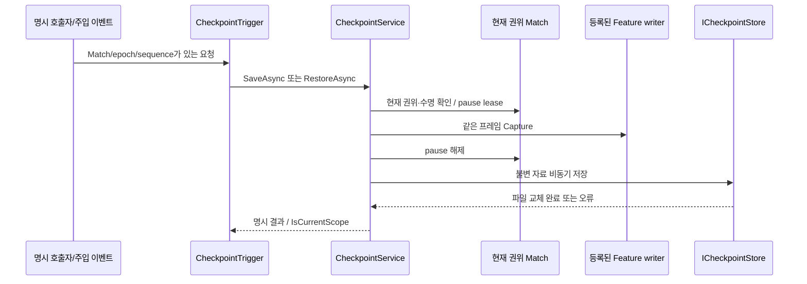

# 체크포인트 실행·요청 API

갱신: 2026-11-02. 실행기와 요청 관찰자는 구현했고 계약 검사 15개, payload 검사 3개를 통과했다. **실제 Scene Feature의 저장·복원 통합은 진행 중이다.** 이 문서의 계약 검사 결과를 실제 전투 전체 복원 완료로 읽지 않는다. 파일 형식과 저장소는 [저장소 API](checkpoint-storage-api.md)를 참고한다.

## 책임과 호출 순서

`CheckpointService`는 저장 시점을 고르지 않는다. `ICheckpointParticipant`는 자신이 소유한 실제 원본을 제공하며, 저장소나 다른 Feature의 상태를 직접 수정하지 않는다. `MatchCheckpointRuntime`은 현재 Session·시간 서비스·Scene 조립부에 실행 권한과 복원 전후 처리를 연결한다. 전역 Singleton 조회는 필요하지 않다.

1. Scene 조립부가 현재 Match에 실행기를 만들고 Feature writer를 `Register`한다. 반환 lease를 해당 Scene/actor 수명에서 해제한다. 중복 키·등록 후 메타데이터 변경은 거부한다.
2. Host의 명시 호출자는 `SaveAsync(slot, cancellation)`을 사용한다. 캡처 동안만 독립 pause lease를 잡고, 캡처한 불변 자료를 작업 스레드 저장소에 전달한다. 파일 쓰기를 기다리며 필드를 멈추지 않는다.
3. 같은 Match에서 `RestoreAsync(slot, policy, cancellation)`을 호출할 수 있다. 재실행 복원은 먼저 저장 metadata로 대상 Match를 준비한 뒤 `Restore(data, policy)`를 사용한다.
4. 복원은 **모든 schema·정의·대상 값을 먼저 검증하고 백업을 준비**한다. 이후 과거 예약·요청을 닫고 게임 시각/epoch를 갱신한 뒤 순서대로 적용한다. 마지막에 공간·환경 등의 읽기 자료를 재구축한다.
5. 적용 실패는 백업 시각과 모든 준비된 Feature를 역순으로 복구한다. 아직 Apply하지 않은 Feature도 이전 예약이 취소됐으므로 Rollback에서 재연결한다. 백업 복구나 정리 실패는 `Fault`로 부분 상태의 재개를 막는다. 승패·보상을 임의 생성하지 않는다.

`RestoreOrder`는 선행 상태의 적용 순서이며 같은 순서는 ordinal 키 순서다. 실제 writer가 필요한 참조를 `PrepareRestore`에서 검증해야 한다. `Dispose`는 준비 자원 정리만 하며 적용 상태를 바꾸지 않는다. CPU 객체를 통째로 직렬화하지 않고 각 writer가 명시 schema의 바이너리를 작성한다.

## 경제 정책과 결과 해석

- World는 복원한다. Progression은 현재 값을 유지한다. Currency도 기본적으로 현재 값을 유지하며 `CurrencyRestorePolicy.RestoreCheckpoint`를 명시한 경우에만 저장값으로 되돌린다.
- Stage·난이도·모드·seed·content version·참가자 수가 다른 Match에는 그대로 덮어쓰지 않는다. 과거 `SourceMatchId`는 진단값이며 새 실행 ID와 일치할 필요는 없다.
- `Saved`는 파일 교체 완료, `Restored`는 적용 완료다. `NotFound`, `Busy`, `Rejected`, `Cancelled`, `Failed`, `Faulted`를 구분한다. `RestoreRolledBack`은 실패한 적용을 백업으로 복구한 결과다.
- 비동기 완료 시 `IsCurrentScope`를 확인한다. 이미 파일 교체가 완료된 저장은 Scene이 종료됐다는 이유로 거짓 실패로 바꾸지 않는다. 과거 실행 결과로 현재 UI/Match를 변경하지 않는다.
- 동기 게임 API와 결과 이벤트는 소유 메인 스레드에서 사용한다. IO 완료 뒤 Unity 상태를 바꾸는 호출자가 임의로 `ConfigureAwait(false)`를 적용하면 안 된다.

## 이벤트 관찰 경계

`CheckpointRequestChannel`은 명시적으로 전달된 요청만 발행한다. `CheckpointTrigger`는 그 원본을 구독하고 해제한다. 자동 저장·복원이 발생할 게임 상황은 연결하지 않았다.

요청은 Match ID·epoch·요청 ID·원본 내 증가 sequence·작업 종류·슬롯·정책으로 구성한다. 같은 최신 요청 재전달은 작업을 다시 실행하지 않고 완료 결과를 재사용한다. 낮은 sequence·같은 sequence의 다른 요청·과거 Match/epoch는 거부한다. sequence는 복원으로 epoch가 바뀌어도 계속 증가시킨다. 새 요청이 실행 중 작업과 충돌하면 `Busy`를 반환하며 몰래 큐에 쌓지 않는다.

관찰자 해제는 구독과 대기 요청 취소를 함께 처리한다. 해제 뒤 완료 이벤트를 호출하지 않는다. 잘못된 결과 구독자가 던진 예외는 다른 구독자를 막지 않고 `LastObserverError`에 남긴다. 원본 이벤트의 실제 게임 규칙은 향후 별도 연결한다.

## 검증과 남은 연결

실행기 10개와 요청 관찰 5개 검사는 권위/준비 거부, 같은 프레임 캡처, 기본 경제 보존·재화 롤백, schema 사전 검증, 실패 보상·Fault, 중복/과거 요청, 해제 및 지연 IO를 확인했다. payload 3개 검사는 schema·길이·UTF-8·남은 바이트 검증을 확인했다. 저장소의 실제 IO 검사는 별도 8개다.

현재 남은 것은 실제 Scene writer의 전체 상태·참조·남은 시간 캡처와 복원, App/Scene 수명 바인딩, 프로필 영속성, 재실행 게임 사이클 통합이다. 일부 writer만 등록한 계약 검사를 게임 전체 복원 증거로 사용하지 않는다.

### 실제 원본 writer 연결 현황

| writer | 저장하는 실제 원본 | 복원·검증 경계 |
| --- | --- | --- |
| `MatchSpatialCheckpointParticipant` / `world/spatial` v1 | 현재 Battlefield Grid 중심·크기·분할·표시 Z, 지역 Grid 정의·정적 소속·정책 모드·점유 셀 | Scene 조립부가 Session과 `RegionSceneBinding.RestoreCheckpoint`를 주입. 이전 Match/Grid 세대 ID는 복사하지 않고 새 세대를 발행. 실제 actor 복원 뒤 삼각형·밀도를 재계산 |
| `ControlUnitHealth` / `world/control-unit` v1 | CU 정의 ID·최대/현재 HP·world pose·local scale | 정의와 HP 범위를 준비 단계에서 확인. 실제 HP와 UI 알림을 적용하며 피해·파괴 사건은 다시 발행하지 않음 |

공간 writer 5개 검사는 실제 Session의 비정방형 Grid·지역 소속/점유, 준비 중 무변경, 적용/백업 복구, 새 Match로의 논리값 이전, 형식 오류 거부, Transform 검증을 확인했다. CU 3개 검사는 실제 컴포넌트의 HP·위치와 알림, 정의 불일치 거부, 죽은 CU 캡처 거부를 확인했다. CU는 EditMode에서 초기화 본문을 명시 호출한 컴포넌트 검사이며 실제 PlayMode Scene 전체 복원을 대신하지 않는다.

이 두 writer는 전체 World 중 일부다. Player·터렛·Enemy·Weather 등의 저장 계약과 Scene 수명 바인딩을 마친 뒤 완전한 저장 기능으로 노출한다. 현재 일부 writer만 등록해서 ‘게임 전체 저장 완료’ UI를 제공하지 않는다.
