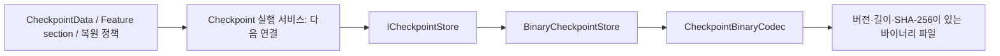

# 체크포인트 바이너리 저장소 API

갱신: 2026-11-02. **자료 형식·복원 정책 표현·실제 파일 저장소를 구현하고 8개 집중 검사를 통과했다.** 아직 App/Scene의 저장 실행기나 실제 Feature 캡처·복원에 연결한 상태는 아니다. 자동 저장·복원 사건은 선택하지 않는다.

## 역할과 의존성



| 타입 | 책임 |
| --- | --- |
| `CheckpointSlot` | 경로와 구분한 슬롯 이름. ASCII 문자·숫자·`-`·`_`, 1~64자. 소문자로 정규화하며 Windows 장치 예약 이름을 거부 |
| `CheckpointData` | 캡처 ID/UTC, 진단용 이전 Match ID, Stage·난이도·모드·seed·content version, 게임 초, 참가자 수, Feature 자료 |
| `CheckpointSection` | 고유 키·Feature schema version·분류와 복사한 불변 payload. 해석은 해당 Feature writer가 담당 |
| `CheckpointRestorePolicy` | World는 복원, 경험치 등 Progression은 현재 유지. Currency는 기본 유지하고 명시 옵션으로만 체크포인트 값 사용 |
| `ICheckpointStore` | 명시적 슬롯의 비동기 저장·로드. Scene/SDK/게임 이벤트를 직접 조회하지 않음 |
| `BinaryCheckpointStore` | 주입된 디렉터리의 IO·파일 핸들·완성본 교체. App 조립부에서 하나의 인스턴스로 사용 |
| `CheckpointBinaryCodec` | 고정된 파일 schema와 제한된 읽기/쓰기. 임의 CLR 객체 역직렬화를 사용하지 않음 |

이름과 수치의 저장은 게임 규칙의 원본을 새로 만드는 작업이 아니다. Feature section에는 해당 Feature의 논리 ID·필요한 값·남은 게임 시간 등을 담아야 한다. Unity 객체 참조, callback delegate, 과거 NGO timestamp/NetworkObjectId/접속 ID를 복원 식별자로 사용하지 않는다. SourceMatchId는 진단용이며 새 실행의 Match ID로 재사용하지 않는다.

## 호출과 결과

```csharp
// App 조립부에서 경로를 결정하고 실행 서비스에 port를 주입한다.
ICheckpointStore store = new BinaryCheckpointStore(
    Path.Combine(Application.persistentDataPath, "Checkpoints"));
var slot = new CheckpointSlot("chosen-slot");
await store.SaveAsync(slot, capturedData, cancellationToken);
CheckpointData loaded = await store.LoadAsync(slot, cancellationToken);
```

`capturedData`는 메인 스레드에서 실제 Feature를 캡처한 뒤 전달할 불변 자료다. 저장소는 작업 스레드에서 Unity 상태를 읽지 않는다. 같은 인스턴스의 IO는 서로 직렬화하지만 요청을 게임 진행 순서로 큐잉하는 실행 서비스는 아니다. 실행 서비스가 중복 작업·권위·세대·취소·복원 순서를 통제한다.

- 슬롯 파일이 없으면 `LoadAsync`는 null이다. 손상·범위 초과는 `InvalidDataException`, 미지원 파일 버전은 `NotSupportedException`, IO/권한 실패는 해당 예외다. 오류를 새 게임이나 빈 snapshot 성공으로 바꾸지 않는다.
- `SaveAsync`는 완성된 임시 파일을 같은 디렉터리에 쓰고 flush한 뒤 기존 파일을 교체한다. 교체 전 취소/실패는 기존 저장을 유지하고 이번 임시 파일을 정리한다. 교체가 끝난 뒤의 취소는 이미 저장한 결과를 취소 실패라고 보고하지 않는다.
- 슬롯은 경로를 받지 않으며 계산한 경로도 저장 디렉터리 안인지 확인한다. 파일은 `<slot>.checkpoint`이고 JSON/Editor capture와 다른 형식이다.
- 해시는 로컬 파일 손상 검출용이다. 계정/재화의 Backend 검증이나 온라인 인증을 대신하지 않는다. 기존 `IProfileService`와 필드 체크포인트의 책임은 분리한다.

## 파일 형식과 한계

외부 envelope는 `CBCP` magic, 파일 버전1, payload 길이, SHA-256, payload다. payload는 UTF-8 길이 접두 문자열·고정 수치·Feature section 배열이다. 전체 인코딩 payload는16MiB, section은4MiB, section 수는128개로 제한한다. 참가자 수의64 제한은 저장 형식의 입력 상한이며 현재 게임의1~2인 정책을 바꾸지 않는다. 문자열/배열 길이를 확인한 뒤 할당하고 중복 키·잘못된 enum·NaN/무한 게임 시간·잘못된 값·후행 데이터를 거부한다.

파일 버전과 Feature section version은 구분한다. 현재 파일 버전이 다르면 명시적으로 실패한다. 개별 Feature schema의 호환/마이그레이션과 실제 정의 ID 검증은 해당 Feature 및 실행 서비스가 연결해야 한다. 미지원 자료를 임의 변환하거나 덮어쓰지 않는다.

8개 검사에서 실제 파일의 새 인스턴스 재읽기, 기존 파일 교체, 손상 보존, 미래 버전/큰 파일 거부, 사전 취소, 대상 파일 잠금에 의한 교체 실패/기존 파일 보존/임시 파일 정리, 슬롯/데이터 불변성과 복원 정책을 확인했다. 증거는 비공개 `Docs/Local/Validation/Sprint20261102/B4-Store/io-continuations/results.xml`이다. 최초 async fixture 정체는 별도 로그로 보존한다. [검사 실행 기준](../development/unity-runtime-test-guidelines.md)을 따른다.

다음 연결은 `CheckpointService`의 메인 스레드 캡처·사전 검증·복원 조율, 이벤트 관찰자의 요청/구독 수명, 현재 Scene Feature writer, 별도 프로필 영속 자료와 보존 정책의 일관성, 재실행 게임 사이클이다. 이 저장소 단위 검사로 해당 단계까지 완료했다고 해석하지 않는다.
