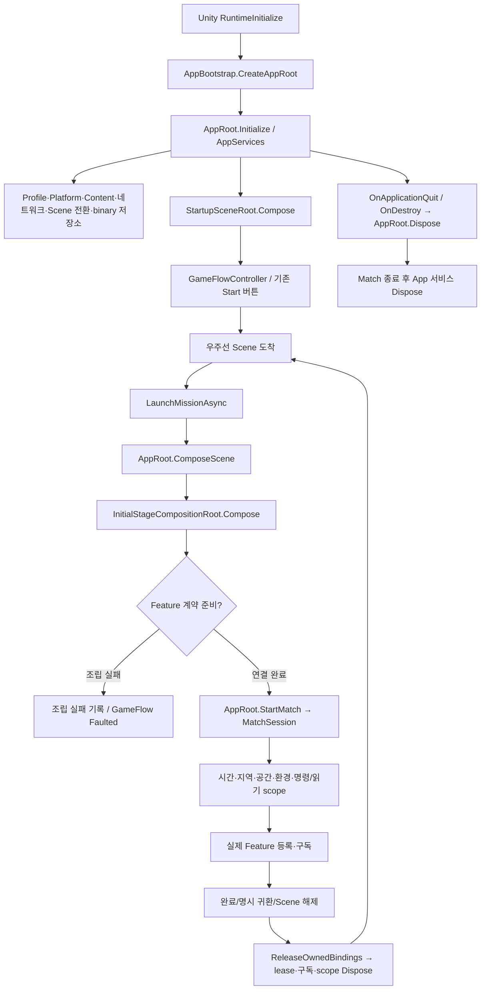
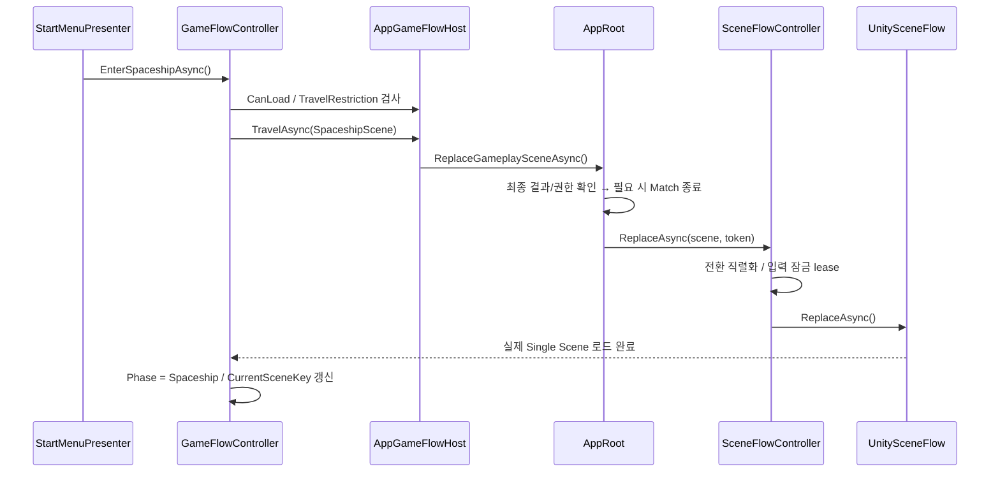
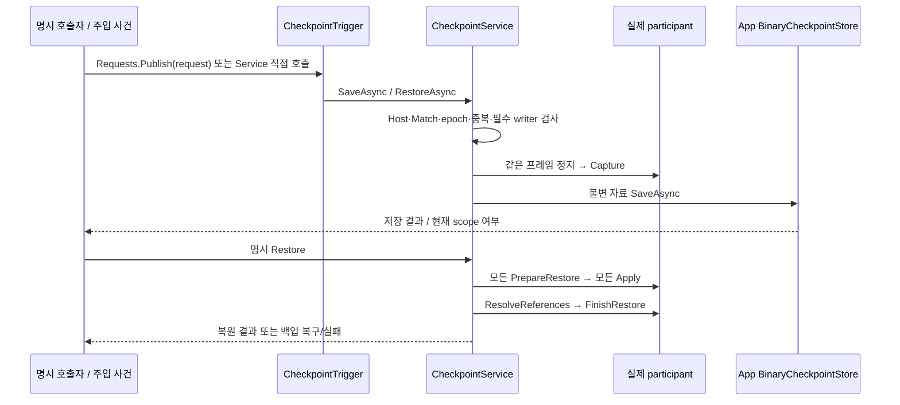
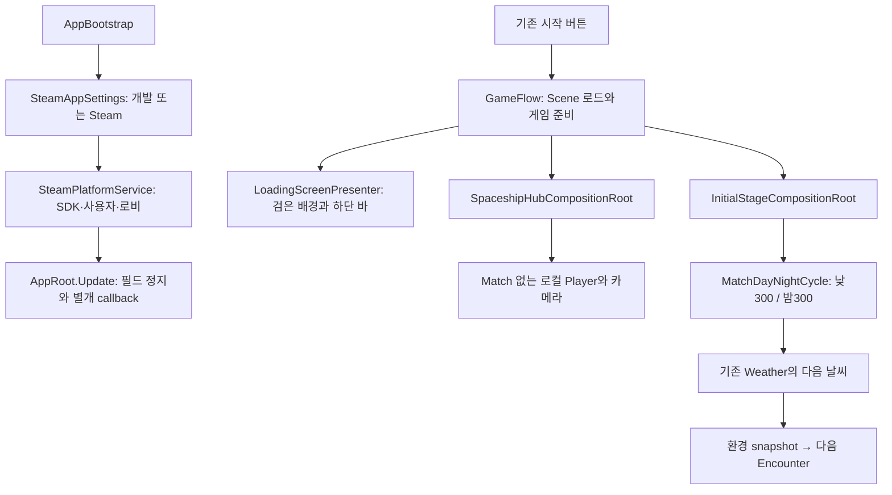

# Core 실제 호출·수명·API 읽기 지도

갱신: 2026-11-05. 실제 Feature 연결과 최신 수동 검사는 [통합 안내](core-feature-integration-guide.md)를 따른다. 아래 설명은 `main 1a03e9a91` 이후 작업 브랜치 기준이다. 이전 HOLD/제외 문서는 당시 보관 기록이며 현재 코드에는 해당 보류 표식이 없다. Weather 고유 writer·미션 콘솔·원격 Client 출입 요청·Player 전체 NetworkBehaviour·제품 경제/Backend는 후속이다. Host 포털 왕복과 실제 Steam SDK/로비·낮밤은 구현했다. 현재 확인/전달 범위는 [최종 로컬 안내](../planning/2026-11-05-core-local-review.md)를 우선한다.

## 1. 같은 이름으로 묶지 않을 상태

| 상태 | 소유자 | 의미 |
| --- | --- | --- |
| GameFlowPhase | GameFlowController | 시작 화면/우주선/행성 입장이라는 App의 위치 |
| NetworkMatchPhase | NetworkMatchCoordinator | 연결된 참가자의 준비·시작·최종 결과 전달 수명 |
| MatchPhase | MatchSession | 이번 판의 규칙 실행·완료 상태 |
| RegionGridSnapshot | Match의 지역 원본/Client replica | 정적/동적 모드 모두 최종 점유 셀이 원본. 삼각형은 동적 점유 계산의 입력 |
| Feature 상태 | Player/FieldTurret/Enemy/World 담당 | 실제 HP·무기·AI·전력·날씨 등의 원본 |

App의 위치가 Mission이라고 NGO/Feature 전체 동기화가 끝난 것은 아니다. GameFlow는 실제 Match 조립을 확인하고 실패를 Faulted로 남긴다. MatchState의 기초 HP 필드가 실제 모든 Feature HP를 대신하지 않는다.

Random 소비자는 기존 IRandomConsumer의 BindRandom에서 공용 정적 헬퍼 `RandomBinding.Bind(streams, "weather", ref _random)`의 반환값을 돌려준다. RandomConsumerScope가 Match 조립 실패·종료 시 이를 해제한다. 파트별 해제 클래스나 공통 부모 클래스를 만들지 않는다. 일반 계산 함수에는 IRandomSource만 전달한다. [완성된 사용 예제와 해제/재연결 규칙](core-random-api.md)을 따른다.

## 2. 생성과 종료의 한 쌍



| 생성자 / 연결 지점 | 소유자 | 종료 지점 |
| --- | --- | --- |
| AppBootstrap.CreateServices | AppRoot | AppRoot.Dispose → AppServices.Dispose |
| ConfigureGameFlow | AppRoot | GameFlowController.Dispose; Scene 전환 전에 취소 요청 |
| StartMenuPresenter.Bind | StartupSceneRoot/시작 Scene | OnDisable/OnDestroy → Unbind. App 흐름 자체는 Dispose하지 않음 |
| AppRoot.StartMatch | AppRoot | EndCurrentMatch / TryEndMatch / Dispose |
| InitialStageCompositionRoot의 각 scope | 해당 Scene composition | ReleaseOwnedBindings / 초기화 실패 rollback |
| MatchTimeService, MatchCoordinator | 권위 Match composition | Scene 종료·Match 종료. NGO pump와 별개 |
| AppServices.CreateCheckpointScope | 호출한 Match composition | 호출자가 scope.Dispose. App 저장소 수명은 유지 |
| Register(participant)의 반환 lease | 실제 participant를 연결한 호출자 | 교체/despawn/종료 때 Dispose |

소유권을 전달받지 않은 다른 Feature의 GameObject를 Core가 저장/정리 편의를 위해 파괴하지 않는다. 등록 lease와 객체 파괴 책임을 구분한다.

## 3. 시작 버튼은 어떤 함수를 호출하는가



Mission 출격은 위 순서 뒤 `WaitForMissionReadyAsync`를 추가한다. 파일만 로드되었거나 Network 준비만 시작한 상태를 입장 성공으로 반환하지 않는다. 조립 예외·해제·App 종료·준비 대기 시간 초과는 실패/취소로 전파된다. 현재 터렛 시간/원본과 명시 Encounter 생성기는 연결되어 있다.

기존 공용 메뉴/결과 버튼은 `AppRoot.NavigateFromScreenAsync`를 거쳐 같은 GameFlow로 전달한다. 완전 재시작은 `RestartMissionAsync`, 결과 귀환은 `ReturnToSpaceshipAsync`다. 임시 우주선 방문은 필드를 종료하지 않는 별도 출입 계약이며 이 API를 재사용해 Match를 종료시키지 않는다.

## 4. 시간과 Weather 연결

현재 권위 Scene의 생성 순서는 `MatchTimeService → MatchCoordinator → MatchEnvironmentSceneScope`다. 실제 Initial_Stage에서 이 경로로 자동 스폰·필드 정지와 재개를 확인했다.

1. Timestamp adapter가 NGO 서버 시각 또는 개발용 Unity 단조 시각을 읽는다.
2. MatchTimeService의 Clock은 anchor·배속·정지 정책으로 게임 초를 계산한다. 시간은 복원 시 새 epoch를 갖는다.
3. 같은 서비스의 Scheduler가 기한에 도달한 예약을 실행한다. 종료/epoch 교체/호출자 취소로 과거 예약을 정리한다.
4. MatchPresenceService는 Host 참가자의 위치 보고를 집계한다. 1명 또는 SOS 2명 모두 우주선에 있어야 필드 정지다.
5. Core가 연결한 CountTick/Weather 어댑터가 `IMatchScheduledEnvironmentFeature.BindAuthority`로 예약을 등록하고 반환 lease로 정리한다. 실제 Feature가 없는 상태를 낮밤 완성으로 표시하지 않는다.
6. 환경 Changed는 Match의 읽기 snapshot을 바꾼다. 환경 변경 자체를 추가 Spawn 명령으로 바꾸지 않는다.

게임 시간 정지는 네트워크 연결·메시지 pump·우주선/UI와 다르다. Enemy/터렛의 진행·물리/예약을 실제로 멈추는 부분은 각 Feature consumer가 제공해야 한다. Core가 해당 코드의 deltaTime/공격 루프를 몰래 교체하지 않는다.

## 5. 저장 API를 어디서 조립하는가

AppBootstrap은 `Application.persistentDataPath/Checkpoints`의 BinaryCheckpointStore와 payload codec을 주입한다. 현재는 로컬 개발 사용자 구성이다. Steam 계정/Backend 프로필 권위 및 계정별 저장 분리는 실제 서비스 도입 때 연결한다.

Match 조립부의 호출 형태는 다음과 같다. 아래 인자는 조립부가 실제 계약에서 제공해야 하는 값이며, 새 자동 저장 규칙이나 임의 writer 키가 아니다.

```csharp
// runtime: 현재 Match/게임 시간/권위/취소/복원 전후 정리 callback을 가진 port.
// participants: 실제 원본에서 캡처/복원하는 각 담당자의 writer.
// requiredKeys: 등록된 것에서 자동 추측하지 않고 조립 계약으로 정한 필수 writer 목록.
var scope = app.CreateCheckpointScope(runtime, participants, requiredKeys);
var missing = scope.Service.MissingParticipantKeys;
var saved = await scope.Service.SaveAsync(slot, cancellation);
if (!saved.IsSuccess || !saved.IsCurrentScope)
{
    // Reason을 표시/기록하고 이전 Match의 결과를 현재 게임에 적용하지 않는다.
}
// Feature 교체 시: var lease = scope.Register(writer); ... lease.Dispose();
// 해당 Match 종료 시 scope.Dispose();
```

필수 writer 누락은 직접 API와 CheckpointTrigger가 공유하는 서비스 내부에서 거부한다. scope는 최소 한 개의 필수 키를 요구한다. Source에 현재 등록된 writer만 보고 게임 전체 저장이 준비됐다고 추측하지 않는다.



`AppRoot.ReadCheckpointAsync`는 메타데이터 읽기 port다. 새 `ResumeCheckpointAsync`가 저장 입력으로 새 1인 Mission 구성과 실제 writer 복원까지 조율한다. 현재 전체 저장/복원은 실제 Weather writer 누락으로 차단한다.

기본 정책은 당시 World 복원, 경험치 등 Progression과 Currency는 현재 값 유지다. Currency는 요청 정책에 따라 체크포인트 값으로 되돌릴 수 있다. 현재 프로필 자료에 경험치/성장 원본 전체가 없어 Feature 계약을 통해 구현해야 한다.

## 6. 팀원이 제공/소비할 접점

| 담당 | Core가 제공하는 것 | 담당자가 제공/연결할 것 | 현재 상태 |
| --- | --- | --- | --- |
| Player/UI | 실제 권위 actor 등록 lease, 참가자 위치 보고, 공용 입력/화면 경계 | 실제 원격 actor·포털 출입 보고 | Host 시간·입력·HP/무기/설치물 writer 연결. 전체 NetworkBehaviour는 Player 후속 |
| FieldTurret | Match ID/요청·권한/지역 Grid/읽기 snapshot 계약 | 실제 소유·ID·Match lease·관측 및 전력/actor writer | 실제 시간·HP/전력·종류별 전투·저장 원본 연결 |
| Enemy/Encounter | 확정 공간/환경·source context와 요청 결과/수명 | 게임별 생성 규칙·전달 연출·동적 source 고유 원본 | 실제 Planner/Executor의 환경/origin·시간·writer 연결 |
| World/Weather | clock/scheduler, 환경 snapshot, GameFlow/Scene 전환 API | 날씨 Random·실제 Weather writer, 허브 PlayerStart/포털·콘솔 UX | Core CountTick/환경 전달 연결. 진태 3번째 이후 후속 |
| Core | App 저장소·조율/규칙·DI·검증·문서 | 위 계약의 조립, 현재 원본과 문서의 일치 | 실제 Scene 접점·own-world 반복 복원 검증. 제품 전체 인수는 후속 |

11/3 회의의 소환형/회복형 분리·암살자 타깃·수리/피해 공통화·터렛 검증 지원 목록은 별도 담당자 작업/요청이다. 이번에 그 알고리즘이나 미정 API를 임의 추가하지 않았다. [최신 main 회의](https://github.com/Team-HJD-21/unity-6-the-developer/blob/bf3db829/Docs/planning/2026-11-03-weekly-progress.md)

## 7. 전체 검토에서 확인한 것과 남은 것

Core C# 437개에는 Editor55개·Tests50개가 포함된다. 단순 파일 수를 모두 게임 관리 runtime으로 보지 않는다. Domain90·Contracts104는 값/자료·외부 경계로 나뉜다. 현재13개 Core asmdef의 참조 순환과 엔진 비참조 계층의 Unity using은 정적 검사에서 발견되지 않았다. 이 검사는 전체 동작/설계의 무결성을 증명하는 검사는 아니다.

AppRoot는 Unity 수명·현재 Match·Scene 조립의 소유자다. GameFlow 절차는 Application으로, Unity 준비 확인은 AppGameFlowHost로, 시작 버튼은 Presenter로 분리했다. 체크포인트의 저장소/Match scope/실행/관찰도 각 수명으로 분리했다.

Bootstrap의 터렛 구체 타입 참조는 실제 Feature 조립에 한정한다. 원본을 복제하는 별도 Manager는 추가하지 않았다. 공용 화면은 AppScreenStyle로 기존 NEXON OTF·HUD sprite를 재사용하며 최종 시각 인수는 수동 확인 대상이다.

PL은 README의 읽는 순서→이 문서의 실제 함수 흐름→각 API 문서→최신 통합 안내/인수인계 순으로 확인한다. 이해가 어려운 함수명/소유권은 PR 이전 검토에서 보완한다.

## 낮밤·Steam·시작 우주선 후속



시작 우주선은 Scene에 있던 비활성 `Capsule`의 실내 배치점만 참조하며 그 임시 객체를 활성화하지 않는다. 실제 Player는 Stage와 같은 prefab에서 생성하고, `SpaceshipHubSettings`에서 표식·prefab·배율을 설정한다. 필드의 Additive 우주선 방문에는 이 actor/카메라를 중복 생성하지 않는다. 출격하면 허브 객체를 정리하고 기존 Mission PlayerStart에서 새 actor를 조립한다.

Steam의 플랫폼 식별/로비는 실제 NGO 게임 transport·Backend 인증과 구분한다. [Steam 사용법](steam-api.md), [낮밤과 Weather 저장 변경](day-night-api.md), [운영 화면](screen-management-api.md)을 따른다.
