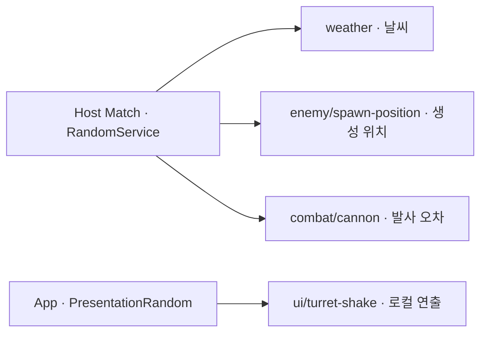

# 범용 Random API — 사용법과 기존 호출 교체 위치

기준: 2026-11-05. Core만 변경한 구현이다. Weather·Enemy·터렛·HUD의 기존 난수 호출은 아직 교체하지 않았다.

**Random을 사용하는 기능을 구현·교체하기 전에 이 문서의 주입 방법, 게임/연출 구분, 범위 규칙을 먼저 확인한다.** 함수 이름만 치환하면 Client의 독립 추첨이나 저장 상태 누락은 해결되지 않는다.

## 왜 도입했나

각 기능이 Unity의 전역 Random을 직접 사용하면 날씨, 적 생성, 포탄 오차, UI 흔들림이 같은 난수 진행 상태를 소비한다. 이 경우 HUD 효과의 호출 횟수를 바꾼 것만으로 다음 게임 추첨 결과도 달라질 수 있다. 공통 함수는 유지하면서 `weather`, `enemy/spawn-position`, `combat/cannon`처럼 이름별로 상태를 나눠 이 의존을 끊는다.

온라인 게임에서는 Host가 게임 결과를 결정해야 한다. Core에서 Match의 권한과 수명을 확인하고 Feature에는 필요한 source를 주입한다. Client가 같은 seed로 따로 추첨해 결과가 일치할 것이라고 가정하지 않는다. 로컬 HUD 효과는 App의 PresentationRandom을 사용한다.

안전장치로 게임을 복원할 때 시작 seed만 다시 넣으면 난수도 처음부터 시작한다. 이미 진행한 뒤의 상태를 함께 저장해야 다음 날씨/스폰 추첨부터 이어갈 수 있다. Core가 이름별 난수 원본을 저장하고, 각 Feature는 실제 날씨·예고 큐·생성 개체 등 자신의 원본을 저장한다.

또한 정수/실수 범위와 잘못된 가중치 처리 등을 공통 함수로 정하면 파트마다 다른 추첨 코드를 다시 만들 필요가 줄어든다. 고정 seed와 호출 순서로 재현할 수 있어 검사와 버그 추적에도 사용할 수 있다.

| Core가 맡는 것 | Feature가 맡는 것 |
| --- | --- |
| 난수 함수, seed와 이름별 진행 상태, 권한/수명, 난수 저장 writer | 날씨 가중치, 스폰 규칙, 공격 오차 등 실제 게임 규칙/데이터 |
| 게임/로컬 연출용 서비스 분리 | 전달받은 올바른 source 선택과 호출 시점 |



## 무엇을 쓰면 되나

모든 기능은 `IRandomSource`의 같은 함수 세트를 사용한다. 게임 판정용은 Host Match의 `IRandomStreams`, HUD 효과는 App의 `PresentationRandom`에서 받는다. 한 개의 전역 seed/진행 상태를 공유하는 방식은 아니다. 같은 API 아래에서 날씨·스폰·공격·로컬 연출을 분리해야 UI 호출 횟수 때문에 날씨 결과가 달라지지 않는다.

| 할 일 | 호출 | 범위/동작 |
| --- | --- | --- |
| 정수 범위 | `random.NextInt(0, 10)` | 0 이상 10 미만 |
| 실수 범위 | `random.NextFloat(-.5f, .5f)` / `NextDouble(min, max)` | 유한한 하한 이상, 상한 미만 |
| 0~1 실수 | `NextFloat()` / `NextDouble()` | 1 미만; double은 53비트 해상도 |
| 참/거짓 | `NextBool()` | 동일 확률 |
| 확률 판정 | `Chance(.25)` | 25%; 입력 0~1. 0/1은 추첨 없이 확정 |
| 목록 선택 | `Choose(values)` | 빈 목록 거부 |
| 가중치 인덱스 | `WeightedIndex(weights)` | 0 가중치 제외, 음수/NaN/무한/전부 0 거부 |
| 가중치 항목 | `WeightedChoose(values, weights)` | 항목/가중치 개수 동일 |
| 목록 섞기 | `Shuffle(list)` | 호출자 목록을 제자리에서 변경 |
| 원판 좌표 | `InsideUnitCircle()` | XY 원판 면적에 균일한 `(double X, double Y)` |
| 원시 난수 | `NextUInt32()` | 32비트 전체 범위. 일반 Feature는 위 함수 우선 |

확장 함수는 `using TeamHJD.Game.Application;`, 계약은 `using TeamHJD.Game.Contracts;`가 필요하다. 정수/실수 모두 `min < max`여야 한다. 잘못된 입력은 추첨 전에 거부한다. Unity의 float `Random.Range`는 양 끝을 포함하므로 **상한을 포함해야 하는 게임 규칙은 교체 시 별도로 검토**한다. [Unity 공식 Range 문서](https://docs.unity3d.com/6000.3/Documentation/ScriptReference/Random.Range.html)

## 진태 — Weather에 주입받기

기존 Weather 컴포넌트에 `IRandomConsumer`를 구현하면 `InitialStageCompositionRoot`가 Host Match 조립 시 자동으로 `BindRandom`을 호출한다. 활성화된 같은 Scene의 소비자만 대상이다. 이때 바인딩은 환경 Feature의 `BindAuthority`보다 먼저 이루어진다.

아래는 **추가할 연결 예제**다. 기존 Weather 컴포넌트에 같은 연결을 넣으면 된다. 예제 컴포넌트를 실제 Weather와 중복 배치하는 지시가 아니며, 이번 변경이 `WeatherManager.cs`에 적용된 것도 아니다. `DrawWeatherRoll`은 Host 환경 초기화/실제 날씨 선택 시점에 호출한다.

```csharp
using System;
using TeamHJD.Game.Contracts;
using UnityEngine;

public sealed class WeatherRandomExample : MonoBehaviour, IRandomConsumer
{
    private IRandomSource _weatherRandom;

    public IDisposable BindRandom(IRandomStreams random)
    {
        if (_weatherRandom != null)
            throw new InvalidOperationException("Weather random is already bound.");

        var source = random.GetStream("weather");
        _weatherRandom = source;
        return new RandomBinding(() =>
        {
            if (ReferenceEquals(_weatherRandom, source))
                _weatherRandom = null;
        });
    }

    public int DrawWeatherRoll(int totalWeight)
    {
        if (_weatherRandom == null)
            throw new InvalidOperationException("Bind Core random before choosing weather.");

        return _weatherRandom.NextInt(0, totalWeight);
    }

    private sealed class RandomBinding : IDisposable
    {
        private Action _release;

        public RandomBinding(Action release) => _release = release;

        public void Dispose()
        {
            var release = _release;
            _release = null;
            release?.Invoke();
        }
    }
}
```

- `Awake`에서 먼저 날씨를 뽑지 않는다. 난수 주입 뒤, 권위 환경 바인딩이 준비된 시점에 최초 선택/예고 큐를 생성한다.
- Client는 권위 난수를 받지 않는다. Client의 `Start`에서 별도로 날씨를 뽑지 않고 Host 환경 snapshot을 표시한다.
- `"weather"`는 초기화 때 한 번 받는다. 난수마다 새 seed를 만들거나 프레임/InstanceId로 이름을 만들지 않는다.
- Match 종료/조립 실패 시 Core가 반환 lease를 Dispose한다. 이미 보관한 source도 권한 상실/Match 종료 후에는 사용할 수 없다.
- 나중에 생성된 동적 Feature는 Scene 조립부가 `BindRandom`을 직접 호출하고 그 lease를 소유한다. 기존 Scene 검색이 뒤늦게 생성된 객체를 자동 연결하지는 않는다.
- 직접 조회가 필요한 Core 조립부에는 `InitialStageCompositionRoot.Random` / `MatchSession.Random`이 있다. 초기화 전과 Client에서는 null이다. Feature 안에 매 프레임 전역 검색을 넣지 않는다.

## 다른 기능에서도 같은 함수 사용하기

모든 예제의 `streams`는 조립부가 주입한 `IRandomStreams`다. `RandomService`를 Feature마다 새로 만들지 않는다. 확장 함수를 쓰는 파일에는 아래 두 using을 추가한다.

```csharp
using TeamHJD.Game.Application;
using TeamHJD.Game.Contracts;

// 아래 streams는 조립부가 주입한 Match 난수.
IRandomSource spawn = streams.GetStream("enemy/spawn-position");
var offset = spawn.InsideUnitCircle();
Vector3 position = point.Position
    + new Vector3((float)offset.X, (float)offset.Y, 0f) * point.SpawnRadius;

IRandomSource cannon = streams.GetStream("combat/cannon");
float scatter = cannon.NextFloat(-.5f, .5f);
bool critical = cannon.Chance(.1);
```

목록/가중치/셔플은 다음처럼 사용한다. 가중치는 상대 비율이며 아래 예제는 Sunny:Rain:Thunder가 3:1:1이다. 실제 날씨 가중치 데이터는 Weather가 소유한다.

```csharp
IRandomSource random = streams.GetStream("feature/example");
string[] weatherIds = { "sunny", "rain", "thunder" };
double[] weights = { 3d, 1d, 1d };

string uniformChoice = random.Choose(weatherIds);
string weightedChoice = random.WeightedChoose(weatherIds, weights);
bool succeeded = random.Chance(0.25); // 25%

int[] order = { 0, 1, 2, 3 };
random.Shuffle(order); // 원본 배열의 순서를 변경
```

HUD 흔들림은 Core/UI 조립부가 AppRoot 인스턴스 `app`의 `PresentationRandom`에서 source를 받아 전달한다. 정적/Singleton 호출이 아니다.

```csharp
// app은 조립부가 소유한 AppRoot 인스턴스.
IRandomSource uiRandom = app.PresentationRandom.GetStream("ui/turret-shake");
float offsetX = uiRandom.NextFloat(-1f, 1f) * shakeAmount;
float offsetY = uiRandom.NextFloat(-1f, 1f) * shakeAmount;
```

App 연출 난수는 App 수명이며 게임 체크포인트에 저장하지 않는다. 게임 판정은 `MatchConfig.RandomSeed`로 생성된 Match 서비스를 사용한다. 동일 이름은 같은 상태를 공유하므로 기능 안의 호출 순서는 결과에 영향을 준다.

### 교체 전 확인

- 게임 판정인가, 로컬 연출인가? 게임은 Host Match, 연출은 App 서비스를 사용한다.
- source를 초기화 때 받아 보관했는가? 매 호출마다 생성/전역 검색하지 않는다.
- 최초 추첨이 BindRandom 이후인가? Client에서 권위 결과를 다시 추첨하지 않는다.
- 범위의 상한 제외와 가중치 0 처리에 기존 게임 규칙이 맞는가?
- 저장 대상이면 Core 난수 writer와 해당 Feature 원본 writer를 함께 등록했는가?
- Match 종료/교체 시 바인딩을 해제하고 이전 source를 계속 사용하지 않는가?

## 저장/복원 연결

난수 생성기와 진행 상태는 Core가 소유한다. Weather는 실제 날씨·예고 큐·남은 전환 시간만 자신의 writer로 저장한다.

저장 조립부는 `scene.CreateRandomCheckpointParticipant()` 또는 `session.CreateRandomCheckpointParticipant()`를 실제 Feature writer 목록에 추가하고, 필수 목록에도 `"core/random"`을 포함한다. 기존 `AppRoot.CreateCheckpointScope(runtime, participants, requiredKeys)`로 조립한다. **이 writer 하나로 전체 게임 저장이 되는 것은 아니다.** Weather/Enemy/Player 등 필요한 원본 writer도 함께 등록한다.

```csharp
ICheckpointParticipant randomWriter = scene.CreateRandomCheckpointParticipant();
participants.Add(randomWriter);
requiredKeys.Add(randomWriter.Key); // core/random
// 이후 기존 CreateCheckpointScope 호출에 participants/requiredKeys 전달
```

난수 writer는 schema 1 / World / RestoreOrder 0이다. 알고리즘 버전·seed·이름별 상태를 기록한다. 준비 단계에서 입력 전체를 검증하고 적용/백업 복구 단계에서만 변경한다. 같은 seed의 새 Match로 이어갈 수 있고, 이미 받은 source 참조도 복원된 상태를 따른다. 저장 이후 생성된 흐름은 초기 상태로 되돌아간다. 오래된 저장에 필수 `core/random`이 없으면 조용히 새 난수를 시작하지 않고 기존 체크포인트 검증에서 거부한다.

정해진 자동 저장 사건은 추가하지 않았다. PCG32는 게임용 의사 난수이며 인증 토큰/백엔드 보상 검증용 난수가 아니다. 전체 AI/물리의 결정적 리플레이를 제공한다는 의미도 아니다.

## 기존 프로젝트 교체 목록 — 이번에는 수정하지 않음

검색 범위: `Assets`의 C# 실행 소스. 테스트·Editor·외부 플러그인을 분리했다. 현재 기능 소스에서 직접 난수를 소비하는 곳은 **6개 파일, 7개 호출부**다.

| 담당/파일 | 현재 사용 위치와 목적 | 이후 교체 |
| --- | --- | --- |
| World/Weather · `Assets/Scripts/Map/WeatherManager.cs:115` | `GetWeather()`의 정수 추첨. sunnyWeight에 따른 날씨/예고 큐 선택 | Match `weather` 흐름의 `NextInt(0, sunnyWeight + (int)Weather.WEATHER_MAX)`. 기존 가중치 해석 유지 |
| Enemy/Encounter · `Assets/Scripts/Features/Enemy/Spawning/EnemySpawnExecutor.cs:289` | 각 적을 SpawnPoint 반경의 원판 안에 분산. `Random.insideUnitCircle` | Host Match `enemy/spawn-position` 흐름의 `InsideUnitCircle()`을 Vector2/3로 변환. 기존 반경·스폰 지점 배분 유지 |
| FieldTurret · `Assets/Scripts/Features/FieldTurrets/Cannon/FieldCanonTurretLv1.cs:29` | `Shoot()`에서 발사 기준점 X에 -0.5~0.5 가산 | Match `combat/cannon` 흐름의 `NextFloat(-.5f, .5f)` |
| FieldTurret · `Assets/Scripts/Features/FieldTurrets/Cannon/FieldCanonTurretLv2.cs:34` | `Shoot()` 루프에서 각 발사 방향 Transform X에 오차 가산 | 같은 API. 포탄마다 추첨하는 기존 호출 횟수/순서 확인 |
| FieldTurret · `Assets/Scripts/Features/FieldTurrets/Cannon/FieldCanonTurretLv3.cs:31` | Lv2와 같은 발사 방향 오차 | 같은 API. 공유 흐름 또는 안정적 논리 ID별 흐름은 해당 파트와 결정 |
| Player/UI · `Assets/Scripts/UI/Turrets/TurretInteractionUI.cs:233–234` | UI 흔들림의 X/Y 두 차례 실수 추첨 | App `ui/turret-shake` 흐름의 `NextFloat(-1f, 1f)` 두 번. Match 난수 사용 금지 |

`FieldLaserTurret.cs:79`의 난수 코드는 이미 주석이라 현재 실행 교체 대상이 아니다. `Guid.NewGuid()`로 만드는 Match/요청/등록 ID와 seed를 전달·저장하는 필드도 게임 추첨 함수가 아니므로 이번 교체 목록에 포함하지 않았다. Core 난수 검사의 Unity Random 사용은 전역 상태를 훼손하지 않는지 확인하기 위한 검사이며 시작 상태를 복구한다.

현재 Cannon은 Transform의 기존 X에 오차를 누적한다. **난수 API를 바꾸면서 이 조준 동작까지 임의로 고치지 않는다.** 해당 파트가 기준점/발사 방향 의도를 확인한 뒤 별도 변경한다. 원판 좌표로 흩뿌리는 것과 어떤 SpawnPoint를 선택/배분하는지도 별개 책임이다.

## 구현 위치와 검증

- `Contracts/Randomness`: IRandomSource / IRandomStreams / IRandomConsumer.
- `Application/Randomness`: RandomService / RandomExtensions / RandomConsumerScope / PCG32 내부 구현.
- `Domain/Randomness`: 버전·seed·이름별 불변 상태.
- `Application/Persistence/RandomCheckpointParticipant.cs`: 기존 저장 실행기 연결.
- `InitialStageCompositionRoot`: Match 서비스 생성/Feature 주입. `AppServices`: 로컬 연출 서비스 생성.

PCG32 초기화·상태 전이·정수 rejection sampling은 [공식 minimal 구현](https://www.pcg-random.org/download.html)을 C#으로 이식했다. 이름은 고정 FNV-1a로 해시하여 실행별 string.GetHashCode 차이를 피한다. 출처와 Apache-2.0 전문은 [라이선스 파일](../licenses/pcg32-LICENSE.txt)에 포함했다. stream 이름은 소문자 ASCII 1~128자, scope당 최대 256개다.

삭제 전 검수 커밋 `e87bdf91`에서 고정 참조 수열, 음수/전체 int 폭, 인접 실수의 상한 제외, 가중치 검증, 원판 분포, 이름별 독립성, 권한/Dispose, snapshot 복원/백업, 기존 저장 실행기의 왕복을 확인했다. 이후 PL 요청으로 이번 API에 추가했던 임시 테스트 7개와 .meta는 최종 PR에서 제외했다. 실행 결과는 삭제 전 검증 기록이며, 실제 Weather/Enemy/터렛/HUD 교체 검증은 각 파트가 위 연결을 적용한 뒤 진행한다.
