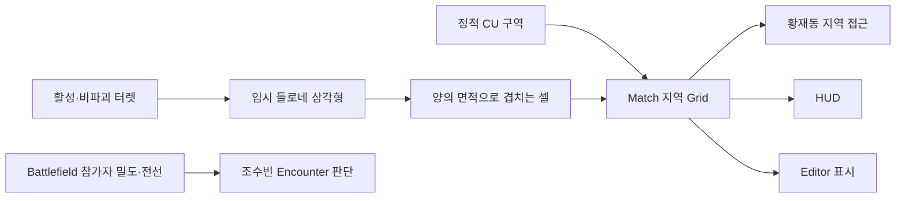

# 지역·Encounter·네트워크 기반 API

기준: 2026-10-15 작업 브랜치. [배치/증거/잔여](../planning/2026-10-15-core-sprint-implementation.md) · [공통 규약](core-api-usage.md)

## 지역 데이터와 실제 연결

| 진입점 | 역할 |
| --- | --- |
| `MatchSession.InitializeRegions(definition, mode)` | 한 번 생성. Match가 Runtime을 소유하며 조회 Port 반환 |
| `session.Regions.Snapshot` / `Changed` | 불변 확정 결과/변경 통지 |
| `RegionSceneBinding.ResetPolicy(mode, true)` | 확인 후 새 Grid 세대로 Reset. 미확인 요청은 거부 |
| `RegionSceneBinding.TryUnlockThroughZone(zone)` | 정적 해금의 Core 쓰기 경로 |
| `FieldTurretController.Regions` | HUD/Feature의 읽기 Port. 바인딩 없으면 null |
| `RegionGridReplica.Apply(frame, senderIsVerifiedServer)` | Client 읽기 모델. 실제 서버 검증은 전송 어댑터 책임 |

정적·동적 모두 지역 Grid가 원본이다. 황재동의 별도 Grid 설정은 명시적 값 변환으로 연결한다. Battlefield의 Player/Enemy 밀도 셀과 같은 데이터라고 취급하지 않는다.



위 S와 T 경로는 선택한 모드 하나만 실행한다. Dynamic은 지역 잠금 없이 활성화로 점령한다. OFF·파괴 시 현재 입력으로 다시 계산해 점령을 회수하지만 남은 터렛의 활성/전력 예약은 유지한다. 과열은 OFF가 아니므로 점을 제거하지 않는다. 삼각형 자체는 정확한 점유영역이 아니며 최종 결과는 셀 집합이다.

GridId는 Reset 동등성, GridGeneration은 복제에서의 Reset 순서, revision은 같은 Grid 안의 변경 순서다. MatchDescriptorId는 같은 Match ID라도 다른 준비 시도와 분리한다. Client 모델은 이전 준비·이전 Grid 세대·과거 revision 및 동일 revision의 상충 결과를 거부한다. **실제 NGO 지역 payload 전송은 아직 미연결**이다.

## 정식 Encounter 요청

`EncounterRequestService`는 양현석의 조율, `IEncounterExecutor` 구현은 조수빈의 실제 계획/생성 경계다. 기존 `EnemyNetworkTestLauncher`의 게임 시작·UI·Scene·Debugger 메서드는 이 경계로 변환한다.

```csharp
var context = new MatchRequestContext(matchId, requestId, issuerId);
var request = new EncounterRequest(context, new DefinitionId("Normal"), 10,
    EncounterRequestSource.RuntimeUI);
EncounterRequestResult result = requests.Submit(request, verifiedIssuer);
```

- verifiedIssuer는 실제 연결에서 검증한 참가자 ID다. payload의 IssuerId나 DebugWindow 출처를 인증으로 신뢰하지 않는다.
- 현재 Scene은 로컬 `local-player` 바인딩만 지원한다. 원격 연결 검증/주입은 다음 통합 대상이다.
- 입력에는 Snapshot을 넣지 않는다. 권한 측 provider에서 현재 Match의 최신 결과를 조회한다. 호환 Snapshot 메서드도 다른 Match는 거부하고 현재 Match의 옛 결과는 실행 원본으로 사용하지 않는다.
- 같은 요청의 재전송은 같은 RequestId·동일 payload다. 반복 생성은 새로운 RequestId를 발급한다.
- 결과는 Spawned/PartialSpawn/PlanRejected/SpawnFailed, 권한·Match·충돌·용량 거부 등으로 구분한다. 부분 실행/실패도 확정해 전체 재실행으로 중복 생성하지 않는다.
- IsReplay는 기존 확정 결과의 재사용이다. ExecutionFailed의 실제 부작용 수는 불명확할 수 있으므로 HasKnownExecutionCounts가 false이며 0마리 생성으로 단정하지 않는다.
- Ledger는 기본 4096개/Match, 임의 퇴출 없음. 용량 초과는 명시적으로 거부한다. 요청 중복 보장은 같은 Match 수명 안에서만 유효하며 영속 백엔드 보장이 아니다.
- 게임 cadence는 게임 요청 주체가 소유한다. Snapshot 변경 자체를 Spawn 명령으로 해석하지 않는다.
- 요청은 Host를 시작하지 않는다. 현재 테스트 Scene의 첫 시작 coroutine은 별도의 명시적 Host 시작을 아직 담당한다.

실제 Host 검사에서 10개 생성, 동일 요청 재전송 추가 생성 0, 예산/발신자 변조 거부, Unbind 후 요청 거부를 확인했다. 최종 조수빈 타입·원격 정책은 담당자 리뷰 대상이며 조수빈의 분포/생성 알고리즘은 재작성하지 않았다.

## App 연결 수명과 권장 시작 순서

`NgoNetworkSession`은 전달된 NetworkManager를 사용하며 자신이 시작한 연결만 닫는다. App 조립부가 `AppRoot.AttachNetworkSession(adapter)`로 소유권을 넘긴 뒤 `appRoot.NetworkSession.TryStartHost()` 또는 TryStartClient를 명시적으로 호출한다. Attach 자체는 서버를 열지 않는다. 기존 외부 테스트 Host를 관찰한 어댑터는 그 연결을 임의 종료하지 않는다.

권장 순서: **연결 API → 실제 참가자 집합/설정 확정 → Scene·Feature 준비 → Host의 Match 시작 API**. Host 혼자 시작할 수 있으며 연결되었다는 이유만으로 Match를 시작하지 않는다. MatchReadyBarrier는 준비 모델이고 실제 전송 구현을 대체하지 않는다. 참가자 집합이 바뀌면 새 준비 세대를 만들어야 한다.

`NetworkMatchCoordinator.TryPrepare(config, grid, mode, participants)`는 실제 Host만 설정을 확정한다. 각 인스턴스의 Feature 준비 후 `MarkLocalReady()`, Host가 `TryStart()`를 호출한다. `Preparing/Started/Ended`는 조립부의 Feature 연결/해제 진입점이다. Client는 Host의 Descriptor를 사용하며 로컬 Match 설정을 생성하지 않는다. `TryResolveParticipant(verifiedConnectionId, out playerId)`는 실제 발신 연결을 참가자에 대응시킨다.

`NgoMatchLifecycleTransport`는 실제 NGO가 시작된 뒤 하나만 조립한다. `AppRoot.AttachNetworkMatchTransport(transport)`로 전송/조율기 소유권을 넘기면 AppRoot.Update가 게임시간 정지와 무관하게 Pump한다. 독립 테스트처럼 App에 붙이지 않은 소유자는 직접 Pump한다. 명시적 준비·시작/종료 및 RLE 지역 정의를 전송하며, 큰 설정은 제한된 조각 큐로 전달한다. 두 SDK 인스턴스의 실제 UTP 패킷 검사는 통과했으나 Initial_Stage 정식 Scene 조립, 별도 두 실행 파일·최소 NetworkObject 검증은 남아 있다. 점령 Snapshot의 실제 지역 복제도 별도다.

권장 조립 순서는 AttachNetworkSession → 명시적 TryStartHost/TryStartClient → 연결 성공 후 NgoMatchLifecycleTransport 생성/AttachNetworkMatchTransport → TryPrepare/Feature 준비/MarkLocalReady/TryStart다. 서버 전용 연결과 Match 설정을 UI가 생성하지 않는다. Descriptor의 참가자 순서는 Host Config의 Player 순서를 보존하며 TryGetSlot으로 확인할 수 있다. 이는 프로세스마다 달라질 수 있는 Unity InstanceID와 다르다.

App 정리는 Match의 Feature 바인딩과 자원을 먼저 해제하고 네트워크 서비스를 포함한 App 자원을 정리한다. 하나의 Feature/서비스가 실패해도 나머지 정리를 수행하고 오류를 모아 보고한다. Initial_Stage는 아직 로컬 Match/테스트 Launcher 경로이며 새 App 네트워크 시작 흐름으로 자동 전환하지 않았다.

## HUD / Debugger 확인

- Game Debugger → Battlefield → **지역 Grid · 점령 원본**에서 현재 정책/점령 수를 확인한다. 모드/Grid Reset은 확인창을 거친다.
- Scene 점령 Grid는 확정 셀, 임시 판정 삼각형은 계산 입력을 표시한다. 후자는 표시용이며 새 상태 원본이 아니다.
- HUD 우측 하단의 CU 패널은 Static/Dynamic 정책·점령 셀·자동 활성화 상태를 표시한다. Dynamic 안내는 잠금 해제가 아니라 활성화로 점령한다는 뜻이다.
- 살아 있는 Player가 CU의 interactionDistance 안에 있고 조작 가능할 때 자동 활성화를 요청할 수 있다. 재실행 대기/진행 중 거부·전력·우선순위는 황재동 Controller가 소유한다.
- 현재 HUD 입력은 황재동 로컬 API에 연결됐다. 원격 공용 요청/로컬 actor 주입과 최종 해상도별 시각 인수는 미완료다.
