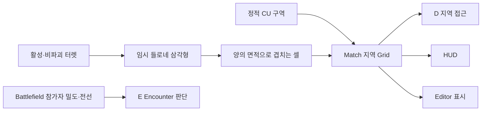

# 지역·Encounter·네트워크 기반 API

기준: 2026-10-15 작업 브랜치. [배치/증거/잔여](../planning/2026-10-15-core-sprint-implementation.md) · [공통 규약](core-api-usage.md)

## 지역 데이터와 실제 연결

| 진입점 | 역할 |
| --- | --- |
| `MatchSession.InitializeRegions(definition, mode)` | 한 번 생성. Match가 Runtime을 소유하며 조회 Port 반환 |
| `session.Regions.Snapshot` / `Changed` | 불변 확정 결과/변경 통지 |
| `RegionSceneBinding.ResetPolicy(mode, true)` | 확인 후 새 Grid 세대로 Reset. 미확인 요청은 거부 |
| `RegionSceneBinding.TryUnlockThroughZone(zone)` | 정적 해금의 Core 쓰기 경로 |
| `TurretController.Regions` | HUD/Feature의 읽기 Port. 바인딩 없으면 null |
| `RegionGridReplica.Apply(frame, senderIsVerifiedServer)` | Client 읽기 모델. 실제 서버 검증은 전송 어댑터 책임 |
| `AppRoot.AttachRegionSnapshotTransport(transport)` | App이 지역 조율/전송 수명을 소유하고 Update에서 latest pending·전송을 Pump |
| `appRoot.NetworkRegions.BindHostSource(session.Regions)` | 실행 중 Host Match의 확정 지역 원본 연결 |
| `appRoot.NetworkRegions.SourceChanged` | Client의 첫 준비된 읽기 모델 및 종료 null 통지 |
| `RegionSceneBinding.BindReplica(source)` | Client Scene 연결. 자체 Match/삼각형/쓰기 권한을 만들지 않음 |

정적·동적 모두 지역 Grid가 원본이다. D의 별도 Grid 설정은 명시적 값 변환으로 연결한다. Battlefield의 Player/Enemy 밀도 셀과 같은 데이터라고 취급하지 않는다.



위 S와 T 경로는 선택한 모드 하나만 실행한다. Dynamic은 지역 잠금 없이 활성화로 점령한다. OFF·파괴 시 현재 입력으로 다시 계산해 점령을 회수하지만 남은 터렛의 활성/전력 예약은 유지한다. 과열은 OFF가 아니므로 점을 제거하지 않는다. 삼각형 자체는 정확한 점유영역이 아니며 최종 결과는 셀 집합이다.

GridId는 Reset 동등성, GridGeneration은 복제에서의 Reset 순서, revision은 같은 Grid 안의 변경 순서다. MatchDescriptorId는 같은 Match ID라도 다른 준비 시도와 분리한다. Client 모델은 이전 준비·이전 Grid 세대·과거 revision 및 동일 revision의 상충 결과를 거부한다. 실제 NGO/UTP의 초기·변경·Reset·종료/재시작 검사와 Windows 두 실행 파일의 Initial_Stage 지역 수신·정적/동적 점령·회수·재시작 검사를 통과했다. 원격 Feature 명령과 전체 협동 전투 완료를 뜻하지 않는다.

지역은 전체 Snapshot으로 전송한다. 소속은 RLE, 점령은 bitset이며 Client에서 삼각형을 복원하지 않는다. 큐에 아직 보내지 않은 전체 상태는 최신 상태로 합친다. 미접수 전송은 다음 App Pump에서 재시도하며 구식 변경량을 무제한 쌓지 않는다. 이미 전송 중인 메시지는 바꾸지 않는다. 이 처리와 달리 준비/시작/종료는 순서를 유지하고 합치지 않는다.

## 터렛 논리 ID와 실제 등록 연결

`SceneEntityIdentity`는 Scene에 저장한 **배치 개체의 논리 ID**다. 동일한 프리팹의 배치마다 다른 키를 가지며 DefinitionId, D의 InstanceId, SDK NetworkObjectId와 다르다. 키는 Match가 바뀌어도 배치를 가리킬 수 있지만 요청은 반드시 현재 MatchId를 포함한다. 계정 Profile/세이브 파일 ID 체계를 이 키로 구현한 것은 아니다.

`TurretMatchBinding`은 Match별 `MatchEntityRegistry<int>`로 논리 ID↔현재 D InstanceId를 대응한다. D의 실제 Registry가 원본이며 Core는 별도 터렛 생성자·매니저를 만들지 않는다. `TryResolveEntityId`/`TryResolveLocalId`는 현재 실제 등록과 객체 소유자까지 대조한다. 다른 Match의 해제는 무시하고 종료 시 대응표·구독을 함께 폐기한다. 등록 토큰이 달라지면 이전 토큰으로 새 등록을 해제할 수 없다.

정식 Initial_Stage에서는 `NetworkSceneSetup`이 Core 바인딩과 제작 키를 연결한다. 추가 배치를 복제했다면 재생 전에 `Tools > TeamHJD > The Developer > Configure Turret Identities`로 누락·중복 키를 명시적으로 고친다. 정상 키는 유지하며 런타임에서 각 Client가 임의 GUID를 만들지 않는다.

동적 생성은 D Factory의 실제 생성/등록이 먼저다. 생성 담당자는 주입받은 `ITurretEntityRegistration`에 `TryRegisterEntity(matchId, authorityAssignedEntityId, actor.InstanceId, out reason)`를 호출한다. ID 충돌·잘못된 Match·없는 D 개체는 거부한다. 실패 시 생성 객체를 롤백하는 책임도 D에 남는다. 등록 전 개체를 Core 배치/명령 대상으로 임의 편입하지 않는다.

D 승급/강등은 기존 로컬 ID·상태 이전을 그대로 수행한다. Core는 D의 명시적 LevelUpgraded/LevelDowngraded 사실을 받아 새 객체에 같은 논리 ID 메타데이터만 이전한다. Core-bound Battlefield source는 한 프레임의 해제→등록→ID 이전이 끝난 LateUpdate에 최종 배치를 발행해 빈 중간 배치를 내보내지 않는다. 초기 조립의 명시적 Capture는 즉시 읽는다.

Battlefield의 배치 입력과 동적 지역의 활성 터렛 입력은 같은 논리 ID를 사용하되 서로 다른 의미의 자료다. 과열은 배치 제거/OFF로 취급하지 않는다. D의 원래 TurretSnapshot과 InstanceId 기반 UI/API는 보존한다. Core가 연결되지 않은 standalone D Scene의 로컬 ID 호환 경로를 네트워크 식별자로 사용하지 않는다.

명령/권한 gateway와 구조화된 결과, Match 종료 시 D의 실행 상태 정리 계약은 이어지는 구현 대상이다. 위 대응표 구현만으로 전력/체력/업그레이드 초기화나 전체 터렛 복제를 완료했다고 하지 않는다.

## 정식 Encounter 요청

`EncounterRequestService`는 A의 조율, `IEncounterExecutor` 구현은 E의 실제 계획/생성 경계다. 기존 `EnemyNetworkTestLauncher`의 게임 시작·UI·Scene·Debugger 메서드는 이 경계로 변환한다.

```csharp
var context = new MatchRequestContext(matchId, requestId, issuerId);
var request = new EncounterRequest(context, new DefinitionId("Normal"), 10,
    EncounterRequestSource.RuntimeUI);
EncounterRequestResult result = requests.Submit(request, verifiedIssuer);
```

- verifiedIssuer는 실제 연결에서 검증한 참가자 ID다. payload의 IssuerId나 DebugWindow 출처를 인증으로 신뢰하지 않는다.
- 정식 Scene의 자동 Encounter는 준비된 Host 참가자 ID를 명시적으로 주입한다. 현재 Host의 Match-local ID는 `local-player`다. Client에게 임의 적 생성 권한을 주지 않으며 원격 Feature 요청 gateway는 별도 통합 대상이다.
- 입력에는 Snapshot을 넣지 않는다. 권한 측 provider에서 현재 Match의 최신 결과를 조회한다. 호환 Snapshot 메서드도 다른 Match는 거부하고 현재 Match의 옛 결과는 실행 원본으로 사용하지 않는다.
- 같은 요청의 재전송은 같은 RequestId·동일 payload다. 반복 생성은 새로운 RequestId를 발급한다.
- 결과는 Spawned/PartialSpawn/PlanRejected/SpawnFailed, 권한·Match·충돌·용량 거부 등으로 구분한다. 부분 실행/실패도 확정해 전체 재실행으로 중복 생성하지 않는다.
- IsReplay는 기존 확정 결과의 재사용이다. ExecutionFailed의 실제 부작용 수는 불명확할 수 있으므로 HasKnownExecutionCounts가 false이며 0마리 생성으로 단정하지 않는다.
- Ledger는 기본 4096개/Match, 임의 퇴출 없음. 용량 초과는 명시적으로 거부한다. 요청 중복 보장은 같은 Match 수명 안에서만 유효하며 영속 백엔드 보장이 아니다.
- 게임 cadence는 게임 요청 주체가 소유한다. Snapshot 변경 자체를 Spawn 명령으로 해석하지 않는다.
- 요청은 Host를 시작하지 않는다. App 소유 경로는 연결 API가 담당하고 standalone Enemy 테스트 Scene만 기존 첫 시작 coroutine 정책을 유지한다.

실제 Host 검사에서 10개 생성, 동일 요청 재전송 추가 생성 0, 예산/발신자 변조 거부, Unbind 후 요청 거부를 확인했다. 최종 E 타입·원격 정책은 담당자 리뷰 대상이며 E의 분포/생성 알고리즘은 재작성하지 않았다.

## App 연결 수명과 권장 시작 순서

`NgoNetworkSession`은 전달된 NetworkManager를 사용하며 자신이 시작한 연결만 닫는다. App 조립부가 `AppRoot.AttachNetworkSession(adapter)`로 소유권을 넘긴 뒤 `appRoot.NetworkSession.TryStartHost()` 또는 TryStartClient를 명시적으로 호출한다. Attach 자체는 서버를 열지 않는다. 기존 외부 테스트 Host를 관찰한 어댑터는 그 연결을 임의 종료하지 않는다.

권장 순서: **연결 API → 실제 참가자 집합/설정 확정 → Scene·Feature 준비 → Host의 Match 시작 API**. Host 혼자 시작할 수 있으며 연결되었다는 이유만으로 Match를 시작하지 않는다. MatchReadyBarrier는 준비 모델이고 실제 전송 구현을 대체하지 않는다. 참가자 집합이 바뀌면 새 준비 세대를 만들어야 한다.

`NetworkMatchCoordinator.TryPrepare(config, grid, mode, participants)`는 실제 Host만 설정을 확정한다. 각 인스턴스의 Feature 준비 후 `MarkLocalReady()`, Host가 `TryStart()`를 호출한다. `Preparing/Started/Ended`는 조립부의 Feature 연결/해제 진입점이다. Client는 Host의 Descriptor를 사용하며 로컬 Match 설정을 생성하지 않는다. `TryResolveParticipant(verifiedConnectionId, out playerId)`는 실제 발신 연결을 참가자에 대응시킨다.

`NgoMatchLifecycleTransport`는 실제 NGO가 시작된 뒤 하나만 조립한다. `AppRoot.AttachNetworkMatchTransport(transport)`로 전송/조율기 소유권을 넘기면 AppRoot.Update가 게임시간 정지와 무관하게 Pump한다. 독립 테스트처럼 App에 붙이지 않은 소유자는 직접 Pump한다. 명시적 준비·시작/종료 및 RLE 지역 정의를 전송하며, 큰 설정은 제한된 조각 큐로 전달한다. 두 SDK 인스턴스의 실제 UTP 검사에 이어 **별도 Windows 프로세스 두 개**로 실제 Scene·최소 Core NetworkObject·지역 상태·종료/재시작을 확인했다. 정상 Client Feature 요청·거부 경계의 실제 연결은 후속 작업이다.

권장 조립 순서는 AttachNetworkSession → 명시적 TryStartHost/TryStartClient → 연결 성공 후 NgoMatchLifecycleTransport 생성/AttachNetworkMatchTransport → TryPrepare/Feature 준비/MarkLocalReady/TryStart다. 서버 전용 연결과 Match 설정을 UI가 생성하지 않는다. Descriptor의 참가자 순서는 Host Config의 Player 순서를 보존하며 TryGetSlot으로 확인할 수 있다. 이는 프로세스마다 달라질 수 있는 Unity InstanceID와 다르다.

App 정리는 Match의 Feature 바인딩과 자원을 먼저 해제하고 네트워크 서비스를 포함한 App 자원을 정리한다. 하나의 Feature/서비스가 실패해도 나머지 정리를 수행하고 오류를 모아 보고한다. `InitialStageNetworkBinding`이 연결된 Initial_Stage는 App 소유 경로를 사용한다. 이 컴포넌트가 없는 기존 Feature 테스트 Scene은 로컬 호환 경로를 유지한다.

### Initial_Stage 실행 API

| `InitialStageNetworkBinding` | 의미 |
| --- | --- |
| `TryStartHost()` / `TryStartClient()` | 실제 SDK 연결 시작. Match를 만들지 않음 |
| `TryPrepareMatch()` | Host가 현재 실제 접속자 1~2명을 고정하고 설정 전송. 준비 이후 도중 참가 제외 |
| `TryStartMatch()` | 모두 준비된 경우 Host만 시작. 인원수 감시로 자동 실행하지 않음 |
| `TryEndMatch()` | Match/actor/적·지역 바인딩 정리. App 연결은 유지 |
| `ShutdownConnection()` | App이 소유한 실제 연결 종료 |

`SinglePlayerHost` 진입 설정만 동일한 연결→준비→시작 API를 순서대로 호출한다. `Manual`은 Inspector의 별도 버튼 또는 게임 흐름 코드에서 호출한다. Client 진입은 연결만 열고 Host 설정을 기다린다. Stage/content version·PlayerStart 슬롯·필수 제작 연결 검사가 실패하면 준비/실행을 중단한다. `peer-{connectionId}`는 Match-local 식별자일 뿐 Steam 계정 인증 결과가 아니다.

`NgoNetworkSession.ConnectedPeerIds`는 SDK의 접속 완료 콜백을 받은 연결만 복사해 제공한다. NGO Scene 관리가 켜져 있을 때 이 콜백은 Scene 동기화 완료 뒤 발생한다. Scene의 준비 API는 승인만 된 연결과 이 목록이 다르면 거부한다. 어댑터는 연결 전에 App에 붙이는 것이 정식 경로다. 외부에서 이미 열린 Host를 관찰하는 경우 과거 원격 콜백을 임의로 복원하거나 Scene 준비를 추정하지 않는다.

### 최소 Match 네트워크 객체

`Assets/Prefabs/Core/NetworkMatchAnchor.prefab`은 실행 중 Match당 Host가 하나만 생성한다. `NetworkMatchAnchorState` 한 NetworkVariable에 MatchId·DescriptorId·Stage·Seed와 지역 GridId/revision/모드/점령 셀 수를 원자적으로 투영한다. Client 쓰기는 불가하며 **전체 지역 원본이나 두 번째 Match 상태 관리자가 아니다.** 실제 Grid payload는 기존 지역 채널이 계속 전달한다.

논리 EntityId는 `match-anchor/{descriptorId}`이고 SDK NetworkObjectId와 같은 값이 아니다. Host는 명시적으로 주입한 NGO 관리자의 InstantiateAndSpawn을 사용한다. Match 종료에 구독을 해제하고 Despawn하며 다음 Match는 새 객체/DescriptorId를 사용한다. 이 객체가 보인다고 상대 Player/Turret 전투 복제가 완료된 것은 아니다.

### 독립 실행 파일 검증

1. Unity CLI로 `TeamHJD.Game.Editor.NetworkSceneSetup.ConfigureInitialStage`를 실행하면 기존 Scene의 프리팹 참조를 연결한다. 일반 사용 때 매번 실행하지 않는다.
2. `TeamHJD.Game.Editor.CoreNetworkBuildPipeline.BuildWindowsDevelopment`가 현재 Build Settings의 Initial_Stage·Spaceship으로 Windows 개발 빌드를 만든다.
3. PowerShell에서 `./tools/Test-CoreNetworkPair.ps1`을 실행한다. 자신이 시작한 Host/Client PID만 관리하며 결과와 실패 로그는 ignored `Docs/Local/Validation/CoreSprint20261015/NetworkPair/<run>/`에 보존한다.

개발 빌드의 `CoreNetworkBuild`는 전용 CLI 옵션이 있을 때만 동작한다. 실제 Scene 조립 API를 호출하고 별도 진단 채널로 결과를 대조한다. Match 설정 전체와 지역 Snapshot의 해시, 실제 최소 객체 ID, Client의 로컬 슬롯/무권한 상태, 정적→동적→회수→종료→재시작을 확인한다. 일반 실행/Release에는 검증 루프를 시작하지 않으며 게임 진행 정책을 대체하지 않는다. Loopback 검증은 LAN/인터넷·지연·손실·GUI 인수와 구분한다.

Host는 Descriptor의 전체 참가자 상태를 가지되 **현재 각 인스턴스에는 자기 로컬 Player actor만 생성한다**. `MatchPlayerActorScope.SpawnLocalPlayer`와 `IPlayerNetworkMatchBinding`은 Client의 로컬 actor를 권한 MatchSession 없이 연결한다. 상대 actor 이동/공격 복제와 Host의 원격 Player 위치 수집은 B의 후속 Feature 연결이 필요하다. 가짜 원격 좌표를 Battlefield에 채우지 않는다.

`IAppOwnedEncounterMatchConsumer.UseAppNetworkOwnership()`는 Match 바인딩 전에 호출한다. 이어서 `BindAuthorityMatch(matchId, verifiedHostPlayerId, latestProvider)`로 Host 요청을 연결한다. E의 자동 Spawn/UI는 연결을 개설하지 않으며 테스트 OnGUI도 표시하지 않는다. Unbind 시 E의 `EnemySpawnExecutor.DespawnForMatch`가 해당 Match의 적만 제거한다. 실제 Spawn/Despawn 구현은 계속 E가 소유한다.

NGO 연결을 종료했다가 다시 시작할 때도 같은 Port를 유지할 수 있다. 공용 채널은 새 SDK 메시지 관리자에 재등록하고 옛 연결의 큐/조립 버퍼를 폐기한다. Match 재시작과 실제 연결 재시작은 각각 별도로 검사했다. Runtime App 종료는 OnApplicationQuit/OnDestroy, Editor 재생 종료는 ExitingPlayMode의 선행 Dispose를 사용한다.

## HUD / Debugger 확인

### 터렛 명령과 제어 수명

Core의 `TurretMatchBinding.BindCommands`에는 현재 권한/실행 상태·참가자 검사와 필수 `ITurretCommandAuthorization`을 주입한다. 제품 요청 권한의 기본 정책은 아직 확정 전이다. `Commands.Submit(request, verifiedIssuer)`의 verifiedIssuer는 실제 연결 매핑 결과여야 하며 payload의 IssuerId를 그대로 복사해 인증하지 않는다.

`TurretCommandRequest`는 SetActivation, StartAutoActivation, UpgradeLevel/DowngradeLevel, ApplyUpgrade/DowngradeUpgrade를 표현한다. 실제 D 처리 결과는 `TurretCommandResult`로 돌려준다. 같은 요청 GUID를 재전송하면 최초 확정 결과를 재사용한다. 다른 의도를 같은 GUID로 보내면 RequestConflict다. Accepted는 CU 자동 작업의 시작, Applied는 즉시 적용이며 두 상태를 혼동하지 않는다. 체력 수리·임의 피해·생성 명령은 이 API에 포함하지 않았다.

Host의 D 제어 lease는 `BindMatchScope`로 조립하고 Match 해제 시 Dispose한다. Client/종료 상태에서 직접 D 쓰기·공격은 허용하지 않는다. 자동 큐/예약 해제와 개체 체력·강화 초기화는 다른 책임이며 후자를 이 lease가 수행하지 않는다. 독립 D 테스트 Scene은 기존 로컬 동작을 유지한다. 원격 명령 전송과 HUD 입력 연결은 진행 중이다.

입력 소비자용 `ITurretCommandRequester.TrySubmit`은 **큐 접수 여부**, `ResultReceived`는 서버 결과다. `TryRetry(requestId)`는 미확정 의도를 같은 GUID로만 재전송한다. 응답이 없다고 미실행으로 단정하지 않으며, InProgress는 Pending을 끝내지 않는다. 기본 미확정 요청 한도는 64개다. Match별 gateway는 종료 때 Dispose하고 App 연결의 transport를 대신 파괴하지 않는다. 현재 실제 UTP transport/gateway 검증은 끝났지만 정식 Scene/HUD 조립은 진행 중이다.

공용 ON/OFF·CU 자동 요청·승급·강화/강등은 모두 참가자에게 허용하기로 확정했다. Host는 `IPlayerInteractionSource`의 최신 권위 상태와 실제 대상 위치로 거리·생존·조작 상태를 검사한다. 제공자가 없으면 AuthorityActorUnavailable로 거부한다. `PlayerInteractionRegistry.Register`의 lease는 B의 서버 actor 수명에 연결하고 교체 전 이전 등록을 해제한다. Client payload의 좌표/생존 주장이나 PlayerStart로 이 원본을 대신하지 않는다.

실제 B actor는 `PlayerControlState : IPlayerInteractionActor`가 최신 상태를 제공한다. `PlayerInteractionActorBinding`에는 Host가 소유하는 생성된 GameObject와 참가자 ID를 명시한다. Client의 로컬 actor나 prefab을 Host 권위 actor라고 대신 등록하지 않는다. `AppRoot.AttachTurretCommandTransport`는 전송 소유권만 App에 이전한다. `NetworkTurretCommands`를 빌린 Match gateway의 Dispose가 연결/전송을 닫아서는 안 된다. 실제 Scene의 이 전송 부착과 actor Port는 검사했으며 gateway/HUD 자동 조립은 진행 중이다.

Initial_Stage의 **gateway 자동 조립은 구현/검증 완료**다. `InitialStageNetworkBinding.TurretCommands`를 통해 현재 참가자의 `MatchRequestContext`와 의도를 보낸다. Host의 최대 상호작용 거리는 NetworkBinding의 `_turretInteractionDistance`(기본 10)가 원본이고 HUD의 거리 힌트로 인증하지 않는다. CU 자동 요청도 실제 CU 생존·활성 여부를 검사한다.

`RegisterAuthorityPlayerActor(matchId, playerId, actualHostActor)`는 Host에서만 사용할 수 있다. B가 생성/복제하는 실제 actor를 넘기고 반환 lease를 그 actor의 교체/Despawn 수명에 연결한다. 아직 Host actor가 없는 원격 참가자의 요청은 AuthorityActorUnavailable이다. 정상 입력용 requester가 있어도 B 원격 actor 복제나 D의 Client 터렛 상태 복제가 자동 구현된 것은 아니다. **HUD requester 입력 교체는 진행 중**이다.

- Game Debugger → Battlefield → **지역 Grid · 점령 원본**에서 현재 정책/점령 수를 확인한다. 모드/Grid Reset은 확인창을 거친다.
- Scene 점령 Grid는 확정 셀, 임시 판정 삼각형은 계산 입력을 표시한다. 후자는 표시용이며 새 상태 원본이 아니다.
- HUD 우측 하단의 CU 패널은 Static/Dynamic 정책·점령 셀·자동 활성화 상태를 표시한다. Dynamic 안내는 잠금 해제가 아니라 활성화로 점령한다는 뜻이다.
- 살아 있는 Player가 CU의 interactionDistance 안에 있고 조작 가능할 때 자동 활성화를 요청할 수 있다. 재실행 대기/진행 중 거부·전력·우선순위는 D Controller가 소유한다.
- HUD actor는 `ILocalPlayerActorConsumer`의 PrepareLocalActor/BindLocalActor/UnbindLocalActor로 명시한다. 실제 Scene에서 대기·교체·다른 Match 해제 거부·HUD 비활성/재활성을 검증했다. UI가 actor를 생성/파괴하지 않는다.
- 현재 CU/터렛 입력은 D 로컬 API에 연결됐다. 별도 Client 실행 파일의 로컬 슬롯 actor와 지역 읽기 연결은 확인했다. 원격 공용 요청·Client HUD 명령/거리 검증·최종 해상도별 시각 인수는 미완료다.
