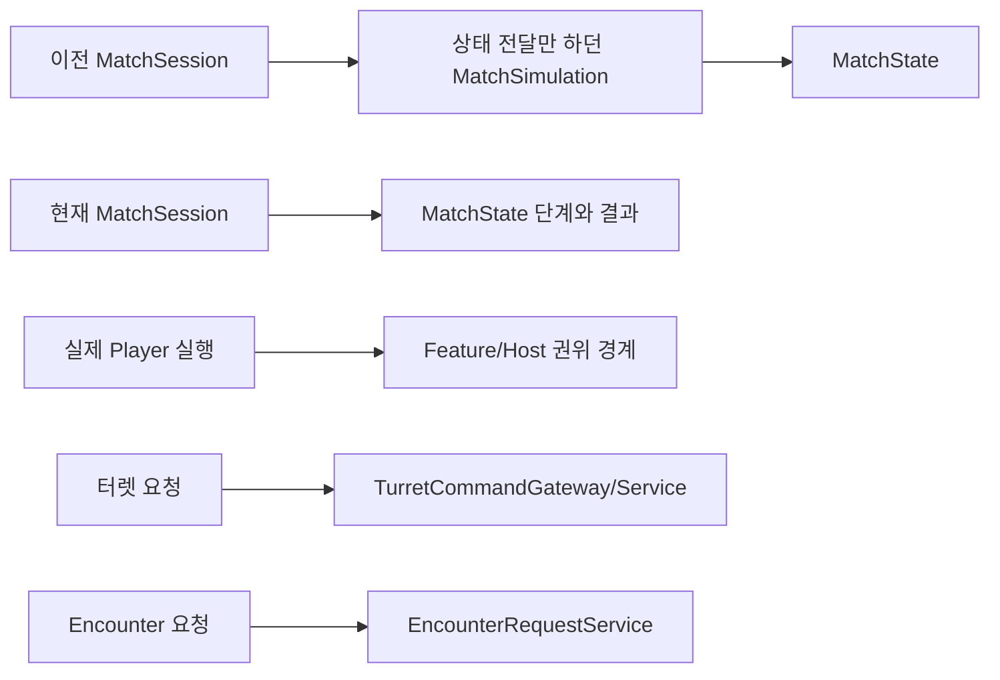

# Core 구조·복잡도 재검토

현재 작업 브랜치 기준. 스프린트 기능을 구현한 뒤, 사용자가 추가한 **어렵거나 과도한 반복·논리 불일치·없어도 되는 구조 조사/정리**를 반영했다. 이름이 업계 용어인 것과 실제로 필요한 클래스인 것은 다르다.

## 실제로 줄인 부분

| 발견 | 왜 문제였나 | 정리 |
| --- | --- | --- |
| MatchSession→MatchSimulation→MatchState | Simulation은 별도 상태도 실제 명령 처리도 없었다. 단계 변경을 전달하고 Execute는 항상 NotHandled였다. 게임 전체 시뮬레이션이 여기 있는 것처럼 읽혔다 | 중간 클래스/생성 의존을 제거하고 `MatchSession → MatchState.Start/Complete/MarkDisposed`로 직접 연결. 단계와 같은 Match 결과 검증은 State에 유지 |
| 사용되지 않는 MatchState의 HP/개체 변경 함수 | SetControlUnit/SetWave/ReplacePlayer/ReplaceTurret/ReplaceEnemy와 generic ReplaceById의 실제 호출이 없었다. Feature 원본과 별개의 Core 전투 원본을 키우는 경로로 오해할 수 있었다 | 호출되지 않는 내부 변경 함수를 제거. 실제 HP·전력·전투는 Feature 원본, State는 단계/확정 결과와 기존 초기 자료를 보관 |
| 일반 Submit의 오해 | 초기 GameCommand 계약은 실제 전투 처리기로 연결된 적이 없는데 팀 가이드는 Player 입력의 기본 길처럼 안내했다 | 공개 호환 경계는 유지하되 `NotHandled / UseFeatureRequestApi`를 명시. 팀 가이드는 실제 Player·터렛·Encounter 요청 경로로 수정. 빈 Simulation 실행/불가능한 이벤트 순회 제거 |
| EnemyProjectile 생성 시 시간 바인딩2회 | BindOwner 내부에서 이미 연결한 뒤 Spawner가 다시 연결했다. owner 생략 시에는 검사한 Spawner의 시계가 탄환에 전달되지 않았다 | 생성자 바인딩 한 번에서 시계/수명 정책까지 전달. owner 생략은 명시 Spawner를 생성자로 사용. Client의 NGO 파괴 소유권은 유지 |
| 큰 InitialStageCompositionRoot 파일 | 초기 조립·Client 준비/읽기 복제·공간 투영이 한 파일에 섞여 실제 입장/해제 흐름을 따라가기 어려웠다 | 같은 컴포넌트의 `.Networking.cs`·`.Spatial.cs`에 관련 메서드13개를 본문 변경 없이 이동. 새 Manager/추가 객체·별도 상태를 만들지 않았고 기존 Scene GUID 유지 |
| 진단 ID와 공간/저장 ID 불일치 | Spawn/사망 관측은 NGO 실행 ID, Grid/저장은 논리 ID를 사용해 같은 적을 바로 추적할 수 없었다 | 관측 EntityId를 SceneEntityIdentity로 일치시킴. NGO ID는 현재 실행 내부 추적에만 사용 |
| 일반/복원 입장의 취소 정리 불일치 | 복원은 새 Match를 정리하지만 일반 출격은 Match 시작 직후 취소 시 새 Match가 남았다. 실제 Scene 검사로 재현 | `AppRoot.EndFailedMissionArrival(expectedMatchId)` 하나로 연결. 다른 Match·결과 전송 gate를 건너뛰지 않으며 일반 취소/파일 입장5개 검사 통과 |
| 읽기 어려운 상태/시간 코드 | 같은 줄의 여러 상태 변경과 중첩 제어문 때문에 실행 순서가 숨었다 | 보완 파일19개 서식을 분리 커밋. Roslyn 실행 토큰 동일성을 확인했고 역할/호출 주체 주석과 실제 API 안내를 보강 |

## 비슷해 보여도 유지한 구분

| 구조 | 유지 이유 |
| --- | --- |
| GameFlow / SceneFlowController | 전자는 시작 화면·허브·Mission 입장 상태/준비, 후자는 실제 로드·직렬화·취소·입력 잠금이다. 파일 로드 완료와 게임 입장 성공은 다르다 |
| MatchSession / MatchCoordinator / NetworkMatchCoordinator | 한 판 소유권·데이터, 실제 진행/단일 완료와 작업 취소, 실제 접속자 준비/신호/결과 전달이다. 하나의 거대 Manager에 넣지 않는다 |
| App / Scene / Match scope | 앱 통신/로컬 UI는 필드 정지/종료 후에도 필요하다. Scene 객체와 게임 작업의 수명도 다르다 |
| IMatchTime / scheduler / CountTick | 시간 조회, 기한 실행, 날씨 Feature의 다음 전환 간격이다. 전투 전체를 별도 고정 Tick 엔진으로 옮기지 않는다 |
| RegionGrid / Battlefield Grid / 삼각형 | 점령 원본, 개체 밀도/질의, 동적 점령과 전선 계산 입력이다. 같은 이름의 Grid라고 같은 데이터를 합치면 역할이 깨진다 |
| 터렛 정의/RuntimeState/표시 snapshot/공간 입력 | 제작 기준, 실제 HP/전력·진행 원본, 복제/표시, 분석용 위치라는 서로 다른 역할이다. 같은 HP를 쓰는 두 관리자를 추가하지 않는다 |
| 저장 Prepare / Apply / Resolve / rollback | 검증 전에 월드를 바꾸지 않고, 재생성된 개체끼리 참조를 연결하며 실패한 적용을 되돌리는 데 필요하다. 간단한 직렬화 함수 하나로 줄이면 원자성과 소유권이 깨진다 |
| RandomBinding / 등록 lease | 전역 CurrentMatch 검색과 부모 상속 없이 쉽게 연결/해제한다. 해제된 난수 source의 사용도 거부한다 |
| NetworkObjectId / EntityId / PlayerId / MatchId | 전송 실행, 재생성 논리 개체, 계정/참가자, 한 판이라는 수명이 다르다. 서로 대신 쓰지 않는다 |

## 남겨 둔 호환 자료와 실제 한계

- `GameCommand`, `SimulationOutcome`, 초기 Player/CU/Wave 등의 Domain 자료는 기존 공개 생성/조회 계약에 남아 있다. 현재 명령 처리나 실제 HP 원본으로 사용하지 않는다. `MatchSimulation`을 삭제했다고 실제 Feature 전투를 MatchState로 옮기지 않았다. 이 자료를 완전히 제거하려면 공개 초기화/snapshot 계약도 함께 바꾸는 별도 변경이어야 하며, 호출되지 않는 내부 변경 경로는 이번에 먼저 없앴다.
- `FakeProfileService`/`FakePlatformService`와 비제작 콘텐츠 fallback은 실제 서비스가 아직 없다는 명시적 개발 구성이다. 이름만 바꿔 실제 Steam/Backend처럼 보이게 만들지 않는다. 실제 Scene/저장소는 Fake가 아니다.
- 큰 조립부를 여러 서비스/추상 Factory로 다시 감싸는 작업은 하지 않았다. 이번 분리는 같은 클래스의 파일 탐색만 단순하게 한다. 새 public API는 주입 대상/호출 주체/해제 책임이 실제로 있을 때 추가한다.
- Scene의 구형 Debug Spawner, 미지정 NGO prefab 경고, 제작 터렛의 중복 runtime ID 재배정 경고는 기존 제작 참조가 있다. 발견 순서로 실행기를 고르지 않도록 이미 명시 설정을 쓴다. 이를 무작정 지워 팀원의 제작 자료를 변경하지 않았다. 해당 경고를 오류0 검사와 혼동하지 않는다.

기능/Issue/외부 의존은 [요구 대응](../planning/2026-11-05-core-requirements-and-issue-map.md), 실행 근거는 [배치 기록](../planning/2026-11-05-core-completion-batches.md)에 기록한다. 이 검토가 실제 Player 전투 네트워크·Weather 고유 writer·미정 제품 규칙까지 구현했다는 의미는 아니다.

## 코드 읽는 순서

기능을 찾을 때 모든 Domain/Contracts부터 읽을 필요는 없다. 아래 조립 흐름을 따라가고 실제 필요한 계약을 역으로 확인하면 된다.

| 순서 | 파일/함수 | 여기서 확인할 것 |
| --- | --- | --- |
| 1 | `AppBootstrap.CreateAppRoot → CreateServices → AppRoot.Initialize` | Unity의 BeforeSceneLoad 진입, 앱 서비스 생성과 종료 소유권 |
| 2 | `GameFlowController.LaunchMissionAsync → TravelAsync` | Scene 교체와 Mission 준비를 별도 완료 조건으로 기다림 |
| 3 | `AppGameFlowHost.WaitForMissionReadyAsync → InitialStageNetworkBinding.StartAfterSceneTravelAsync` | Host의 고정 참가자 준비/시작, 오류·취소 시 이번 Match 정리 |
| 4 | `InitialStageCompositionRoot.Compose → ComposeAuthority` 또는 `.Networking.cs`의 `ComposeNetworkMatch` | 실제 Feature·공용 시간·지역·요청·표시/복제 연결과 원본의 소유자 |
| 5 | 본 파일 `Update`, `.Spatial.cs`의 `RefreshDynamicInput` | 공용 시간/작업 실행과 실제 개체 위치의 Grid 갱신. 입력마다 전체 게임을 재생성하는 구조가 아님 |
| 6 | `.Checkpoints.cs`의 `BindCheckpoints`, `AppRoot.ResumeCheckpointAsync` | Feature writer 등록, 슬롯→새 Match→복원과 실패/취소 경계 |
| 7 | `OnMatchCompleted → ReleaseOwnedBindings`, `AppRoot.EndCurrentMatch` | 게임 작업 종료와 Scene/앱 수명을 구분하고 구독/actor를 누가 해제하는지 |

`MatchSession.Submit`은 실제 Player/터렛/Enemy 기능을 찾아가는 입구가 아니다. 실제 관리 요청은 `TurretCommandGateway/Service`, 스폰 요청은 `EncounterRequestService`, Player 자체 이동/공격은 Feature 실행 코드에서 시작한다.
