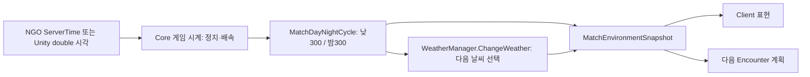

# 낮밤 주기와 Weather 연결

기본값은 **낮300게임초 → 밤300게임초 → 반복**이다. 한 바퀴는10분이다. 실제 기획을 이번 요청에서 확정했고, 별도의 deltaTime 누적 타이머는 만들지 않았다.

## 누가 무엇을 하는가

- `DayNightCycle`은 기준 시각과 현재 게임 시각으로 단계/다음 경계를 계산한다. 프레임이 늦어도 실제 도달한 구간을 계산하며 누적 callback 횟수로 단계를 정하지 않는다.
- `MatchDayNightCycle`은 Scene의 시간대 source다. Host가 공용 scheduler에 다음 경계를 등록한다. 낮밤은 `day` / `night` ID로 기존 환경 snapshot과 전송을 사용한다.
- `InitialStageCompositionRoot.PrepareEnvironmentSources`는 실제 Weather가 있고 다른 시간대 source가 없으면 같은 객체에 이 source를 한 번 확보한다. 이미 명시된 시간대 source가 있으면 임의로 두 번째 것을 만들지 않는다.
- `WeatherManager.Core.cs`는 같은 객체의 `PhaseAdvanced`를 받아 기존 `ChangeWeather()`를 호출한다. 실제 날씨 추첨·예고 큐·효과는 Weather 소유다. 낮/밤과 맑음/비 등 날씨는 서로 다른 축이며 밤이라고 특정 날씨를 강제하지 않는다.

## 중복 타이머를 돌리지 않는다

Initial_Stage에서 낮밤이 날씨 전환을 주도하면 CountTick의 기존5초 자동 예약은 등록하지 않는다. 낮밤 없는 독립 Scene에서는 기존 CountTick을 사용할 수 있다. Inspector의 CountTick 값만300으로 바꾸는 것은 낮밤 구현이 아니다.

`IMatchDayNightCycle.PhaseAdvanced`는 **실제 시간 진행으로 구간이 바뀔 때만** 통지한다. `Changed`는 환경 표시 갱신용이다. 복원/Client 적용은 Changed만 알리고 새 날씨를 뽑지 않는다. 지연 프레임의 여러 경계는 현재 구간으로 한 번 따라잡으며 Weather 큐를 밀린 횟수만큼 연속 소비하지 않는다.

게임 정지와 배속은 기존 Core 필드 시간을 따른다. 1인은 내부, 협동은 전원 내부일 때 필드 정지다. Client가 타이머나 Random으로 권위 날씨를 새로 정하지 않는다. 전환 자체로 새 Encounter를 요청하지 않고 다음 요청의 계획 조건을 바꾼다.

## 저장과 기존 진태님 전달본의 변경

- Core의 `MatchDayNightCycle.Checkpoint.cs`가 `world/time-of-day` section으로 구간 길이와 시작 기준을 저장한다. Core 게임 경과 시각과 함께 현재 단계/남은 구간을 복원한다.
- 진태님의 `world/weather`는 실제 현재 날씨·예고 큐·난수 상태를 저장한다. **낮밤 모드에서 CountTick.CaptureTimerState/RestoreTimerState를 호출하지 않는다.** 낮밤 시간은 위 section이 맡는다.
- 낮밤 없는 독립 Scene의 CountTick 저장 계약은 유지한다. 실제 Weather writer는 이번에 대신 구현하지 않았으며, 누락 시 운영 전체 Save 차단은 유지한다.
- 새 필수 section이 없는 과거 개발용 저장은 현재 필수 writer 검증에서 거절할 수 있다. 임의로 낮/남은300초를 채워 복원하지 않는다.

## 확인 위치

`Game Debugger > Overview > Match 환경`에서 현재 날씨/시간대와 Host의 다음 전환까지 남은 게임 초를 본다. 낮밤 조명·배율·새 HUD 디자인은 이 기능에 임의 추가하지 않았다. 실제 효과는 World 표현과 Encounter 제작 정책에서 연결한다.

[최신 배치](../planning/2026-11-05-day-night-and-steam-batches.md) · [공용 시간 API](match-time-api.md) · [환경 계약](match-environment-api.md)

## 인게임 디버그 HUD와 구간 재시작

Initial_Stage의 기존 날씨 버튼 위에는 Day/Night, 버튼에는 남은 시간, 아래에는 Reset을 표시합니다. [사용법과 연결](weather-debug-hud.md)을 참고합니다.

`IMatchDayNightDebugControl.TryRestartCurrentPhase()`는 권위 Match의 현재 구간을 재시작합니다. 낮밤 단계와 공용 Match 시각은 유지하고 해당 구간의 예약 하나만 교체합니다. 이 API 자체가 Weather를 선택하거나 PhaseAdvanced를 발생시키지는 않습니다. HUD가 재시작 성공 뒤 기존 Button의 날씨 변경 명령을 한 번 호출합니다.

구간의 시작 단계를 보존하려고 `world/time-of-day` payload는 v2로 기록합니다. 기존 v1은 Day 시작 기준으로 읽을 수 있으며, v2는 Night 중 Reset한 epoch·시작 단계도 복원합니다. Weather 큐/난수/현재 날씨 payload를 Core에서 새로 만든 것이 아닙니다.
